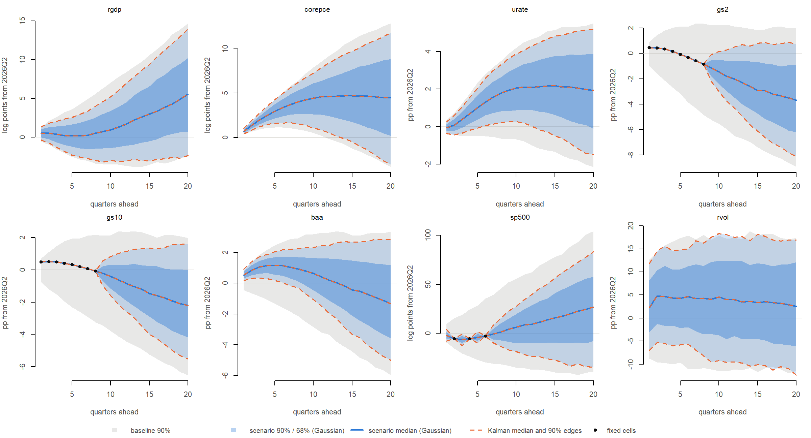

# Conditional forecast checks

**Model:** 31 variables, 5 lags; forecasts from 2026Q2 over 20 quarters. **Draws:** the engine draws of each COVID method’s estimation run (2026m09_none_full_545b70ff, 2026m09_precovid_params_full_dc0d4609), which include hyperparameter uncertainty. Seeds derived from 20261016. Run time 30.7 minutes.

**What is compared.** A scenario fixes future values of some variables in some quarters; the model fills in the rest. Given one posterior draw of (B, Σ), the future path is jointly Gaussian, and the scenario is a draw from that Gaussian conditional on the fixed cells. Two implementations compute it:

- **Kalman** (`R/forecast_conditional.R`, `forecast_conditional_kalman()`): the algorithm of Crump et al. (2021), Section 2.3. The VAR in state-space form (paper eqs. 6–8), the fixed cells treated as observations and all other future cells as missing; Kalman filter and state smoother for the conditional mean, and the simulation smoother of Durbin and Koopman (2002) for draws.
- **Gaussian** (`R/forecast_conditional.R`, `forecast_conditional_gaussian()`): the conditional normal distribution in closed form, written on the standardized shocks (Waggoner and Zha 1999): y = m + A u, the conditions are G u = d, and u = G’(GG’)⁻¹d + (I − G’(GG’)⁻¹G) z.

The two files share no computational code. A third computation, the textbook conditional normal with the joint covariance built from powers of the companion matrix, is used as a reference on some draws.

**Why the paths can be compared one by one.** The simulation smoother simulates an unconditional path y⁺ = m + A z and corrects it: draw = E\[y \| fixed cells\] + y⁺ − E\[y⁺ \| its own fixed cells\]. Since the conditional mean is linear in the fixed values, this equals E\[y \| fixed cells\] + A(I − P)z with P = G’(GG’)⁻¹G, which is the Gaussian method’s draw for the same z. Both methods take z from the same random-number stream, so with the same seed they should give the same paths up to rounding. The comparison below tests this rather than assuming it.

# Test scenarios

Built around each run’s median no-shock path (model units: log points for log series, percentage points for rates). They are test cases, not scenarios for publication.

| scenario | fixed_cells | variables | quarters |
|:---|---:|:---|:---|
| gdp_h1 | 1 | rgdp | 1 |
| gdp_h8_12 | 5 | rgdp | 8, 9, 10, 11, 12 |
| many_cells_h1 | 21 | rgdp, rpce, rresinv, rnresinv, rexp, rimp, rgov, rfedgov, gdpdefl, pce, corepce, cpi, corecpi, comphr, payems, urate, indpro, caputil, houst, rdpi, gs2 | 1 |
| mixed | 27 | gs2, gs10, sp500, wti | 1, 2, 3, 4, 5, 6, 7, 8 |
| heavy | 200 | rgdp, pce, corepce, urate, gs2, gs10, baa, usd, sp500, wti | 1, 2, 3, 4, 5, 6, 7, 8, 9, 10, 11, 12, 13, 14, 15, 16, 17, 18, 19, 20 |

- `gdp_h1`: real GDP +1 one quarter ahead (paper Section 3.1); `gdp_h8_12`: real GDP +1 at 8 to 12 quarters (Section 3.1, medium-run case).
- `many_cells_h1`: 2-year yield +0.25 one quarter ahead, with 20 activity, price and labour variables held at the baseline in that quarter (the shape of the recursive exercise of Section 3.2; used here as a case with many fixed cells in one quarter).
- `mixed`: oil +10, 2- and 10-year yields +0.5 for 8 quarters, S&P 500 −5 in quarters 2, 4 and 6 only (skipped quarters).
- `heavy`: ten variables +0.5 in all 20 quarters (200 fixed cells).

# 1–2. Conditional means and variances, exactly

For 10 evenly spaced draws per COVID method and every scenario: the conditional mean (20 × 31) and the conditional variance of every cell, from both methods, and from the textbook formula on the first 3 of those draws. Variance differences are divided by the cell’s unconditional variance. **Criteria:** means agree to 1e-8 (model units of order 10³, so about 1e-11 relative); relative variance differences below 1e-8; fixed cells have zero variance (below 1e-8 relative); no conditional variance above the unconditional one (beyond 1e-8 relative).

| covid | scenario | fixed_cells | mean_max_abs_diff | var_max_rel_diff | textbook_mean_max_abs_diff | textbook_var_max_rel_diff | fixed_var_max_rel | var_above_unc_max_rel |
|:---|:---|---:|:---|:---|:---|:---|:---|:---|
| none | gdp_h1 | 1 | 6.7e-11 | 2.5e-14 | 4.9e-11 | 2.6e-14 | 2.9e-16 | -7.4e-10 |
| precovid_params | gdp_h1 | 1 | 7.5e-11 | 4.1e-14 | 7.3e-11 | 2.1e-14 | 2.1e-16 | -1.5e-08 |
| none | gdp_h8_12 | 5 | 8.1e-11 | 3.7e-14 | 5.0e-11 | 3.7e-14 | 1.7e-15 | -6.6e-05 |
| precovid_params | gdp_h8_12 | 5 | 1.2e-10 | 3.1e-14 | 6.1e-11 | 2.3e-14 | 1.5e-15 | -6.6e-05 |
| none | many_cells_h1 | 21 | 9.0e-11 | 2.5e-14 | 4.8e-11 | 2.5e-14 | 1.2e-14 | -2.5e-04 |
| precovid_params | many_cells_h1 | 21 | 1.1e-10 | 4.6e-14 | 8.9e-11 | 9.7e-15 | 6.6e-15 | -1.4e-03 |
| none | mixed | 27 | 7.8e-11 | 1.7e-14 | 5.7e-11 | 1.8e-14 | 1.6e-15 | -2.0e-03 |
| precovid_params | mixed | 27 | 8.8e-11 | 2.5e-14 | 8.6e-11 | 1.4e-14 | 1.4e-15 | -8.8e-03 |
| none | heavy | 200 | 9.3e-11 | 5.7e-15 | 4.0e-11 | 1.2e-14 | 2.0e-15 | -1.4e-01 |
| precovid_params | heavy | 200 | 6.4e-11 | 4.6e-15 | 6.1e-11 | 1.2e-14 | 1.4e-15 | -9.0e-02 |

Each entry is the largest over the draws. Verdict: **PASS**.

# 3. Paths with the same seed

Both methods run with the same seed on the same draws, one path per draw: 1000 draws for mixed, 100 evenly spaced draws for the other scenarios. **Criteria:** the largest difference between the two methods’ paths, over all draws and cells, below 1e-8; every path meets its fixed cells to 1e-8.

| covid | scenario | draws | max_abs_diff | max_abs_level | fixed_cells_max_error |
|:---|:---|---:|:---|---:|:---|
| none | gdp_h1 | 100 | 1.8e-10 | 1213.6 | 0.0e+00 |
| none | gdp_h8_12 | 100 | 1.9e-10 | 1210.5 | 0.0e+00 |
| none | many_cells_h1 | 100 | 1.5e-10 | 1213.3 | 1.4e-14 |
| none | mixed | 1000 | 2.7e-10 | 1211.2 | 7.6e-12 |
| none | heavy | 100 | 4.0e-10 | 1202.6 | 4.0e-10 |
| precovid_params | gdp_h1 | 100 | 2.8e-10 | 1206.8 | 0.0e+00 |
| precovid_params | gdp_h8_12 | 100 | 1.7e-10 | 1203.0 | 2.3e-13 |
| precovid_params | many_cells_h1 | 100 | 2.9e-10 | 1206.4 | 3.6e-15 |
| precovid_params | mixed | 1000 | 2.7e-10 | 1209.0 | 5.6e-12 |
| precovid_params | heavy | 100 | 1.3e-09 | 1199.4 | 1.3e-09 |

`max_abs_level` is the largest value in the paths (log points), for scale. Verdict: **PASS**.

# 4. Simulated paths against the exact distribution

One draw per COVID method (the middle draw), scenario mixed: many paths from each method, compared with the textbook conditional mean and covariance. The joint test uses all free cells and their exact covariance: N (m̄ − µ)′ V⁻¹ (m̄ − µ) is χ² with as many degrees of freedom as free cells. The per-cell z and variance ratios are shown for reference; the cells are strongly correlated, so their largest values and the share above 2 vary much more than for independent cells. **Criterion:** joint test p-value above 0.01 for each method.

| covid | draw | method | paths | free_cells | chi2 | chi2_p_value | max_abs_z | typical_max_abs_z | share_abs_z_above_2 | var_ratio_min | var_ratio_max |
|:---|---:|:---|---:|---:|---:|---:|---:|---:|---:|---:|---:|
| none | 500 | kalman | 5000 | 593 | 608.717 | 0.319 | 2.956 | 3.338 | 0.042 | 0.952 | 1.066 |
| none | 500 | gaussian | 20000 | 593 | 646.098 | 0.065 | 2.914 | 3.338 | 0.019 | 0.968 | 1.034 |
| precovid_params | 500 | kalman | 5000 | 593 | 609.840 | 0.307 | 2.891 | 3.338 | 0.030 | 0.960 | 1.057 |
| precovid_params | 500 | gaussian | 20000 | 593 | 649.282 | 0.054 | 2.923 | 3.338 | 0.039 | 0.966 | 1.030 |

Verdict: **PASS**. (Comparison 3 shows that the two methods’ paths are the same function of the random numbers; this comparison shows that the distribution of those paths is the right one.)

# 5. What a user would see: quantiles at production size

Scenario mixed, 1000 draws, one path each, in change from 2026Q2. The last two columns are the difference between medians as a share of the 90% band width: Kalman against Gaussian with the same seed, and Gaussian with a second seed against the first (the size of simulation noise with one path per draw).

**none**

| variable | horizon | fixed | q05_gaussian | q50_gaussian | q95_gaussian | q50_kalman | median_diff_kalman_share | median_diff_seed_share |
|:---|---:|:---|---:|---:|---:|---:|---:|---:|
| rgdp | 1 | FALSE | -0.241 | 0.927 | 2.194 | 0.927 | 0.000 | -0.007 |
| rgdp | 2 | FALSE | -0.426 | 1.166 | 2.749 | 1.166 | 0.000 | 0.001 |
| rgdp | 4 | FALSE | -0.625 | 1.484 | 3.850 | 1.484 | 0.000 | 0.017 |
| rgdp | 8 | FALSE | -0.462 | 2.547 | 6.019 | 2.547 | 0.000 | 0.012 |
| rgdp | 12 | FALSE | -0.311 | 4.416 | 9.125 | 4.416 | 0.000 | -0.012 |
| rgdp | 20 | FALSE | 1.355 | 8.274 | 15.083 | 8.274 | 0.000 | 0.003 |
| corepce | 1 | FALSE | 0.559 | 0.876 | 1.175 | 0.876 | 0.000 | -0.001 |
| corepce | 2 | FALSE | 1.163 | 1.697 | 2.215 | 1.697 | 0.000 | -0.011 |
| corepce | 4 | FALSE | 2.151 | 3.273 | 4.296 | 3.273 | 0.000 | -0.002 |
| corepce | 8 | FALSE | 3.466 | 5.838 | 8.210 | 5.838 | 0.000 | -0.004 |
| corepce | 12 | FALSE | 3.771 | 7.855 | 11.871 | 7.855 | 0.000 | -0.003 |
| corepce | 20 | FALSE | 2.479 | 10.935 | 19.236 | 10.935 | 0.000 | -0.015 |
| urate | 1 | FALSE | -1.328 | -0.403 | 0.493 | -0.403 | 0.000 | 0.033 |
| urate | 2 | FALSE | -1.500 | -0.333 | 0.794 | -0.333 | 0.000 | -0.001 |
| urate | 4 | FALSE | -1.499 | 0.003 | 1.481 | 0.003 | 0.000 | 0.003 |
| urate | 8 | FALSE | -1.437 | 0.660 | 2.726 | 0.660 | 0.000 | 0.022 |
| urate | 12 | FALSE | -1.825 | 1.005 | 3.643 | 1.005 | 0.000 | 0.034 |
| urate | 20 | FALSE | -2.351 | 1.190 | 4.646 | 1.190 | 0.000 | -0.008 |
| gs2 | 1 | TRUE | 0.557 | 0.557 | 0.557 | 0.557 | -0.019 | 0.000 |
| gs2 | 2 | TRUE | 0.599 | 0.599 | 0.599 | 0.599 | -0.018 | 0.000 |
| gs2 | 4 | TRUE | 0.572 | 0.572 | 0.572 | 0.572 | -0.019 | 0.005 |
| gs2 | 8 | TRUE | 0.093 | 0.093 | 0.093 | 0.093 | -0.022 | 0.000 |
| gs2 | 12 | FALSE | -2.900 | -0.658 | 1.631 | -0.658 | 0.000 | -0.016 |
| gs2 | 20 | FALSE | -6.114 | -1.865 | 2.379 | -1.865 | 0.000 | -0.005 |
| gs10 | 1 | TRUE | 0.554 | 0.554 | 0.554 | 0.554 | -0.026 | 0.000 |
| gs10 | 2 | TRUE | 0.598 | 0.598 | 0.598 | 0.598 | -0.018 | 0.006 |
| gs10 | 4 | TRUE | 0.645 | 0.645 | 0.645 | 0.645 | -0.019 | 0.000 |
| gs10 | 8 | TRUE | 0.508 | 0.508 | 0.508 | 0.508 | -0.024 | 0.000 |
| gs10 | 12 | FALSE | -1.549 | 0.171 | 1.925 | 0.171 | 0.000 | -0.012 |
| gs10 | 20 | FALSE | -3.872 | -0.605 | 2.895 | -0.605 | 0.000 | 0.001 |
| baa | 1 | FALSE | 0.143 | 0.504 | 0.858 | 0.504 | 0.000 | 0.003 |
| baa | 2 | FALSE | 0.279 | 0.759 | 1.249 | 0.759 | 0.000 | 0.030 |
| baa | 4 | FALSE | 0.303 | 1.047 | 1.740 | 1.047 | 0.000 | 0.012 |
| baa | 8 | FALSE | -0.112 | 1.099 | 2.232 | 1.099 | 0.000 | 0.010 |
| baa | 12 | FALSE | -1.267 | 0.788 | 2.827 | 0.788 | 0.000 | 0.015 |
| baa | 20 | FALSE | -3.713 | -0.038 | 3.549 | -0.038 | 0.000 | 0.006 |
| sp500 | 1 | FALSE | -6.224 | -0.787 | 5.012 | -0.787 | 0.000 | 0.001 |
| sp500 | 2 | TRUE | -3.124 | -3.124 | -3.124 | -3.124 | 0.000 | 0.000 |
| sp500 | 4 | TRUE | -0.932 | -0.932 | -0.932 | -0.932 | 0.000 | 0.000 |
| sp500 | 8 | FALSE | -4.959 | 8.712 | 21.898 | 8.712 | 0.000 | -0.012 |
| sp500 | 12 | FALSE | -9.828 | 20.039 | 48.168 | 20.039 | 0.000 | 0.001 |
| sp500 | 20 | FALSE | -10.037 | 40.625 | 94.380 | 40.625 | 0.000 | 0.003 |
| rvol | 1 | FALSE | -7.148 | 2.956 | 12.728 | 2.956 | 0.000 | 0.018 |
| rvol | 2 | FALSE | -5.387 | 5.356 | 15.422 | 5.356 | 0.000 | 0.023 |
| rvol | 4 | FALSE | -6.748 | 4.377 | 14.720 | 4.377 | 0.000 | -0.023 |
| rvol | 8 | FALSE | -8.845 | 3.608 | 17.654 | 3.608 | 0.000 | 0.006 |
| rvol | 12 | FALSE | -10.272 | 4.154 | 18.234 | 4.154 | 0.000 | -0.020 |
| rvol | 20 | FALSE | -11.793 | 3.080 | 18.427 | 3.080 | 0.000 | 0.000 |

**precovid_params**

| variable | horizon | fixed | q05_gaussian | q50_gaussian | q95_gaussian | q50_kalman | median_diff_kalman_share | median_diff_seed_share |
|:---|---:|:---|---:|---:|---:|---:|---:|---:|
| rgdp | 1 | FALSE | -0.374 | 0.519 | 1.343 | 0.519 | 0.000 | -0.005 |
| rgdp | 2 | FALSE | -0.765 | 0.524 | 1.800 | 0.524 | 0.000 | 0.001 |
| rgdp | 4 | FALSE | -1.835 | 0.216 | 2.356 | 0.216 | 0.000 | 0.002 |
| rgdp | 8 | FALSE | -3.022 | 0.521 | 4.012 | 0.521 | 0.000 | 0.008 |
| rgdp | 12 | FALSE | -3.049 | 1.699 | 6.934 | 1.699 | 0.000 | 0.000 |
| rgdp | 20 | FALSE | -2.357 | 5.541 | 13.963 | 5.541 | 0.000 | -0.018 |
| corepce | 1 | FALSE | 0.432 | 0.736 | 1.024 | 0.736 | 0.000 | -0.005 |
| corepce | 2 | FALSE | 0.843 | 1.366 | 1.895 | 1.366 | 0.000 | 0.004 |
| corepce | 4 | FALSE | 1.477 | 2.487 | 3.528 | 2.487 | 0.000 | 0.012 |
| corepce | 8 | FALSE | 1.510 | 4.019 | 6.227 | 4.019 | 0.000 | -0.009 |
| corepce | 12 | FALSE | 0.524 | 4.645 | 8.409 | 4.645 | 0.000 | -0.001 |
| corepce | 20 | FALSE | -3.031 | 4.489 | 11.817 | 4.489 | 0.000 | 0.002 |
| urate | 1 | FALSE | -0.358 | -0.059 | 0.263 | -0.059 | 0.000 | 0.011 |
| urate | 2 | FALSE | -0.433 | 0.089 | 0.608 | 0.089 | 0.000 | 0.003 |
| urate | 4 | FALSE | -0.189 | 0.694 | 1.579 | 0.694 | 0.000 | 0.012 |
| urate | 8 | FALSE | 0.219 | 1.780 | 3.288 | 1.780 | 0.000 | -0.005 |
| urate | 12 | FALSE | 0.029 | 2.096 | 4.299 | 2.096 | 0.000 | 0.021 |
| urate | 20 | FALSE | -1.481 | 1.936 | 5.180 | 1.936 | 0.000 | 0.012 |
| gs2 | 1 | TRUE | 0.471 | 0.471 | 0.471 | 0.471 | 0.000 | 0.000 |
| gs2 | 2 | TRUE | 0.442 | 0.442 | 0.442 | 0.442 | -0.009 | 0.000 |
| gs2 | 4 | TRUE | 0.161 | 0.161 | 0.161 | 0.161 | -0.005 | 0.005 |
| gs2 | 8 | TRUE | -0.848 | -0.848 | -0.848 | -0.848 | 0.002 | 0.000 |
| gs2 | 12 | FALSE | -4.278 | -2.019 | 0.514 | -2.019 | 0.000 | -0.010 |
| gs2 | 20 | FALSE | -8.091 | -3.668 | 0.723 | -3.668 | 0.000 | -0.016 |
| gs10 | 1 | TRUE | 0.500 | 0.500 | 0.500 | 0.500 | 0.000 | 0.000 |
| gs10 | 2 | TRUE | 0.516 | 0.516 | 0.516 | 0.516 | -0.011 | 0.000 |
| gs10 | 4 | TRUE | 0.423 | 0.423 | 0.423 | 0.423 | -0.012 | -0.009 |
| gs10 | 8 | TRUE | -0.054 | -0.054 | -0.054 | -0.054 | 0.000 | 0.005 |
| gs10 | 12 | FALSE | -2.562 | -0.838 | 1.140 | -0.838 | 0.000 | 0.001 |
| gs10 | 20 | FALSE | -5.519 | -2.193 | 1.623 | -2.193 | 0.000 | 0.006 |
| baa | 1 | FALSE | 0.158 | 0.542 | 0.904 | 0.542 | 0.000 | -0.002 |
| baa | 2 | FALSE | 0.310 | 0.834 | 1.390 | 0.834 | 0.000 | 0.036 |
| baa | 4 | FALSE | 0.300 | 1.142 | 1.868 | 1.142 | 0.000 | -0.010 |
| baa | 8 | FALSE | -0.307 | 0.924 | 2.246 | 0.924 | 0.000 | -0.015 |
| baa | 12 | FALSE | -1.935 | 0.209 | 2.459 | 0.209 | 0.000 | -0.005 |
| baa | 20 | FALSE | -5.013 | -1.326 | 2.848 | -1.326 | 0.000 | 0.007 |
| sp500 | 1 | FALSE | -7.609 | -1.813 | 4.117 | -1.813 | 0.000 | 0.005 |
| sp500 | 2 | TRUE | -5.417 | -5.417 | -5.417 | -5.417 | 0.000 | 0.000 |
| sp500 | 4 | TRUE | -5.191 | -5.191 | -5.191 | -5.191 | 0.000 | 0.000 |
| sp500 | 8 | FALSE | -13.399 | 1.675 | 15.598 | 1.675 | 0.000 | -0.015 |
| sp500 | 12 | FALSE | -23.453 | 9.338 | 39.428 | 9.338 | 0.000 | 0.003 |
| sp500 | 20 | FALSE | -34.015 | 26.875 | 82.967 | 26.875 | 0.000 | -0.001 |
| rvol | 1 | FALSE | -7.067 | 2.216 | 11.793 | 2.216 | 0.000 | 0.032 |
| rvol | 2 | FALSE | -5.353 | 4.773 | 14.494 | 4.773 | 0.000 | 0.017 |
| rvol | 4 | FALSE | -5.992 | 4.399 | 14.616 | 4.399 | 0.000 | -0.016 |
| rvol | 8 | FALSE | -8.221 | 4.291 | 16.271 | 4.291 | 0.000 | -0.004 |
| rvol | 12 | FALSE | -9.550 | 3.973 | 17.495 | 3.973 | 0.000 | -0.005 |
| rvol | 20 | FALSE | -12.340 | 2.515 | 16.967 | 2.515 | 0.000 | 0.013 |

# 6. Cost

Milliseconds per posterior draw, one path per draw, 31 variables and 20 quarters (R 4.6.1, reference BLAS, single process).

| covid           | scenario      | draws | ms_per_draw_kalman | ms_per_draw_gaussian |
|:----------------|:--------------|------:|-------------------:|---------------------:|
| none            | gdp_h1        |   100 |                564 |                   29 |
| none            | gdp_h8_12     |   100 |                288 |                   29 |
| none            | many_cells_h1 |   100 |                559 |                   30 |
| none            | mixed         |  1000 |                566 |                   30 |
| none            | heavy         |   100 |                570 |                   66 |
| precovid_params | gdp_h1        |   100 |                561 |                   30 |
| precovid_params | gdp_h8_12     |   100 |                474 |                   33 |
| precovid_params | many_cells_h1 |   100 |                557 |                   36 |
| precovid_params | mixed         |  1000 |                387 |                   11 |
| precovid_params | heavy         |   100 |                199 |                   27 |

At 1,000 draws a scenario takes about 558 ms × 1,000 ≈ 9.3 minutes with the Kalman method and about 0.5 minutes with the Gaussian method. The Kalman filter carries a 186 × 186 state covariance through 20 quarters for every draw; the Gaussian method works with the 620 standardized shocks directly.

# Summary

| comparison                        | verdict  |
|:----------------------------------|:---------|
| 1-2 exact means and variances     | **PASS** |
| 3 same-seed paths                 | **PASS** |
| 4 simulated vs exact distribution | **PASS** |
