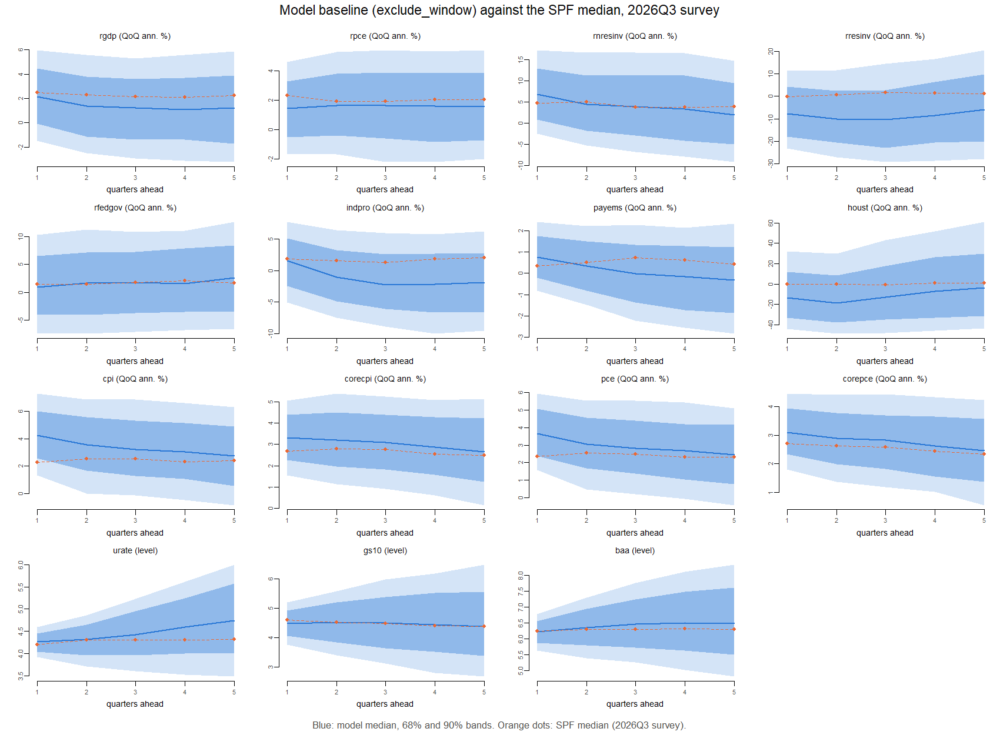
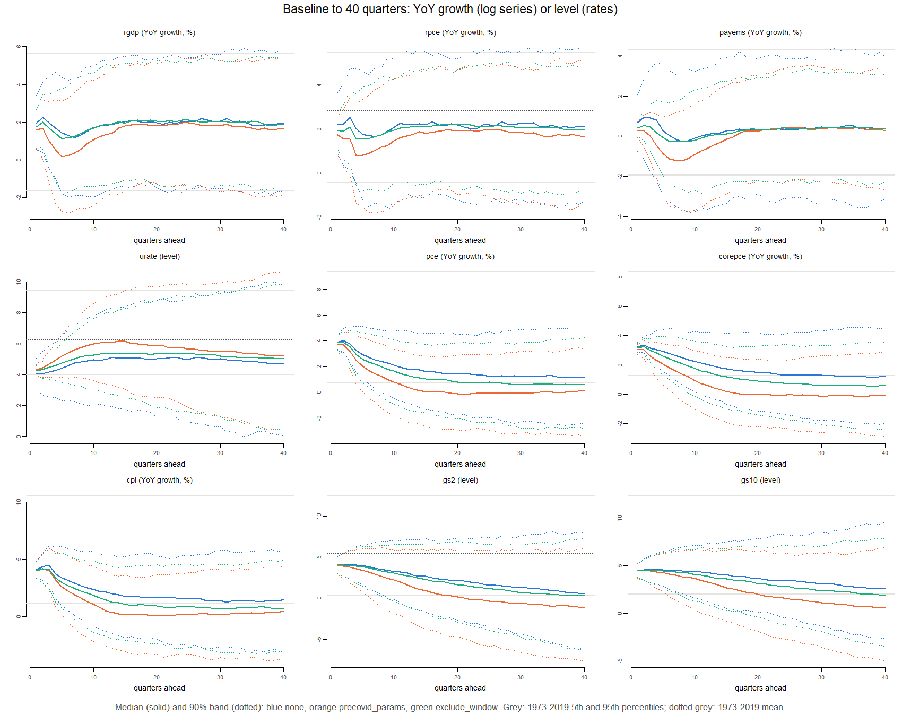
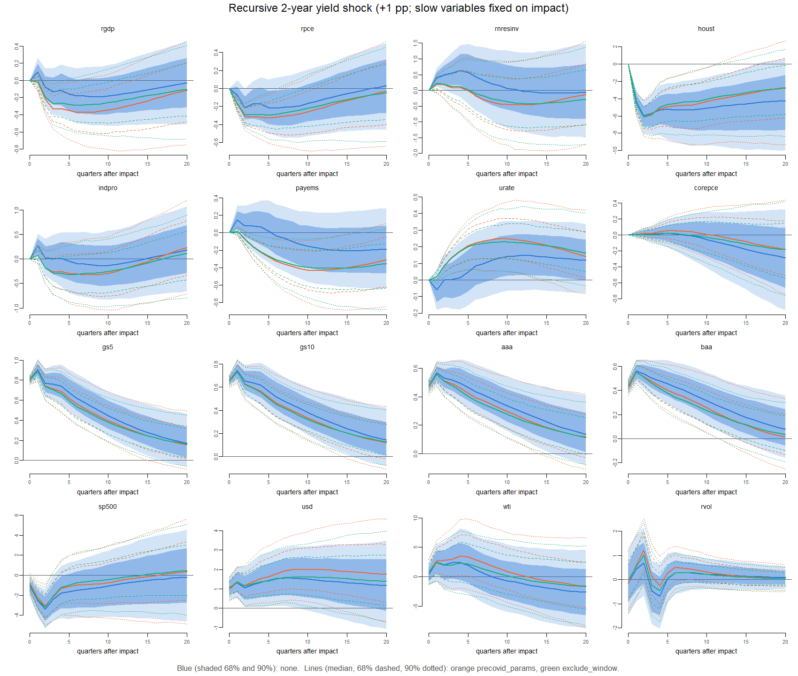
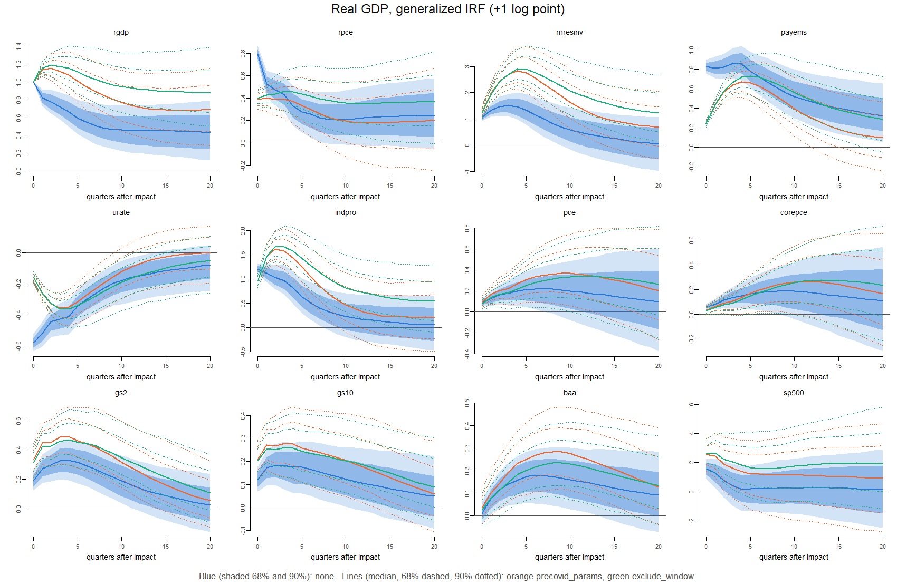

# COVID treatments compared

**Treatments.** All three are estimated with the same model, prior, data (QD vintage 2026m09, 1973Q1–2026Q2), MCMC settings and seeds; all forecast from the data through 2026Q2 (`docs/methodology.md`, section 11).

| method | run | equations_used | left_out |
|:---|:---|---:|:---|
| none | 2026m09_none_full_545b70ff | 209 | none |
| precovid_params | 2026m09_precovid_params_full_dc0d4609 | 183 | 2020Q1 to 2026Q2 |
| exclude_window | 2026m09_exclude_window_full_6a9c5d25 | 201 | 2020Q1 to 2021Q4 |

*`none`: every quarter. `precovid_params`: the sample ends in 2019Q4. `exclude_window`: the equations of 2020Q1–2021Q4 are left out, every other quarter is used (2022Q1–2026Q2 included); the window’s data still serve as lags of the 2022 equations.*

# Summary

*Written from the results of 2026-11-02 (estimation of `exclude_window` on QD vintage 2026m09); the numbers in the sections below are recomputed when the checks rerun, this summary is not.*

- **Impulse responses.** `exclude_window` gives the responses of the pre-COVID estimates, close to the paper: for a 1% GDP shock (Figure 6) GDP peaks at 1.19 (paper about 1.1), payrolls 0.73 (0.65), unemployment −0.36 (−0.35), investment 2.90 (2.9), core PCE +0.27 after three years (0.26); after the recursive 2-year shock (Figure 9, per 25 bp) GDP is about 0 one quarter after impact (no rise, as in the paper) and falls to −0.07 (−0.09), payrolls −0.10 (−0.12). 30 of 32 expected signs hold with the 68% band clear of zero, 2 are weak, none opposite. The one difference from the paper, shared with `precovid_params`, is a more persistent GDP response (0.92 three years after a GDP shock, paper 0.5). Under `none` the 2020 quarters halve the activity responses.
- **Forecasts.** `exclude_window` forecasts lie between the other two and closer to `none` for activity: GDP growth (YoY) 2.0% in 2026Q4, 1.4–1.3% in 2027–28, 1.8% in 2029Q2; unemployment rising to 5.1% by 2028Q2 (`none` 4.8%, `precovid_params` 5.8%). Against the SPF its medians sit between the 30th and 80th percentile of the SPF-comparable variables except first-quarter CPI (13th), where every method carries 2026Q2’s inflation forward.
- **Recent origins.** Forecasts from 2022Q4–2024Q4 with each method’s estimates: `exclude_window` and `none` miss by similar amounts (GDP YoY about +0.6 to +0.9 pp too low; these origins are inside their estimation samples), `precovid_params` by about twice as much (+1.5 to +1.7 pp). Replacing the record-low consumer sentiment by its 1973–2019 mean lifts the `exclude_window` GDP forecast by only 0.1 pp (`precovid_params`: 0.4 pp): the 2022–26 data teach the model that low sentiment has not meant recession.
- **Long-run drift remains.** Inflation and yields still drift down, less than under `precovid_params` and more than under `none`: core PCE inflation 1.5% three years ahead and 0.6% at ten years; the 2-year yield 2.8% at three years, 0.2% at ten, still falling by about 0.07 pp a year at 15–20 years. This part of the low forecasts comes from the 1973–2019 trends, which all three samples contain; the COVID treatment does not address it. The 2% inflation anchor reweights mildly under `exclude_window` (effective sample size 91%, PCE inflation three years ahead from 1.40% to 1.98%).

# 1. Estimation

| method | lambda | lambda_q05 | lambda_q95 | mu | mu_q05 | mu_q95 | min_ess | max_rhat | largest_root_median | share_roots_above_1 |
|:---|---:|---:|---:|---:|---:|---:|---:|---:|---:|---:|
| none | 0.394 | 0.356 | 0.433 | 0.278 | 0.228 | 0.338 | 1439.650 | 1.005 | 1.011 | 1 |
| precovid_params | 0.409 | 0.368 | 0.453 | 0.352 | 0.289 | 0.430 | 1477.511 | 1.005 | 1.013 | 1 |
| exclude_window | 0.391 | 0.353 | 0.431 | 0.297 | 0.244 | 0.360 | 1426.153 | 1.004 | 1.012 | 1 |

*λ: overall tightness of the Minnesota prior; µ: tightness of the sum-of-coefficients prior (smaller = tighter); posterior median and 90% interval. ESS and R-hat over the 33 hyperparameters (convergence targets: ESS ≥ 1,000, R-hat \< 1.05; not reviewed further here).*

# 2. Baseline forecasts

Medians of the untilted baseline: year-on-year percent change for log series, levels for rates (percent). Full tables with 68% bands: `forecast_review.html`, section 0.

| variable | quarter |  none | precovid_params | exclude_window |
|:---------|:--------|------:|----------------:|---------------:|
| rgdp     | 2026Q4  |   2.4 |             1.7 |            2.0 |
| rgdp     | 2027Q2  |   1.8 |             0.5 |            1.4 |
| rgdp     | 2027Q4  |   1.2 |             0.2 |            1.3 |
| rgdp     | 2028Q2  |   1.3 |             0.5 |            1.4 |
| rgdp     | 2029Q2  |   1.9 |             1.3 |            1.8 |
| rpce     | 2026Q4  |   2.3 |             1.6 |            1.9 |
| rpce     | 2027Q2  |   2.0 |             0.8 |            1.5 |
| rpce     | 2027Q4  |   1.7 |             0.8 |            1.6 |
| rpce     | 2028Q2  |   1.8 |             1.1 |            1.7 |
| rpce     | 2029Q2  |   2.1 |             1.6 |            2.1 |
| rnresinv | 2026Q4  |   7.9 |             6.5 |            7.7 |
| rnresinv | 2027Q2  |   4.8 |             2.0 |            4.6 |
| rnresinv | 2027Q4  |   2.4 |            -1.0 |            2.9 |
| rnresinv | 2028Q2  |   1.4 |            -1.6 |            2.0 |
| rnresinv | 2029Q2  |   2.2 |             0.3 |            3.0 |
| payems   | 2026Q4  |   0.9 |             0.3 |            0.5 |
| payems   | 2027Q2  |   0.9 |            -0.4 |            0.2 |
| payems   | 2027Q4  |   0.0 |            -1.2 |           -0.2 |
| payems   | 2028Q2  |  -0.3 |            -1.2 |           -0.3 |
| payems   | 2029Q2  |   0.0 |            -0.6 |            0.0 |
| urate    | 2026Q4  |   4.0 |             4.4 |            4.3 |
| urate    | 2027Q2  |   4.2 |             4.9 |            4.6 |
| urate    | 2027Q4  |   4.6 |             5.4 |            4.9 |
| urate    | 2028Q2  |   4.8 |             5.8 |            5.1 |
| urate    | 2029Q2  |   5.1 |             6.2 |            5.3 |
| pce      | 2026Q4  |   4.1 |             3.8 |            4.0 |
| pce      | 2027Q2  |   3.4 |             2.5 |            3.0 |
| pce      | 2027Q4  |   2.9 |             1.8 |            2.5 |
| pce      | 2028Q2  |   2.4 |             1.3 |            2.1 |
| pce      | 2029Q2  |   1.9 |             0.5 |            1.4 |
| corepce  | 2026Q4  |   3.4 |             3.1 |            3.3 |
| corepce  | 2027Q2  |   3.1 |             2.3 |            2.8 |
| corepce  | 2027Q4  |   2.9 |             1.8 |            2.5 |
| corepce  | 2028Q2  |   2.5 |             1.4 |            2.2 |
| corepce  | 2029Q2  |   2.0 |             0.6 |            1.5 |
| cpi      | 2026Q4  |   4.4 |             4.2 |            4.2 |
| cpi      | 2027Q2  |   3.9 |             3.3 |            3.5 |
| cpi      | 2027Q4  |   3.3 |             2.5 |            2.8 |
| cpi      | 2028Q2  |   2.8 |             1.7 |            2.3 |
| cpi      | 2029Q2  |   2.1 |             0.6 |            1.5 |
| corecpi  | 2026Q4  |   3.2 |             3.0 |            3.0 |
| corecpi  | 2027Q2  |   3.5 |             3.1 |            3.1 |
| corecpi  | 2027Q4  |   3.2 |             2.5 |            2.7 |
| corecpi  | 2028Q2  |   2.8 |             1.8 |            2.4 |
| corecpi  | 2029Q2  |   2.2 |             0.7 |            1.6 |
| gs2      | 2026Q4  |   4.1 |             3.9 |            4.0 |
| gs2      | 2027Q2  |   4.1 |             3.7 |            3.9 |
| gs2      | 2027Q4  |   3.9 |             3.1 |            3.7 |
| gs2      | 2028Q2  |   3.6 |             2.6 |            3.5 |
| gs2      | 2029Q2  |   3.2 |             1.6 |            2.8 |
| gs10     | 2026Q4  |   4.6 |             4.5 |            4.5 |
| gs10     | 2027Q2  |   4.6 |             4.4 |            4.4 |
| gs10     | 2027Q4  |   4.6 |             4.0 |            4.3 |
| gs10     | 2028Q2  |   4.5 |             3.9 |            4.3 |
| gs10     | 2029Q2  |   4.2 |             3.2 |            3.9 |
| baa      | 2026Q4  |   6.4 |             6.4 |            6.4 |
| baa      | 2027Q2  |   6.6 |             6.7 |            6.5 |
| baa      | 2027Q4  |   6.7 |             6.5 |            6.5 |
| baa      | 2028Q2  |   6.7 |             6.4 |            6.4 |
| baa      | 2029Q2  |   6.4 |             5.8 |            6.0 |
| houst    | 2026Q4  |  -6.3 |            -9.3 |           -6.7 |
| houst    | 2027Q2  | -13.4 |           -17.5 |          -13.4 |
| houst    | 2027Q4  |  -8.6 |           -10.0 |           -7.6 |
| houst    | 2028Q2  |  -5.2 |            -4.7 |           -3.7 |
| houst    | 2029Q2  |  -2.8 |             0.1 |           -1.0 |
| sp500    | 2026Q4  |   9.8 |             7.0 |            8.6 |
| sp500    | 2027Q2  |   5.2 |             0.2 |            3.7 |
| sp500    | 2027Q4  |   7.5 |             3.4 |            7.5 |
| sp500    | 2028Q2  |  10.2 |             7.1 |            9.5 |
| sp500    | 2029Q2  |  11.4 |             7.8 |           11.8 |
| wti      | 2026Q4  |  71.0 |            65.9 |           68.7 |
| wti      | 2027Q2  |   4.9 |            -0.7 |            4.1 |
| wti      | 2027Q4  |  -2.4 |            -4.9 |           -1.7 |
| wti      | 2028Q2  |  -3.3 |            -5.3 |           -3.5 |
| wti      | 2029Q2  |  -1.2 |            -4.3 |           -0.4 |

**Against the SPF** (2026Q3 survey; annualized quarterly growth for log series, levels for rates; h1 = 2026Q3, h4 = 2027Q2):

| variable | horizon |  spf |  none | precovid_params | exclude_window |
|:---------|--------:|-----:|------:|----------------:|---------------:|
| rgdp     |       1 | 2.46 |  3.07 |            1.58 |           2.13 |
| rgdp     |       4 | 2.12 |  1.10 |           -0.08 |           1.09 |
| rpce     |       1 | 2.29 |  2.67 |            0.78 |           1.44 |
| rpce     |       4 | 2.02 |  1.61 |            0.77 |           1.61 |
| indpro   |       1 | 1.86 |  2.58 |           -0.46 |           1.55 |
| indpro   |       4 | 1.79 | -2.15 |           -4.62 |          -2.13 |
| payems   |       1 | 0.34 |  1.66 |            0.45 |           0.77 |
| payems   |       4 | 0.61 |  0.20 |           -1.13 |          -0.15 |
| cpi      |       1 | 2.28 |  4.50 |            4.21 |           4.22 |
| cpi      |       4 | 2.32 |  3.56 |            2.69 |           3.04 |
| corepce  |       1 | 2.70 |  3.30 |            2.70 |           3.09 |
| corepce  |       4 | 2.43 |  2.97 |            2.01 |           2.63 |
| urate    |       1 | 4.20 |  4.08 |            4.29 |           4.26 |
| urate    |       4 | 4.30 |  4.24 |            4.91 |           4.59 |
| gs10     |       1 | 4.60 |  4.51 |            4.47 |           4.48 |
| gs10     |       4 | 4.40 |  4.61 |            4.35 |           4.45 |

| variable | horizon | spf | none | precovid_params | exclude_window |
|:---------|--------:|----:|-----:|----------------:|---------------:|
| rgdp     |       1 |   2 |   42 |              65 |             56 |
| rgdp     |       4 |   2 |   60 |              77 |             65 |
| rpce     |       1 |   2 |   47 |              79 |             69 |
| rpce     |       4 |   2 |   54 |              70 |             57 |
| indpro   |       1 |   2 |   45 |              73 |             54 |
| indpro   |       4 |   2 |   73 |              91 |             80 |
| payems   |       1 |   0 |   36 |              46 |             34 |
| payems   |       4 |   1 |   55 |              88 |             72 |
| cpi      |       1 |   2 |   10 |              14 |             13 |
| cpi      |       4 |   2 |   28 |              43 |             35 |
| corepce  |       1 |   3 |   22 |              50 |             30 |
| corepce  |       4 |   2 |   32 |              65 |             41 |
| urate    |       1 |   4 |   57 |              33 |             39 |
| urate    |       4 |   4 |   53 |              18 |             32 |
| gs10     |       1 |   5 |   58 |              63 |             60 |
| gs10     |       4 |   4 |   43 |              52 |             49 |

*Percentile of the SPF median in each method’s predictive distribution (50 = the SPF median equals the model’s).*

# 3. Long horizons and drift

No-shock forecast (median over draws of each draw’s mean path; YoY growth or level) and its change per year between 15 and 20 years out:

| method          | variable |    h4 |   h12 |   h20 |   h40 |   h60 |   h80 | change_per_year |
|:----------------|:---------|------:|------:|------:|------:|------:|------:|----------------:|
| none            | rgdp     |  1.65 |  1.83 |  1.99 |  1.99 |  1.88 |  1.80 |           -0.02 |
| precovid_params | rgdp     |  0.47 |  1.38 |  1.92 |  1.69 |  1.57 |  1.52 |           -0.01 |
| exclude_window  | rgdp     |  1.34 |  1.85 |  2.05 |  1.98 |  1.88 |  1.82 |           -0.01 |
| none            | payems   |  0.75 |  0.00 |  0.35 |  0.50 |  0.37 |  0.29 |           -0.02 |
| precovid_params | payems   | -0.46 | -0.65 |  0.31 |  0.33 |  0.16 |  0.10 |           -0.01 |
| exclude_window  | payems   |  0.23 | -0.07 |  0.37 |  0.44 |  0.31 |  0.19 |           -0.02 |
| none            | urate    |  4.29 |  5.13 |  5.20 |  4.82 |  4.48 |  4.23 |           -0.05 |
| precovid_params | urate    |  4.90 |  6.15 |  5.97 |  5.13 |  4.84 |  4.62 |           -0.04 |
| exclude_window  | urate    |  4.58 |  5.36 |  5.37 |  4.84 |  4.58 |  4.50 |           -0.02 |
| none            | pce      |  3.28 |  1.87 |  1.37 |  1.20 |  1.21 |  1.09 |           -0.02 |
| precovid_params | pce      |  2.53 |  0.42 | -0.14 |  0.06 |  0.02 | -0.19 |           -0.04 |
| exclude_window  | pce      |  2.98 |  1.38 |  0.79 |  0.62 |  0.55 |  0.42 |           -0.03 |
| none            | corepce  |  3.07 |  2.00 |  1.44 |  1.22 |  1.17 |  1.07 |           -0.02 |
| precovid_params | corepce  |  2.30 |  0.59 | -0.02 | -0.02 | -0.10 | -0.27 |           -0.03 |
| exclude_window  | corepce  |  2.80 |  1.51 |  0.86 |  0.57 |  0.47 |  0.31 |           -0.03 |
| none            | gs2      |  4.04 |  3.02 |  2.01 |  0.75 |  0.20 | -0.15 |           -0.07 |
| precovid_params | gs2      |  3.63 |  1.65 |  0.29 | -0.88 | -1.31 | -1.70 |           -0.08 |
| exclude_window  | gs2      |  3.94 |  2.77 |  1.64 |  0.24 | -0.38 | -0.74 |           -0.07 |
| none            | gs10     |  4.57 |  4.20 |  3.63 |  2.53 |  2.15 |  1.85 |           -0.06 |
| precovid_params | gs10     |  4.35 |  3.24 |  2.02 |  0.64 |  0.01 | -0.60 |           -0.12 |
| exclude_window  | gs10     |  4.49 |  3.92 |  3.15 |  1.89 |  1.22 |  0.86 |           -0.07 |

*For comparison, the 1973–2019 change per year, first to last value: rgdp 0.06; payems -0.03; urate -0.03; pce -0.16; corepce -0.09; gs2 -0.1; gs10 -0.1.*

| variable | horizon | none | precovid_params | exclude_window |
|:---------|--------:|-----:|----------------:|---------------:|
| gs2      |      12 | 0.10 |            0.27 |           0.12 |
| gs2      |      20 | 0.21 |            0.48 |           0.27 |
| gs2      |      40 | 0.44 |            0.60 |           0.47 |
| gs5      |      12 | 0.04 |            0.14 |           0.05 |
| gs5      |      20 | 0.11 |            0.33 |           0.14 |
| gs5      |      40 | 0.30 |            0.52 |           0.37 |
| gs10     |      12 | 0.01 |            0.06 |           0.02 |
| gs10     |      20 | 0.04 |            0.19 |           0.08 |
| gs10     |      40 | 0.22 |            0.42 |           0.27 |

*Share of simulated draws with a negative yield.*

**Inflation anchor** (median of PCE inflation, YoY, at 2.0% 12 quarters ahead, by entropic tilting):

| method | pce_h12_untilted | pce_h12_tilted | corepce_h12_untilted | corepce_h12_tilted | gs2_h12_untilted | gs2_h12_tilted | ess_share |
|:---|---:|---:|---:|---:|---:|---:|---:|
| none | 1.87 | 1.98 | 1.99 | 2.05 | 3.03 | 3.08 | 1.00 |
| precovid_params | 0.41 | 1.98 | 0.60 | 1.52 | 1.60 | 2.37 | 0.59 |
| exclude_window | 1.40 | 1.98 | 1.52 | 1.87 | 2.77 | 3.01 | 0.91 |

# 4. Forecasts from recent origins

No-shock medians made from earlier origins with each method’s estimates, against what happened (realized minus forecast; positive = forecast too low). Not real-time forecasts: `none` and `exclude_window` were estimated on data that include these outcomes; `precovid_params` was not (after 2019).

| variable | horizon | exclude_window |  none | precovid_params |
|:---------|--------:|---------------:|------:|----------------:|
| corepce  |       4 |           0.28 |  0.18 |            0.64 |
| gs10     |       4 |          -0.04 | -0.01 |            0.08 |
| gs2      |       4 |          -0.35 | -0.29 |           -0.15 |
| payems   |       4 |           0.27 |  0.50 |            0.83 |
| pce      |       4 |           0.02 | -0.09 |            0.27 |
| rgdp     |       4 |           0.81 |  0.94 |            1.73 |
| urate    |       4 |          -0.08 | -0.20 |           -0.31 |
| corepce  |       8 |           0.72 |  0.46 |            1.22 |
| gs10     |       8 |           0.08 |  0.07 |            0.42 |
| gs2      |       8 |          -0.22 | -0.21 |            0.39 |
| payems   |       8 |           0.41 |  0.50 |            1.34 |
| pce      |       8 |           0.81 |  0.54 |            1.34 |
| rgdp     |       8 |           0.58 |  0.58 |            1.52 |
| urate    |       8 |          -0.36 | -0.50 |           -0.99 |

*Mean error over the origins 2022Q4, 2023Q4, 2024Q2, 2024Q4 (YoY growth for log series, level for rates; h = 4 and 8 quarters).*

| variable | exclude_window |  none | precovid_params |
|:---------|---------------:|------:|----------------:|
| corepce  |           0.12 |  0.00 |            0.26 |
| gs10     |          -0.15 | -0.15 |           -0.10 |
| gs2      |           0.09 |  0.08 |            0.16 |
| payems   |           0.51 |  0.66 |            0.70 |
| pce      |          -0.10 | -0.24 |            0.00 |
| rgdp     |           0.59 |  0.65 |            0.92 |
| urate    |          -0.31 | -0.39 |           -0.40 |

*Mean error over 2017Q4 and 2018Q4, h = 4 (in-sample for every method).*

# 5. Unusual recent data

Effect on the no-shock median of replacing the last five quarters of one variable (counterfactual minus actual; YoY growth or level):

| change | variable | none | precovid_params | exclude_window |
|:---|:---|---:|---:|---:|
| umich at its 1973-2019 mean (last 5 quarters) | rgdp | 0.13 | 0.37 | 0.12 |
| umich at its 1973-2019 mean (last 5 quarters) | payems | 0.02 | 0.30 | 0.10 |
| umich at its 1973-2019 mean (last 5 quarters) | urate | -0.01 | -0.32 | -0.13 |
| umich at its 1973-2019 mean (last 5 quarters) | corepce | -0.20 | -0.15 | -0.22 |
| umich at its 1973-2019 mean (last 5 quarters) | gs2 | -0.04 | 0.05 | -0.07 |
| oil flat at its 2025Q1 level (last 5 quarters) | rgdp | 0.10 | 0.16 | 0.13 |
| oil flat at its 2025Q1 level (last 5 quarters) | payems | 0.20 | 0.16 | 0.17 |
| oil flat at its 2025Q1 level (last 5 quarters) | urate | -0.15 | -0.07 | -0.07 |
| oil flat at its 2025Q1 level (last 5 quarters) | corepce | 0.13 | 0.10 | 0.09 |
| oil flat at its 2025Q1 level (last 5 quarters) | gs2 | 0.26 | 0.22 | 0.21 |

*At h = 8 (2028Q2). Consumer sentiment was 48 in 2026Q2, against a 1973–2019 mean of 85.*

# 6. Impulse responses

Against the paper’s Figures 6, 8 and 9 (paper medians read from its charts by eye; GDP +1%, 2-year yield +25 bp):

| figure | variable | statistic | paper |   none | precovid_params | exclude_window |
|:-------|:---------|:----------|------:|-------:|----------------:|---------------:|
| 6      | rgdp     | max h0-12 |  1.10 |  1.000 |           1.154 |          1.185 |
| 6      | rgdp     | at h12    |  0.50 |  0.454 |           0.714 |          0.919 |
| 6      | payems   | max h0-12 |  0.65 |  0.858 |           0.669 |          0.729 |
| 6      | urate    | min h0-12 | -0.35 | -0.579 |          -0.356 |         -0.363 |
| 6      | rnresinv | max h0-12 |  2.90 |  1.501 |           2.827 |          2.902 |
| 6      | pce      | at h12    |  0.37 |  0.179 |           0.350 |          0.339 |
| 6      | corepce  | at h12    |  0.26 |  0.175 |           0.261 |          0.273 |
| 6      | gs2      | max h0-12 |  0.55 |  0.331 |           0.493 |          0.471 |
| 6      | gs10     | max h0-12 |  0.33 |  0.183 |           0.279 |          0.260 |
| 6      | baa      | max h0-12 |  0.33 |  0.180 |           0.284 |          0.233 |
| 6      | sp500    | max h0-4  |  2.80 |  1.573 |           2.538 |          2.659 |
| 8      | rgdp     | max h0-4  |  0.09 |  0.123 |           0.095 |          0.095 |
| 8      | rgdp     | at h12    | -0.08 | -0.015 |          -0.060 |         -0.028 |
| 8      | urate    | min h0-4  | -0.04 | -0.079 |          -0.045 |         -0.046 |
| 8      | urate    | at h12    |  0.06 |  0.022 |           0.049 |          0.037 |
| 8      | baa      | max h0-12 |  0.14 |  0.142 |           0.137 |          0.131 |
| 8      | sp500    | min h0-12 | -1.00 | -0.626 |          -0.587 |         -0.600 |
| 9      | rgdp     | at h1     |  0.00 |  0.025 |          -0.005 |         -0.002 |
| 9      | rgdp     | min h0-12 | -0.09 | -0.048 |          -0.093 |         -0.072 |
| 9      | urate    | at h12    |  0.07 |  0.037 |           0.059 |          0.056 |
| 9      | payems   | min h0-12 | -0.12 | -0.046 |          -0.109 |         -0.102 |
| 9      | baa      | max h0-12 |  0.14 |  0.140 |           0.137 |          0.138 |
| 9      | sp500    | min h0-12 | -0.80 | -0.844 |          -0.763 |         -0.795 |
| 9      | usd      | at h12    |  0.60 |  0.354 |           0.497 |          0.393 |

Expected signs (spec 9.5; 32 responses per method; “as expected” = right sign and 68% band excluding zero):

| method          | as expected | weak |
|:----------------|------------:|-----:|
| exclude_window  |          30 |    2 |
| none            |          29 |    3 |
| precovid_params |          30 |    2 |

| method          | variable |    q05 |    q16 |    q50 |   q84 |   q95 |
|:----------------|:---------|-------:|-------:|-------:|------:|------:|
| none            | rgdp     | -0.058 |  0.003 |  0.099 | 0.199 | 0.265 |
| none            | urate    | -0.181 | -0.131 | -0.060 | 0.011 | 0.062 |
| precovid_params | rgdp     | -0.127 | -0.089 | -0.021 | 0.049 | 0.085 |
| precovid_params | urate    | -0.020 | -0.003 |  0.019 | 0.043 | 0.059 |
| exclude_window  | rgdp     | -0.108 | -0.071 | -0.008 | 0.055 | 0.094 |
| exclude_window  | urate    | -0.018 | -0.004 |  0.020 | 0.042 | 0.057 |

*Recursive 2-year shock, one quarter after impact (per 1 pp).*

Other identifications (2-year generalized, oil, S&P 500, Baa spread): `irf_review.html`.
