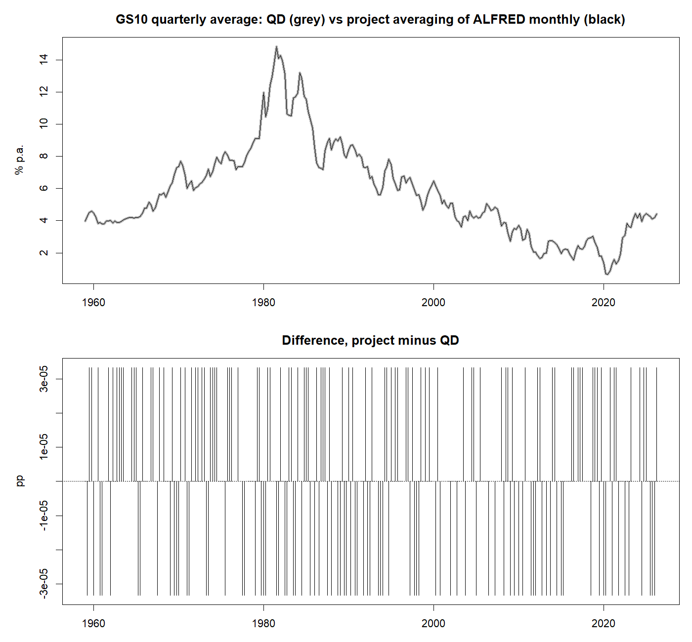
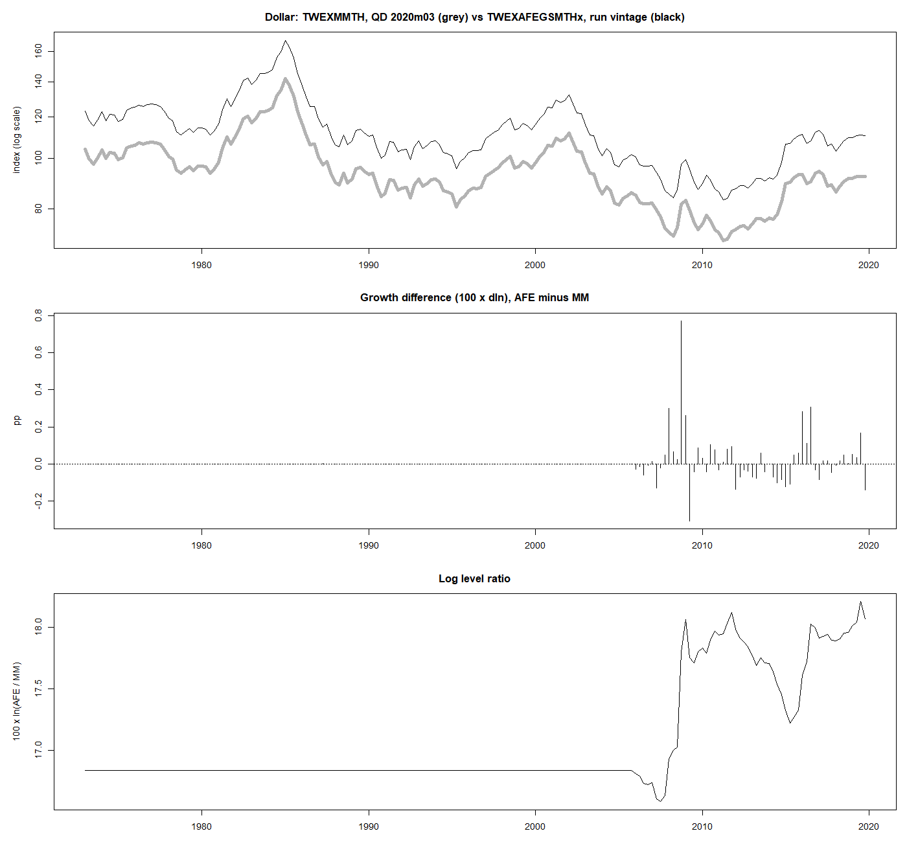
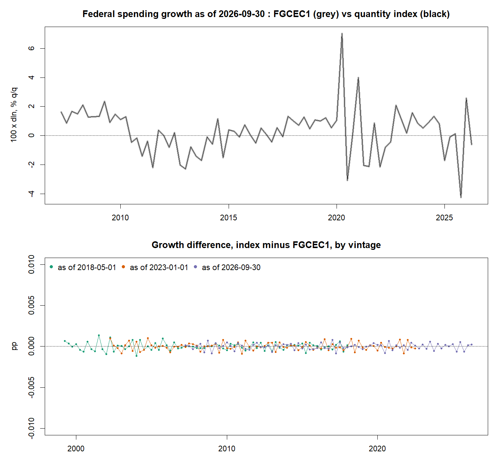
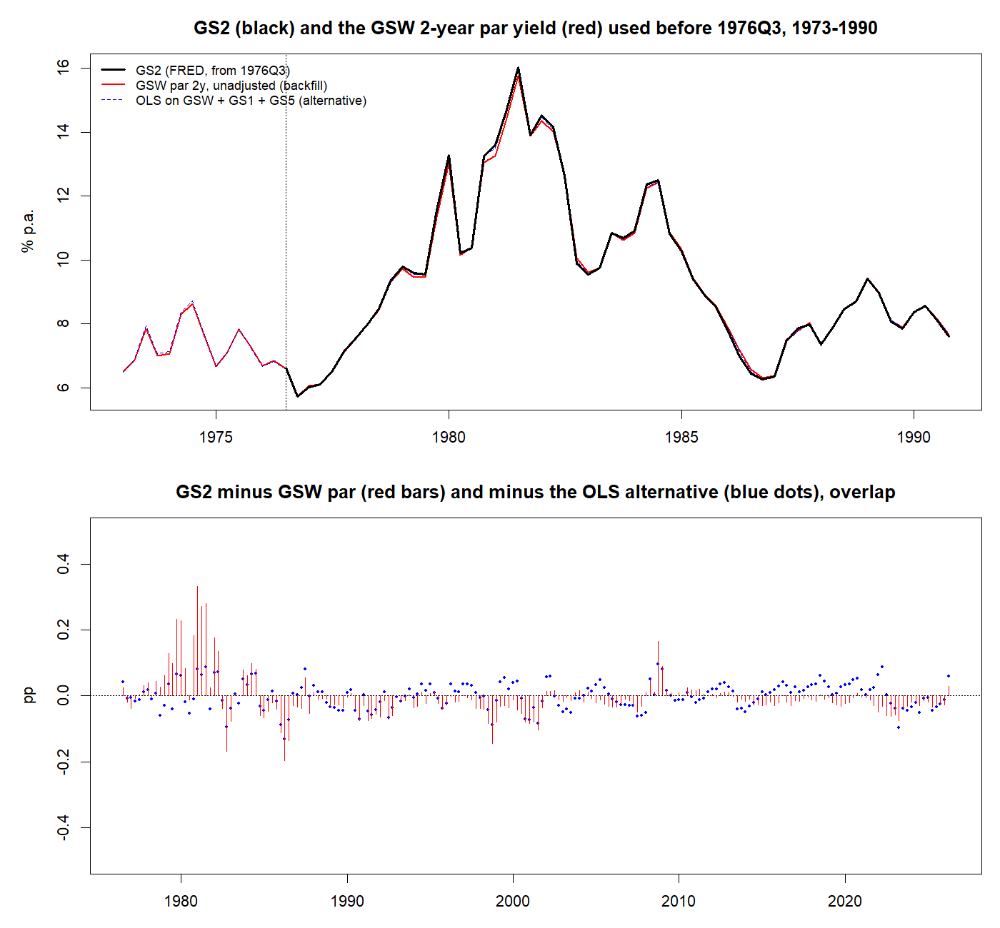
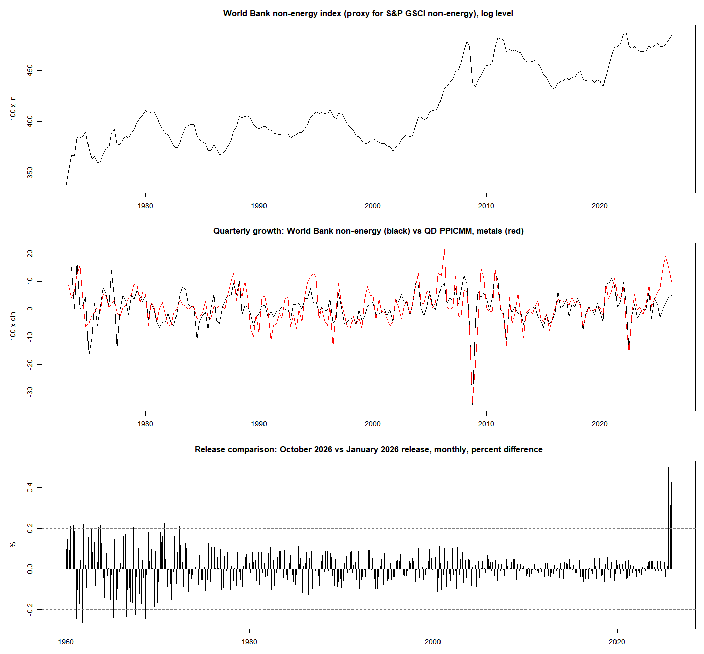
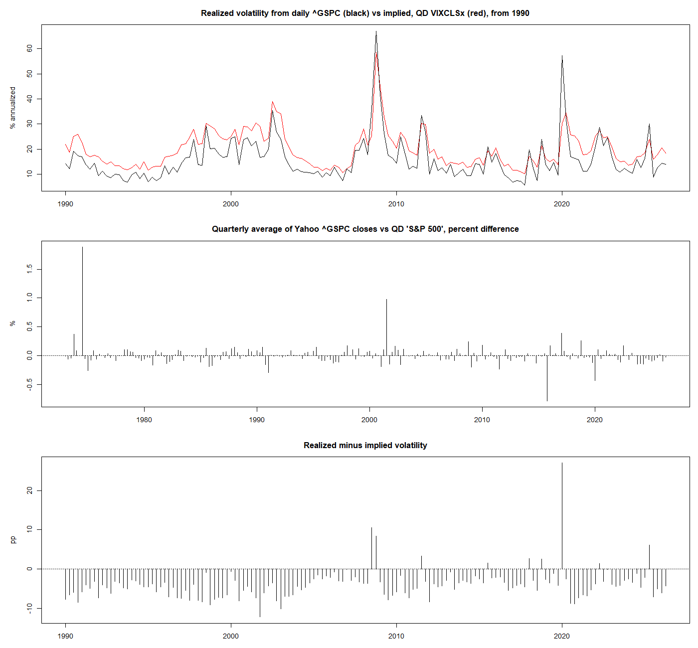
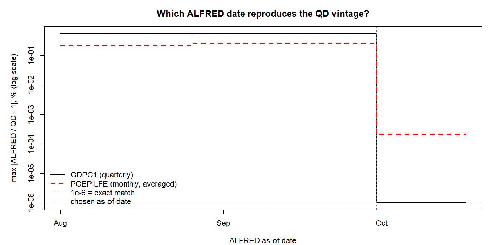

# Data validation report

**Data:** QD vintage FRED-QD_2026m09.csv, ALFRED as of 2026-09-30, sample 1973Q1 to 2026Q2 (214 quarters). Built 2026-10-25 16:43.

The checks follow `docs/data.md`, sections 3 and 4. They report; none changes the data. Rows 30 (World Bank non-energy index) is a **proxy** for the S&P GSCI non-energy index.

# 1. Coverage

| series | first_available | last_available | starts_by_start | missing_in_sample | gaps_after_start |
|:---|:---|:---|:---|---:|---:|
| rgdp | 1959Q1 | 2026Q2 | TRUE | 0 | 0 |
| rpce | 1959Q1 | 2026Q2 | TRUE | 0 | 0 |
| rresinv | 1959Q1 | 2026Q2 | TRUE | 0 | 0 |
| rnresinv | 1959Q1 | 2026Q2 | TRUE | 0 | 0 |
| rexp | 1959Q1 | 2026Q2 | TRUE | 0 | 0 |
| rimp | 1959Q1 | 2026Q2 | TRUE | 0 | 0 |
| rgov | 1959Q1 | 2026Q2 | TRUE | 0 | 0 |
| rfedgov | 1947Q1 | 2026Q2 | TRUE | 0 | 0 |
| gdpdefl | 1959Q1 | 2026Q2 | TRUE | 0 | 0 |
| pce | 1959Q1 | 2026Q2 | TRUE | 0 | 0 |
| corepce | 1959Q1 | 2026Q2 | TRUE | 0 | 0 |
| cpi | 1959Q1 | 2026Q2 | TRUE | 0 | 0 |
| corecpi | 1959Q1 | 2026Q2 | TRUE | 0 | 0 |
| comphr | 1947Q1 | 2026Q2 | TRUE | 0 | 0 |
| payems | 1959Q1 | 2026Q2 | TRUE | 0 | 0 |
| urate | 1959Q1 | 2026Q2 | TRUE | 0 | 0 |
| indpro | 1959Q1 | 2026Q2 | TRUE | 0 | 0 |
| caputil | 1959Q1 | 2026Q2 | TRUE | 0 | 0 |
| houst | 1959Q1 | 2026Q2 | TRUE | 0 | 0 |
| rdpi | 1959Q1 | 2026Q2 | TRUE | 0 | 0 |
| umich | 1959Q2 | 2026Q2 | TRUE | 0 | 0 |
| gs2 | 1973Q1 | 2026Q2 | TRUE | 0 | 0 |
| gs5 | 1959Q1 | 2026Q2 | TRUE | 0 | 0 |
| gs10 | 1959Q1 | 2026Q2 | TRUE | 0 | 0 |
| aaa | 1959Q1 | 2026Q2 | TRUE | 0 | 0 |
| baa | 1959Q1 | 2026Q2 | TRUE | 0 | 0 |
| usd | 1973Q1 | 2026Q2 | TRUE | 0 | 0 |
| sp500 | 1959Q1 | 2026Q2 | TRUE | 0 | 0 |
| wti | 1946Q1 | 2026Q2 | TRUE | 0 | 0 |
| gsci_nonenergy | 1960Q1 | 2026Q3 | TRUE | 0 | 0 |
| rvol | 1928Q1 | 2026Q3 | TRUE | 0 | 0 |

`first_available` is the first quarter after any backfill. GS2 starts in 1976:Q3 on FRED and is backfilled before that with the GSW 2-year par yield (section 9 below; docs/data.md 3.6). Series with `starts_by_start = FALSE` would have missing quarters (`NA`) at the start of the tables.

# 2. Last-quarter completeness

The sample ends at 2026Q2, the last quarter shared by all 31 series.

| series         | last_available | relative_to_sample_end |
|:---------------|:---------------|:-----------------------|
| rgdp           | 2026Q2         | same                   |
| rpce           | 2026Q2         | same                   |
| rresinv        | 2026Q2         | same                   |
| rnresinv       | 2026Q2         | same                   |
| rexp           | 2026Q2         | same                   |
| rimp           | 2026Q2         | same                   |
| rgov           | 2026Q2         | same                   |
| rfedgov        | 2026Q2         | same                   |
| gdpdefl        | 2026Q2         | same                   |
| pce            | 2026Q2         | same                   |
| corepce        | 2026Q2         | same                   |
| cpi            | 2026Q2         | same                   |
| corecpi        | 2026Q2         | same                   |
| comphr         | 2026Q2         | same                   |
| payems         | 2026Q2         | same                   |
| urate          | 2026Q2         | same                   |
| indpro         | 2026Q2         | same                   |
| caputil        | 2026Q2         | same                   |
| houst          | 2026Q2         | same                   |
| rdpi           | 2026Q2         | same                   |
| umich          | 2026Q2         | same                   |
| gs2            | 2026Q2         | same                   |
| gs5            | 2026Q2         | same                   |
| gs10           | 2026Q2         | same                   |
| aaa            | 2026Q2         | same                   |
| baa            | 2026Q2         | same                   |
| usd            | 2026Q2         | same                   |
| sp500          | 2026Q2         | same                   |
| wti            | 2026Q2         | same                   |
| gsci_nonenergy | 2026Q3         | later                  |
| rvol           | 2026Q3         | later                  |

# 3. Log safety

| series         |  min_value | n_nonpositive |
|:---------------|-----------:|--------------:|
| rgdp           |  5957.0350 |             0 |
| rpce           |  3721.7260 |             0 |
| rresinv        |   304.6983 |             0 |
| rnresinv       |   384.7743 |             0 |
| rexp           |   239.0180 |             0 |
| rimp           |   247.0930 |             0 |
| rgov           |  1620.9360 |             0 |
| rfedgov        |    49.4970 |             0 |
| gdpdefl        |    22.7350 |             0 |
| pce            |    21.8230 |             0 |
| corepce        |    22.5407 |             0 |
| cpi            |    43.0333 |             0 |
| corecpi        |    44.8000 |             0 |
| comphr         |    12.8600 |             0 |
| payems         | 75971.6667 |             0 |
| indpro         |    40.1533 |             0 |
| houst          |   525.6667 |             0 |
| rdpi           |  4420.5070 |             0 |
| usd            |    83.2260 |             0 |
| sp500          |    69.4167 |             0 |
| wti            |     3.5600 |             0 |
| gsci_nonenergy |    28.8333 |             0 |

# 4. Aggregation check (project-side monthly averaging)

GS10 averaged to quarterly by the project’s `monthly_to_quarterly()` from ALFRED monthly data, against QD’s GS10. Validates the averaging used for GS2, WTISPLC and the World Bank index.

| quarters | first  | last   | max_abs_diff_pp | mean_diff_pp |
|---------:|:-------|:-------|----------------:|-------------:|
|      270 | 1959Q1 | 2026Q2 |               0 |            0 |

# 5. Dollar index (docs/data.md 3.1)

QD’s TWEXAFEGSMTHx (run vintage) against TWEXMMTH from the last QD vintage that carries it. Up to 2005 the QD series is TWEXMMTH rescaled; from 2006 it is the AFE index.

| quarters | first  | last   | corr_growth | max_abs_growth_diff_pp | sd_log_ratio |
|---------:|:-------|:-------|------------:|-----------------------:|-------------:|
|      188 | 1973Q1 | 2019Q4 |      0.9997 |                 0.7723 |       0.4345 |

To judge whether the post-2006 differences matter, the table below compares them with the series’ own movements over the AFE segment (from 2006:Q2):

| measure                                   |  value |
|:------------------------------------------|-------:|
| quarters                                  | 55.000 |
| sd of q/q growth, AFE (pp)                |  3.144 |
| sd of q/q growth difference (pp)          |  0.152 |
| ratio: sd difference / sd growth          |  0.048 |
| mean \|q/q growth\|, AFE (pp)             |  2.328 |
| mean \|q/q growth difference\| (pp)       |  0.093 |
| slope, AFE growth on MM growth            |  1.013 |
| R-squared, AFE growth on MM growth        |  0.998 |
| sd of YoY growth, AFE (pp)                |  7.179 |
| max \|YoY growth difference\| (pp)        |  1.165 |
| level drift over the segment (log points) |  1.255 |
| range of 100 x ln(AFE) over the segment   | 30.404 |

# 6. Break detection

Quarter-to-quarter changes (100·Δln for log series, Δ for raw series) more than 4 standard deviations from the series mean. For review: real events are expected among them.

| series         | quarter | change |     z |
|:---------------|:--------|-------:|------:|
| rgdp           | 2020Q2  |  -8.20 |  -8.3 |
| rgdp           | 2020Q3  |   7.48 |   6.4 |
| rpce           | 2020Q2  |  -9.05 |  -9.1 |
| rpce           | 2020Q3  |   8.52 |   7.3 |
| rresinv        | 1980Q2  | -20.52 |  -4.7 |
| rnresinv       | 2009Q1  |  -7.83 |  -4.3 |
| rnresinv       | 2020Q2  |  -8.47 |  -4.6 |
| rexp           | 2020Q2  | -23.52 |  -8.5 |
| rimp           | 2020Q2  | -18.52 |  -6.1 |
| rimp           | 2020Q3  |  15.27 |   4.3 |
| rfedgov        | 2020Q2  |   7.04 |   4.2 |
| cpi            | 2008Q4  |  -2.32 |  -4.1 |
| corecpi        | 1980Q1  |   3.63 |   4.1 |
| comphr         | 2009Q1  |  -2.70 |  -4.1 |
| comphr         | 2020Q2  |   5.65 |   4.7 |
| payems         | 2020Q2  | -12.65 | -12.1 |
| payems         | 2020Q3  |   5.03 |   4.4 |
| urate          | 2020Q2  |   9.17 |  11.7 |
| urate          | 2020Q3  |  -4.20 |  -5.4 |
| indpro         | 1975Q1  |  -6.92 |  -4.1 |
| indpro         | 2020Q2  | -13.44 |  -7.7 |
| indpro         | 2020Q3  |   9.05 |   4.8 |
| caputil        | 1975Q1  |  -7.02 |  -4.7 |
| caputil        | 2020Q2  |  -9.90 |  -6.6 |
| caputil        | 2020Q3  |   7.84 |   5.3 |
| rdpi           | 2020Q2  |   9.49 |   5.9 |
| rdpi           | 2021Q1  |  11.60 |   7.4 |
| rdpi           | 2021Q2  |  -8.00 |  -5.8 |
| umich          | 2020Q2  | -22.50 |  -4.1 |
| gs2            | 1980Q2  |  -3.04 |  -4.5 |
| gs2            | 1980Q4  |   2.85 |   4.3 |
| gs2            | 1982Q4  |  -2.75 |  -4.1 |
| gs5            | 1982Q4  |  -2.64 |  -4.6 |
| gs10           | 1982Q4  |  -2.45 |  -4.9 |
| aaa            | 1980Q1  |   1.60 |   4.0 |
| aaa            | 1982Q4  |  -1.88 |  -4.7 |
| baa            | 1982Q4  |  -1.86 |  -4.3 |
| sp500          | 2008Q4  | -31.92 |  -5.5 |
| wti            | 1974Q1  |  85.26 |   5.4 |
| wti            | 2008Q4  | -70.37 |  -4.7 |
| gsci_nonenergy | 2008Q4  | -34.48 |  -6.1 |
| rvol           | 1987Q4  |  47.02 |   5.6 |
| rvol           | 1988Q1  | -38.35 |  -4.6 |
| rvol           | 2020Q1  |  47.75 |   5.7 |

# 7. API metadata

| id | title | units | frequency | seasonal_adjustment | last_updated |
|:---|:---|:---|:---|:---|:---|
| FGCEC1 | Real Federal Consumption Expenditures and Gross Investment | Billions of Chained 2017 Dollars | Quarterly | Seasonally Adjusted Annual Rate | 2026-09-30 07:54:11-05 |
| HCOMPBS | Business Sector: Hourly Compensation for All Workers | Index 2017=100 | Quarterly | Seasonally Adjusted | 2026-09-03 07:38:33-05 |
| GS2 | Market Yield on U.S. Treasury Securities at 2-Year Constant Maturity, Quoted on an Investment Basis | Percent | Monthly | Not Seasonally Adjusted | 2026-10-01 15:16:48-05 |
| GDPC1 | Real Gross Domestic Product | Billions of Chained 2017 Dollars | Quarterly | Seasonally Adjusted Annual Rate | 2026-09-30 07:53:55-05 |
| PCEPILFE | Personal Consumption Expenditures Excluding Food and Energy (Chain-Type Price Index) | Index 2017=100 | Monthly | Seasonally Adjusted | 2026-09-30 07:43:28-05 |
| GS10 | Market Yield on U.S. Treasury Securities at 10-Year Constant Maturity, Quoted on an Investment Basis | Percent | Monthly | Not Seasonally Adjusted | 2026-10-01 15:16:43-05 |
| MCOILWTICO | Crude Oil Prices: West Texas Intermediate (WTI) - Cushing, Oklahoma | Dollars per Barrel | Monthly | Not Seasonally Adjusted | 2026-10-07 12:17:22-05 |
| B823RA3Q086SBEA | Real government consumption expenditures and gross investment: Federal (chain-type quantity index) | Index 2017=100 | Quarterly | Seasonally Adjusted | 2026-09-30 07:57:14-05 |
| WTISPLC | Spot Crude Oil Price: West Texas Intermediate (WTI) | Dollars per Barrel | Monthly | Not Seasonally Adjusted | 2026-10-07 12:33:23-05 |

# 8. Federal spending index (docs/data.md 3.5)

BEA chain-type quantity index (B823RA3Q086SBEA, used for row 8) against chained-dollar FGCEC1, in several vintages.

| as_of | first | last | quarters | max_abs_growth_diff_pp | corr_growth | sd_log_ratio |
|:---|:---|:---|---:|---:|---:|---:|
| 2018-05-01 | 1999Q1 | 2018Q1 | 77 | 0.0014 | 1 | 3e-04 |
| 2023-01-01 | 2002Q1 | 2022Q3 | 83 | 0.0010 | 1 | 3e-04 |
| 2026-09-30 | 2007Q1 | 2026Q2 | 78 | 0.0009 | 1 | 3e-04 |

# 9. GS2 backfill (docs/data.md 3.6)

GS2 (FRED, constant maturity) starts in 1976:Q3. Earlier quarters use the Gürkaynak–Sack–Wright 2-year par yield (Federal Reserve) unadjusted. Candidates compared with GS2 over the overlap, and in a backcast test (fit on 1981:Q3 onward, predict the first five years of GS2). The regression on GSW + GS1 + GS5 fits best and is the documented alternative.

| candidate | rmse_overlap_pp | max_abs_overlap_pp | rmse_backcast_test_pp | max_abs_backcast_test_pp |
|:---|---:|---:|---:|---:|
| GSW par, unadjusted (used) | 0.066 | 0.333 | 0.136 | 0.333 |
| OLS: GS2 on GSW par | 0.061 | 0.287 | 0.140 | 0.338 |
| OLS: GS2 on GS1 + GS5 | 0.110 | 0.341 | 0.240 | 0.474 |
| OLS: GS2 on GSW par + GS1 + GS5 | 0.040 | 0.131 | 0.056 | 0.133 |

| measure                                                  | value            |
|:---------------------------------------------------------|:-----------------|
| overlap                                                  | 1976Q3 to 2026Q2 |
| correlation of q/q changes, GS2 vs GSW                   | 0.9977           |
| sd of GS2 q/q change, overlap to 1985Q4 (pp)             | 1.22             |
| backcast test window                                     | 1976Q3 to 1981Q2 |
| max \|GSW - best OLS\| over the backfilled quarters (pp) | 0.088            |

Coefficients of the alternative (full overlap): (Intercept) = -0.0687, gsw = 0.6985, GS1 = 0.1923, GS5 = 0.1212.

Backfilled quarters:

| series | quarter    | value | source       |
|:-------|:-----------|------:|:-------------|
| gs2    | 1973-01-01 | 6.516 | GSW SVENPY02 |
| gs2    | 1973-04-01 | 6.875 | GSW SVENPY02 |
| gs2    | 1973-07-01 | 7.856 | GSW SVENPY02 |
| gs2    | 1973-10-01 | 7.000 | GSW SVENPY02 |
| gs2    | 1974-01-01 | 7.072 | GSW SVENPY02 |
| gs2    | 1974-04-01 | 8.292 | GSW SVENPY02 |
| gs2    | 1974-07-01 | 8.638 | GSW SVENPY02 |
| gs2    | 1974-10-01 | 7.609 | GSW SVENPY02 |
| gs2    | 1975-01-01 | 6.677 | GSW SVENPY02 |
| gs2    | 1975-04-01 | 7.108 | GSW SVENPY02 |
| gs2    | 1975-07-01 | 7.842 | GSW SVENPY02 |
| gs2    | 1975-10-01 | 7.264 | GSW SVENPY02 |
| gs2    | 1976-01-01 | 6.693 | GSW SVENPY02 |
| gs2    | 1976-04-01 | 6.851 | GSW SVENPY02 |

# 10. World Bank non-energy index (docs/data.md 3.3)

Correlation of quarterly changes with QD producer price series, and comparison of the stored January 2026 and October 2026 releases (the October release stores one decimal; differences up to about 0.2% at low index levels are rounding).

| corr_growth_PPIACO | corr_growth_PPICMM | release_overlap_months | release_months_beyond_rounding | release_max_abs_pct_diff |
|---:|---:|---:|---:|---:|
| 0.5967 | 0.6842 | 792 | 5 | 0.5005 |

# 11. Realized volatility (docs/data.md 3.4)

| daily_moves_over_10pct | sp500_max_abs_pct_diff | sp500_mean_pct_diff | corr_rvol_vix_1990 | mean_rvol_minus_vix |
|---:|---:|---:|---:|---:|
| 4 | 1.8854 | 0.0032 | 0.8841 | -3.9705 |

Daily moves larger than 10% since the sample start:

| date       |       r |
|:-----------|--------:|
| 1987-10-19 | -0.2290 |
| 2008-10-13 |  0.1096 |
| 2008-10-28 |  0.1025 |
| 2020-03-16 | -0.1277 |

Highest quarters:

| quarter | rvol |
|:--------|-----:|
| 2008Q4  | 67.1 |
| 1987Q4  | 61.2 |
| 2020Q1  | 57.3 |
| 2009Q1  | 41.7 |
| 2008Q3  | 35.8 |

# 12. ALFRED as-of date (docs/data.md, section 1)

Largest relative distance between QD’s GDPC1 and PCEPILFE and the ALFRED series as of each date. The run uses the first date at which both match up to QD’s rounding.

| as_of      | gdp_max_abs_pct | pce_max_abs_pct | gdp_day_before |
|:-----------|----------------:|----------------:|---------------:|
| 2026-09-30 |               0 |        0.000212 |       0.567019 |

