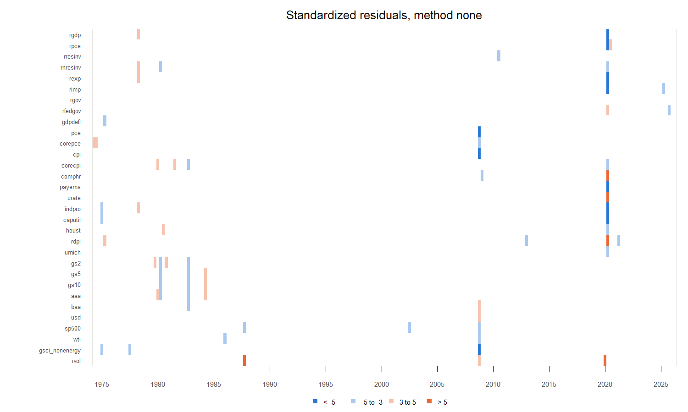
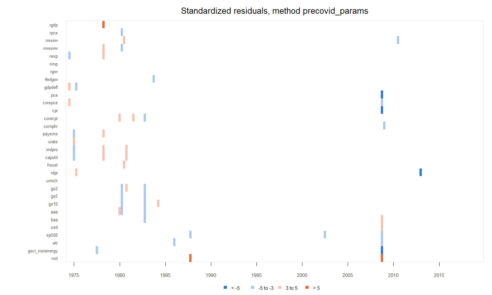
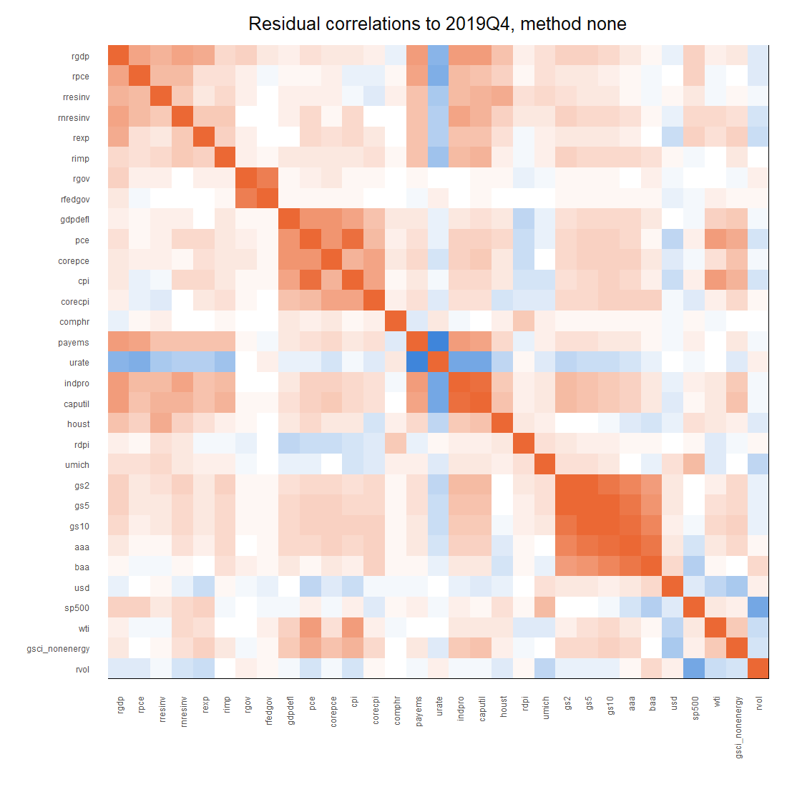
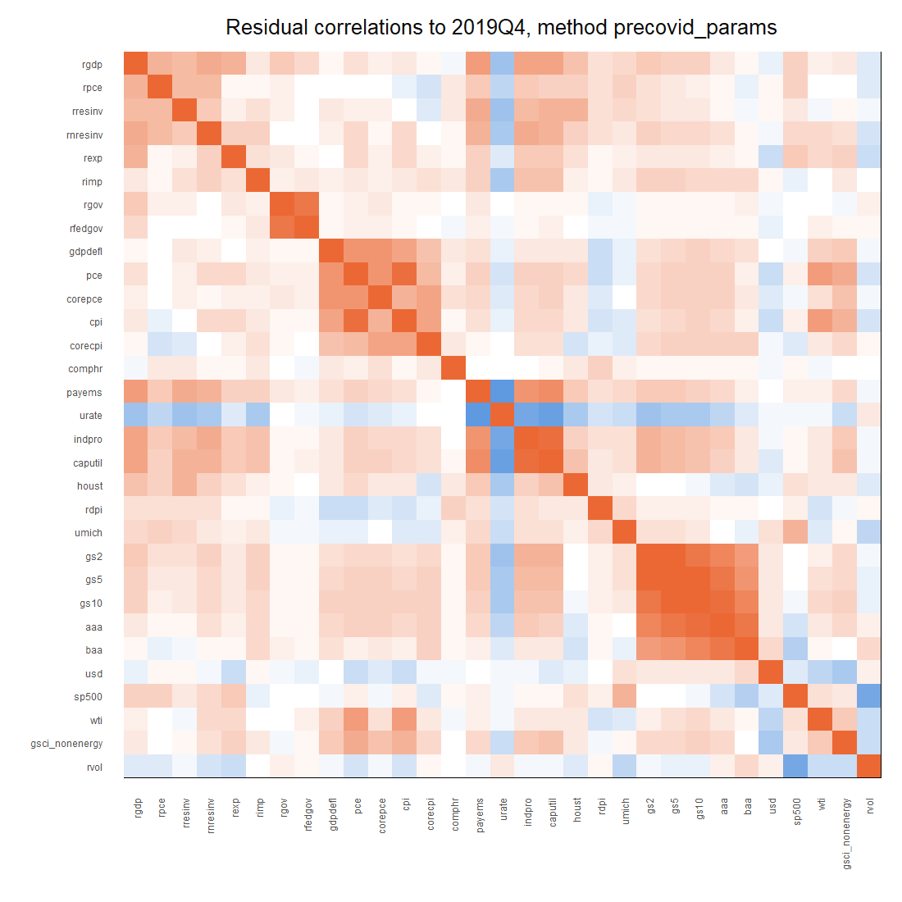

# Estimation diagnostics

**Runs:** 2026m09_none_full_545b70ff (1973Q1 to 2026Q2); 2026m09_precovid_params_full_dc0d4609 (1973Q1 to 2019Q4). Lag length 5. The COVID methods are described in `docs/methodology.md`: `none` estimates on every quarter; `precovid_params` estimates on data to 2019Q4.

**What is checked.** Each run’s MCMC report (`mcmc_diagnostics.html` in the run’s folder) already checks the sampler, every hyperparameter against its bounds, λ and µ against their hyperpriors, and the stability of the coefficient draws; section 1 collects its key numbers. Section 2 checks what that report does not: the fit of the VAR, through its one-quarter-ahead residuals e_t = y_t − B′x_t, at the posterior mean of B and Σ (a point estimate describing the fit). Standardized residuals z = e / √Σ_jj have unit variance if the model’s Σ describes the residuals.

# 1. From the MCMC reports

| method | min_ess | max_rhat | multivariate_rhat | max_share_near_bound | lambda_median | mu_median | sigma_pd |
|:---|---:|---:|---:|---:|---:|---:|---:|
| none | 1439.650 | 1.005 | 1.012 | 0 | 0.394 | 0.278 | 1 |
| precovid_params | 1477.511 | 1.005 | 1.021 | 0 | 0.409 | 0.352 | 1 |

*ESS summed over 4 chains (target ≥ 1,000); R-hat (target \< 1.05); share of draws within 1% of a search bound (largest over the 33 hyperparameters); λ and µ posterior medians; share of draws with Σ positive definite.*

**Stability of the coefficient draws.** Largest companion-matrix eigenvalue modulus per draw (above 1: the draw’s VAR is explosive):

| draws                          | median |    q95 |    max | share_above_1 |
|:-------------------------------|-------:|-------:|-------:|--------------:|
| production, none               | 1.0114 | 1.0236 | 1.0480 |             1 |
| production, precovid_params    | 1.0128 | 1.0265 | 1.0482 |             1 |
| stability check, origin 2007Q4 | 1.0198 | 1.0395 | 1.0615 |             1 |
| stability check, origin 2016Q2 | 1.0138 | 1.0274 | 1.0561 |             1 |
| stability check, origin 2024Q2 | 1.0115 | 1.0227 | 1.0378 |             1 |

*Stability-check rows: method `none`, sample to the origin, 1,000 draws at the origin’s hyperparameter mode.*

Every draw has its largest root slightly above 1, in both runs and at every origin; no stationarity restriction is imposed (Crump et al. 2021 impose none). The simulation recovery check found the same in samples drawn from a stable model (largest root 0.9999): roots at or slightly above 1 are what this prior and these data give for a highly persistent system, not a sign that the truth is explosive. Whether this matters for forecasts is examined at 40 quarters with the forecast reasonableness checks.

# 2. Residuals

| method | residual_quarters | cells | beyond_3 | beyond_3_expected_normal | beyond_5 | beyond_3_before_2020 |
|:---|:---|---:|---:|---:|---:|---:|
| none | 1974Q2 to 2026Q2 | 6479 | 68 | 17 | 15 | 48 |
| precovid_params | 1974Q2 to 2019Q4 | 5673 | 54 | 15 | 7 | 54 |

*`beyond_3_expected_normal`: the count a normal distribution would give (0.27% of cells). More are expected: macro shocks have fat tails.*

## Outliers beyond ±5

**Method none**

| quarter | variable       |      z |
|:--------|:---------------|-------:|
| 2020Q2  | payems         | -12.26 |
| 2020Q2  | urate          |  12.01 |
| 2020Q2  | rpce           |  -9.64 |
| 2020Q2  | rgdp           |  -8.64 |
| 2020Q2  | indpro         |  -8.11 |
| 2020Q2  | rexp           |  -7.80 |
| 2020Q2  | caputil        |  -7.33 |
| 2008Q4  | pce            |  -6.61 |
| 2008Q4  | cpi            |  -6.51 |
| 1987Q4  | rvol           |   6.51 |
| 2020Q2  | rdpi           |   6.28 |
| 2020Q1  | rvol           |   6.23 |
| 2020Q2  | rimp           |  -5.94 |
| 2008Q4  | gsci_nonenergy |  -5.92 |
| 2020Q2  | comphr         |   5.36 |

**Method precovid_params**

| quarter | variable       |     z |
|:--------|:---------------|------:|
| 1987Q4  | rvol           |  6.90 |
| 2008Q4  | cpi            | -6.63 |
| 2008Q4  | pce            | -6.60 |
| 2008Q4  | gsci_nonenergy | -5.79 |
| 2013Q1  | rdpi           | -5.35 |
| 2008Q4  | rvol           |  5.33 |
| 1978Q2  | rgdp           |  5.16 |

## Autocorrelation

A VAR with enough lags leaves residuals close to white noise. Per variable: autocorrelations at lags 1–8 and the Ljung–Box test of no autocorrelation up to lag 8. With 31 variables about 1.5 p-values below 0.05 are expected by chance.

**Method none, residuals 1974Q2 to 2026Q2**: Ljung–Box p \< 0.05 for 4 of 31 variables; largest \|lag-1 autocorrelation\| 0.2.

| variable       |  acf_1 |  acf_2 |  acf_4 |  acf_8 | max_abs_acf | ljung_box_p |
|:---------------|-------:|-------:|-------:|-------:|------------:|------------:|
| rdpi           | -0.200 |  0.053 | -0.267 | -0.029 |       0.267 |       0.000 |
| gs2            |  0.049 | -0.113 |  0.005 | -0.033 |       0.241 |       0.013 |
| comphr         | -0.116 |  0.028 | -0.008 | -0.206 |       0.206 |       0.017 |
| gsci_nonenergy |  0.196 | -0.138 |  0.058 | -0.120 |       0.196 |       0.037 |
| gs5            |  0.037 | -0.075 | -0.008 | -0.014 |       0.197 |       0.056 |
| gs10           |  0.038 | -0.045 | -0.027 | -0.032 |       0.190 |       0.062 |
| wti            |  0.096 | -0.134 | -0.022 | -0.125 |       0.139 |       0.091 |
| rresinv        |  0.059 |  0.123 | -0.085 | -0.071 |       0.123 |       0.194 |

**Method none, residuals to 2019Q4 only**: Ljung–Box p \< 0.05 for 8 of 31 variables; largest \|lag-1 autocorrelation\| 0.4.

| variable       |  acf_1 |  acf_2 |  acf_4 |  acf_8 | max_abs_acf | ljung_box_p |
|:---------------|-------:|-------:|-------:|-------:|------------:|------------:|
| payems         |  0.397 |  0.210 |  0.036 |  0.017 |       0.397 |       0.000 |
| urate          |  0.296 |  0.186 |  0.013 |  0.011 |       0.296 |       0.000 |
| rdpi           | -0.305 |  0.112 | -0.117 | -0.031 |       0.305 |       0.002 |
| comphr         | -0.194 |  0.010 | -0.013 | -0.151 |       0.194 |       0.017 |
| gs2            |  0.062 | -0.120 |  0.029 | -0.038 |       0.243 |       0.018 |
| caputil        |  0.199 | -0.085 | -0.050 | -0.165 |       0.199 |       0.028 |
| gsci_nonenergy |  0.221 | -0.116 |  0.049 | -0.137 |       0.221 |       0.037 |
| gs10           |  0.064 | -0.056 | -0.017 | -0.035 |       0.220 |       0.041 |

**Method precovid_params, residuals 1974Q2 to 2019Q4**: Ljung–Box p \< 0.05 for 5 of 31 variables; largest \|lag-1 autocorrelation\| 0.32.

| variable       |  acf_1 |  acf_2 |  acf_4 |  acf_8 | max_abs_acf | ljung_box_p |
|:---------------|-------:|-------:|-------:|-------:|------------:|------------:|
| rdpi           | -0.318 |  0.139 | -0.144 |  0.030 |       0.318 |       0.000 |
| payems         |  0.203 | -0.020 | -0.130 | -0.184 |       0.203 |       0.008 |
| comphr         | -0.198 |  0.021 | -0.019 | -0.128 |       0.198 |       0.019 |
| gs2            |  0.053 | -0.113 |  0.032 | -0.042 |       0.239 |       0.019 |
| urate          |  0.046 | -0.103 | -0.128 | -0.191 |       0.191 |       0.024 |
| wti            |  0.097 | -0.131 |  0.004 | -0.104 |       0.198 |       0.050 |
| gsci_nonenergy |  0.209 | -0.115 |  0.045 | -0.137 |       0.209 |       0.051 |
| caputil        |  0.092 | -0.116 | -0.030 | -0.227 |       0.227 |       0.055 |

*The eight variables with the lowest Ljung–Box p-values.*

## Correlations

**Method none**: selected pairs (all residuals; to 2019Q4)

| pair           |   all | pre_2020 |
|:---------------|------:|---------:|
| cpi / corecpi  |  0.59 |     0.56 |
| pce / corepce  |  0.71 |     0.70 |
| rgdp / rpce    |  0.80 |     0.59 |
| gs5 / gs10     |  0.97 |     0.97 |
| aaa / baa      |  0.88 |     0.87 |
| rgdp / payems  |  0.80 |     0.64 |
| urate / payems | -0.98 |    -0.89 |

**Method precovid_params**: selected pairs (all residuals; to 2019Q4)

| pair           |   all | pre_2020 |
|:---------------|------:|---------:|
| cpi / corecpi  |  0.56 |     0.56 |
| pce / corepce  |  0.70 |     0.70 |
| rgdp / rpce    |  0.50 |     0.50 |
| gs5 / gs10     |  0.97 |     0.97 |
| aaa / baa      |  0.87 |     0.87 |
| rgdp / payems  |  0.61 |     0.61 |
| urate / payems | -0.73 |    -0.73 |

