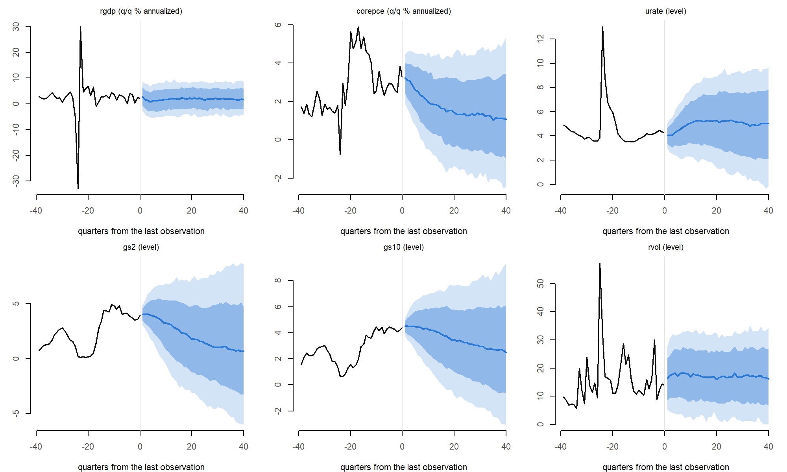
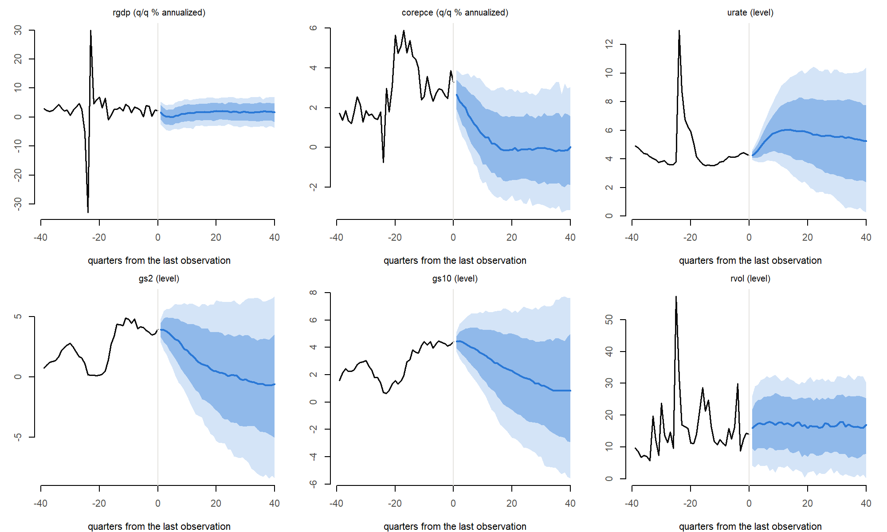

# Forecast checks

**Model:** 31 variables, 5 lags, forecast horizon 20 quarters (40 in section 5). **Draws:** for each COVID method, 500 draws of (Σ, B) from their posterior given the hyperparameters at the posterior mode (`outputs/checks_full_size/`). Hyperparameter uncertainty is not included, so bands are somewhat narrower than they will be with the full posterior. BVAR 1.0.5. Seeds derived from 20261016.

**Forecasts** (`R/forecast.R`, `forecast_unconditional()`): for each draw of (B, Σ), starting from the last 5 observed quarters, the VAR is iterated forward with a shock L·u added each quarter (L L’ = Σ, u standard normal). Each shock enters the next quarter’s lags, so uncertainty accumulates with the horizon. The paths across draws are a sample from the predictive density (Crump et al. 2021, Section 2.3).

# 1. Simulator against exact moments

A VAR(2) with two variables and known coefficients. The exact forecast mean follows the recursion with zero shocks; the exact forecast error covariance at horizon h is Σᵢ₌₀^{h−1} Ψᵢ Σ Ψᵢ’, with Ψᵢ the leading block of Fⁱ (F the companion matrix). 20,000 simulated paths. **Criteria:** \|z\| of every mean below 4; every variance ratio within 1 ± 4 Monte Carlo standard errors.

| horizon | variable | mean_exact | mean_sim | z_mean | sd_exact | sd_sim | var_ratio |
|--------:|:---------|-----------:|---------:|-------:|---------:|-------:|----------:|
|       1 | a        |      2.750 |    2.758 |  1.067 |    1.000 |  1.005 |     1.011 |
|       1 | b        |      1.050 |    1.053 |  0.648 |    0.707 |  0.710 |     1.007 |
|       2 | a        |      2.860 |    2.862 |  0.230 |    1.215 |  1.211 |     0.994 |
|       2 | b        |      0.900 |    0.901 |  0.176 |    0.822 |  0.818 |     0.991 |
|       3 | a        |      2.841 |    2.851 |  1.008 |    1.369 |  1.365 |     0.994 |
|       3 | b        |      0.851 |    0.859 |  1.196 |    0.949 |  0.952 |     1.007 |
|       4 | a        |      2.857 |    2.852 | -0.462 |    1.479 |  1.474 |     0.993 |
|       4 | b        |      0.780 |    0.777 | -0.410 |    1.035 |  1.029 |     0.989 |
|       5 | a        |      2.853 |    2.850 | -0.268 |    1.560 |  1.562 |     1.002 |
|       5 | b        |      0.731 |    0.729 | -0.200 |    1.109 |  1.118 |     1.016 |
|       6 | a        |      2.851 |    2.843 | -0.765 |    1.622 |  1.622 |     1.000 |
|       6 | b        |      0.685 |    0.682 | -0.294 |    1.168 |  1.167 |     0.998 |
|       7 | a        |      2.845 |    2.841 | -0.372 |    1.670 |  1.670 |     0.999 |
|       7 | b        |      0.647 |    0.641 | -0.690 |    1.218 |  1.224 |     1.010 |
|       8 | a        |      2.838 |    2.823 | -1.309 |    1.708 |  1.704 |     0.995 |
|       8 | b        |      0.613 |    0.606 | -0.784 |    1.260 |  1.261 |     1.001 |

Verdict: **PASS**. The same check is a unit test (`tests/testthat/test-forecast.R`), together with the recursion itself, the use of only the last 5 rows of the history, and the agreement of the no-shock path with BVAR’s own mean-path function.

# 2. BVAR::predict() with the same draws

The project’s draws were passed to `BVAR::predict()` (method `none`, history to 2026Q2). BVAR 1.0.5 computes each draw’s no-shock path and then adds, to each quarter separately, a noise vector Σ’u (the covariance matrix in place of its Cholesky factor; BVAR GitHub issue \#86). The noise therefore has covariance Σ² (not Σ) and is not carried through the dynamics.

| variable | horizon | mean_own | mean_bvar | sd_own | sd_bvar | sd_ratio_bvar_to_own |
|:---------|--------:|---------:|----------:|-------:|--------:|---------------------:|
| rgdp     |       1 | 1011.036 |  1010.628 |  0.817 |   4.584 |                5.612 |
| rgdp     |       4 | 1011.987 |  1011.944 |  1.726 |   4.799 |                2.780 |
| rgdp     |       8 | 1013.287 |  1013.300 |  2.565 |   4.632 |                1.806 |
| rgdp     |      20 | 1018.998 |  1018.824 |  4.719 |   5.902 |                1.251 |
| corepce  |       1 |  487.350 |   487.299 |  0.188 |   0.745 |                3.961 |
| corepce  |       4 |  489.587 |   489.593 |  0.716 |   0.854 |                1.192 |
| corepce  |       8 |  492.035 |   492.036 |  1.688 |   1.181 |                0.700 |
| corepce  |      20 |  496.948 |   496.982 |  5.158 |   3.448 |                0.668 |
| urate    |       1 |    4.008 |     4.255 |  0.624 |   3.068 |                4.919 |
| urate    |       4 |    4.270 |     4.297 |  1.165 |   3.172 |                2.724 |
| urate    |       8 |    4.895 |     4.881 |  1.562 |   3.114 |                1.993 |
| urate    |      20 |    5.267 |     5.367 |  2.275 |   3.492 |                1.534 |
| gs2      |       1 |    4.024 |     3.934 |  0.567 |   1.705 |                3.005 |
| gs2      |       4 |    4.069 |     4.055 |  1.285 |   1.799 |                1.400 |
| gs2      |       8 |    3.592 |     3.598 |  2.017 |   2.087 |                1.035 |
| gs2      |      20 |    1.938 |     2.007 |  2.960 |   2.636 |                0.890 |
| gs10     |       1 |    4.477 |     4.415 |  0.426 |   1.642 |                3.855 |
| gs10     |       4 |    4.578 |     4.570 |  1.007 |   1.735 |                1.723 |
| gs10     |       8 |    4.410 |     4.415 |  1.511 |   1.922 |                1.272 |
| gs10     |      20 |    3.461 |     3.502 |  2.340 |   2.319 |                0.991 |
| rvol     |       1 |   16.635 |    18.900 |  7.298 |  54.824 |                7.512 |
| rvol     |       4 |   17.539 |    17.053 |  8.333 |  55.371 |                6.645 |
| rvol     |       8 |   18.488 |    21.176 |  8.572 |  54.091 |                6.310 |
| rvol     |      20 |   16.842 |    17.679 |  9.493 |  55.276 |                5.823 |

Means agree up to simulation noise. The spreads do not. The noise BVAR adds, measured as its draws minus each draw’s no-shock path:

| variable | noise_sd_h1 | noise_sd_h20 | sqrt_sigma_squared | sqrt_sigma | noise_mean_h20 |
|:---|---:|---:|---:|---:|---:|
| rgdp | 4.582 | 4.820 | 4.513 | 0.801 | -0.192 |
| corepce | 0.747 | 0.793 | 0.769 | 0.187 | -0.014 |
| urate | 3.061 | 3.208 | 3.042 | 0.600 | 0.142 |
| gs2 | 1.705 | 1.786 | 1.723 | 0.539 | 0.008 |
| gs10 | 1.644 | 1.677 | 1.655 | 0.411 | 0.013 |
| rvol | 54.920 | 55.172 | 53.910 | 6.678 | 0.548 |

Its standard deviation matches √diag(Σ²) (averaged over draws) and is the same at 1 and 20 quarters, as the source implies. The project’s one-quarter shock standard deviation is √diag(Σ). For the variables shown, BVAR’s bands are several times too wide at short horizons (5.6 times for real GDP at one quarter, 7.5 times for realized volatility), and at long horizons can be too narrow (core PCE prices at 20 quarters: 0.67 times), because they do not widen with the horizon. **Conclusion:** the project’s simulator is used for unconditional forecasts; BVAR’s mean path serves as a cross-check.

# 3. Forecasting from another history

- `predict()` with `newdata` equal to the stored data gives identical draws (same seed): **TRUE**.
- Method `precovid_params`: coefficients estimated on 1973Q1–2019Q4, forecasts started from the latest data (2026Q2). The one-quarter-ahead forecast starts from the latest observations, not from the end of the estimation sample, and BVAR with `newdata` gives the same mean paths as the project’s simulator:

| variable | last_estimation_quarter | last_observed_quarter | own_median_h1 | bvar_newdata_mean_h1_minus_noise |
|:---|---:|---:|---:|---:|
| rgdp | 995.158 | 1010.267 | 1010.664 | 1010.665 |
| corepce | 464.581 | 486.538 | 487.203 | 487.203 |
| urate | 3.600 | 4.267 | 4.279 | 4.280 |
| gs2 | 1.590 | 3.970 | 3.929 | 3.933 |
| gs10 | 1.793 | 4.423 | 4.410 | 4.417 |
| rvol | 9.559 | 14.011 | 15.963 | 15.950 |

Largest \|mean of BVAR’s added noise\| / its s.d. over all horizons and variables: 0.134 (with 500 draws the standard error of each ratio is 1/√500 ≈ 0.045, and the largest of the 620 horizon-variable cells is expected near 0.14 by chance alone), so BVAR’s `newdata` forecasts are the project’s no-shock paths plus noise.

# 4. Cost of conditional forecasts (BVAR)

A scenario fixes some variables for some quarters (here the first draw’s no-shock path + 1, so the conditions can be met). BVAR first computes Cholesky impulse responses for every draw (`irf()`; done once and reusable across scenarios), then for each draw builds the restriction matrix (one row per fixed cell, 31 × 20 = 620 columns) and solves it by singular value decomposition (Waggoner and Zha 1999). Timed on 50 draws.

| scenario | fixed_cells | draws | irf_seconds | scenario_seconds | ms_per_draw_irf | ms_per_draw_scenario | max_abs_error_fixed_cells |
|:---|---:|---:|---:|---:|---:|---:|---:|
| light | 24 | 50 | 3.49 | 0.47 | 69.8 | 9.4 | 0 |
| heavy | 200 | 50 | 3.45 | 5.45 | 69.0 | 109.0 | 0 |

Light: gs2, wti, sp500 fixed for 8 quarters. Heavy: 10 variables fixed for all 20 quarters. Fixed cells are met to rounding. At 1,000 draws, the impulse responses take about 1.2 minutes once, and each scenario 9 to 109 seconds.

**Package issue found:** BVAR 1.0.5 finds conditioned variables by name with `grep()` (partial matching), so a condition on `pce` also matches `rpce` and `corepce`. The checks pass variables by column position, which BVAR handles exactly; any use of BVAR’s conditional forecasts must do the same.

# 5. First look at long-horizon forecasts (preliminary)

Not a result: draws at the mode, no hyperparameter uncertainty, no review. Shown because every draw of the model has a largest companion eigenvalue slightly above 1 (full-size checks report), and long horizons are where that would show. 40 quarters from 2026Q2, 500 paths per method. Growth rates are 4 × the quarterly change in 100·ln (log approximation, percent annualized). Bands: 68% (dark) and 90% (light).

| method          | variable | units            | horizon |   q05 | median |   q95 |
|:----------------|:---------|:-----------------|--------:|------:|-------:|------:|
| none            | rgdp     | q/q % annualized |       4 | -5.24 |   0.76 |  6.73 |
| none            | rgdp     | q/q % annualized |      20 | -4.90 |   2.03 |  8.71 |
| none            | rgdp     | q/q % annualized |      40 | -4.12 |   1.70 |  8.50 |
| none            | corepce  | q/q % annualized |       4 |  0.92 |   2.79 |  4.57 |
| none            | corepce  | q/q % annualized |      20 | -1.35 |   1.42 |  4.52 |
| none            | corepce  | q/q % annualized |      40 | -2.44 |   1.06 |  5.37 |
| none            | urate    | level            |       4 |  2.41 |   4.31 |  6.06 |
| none            | urate    | level            |      20 |  1.38 |   5.25 |  8.87 |
| none            | urate    | level            |      40 | -0.14 |   5.03 |  9.67 |
| none            | gs2      | level            |       4 |  1.79 |   3.97 |  6.12 |
| none            | gs2      | level            |      20 | -3.12 |   1.79 |  7.25 |
| none            | gs2      | level            |      40 | -5.95 |   0.68 |  8.59 |
| none            | gs10     | level            |       4 |  2.94 |   4.50 |  6.25 |
| none            | gs10     | level            |      20 | -0.84 |   3.48 |  7.61 |
| none            | gs10     | level            |      40 | -3.02 |   2.49 |  9.36 |
| none            | rvol     | level            |       4 |  3.91 |  18.22 | 31.57 |
| none            | rvol     | level            |      20 |  2.37 |  16.11 | 32.31 |
| none            | rvol     | level            |      40 |  0.25 |  16.20 | 34.37 |
| precovid_params | rgdp     | q/q % annualized |       4 | -4.77 |   0.16 |  4.38 |
| precovid_params | rgdp     | q/q % annualized |      20 | -3.12 |   2.17 |  6.41 |
| precovid_params | rgdp     | q/q % annualized |      40 | -3.66 |   1.68 |  6.78 |
| precovid_params | corepce  | q/q % annualized |       4 |  0.32 |   2.01 |  3.69 |
| precovid_params | corepce  | q/q % annualized |      20 | -2.39 |  -0.13 |  2.94 |
| precovid_params | corepce  | q/q % annualized |      40 | -3.16 |   0.04 |  3.05 |
| precovid_params | urate    | level            |       4 |  3.75 |   4.88 |  5.96 |
| precovid_params | urate    | level            |      20 |  2.21 |   5.86 | 10.12 |
| precovid_params | urate    | level            |      40 |  0.27 |   5.25 | 10.43 |
| precovid_params | gs2      | level            |       4 |  1.25 |   3.63 |  5.68 |
| precovid_params | gs2      | level            |      20 | -5.31 |   0.50 |  6.37 |
| precovid_params | gs2      | level            |      40 | -8.39 |  -0.58 |  6.71 |
| precovid_params | gs10     | level            |       4 |  2.65 |   4.28 |  6.11 |
| precovid_params | gs10     | level            |      20 | -2.59 |   2.28 |  6.53 |
| precovid_params | gs10     | level            |      40 | -5.58 |   0.82 |  7.59 |
| precovid_params | rvol     | level            |       4 |  4.06 |  17.46 | 31.06 |
| precovid_params | rvol     | level            |      20 |  1.95 |  16.08 | 31.33 |
| precovid_params | rvol     | level            |      40 |  0.22 |  17.03 | 30.02 |

**Reading.** Real GDP growth (median about 1.7–2.2%), the unemployment rate (about 5%) and realized volatility settle at plausible values, and no median path explodes over 40 quarters. Treasury yields do not settle: their medians keep falling, by about 0.2 pp a year for the 2-year yield under both methods and up to 0.3 pp a year for the 10-year yield under `precovid_params`, close to the linear trends of the yields in the estimation samples (1973–2026: −0.18 and −0.17 pp a year; 1981–2019: −0.29 and −0.27). Under `precovid_params`, core PCE inflation falls to about 0% within five years and stays there. A plausible reading, not yet verified, is that a VAR in levels with intercepts and roots at 1 treats the long decline in rates and inflation since the early 1980s as a trend and extrapolates it. To be examined in the forecast reasonableness checks before any long-horizon forecast is shown.
