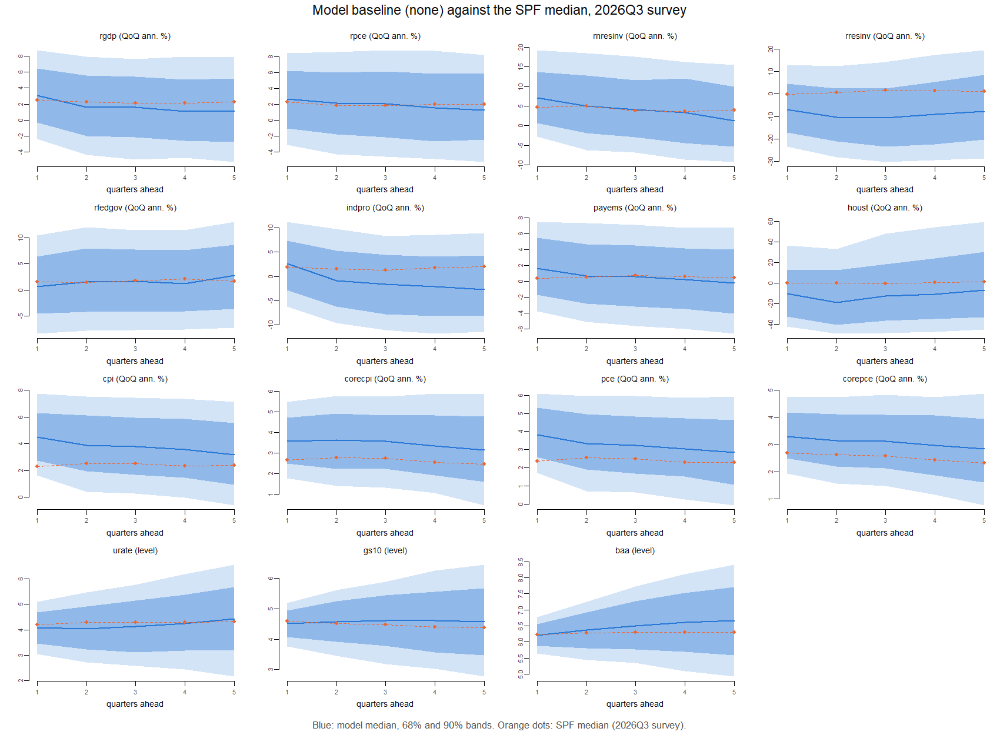
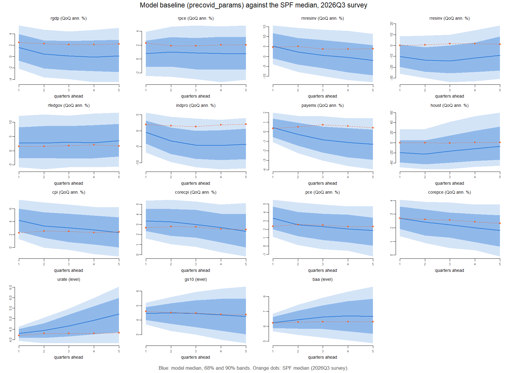
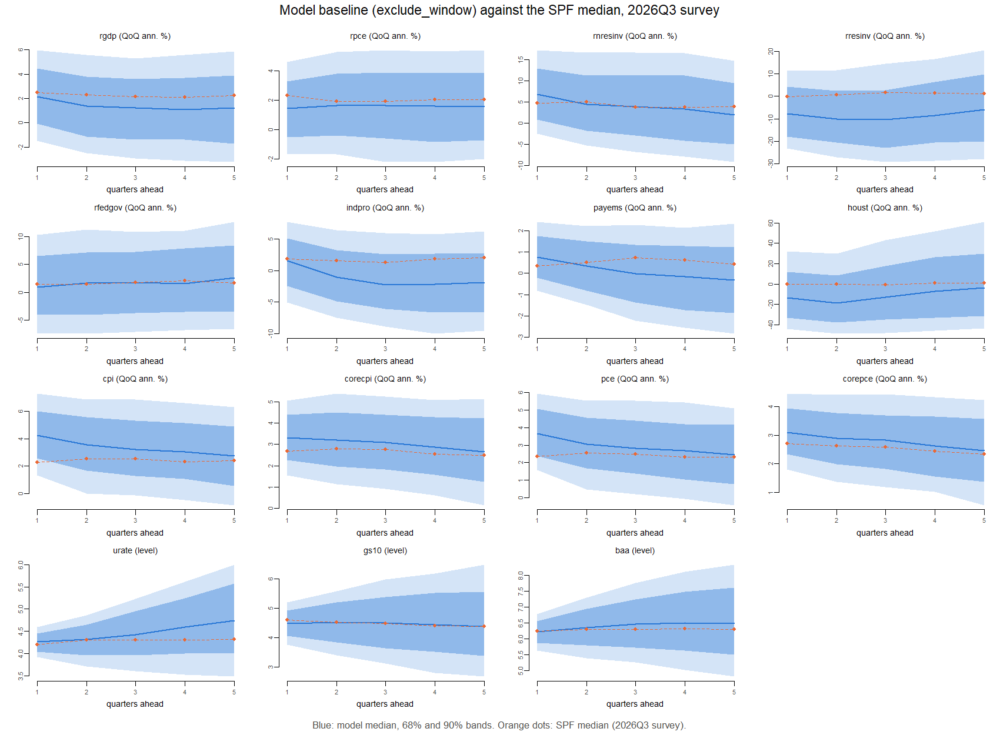
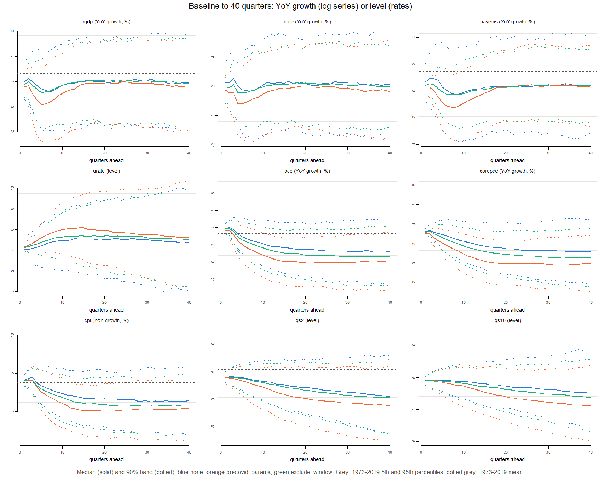

# Forecast reasonableness

**Origin:** data through 2026Q2 (QD vintage 2026m09). **Runs:** 2026m09_none_full_545b70ff; 2026m09_precovid_params_full_dc0d4609; 2026m09_exclude_window_full_6a9c5d25. COVID method `none` estimates on every quarter; `precovid_params` on data to 2019Q4; `exclude_window` (if run) on every quarter except the equations of 2020Q1–2021Q4; all forecast from the latest data (`docs/methodology.md`, section 11). The readings below were written for `none` and `precovid_params`; `exclude_window` is compared in the COVID-treatment comparison report. 1,000 posterior draws, one simulated path each, as published by the engine. Nothing is re-estimated; the engine’s baseline is reproduced from its draws and seed to 3^{-10}.

**Units.** Log series: year-on-year growth (log approximation, 100 × (log y_h − log y\_{h−4})) unless stated; the SPF comparison uses exact annualized quarterly growth, as the SPF does. Rates: levels in percent. Horizon h = quarters after 2026Q2 (h1 = 2026Q3).

# 0. The baseline forecast

Median and 68% band of the untilted baseline, both COVID methods, 12 quarters from 2026Q3. Log series as year-on-year percent changes (computed exactly per path); rates (urate, gs2, gs10, baa) as levels in percent. Simulation noise in these medians is up to about 0.3 pp (section 7). Also saved as `baseline_table.csv`.

**Method none**

| variable | measure | 2026Q3 | 2026Q4 | 2027Q1 | 2027Q2 | 2027Q3 | 2027Q4 | 2028Q1 | 2028Q2 | 2028Q3 | 2028Q4 | 2029Q1 | 2029Q2 |
|:---|:---|:---|:---|:---|:---|:---|:---|:---|:---|:---|:---|:---|:---|
| rgdp | YoY % change | 2.0 \[1.1, 2.8\] | 2.4 \[1.2, 3.5\] | 2.1 \[0.7, 3.5\] | 1.8 \[0.1, 3.6\] | 1.3 \[-0.6, 3.2\] | 1.2 \[-0.7, 3.3\] | 1.2 \[-0.6, 3.2\] | 1.3 \[-0.6, 3.4\] | 1.5 \[-0.5, 3.5\] | 1.7 \[-0.3, 3.5\] | 1.8 \[-0.4, 3.9\] | 1.9 \[-0.5, 4.0\] |
| rpce | YoY % change | 2.3 \[1.3, 3.1\] | 2.3 \[1.2, 3.5\] | 2.7 \[1.2, 4.0\] | 2.0 \[0.4, 3.8\] | 1.8 \[0.0, 3.6\] | 1.7 \[-0.3, 3.6\] | 1.7 \[-0.2, 3.6\] | 1.8 \[-0.2, 3.6\] | 1.9 \[-0.1, 3.9\] | 2.0 \[0.1, 3.9\] | 2.0 \[0.1, 4.1\] | 2.1 \[0.1, 4.2\] |
| rnresinv | YoY % change | 7.0 \[5.3, 8.6\] | 7.9 \[5.1, 10.6\] | 6.3 \[2.7, 10.0\] | 4.8 \[0.1, 9.7\] | 3.5 \[-1.3, 8.6\] | 2.4 \[-2.2, 7.8\] | 1.7 \[-2.9, 7.7\] | 1.4 \[-3.5, 7.5\] | 1.4 \[-3.7, 7.3\] | 1.6 \[-3.8, 7.8\] | 2.2 \[-3.6, 8.1\] | 2.2 \[-3.7, 8.6\] |
| payems | YoY % change | 0.6 \[-0.2, 1.6\] | 0.9 \[-0.3, 2.1\] | 1.0 \[-0.5, 2.5\] | 0.9 \[-1.0, 2.6\] | 0.2 \[-1.5, 2.2\] | 0.0 \[-1.9, 2.1\] | -0.1 \[-2.1, 1.9\] | -0.3 \[-2.3, 1.9\] | -0.2 \[-2.3, 1.9\] | -0.1 \[-2.3, 1.9\] | -0.0 \[-2.1, 2.0\] | 0.0 \[-2.1, 2.1\] |
| urate | level | 4.1 \[3.5, 4.7\] | 4.0 \[3.2, 4.9\] | 4.1 \[3.1, 5.1\] | 4.2 \[3.2, 5.4\] | 4.4 \[3.2, 5.7\] | 4.6 \[3.2, 6.0\] | 4.7 \[3.2, 6.3\] | 4.8 \[3.2, 6.4\] | 5.0 \[3.2, 6.6\] | 5.0 \[3.2, 6.8\] | 5.0 \[3.1, 6.9\] | 5.1 \[3.2, 6.9\] |
| pce | YoY % change | 3.9 \[3.6, 4.3\] | 4.1 \[3.5, 4.7\] | 3.8 \[3.0, 4.8\] | 3.4 \[2.3, 4.5\] | 3.1 \[1.9, 4.4\] | 2.9 \[1.6, 4.3\] | 2.7 \[1.2, 4.1\] | 2.4 \[1.0, 4.0\] | 2.3 \[0.7, 3.9\] | 2.1 \[0.5, 3.8\] | 2.0 \[0.4, 3.7\] | 1.9 \[0.2, 3.7\] |
| corepce | YoY % change | 3.3 \[3.1, 3.5\] | 3.4 \[3.1, 3.8\] | 3.2 \[2.7, 3.8\] | 3.1 \[2.4, 3.9\] | 3.0 \[2.2, 3.9\] | 2.9 \[1.9, 3.8\] | 2.7 \[1.7, 3.8\] | 2.5 \[1.4, 3.7\] | 2.4 \[1.1, 3.7\] | 2.2 \[1.0, 3.6\] | 2.1 \[0.8, 3.5\] | 2.0 \[0.7, 3.5\] |
| cpi | YoY % change | 4.2 \[3.7, 4.6\] | 4.4 \[3.6, 5.2\] | 4.6 \[3.5, 5.7\] | 3.9 \[2.6, 5.4\] | 3.5 \[2.0, 5.3\] | 3.3 \[1.7, 5.1\] | 3.1 \[1.4, 4.9\] | 2.8 \[0.9, 4.7\] | 2.6 \[0.6, 4.5\] | 2.3 \[0.4, 4.4\] | 2.2 \[0.3, 4.3\] | 2.1 \[-0.0, 4.1\] |
| corecpi | YoY % change | 2.8 \[2.5, 3.1\] | 3.2 \[2.6, 3.6\] | 3.4 \[2.7, 4.1\] | 3.5 \[2.6, 4.5\] | 3.4 \[2.3, 4.5\] | 3.2 \[2.1, 4.5\] | 3.0 \[1.8, 4.4\] | 2.8 \[1.5, 4.3\] | 2.7 \[1.2, 4.2\] | 2.5 \[0.9, 4.1\] | 2.3 \[0.7, 4.0\] | 2.2 \[0.5, 3.9\] |
| gs2 | level | 4.0 \[3.5, 4.6\] | 4.1 \[3.3, 5.0\] | 4.2 \[3.1, 5.2\] | 4.1 \[2.8, 5.4\] | 4.0 \[2.6, 5.4\] | 3.9 \[2.4, 5.4\] | 3.8 \[2.1, 5.4\] | 3.6 \[1.8, 5.5\] | 3.6 \[1.6, 5.4\] | 3.5 \[1.3, 5.5\] | 3.3 \[1.0, 5.5\] | 3.2 \[0.7, 5.5\] |
| gs10 | level | 4.5 \[4.1, 4.9\] | 4.6 \[3.9, 5.2\] | 4.6 \[3.8, 5.4\] | 4.6 \[3.6, 5.6\] | 4.6 \[3.5, 5.7\] | 4.6 \[3.4, 5.8\] | 4.6 \[3.2, 5.8\] | 4.5 \[3.0, 6.0\] | 4.5 \[2.9, 6.0\] | 4.4 \[2.7, 6.1\] | 4.3 \[2.6, 6.2\] | 4.2 \[2.4, 6.2\] |
| baa | level | 6.2 \[5.9, 6.6\] | 6.4 \[5.8, 6.9\] | 6.5 \[5.8, 7.3\] | 6.6 \[5.7, 7.5\] | 6.7 \[5.6, 7.7\] | 6.7 \[5.5, 7.8\] | 6.7 \[5.4, 7.9\] | 6.7 \[5.2, 8.1\] | 6.7 \[5.2, 8.2\] | 6.6 \[5.1, 8.2\] | 6.5 \[4.9, 8.3\] | 6.4 \[4.7, 8.3\] |
| houst | YoY % change | -2.9 \[-9.6, 3.0\] | -6.3 \[-15.4, 3.4\] | -15.5 \[-26.6, -3.8\] | -13.4 \[-26.6, 1.5\] | -12.6 \[-25.9, 4.0\] | -8.6 \[-24.5, 9.4\] | -6.8 \[-22.3, 11.7\] | -5.2 \[-21.8, 14.4\] | -5.2 \[-21.6, 14.6\] | -3.1 \[-21.0, 16.5\] | -2.3 \[-20.7, 19.3\] | -2.8 \[-20.9, 20.0\] |
| sp500 | YoY % change | 15.1 \[8.4, 21.6\] | 9.8 \[0.4, 19.7\] | 10.5 \[-2.0, 22.0\] | 5.2 \[-7.9, 18.6\] | 5.6 \[-8.0, 20.8\] | 7.5 \[-6.6, 23.1\] | 8.3 \[-5.4, 24.9\] | 10.2 \[-5.1, 27.1\] | 11.1 \[-3.8, 28.0\] | 11.3 \[-3.3, 28.1\] | 12.1 \[-3.3, 28.6\] | 11.4 \[-3.1, 28.8\] |
| wti | YoY % change | 53.2 \[34.2, 75.8\] | 71.0 \[38.8, 105.2\] | 41.0 \[7.3, 80.8\] | 4.9 \[-23.1, 40.7\] | -1.6 \[-27.1, 32.8\] | -2.4 \[-28.7, 31.0\] | -3.4 \[-27.9, 29.8\] | -3.3 \[-28.1, 28.2\] | -3.6 \[-27.0, 30.1\] | -2.5 \[-26.6, 31.3\] | -1.2 \[-27.5, 32.3\] | -1.2 \[-28.7, 34.0\] |

**Method precovid_params**

| variable | measure | 2026Q3 | 2026Q4 | 2027Q1 | 2027Q2 | 2027Q3 | 2027Q4 | 2028Q1 | 2028Q2 | 2028Q3 | 2028Q4 | 2029Q1 | 2029Q2 |
|:---|:---|:---|:---|:---|:---|:---|:---|:---|:---|:---|:---|:---|:---|
| rgdp | YoY % change | 1.6 \[1.0, 2.2\] | 1.7 \[0.8, 2.6\] | 1.1 \[-0.2, 2.3\] | 0.5 \[-1.0, 2.1\] | 0.1 \[-1.6, 1.9\] | 0.2 \[-1.7, 2.0\] | 0.2 \[-1.7, 2.3\] | 0.5 \[-1.5, 2.7\] | 0.8 \[-1.2, 2.8\] | 1.0 \[-0.9, 3.0\] | 1.2 \[-0.7, 3.2\] | 1.3 \[-0.7, 3.5\] |
| rpce | YoY % change | 1.8 \[1.3, 2.3\] | 1.6 \[0.8, 2.3\] | 1.6 \[0.4, 2.7\] | 0.8 \[-0.6, 2.3\] | 0.8 \[-0.6, 2.3\] | 0.8 \[-0.7, 2.5\] | 0.9 \[-0.7, 2.6\] | 1.1 \[-0.6, 2.8\] | 1.3 \[-0.4, 3.0\] | 1.4 \[-0.2, 3.2\] | 1.5 \[-0.1, 3.3\] | 1.6 \[-0.1, 3.4\] |
| rnresinv | YoY % change | 6.5 \[4.9, 8.1\] | 6.5 \[3.9, 9.3\] | 4.3 \[0.6, 8.2\] | 2.0 \[-2.9, 7.0\] | 0.2 \[-5.2, 5.5\] | -1.0 \[-6.4, 4.5\] | -1.7 \[-7.2, 4.4\] | -1.6 \[-7.3, 4.6\] | -1.3 \[-7.2, 4.7\] | -0.6 \[-6.9, 5.5\] | -0.1 \[-5.7, 6.2\] | 0.3 \[-5.4, 6.9\] |
| payems | YoY % change | 0.3 \[0.1, 0.6\] | 0.3 \[-0.2, 0.8\] | 0.0 \[-0.7, 0.7\] | -0.4 \[-1.4, 0.5\] | -0.9 \[-2.0, 0.3\] | -1.2 \[-2.4, 0.1\] | -1.2 \[-2.7, 0.1\] | -1.2 \[-2.8, 0.2\] | -1.1 \[-2.8, 0.4\] | -1.0 \[-2.7, 0.6\] | -0.8 \[-2.4, 0.8\] | -0.6 \[-2.3, 1.0\] |
| urate | level | 4.3 \[4.1, 4.5\] | 4.4 \[4.1, 4.8\] | 4.7 \[4.2, 5.2\] | 4.9 \[4.3, 5.6\] | 5.2 \[4.4, 6.0\] | 5.4 \[4.5, 6.4\] | 5.6 \[4.6, 6.7\] | 5.8 \[4.6, 7.1\] | 6.0 \[4.6, 7.4\] | 6.0 \[4.6, 7.6\] | 6.1 \[4.5, 7.7\] | 6.2 \[4.5, 7.9\] |
| pce | YoY % change | 3.8 \[3.5, 4.1\] | 3.8 \[3.1, 4.4\] | 3.3 \[2.4, 4.2\] | 2.5 \[1.4, 3.7\] | 2.1 \[0.9, 3.4\] | 1.8 \[0.5, 3.2\] | 1.6 \[0.1, 2.9\] | 1.3 \[-0.3, 2.8\] | 1.0 \[-0.6, 2.6\] | 0.8 \[-0.8, 2.4\] | 0.6 \[-1.0, 2.2\] | 0.5 \[-1.3, 2.0\] |
| corepce | YoY % change | 3.1 \[2.9, 3.3\] | 3.1 \[2.7, 3.5\] | 2.6 \[2.1, 3.2\] | 2.3 \[1.6, 3.1\] | 2.1 \[1.3, 2.9\] | 1.8 \[1.0, 2.8\] | 1.6 \[0.6, 2.6\] | 1.4 \[0.3, 2.5\] | 1.2 \[-0.0, 2.3\] | 1.0 \[-0.3, 2.2\] | 0.8 \[-0.5, 2.0\] | 0.6 \[-0.7, 1.9\] |
| cpi | YoY % change | 4.1 \[3.6, 4.5\] | 4.2 \[3.4, 5.0\] | 4.2 \[3.1, 5.3\] | 3.3 \[1.9, 4.8\] | 2.8 \[1.3, 4.4\] | 2.5 \[0.8, 4.1\] | 2.0 \[0.2, 3.9\] | 1.7 \[-0.3, 3.6\] | 1.4 \[-0.7, 3.3\] | 1.1 \[-0.9, 3.1\] | 0.8 \[-1.1, 2.7\] | 0.6 \[-1.4, 2.5\] |
| corecpi | YoY % change | 2.7 \[2.5, 3.0\] | 3.0 \[2.5, 3.5\] | 3.2 \[2.4, 3.9\] | 3.1 \[2.1, 4.1\] | 2.8 \[1.7, 3.9\] | 2.5 \[1.3, 3.7\] | 2.2 \[0.8, 3.5\] | 1.8 \[0.4, 3.3\] | 1.6 \[0.0, 3.1\] | 1.2 \[-0.4, 2.7\] | 0.9 \[-0.7, 2.6\] | 0.7 \[-0.9, 2.5\] |
| gs2 | level | 4.0 \[3.4, 4.6\] | 3.9 \[3.0, 4.8\] | 3.9 \[2.7, 5.0\] | 3.7 \[2.3, 5.0\] | 3.4 \[1.9, 4.9\] | 3.1 \[1.5, 4.8\] | 2.8 \[1.0, 4.8\] | 2.6 \[0.7, 4.6\] | 2.3 \[0.3, 4.6\] | 2.1 \[-0.1, 4.5\] | 1.8 \[-0.5, 4.4\] | 1.6 \[-0.8, 4.2\] |
| gs10 | level | 4.5 \[4.0, 4.9\] | 4.5 \[3.7, 5.2\] | 4.5 \[3.5, 5.4\] | 4.4 \[3.3, 5.5\] | 4.3 \[3.0, 5.5\] | 4.0 \[2.8, 5.5\] | 4.0 \[2.5, 5.5\] | 3.9 \[2.2, 5.5\] | 3.7 \[2.0, 5.5\] | 3.5 \[1.8, 5.4\] | 3.4 \[1.4, 5.4\] | 3.2 \[1.1, 5.3\] |
| baa | level | 6.2 \[5.9, 6.6\] | 6.4 \[5.8, 7.0\] | 6.6 \[5.8, 7.4\] | 6.7 \[5.7, 7.7\] | 6.7 \[5.5, 7.8\] | 6.5 \[5.4, 8.0\] | 6.5 \[5.1, 8.0\] | 6.4 \[4.9, 8.1\] | 6.2 \[4.7, 8.1\] | 6.2 \[4.4, 8.1\] | 6.0 \[4.1, 8.1\] | 5.8 \[3.8, 8.0\] |
| houst | YoY % change | -5.4 \[-11.7, 1.1\] | -9.3 \[-18.9, 0.3\] | -19.3 \[-31.0, -6.8\] | -17.5 \[-30.7, -1.6\] | -15.0 \[-29.2, 3.7\] | -10.0 \[-25.8, 9.1\] | -7.1 \[-24.1, 13.2\] | -4.7 \[-23.4, 18.5\] | -3.8 \[-22.0, 21.3\] | -2.2 \[-20.6, 21.9\] | -0.7 \[-19.9, 23.6\] | 0.1 \[-19.7, 24.4\] |
| sp500 | YoY % change | 13.6 \[6.9, 20.2\] | 7.0 \[-2.0, 16.8\] | 5.9 \[-5.5, 19.1\] | 0.2 \[-13.5, 15.3\] | 1.0 \[-12.4, 16.5\] | 3.4 \[-10.5, 19.3\] | 5.8 \[-9.4, 23.6\] | 7.1 \[-9.1, 26.6\] | 7.4 \[-7.2, 27.1\] | 8.2 \[-7.1, 27.1\] | 8.8 \[-6.7, 26.8\] | 7.8 \[-6.2, 26.3\] |
| wti | YoY % change | 51.9 \[32.1, 73.0\] | 65.9 \[36.9, 104.4\] | 34.0 \[5.7, 76.6\] | -0.7 \[-26.3, 38.3\] | -5.9 \[-30.5, 29.8\] | -4.9 \[-30.6, 28.4\] | -4.5 \[-31.1, 28.2\] | -5.3 \[-29.8, 30.9\] | -3.9 \[-28.2, 31.9\] | -3.2 \[-27.6, 28.2\] | -3.6 \[-28.6, 31.9\] | -4.3 \[-29.9, 29.4\] |

**Method exclude_window**

| variable | measure | 2026Q3 | 2026Q4 | 2027Q1 | 2027Q2 | 2027Q3 | 2027Q4 | 2028Q1 | 2028Q2 | 2028Q3 | 2028Q4 | 2029Q1 | 2029Q2 |
|:---|:---|:---|:---|:---|:---|:---|:---|:---|:---|:---|:---|:---|:---|
| rgdp | YoY % change | 1.8 \[1.2, 2.3\] | 2.0 \[1.2, 2.9\] | 1.8 \[0.5, 2.9\] | 1.4 \[-0.1, 2.9\] | 1.2 \[-0.5, 2.9\] | 1.3 \[-0.5, 3.0\] | 1.3 \[-0.5, 3.1\] | 1.4 \[-0.3, 3.2\] | 1.6 \[-0.2, 3.4\] | 1.7 \[-0.1, 3.5\] | 1.8 \[-0.0, 3.7\] | 1.8 \[0.0, 3.7\] |
| rpce | YoY % change | 2.0 \[1.5, 2.4\] | 1.9 \[1.1, 2.6\] | 2.1 \[1.1, 3.2\] | 1.5 \[0.2, 2.9\] | 1.6 \[0.2, 3.0\] | 1.6 \[0.2, 3.1\] | 1.7 \[0.2, 3.1\] | 1.7 \[0.3, 3.3\] | 1.8 \[0.4, 3.5\] | 2.0 \[0.4, 3.5\] | 2.1 \[0.4, 3.5\] | 2.1 \[0.4, 3.6\] |
| rnresinv | YoY % change | 6.9 \[5.4, 8.4\] | 7.7 \[5.0, 10.2\] | 6.0 \[2.7, 9.7\] | 4.6 \[0.1, 9.4\] | 3.3 \[-1.4, 8.7\] | 2.9 \[-2.4, 8.2\] | 2.2 \[-3.1, 7.6\] | 2.0 \[-3.4, 7.5\] | 1.8 \[-3.3, 7.5\] | 2.3 \[-3.2, 7.8\] | 2.7 \[-2.8, 8.3\] | 3.0 \[-2.8, 9.1\] |
| payems | YoY % change | 0.4 \[0.2, 0.6\] | 0.5 \[0.1, 1.0\] | 0.5 \[-0.2, 1.2\] | 0.2 \[-0.7, 1.1\] | -0.1 \[-1.1, 1.1\] | -0.2 \[-1.4, 1.0\] | -0.3 \[-1.6, 1.0\] | -0.3 \[-1.7, 1.0\] | -0.3 \[-1.8, 1.1\] | -0.2 \[-1.7, 1.2\] | -0.1 \[-1.6, 1.4\] | -0.0 \[-1.5, 1.4\] |
| urate | level | 4.3 \[4.0, 4.5\] | 4.3 \[4.0, 4.7\] | 4.4 \[4.0, 5.0\] | 4.6 \[4.0, 5.2\] | 4.7 \[4.0, 5.6\] | 4.9 \[4.0, 5.8\] | 5.0 \[4.0, 6.1\] | 5.1 \[3.9, 6.3\] | 5.2 \[4.0, 6.5\] | 5.3 \[3.9, 6.7\] | 5.3 \[3.9, 6.8\] | 5.3 \[3.8, 6.9\] |
| pce | YoY % change | 3.9 \[3.6, 4.2\] | 4.0 \[3.4, 4.6\] | 3.6 \[2.8, 4.5\] | 3.0 \[2.0, 4.2\] | 2.7 \[1.6, 3.9\] | 2.5 \[1.2, 3.9\] | 2.3 \[0.9, 3.6\] | 2.1 \[0.6, 3.5\] | 1.9 \[0.4, 3.4\] | 1.7 \[0.2, 3.2\] | 1.5 \[0.0, 3.1\] | 1.4 \[-0.1, 2.9\] |
| corepce | YoY % change | 3.2 \[3.0, 3.4\] | 3.3 \[3.0, 3.7\] | 3.0 \[2.5, 3.5\] | 2.8 \[2.2, 3.5\] | 2.7 \[1.9, 3.5\] | 2.5 \[1.6, 3.4\] | 2.3 \[1.4, 3.3\] | 2.2 \[1.1, 3.2\] | 2.0 \[0.8, 3.1\] | 1.8 \[0.7, 3.0\] | 1.7 \[0.5, 2.9\] | 1.5 \[0.4, 2.8\] |
| cpi | YoY % change | 4.1 \[3.7, 4.5\] | 4.2 \[3.5, 5.1\] | 4.3 \[3.2, 5.4\] | 3.5 \[2.2, 4.8\] | 3.1 \[1.7, 4.7\] | 2.8 \[1.3, 4.5\] | 2.6 \[0.9, 4.3\] | 2.3 \[0.5, 4.1\] | 2.1 \[0.3, 3.8\] | 1.8 \[-0.0, 3.7\] | 1.6 \[-0.2, 3.5\] | 1.5 \[-0.3, 3.4\] |
| corecpi | YoY % change | 2.7 \[2.5, 3.0\] | 3.0 \[2.5, 3.5\] | 3.1 \[2.4, 3.8\] | 3.1 \[2.2, 4.1\] | 2.9 \[2.0, 4.0\] | 2.7 \[1.7, 4.0\] | 2.6 \[1.3, 3.8\] | 2.4 \[1.0, 3.7\] | 2.1 \[0.7, 3.5\] | 1.9 \[0.5, 3.4\] | 1.8 \[0.2, 3.2\] | 1.6 \[0.1, 3.1\] |
| gs2 | level | 4.0 \[3.5, 4.6\] | 4.0 \[3.2, 4.9\] | 4.0 \[3.0, 5.2\] | 3.9 \[2.7, 5.2\] | 3.8 \[2.4, 5.2\] | 3.7 \[2.2, 5.2\] | 3.5 \[1.9, 5.2\] | 3.5 \[1.6, 5.1\] | 3.4 \[1.4, 5.0\] | 3.1 \[1.1, 5.1\] | 2.9 \[0.9, 5.0\] | 2.8 \[0.5, 5.0\] |
| gs10 | level | 4.5 \[4.1, 4.9\] | 4.5 \[3.8, 5.2\] | 4.5 \[3.6, 5.4\] | 4.4 \[3.5, 5.5\] | 4.4 \[3.4, 5.6\] | 4.3 \[3.2, 5.6\] | 4.3 \[3.1, 5.7\] | 4.3 \[2.9, 5.8\] | 4.2 \[2.8, 5.7\] | 4.1 \[2.6, 5.8\] | 4.0 \[2.4, 5.7\] | 3.9 \[2.3, 5.7\] |
| baa | level | 6.2 \[5.9, 6.6\] | 6.4 \[5.8, 6.9\] | 6.5 \[5.7, 7.2\] | 6.5 \[5.6, 7.5\] | 6.5 \[5.5, 7.6\] | 6.5 \[5.4, 7.7\] | 6.4 \[5.3, 7.7\] | 6.4 \[5.1, 7.8\] | 6.3 \[4.9, 7.8\] | 6.2 \[4.6, 7.8\] | 6.1 \[4.6, 7.9\] | 6.0 \[4.4, 7.9\] |
| houst | YoY % change | -3.7 \[-9.7, 2.7\] | -6.7 \[-16.0, 3.0\] | -16.0 \[-26.7, -3.6\] | -13.4 \[-26.2, 2.5\] | -11.1 \[-25.2, 6.3\] | -7.6 \[-23.1, 11.1\] | -5.9 \[-21.0, 13.5\] | -3.7 \[-20.7, 15.8\] | -4.0 \[-20.0, 17.0\] | -3.1 \[-18.9, 17.4\] | -1.6 \[-18.2, 18.6\] | -1.0 \[-18.5, 19.2\] |
| sp500 | YoY % change | 14.3 \[7.9, 20.6\] | 8.6 \[-0.3, 17.5\] | 8.2 \[-2.5, 20.7\] | 3.7 \[-9.5, 16.9\] | 5.0 \[-8.6, 19.0\] | 7.5 \[-7.8, 22.7\] | 8.9 \[-5.3, 25.2\] | 9.5 \[-4.3, 27.6\] | 10.5 \[-4.0, 29.2\] | 11.7 \[-4.0, 28.5\] | 12.6 \[-3.7, 28.5\] | 11.8 \[-2.9, 28.2\] |
| wti | YoY % change | 52.9 \[33.8, 73.5\] | 68.7 \[37.3, 105.7\] | 38.9 \[6.9, 75.4\] | 4.1 \[-22.7, 35.8\] | -1.9 \[-26.1, 28.4\] | -1.7 \[-26.7, 27.6\] | -2.5 \[-26.8, 27.8\] | -3.5 \[-26.6, 30.6\] | -1.5 \[-26.0, 30.6\] | -0.3 \[-27.0, 30.3\] | 0.5 \[-24.8, 32.0\] | -0.4 \[-26.1, 31.3\] |

# 1. Against the Survey of Professional Forecasters

**Survey:** 2026Q3, released 14 August 2026 (Philadelphia Fed). Its panelists had data through 2026Q2, the same last quarter as the model; the survey’s quarter (2026Q3) is the model’s h1. The 2026Q4 survey is due in mid-to-late November 2026.

**Measures.** Annualized quarter-on-quarter growth for the real series, payrolls, industrial production, housing starts and the price indexes (SPF inflation is the annualized quarterly rate); levels for unemployment, the 10-year Treasury and the Baa yield. Levels of the real series are not compared: the SPF’s starting point is the BEA advance estimate, the model’s the September 2026 vintage after the annual revision.

**Differences in definition and information.** For real variables the SPF’s growth rate is the growth of the median level forecast; the model’s is the median of the growth rates over its paths. The SPF panel also saw the July and early August monthly releases (payrolls, CPI) and its forecasts carry judgment. Quarterly growth rates of a simulated path are noisy (section 7), so single-quarter differences below about 0.5 pp in GDP growth are within simulation noise. Differences are reported, not forced to zero.

**Method none**

| variable | horizon |   spf |    q16 |    q50 |   q84 | spf_percentile |
|:---------|--------:|------:|-------:|-------:|------:|---------------:|
| rgdp     |       1 |  2.46 |  -0.31 |   3.07 |  6.46 |           42.5 |
| rgdp     |       2 |  2.27 |  -2.03 |   1.59 |  5.54 |           56.7 |
| rgdp     |       4 |  2.12 |  -2.55 |   1.10 |  5.06 |           60.4 |
| rpce     |       1 |  2.29 |  -1.04 |   2.67 |  6.26 |           46.7 |
| rpce     |       2 |  1.90 |  -1.72 |   2.16 |  6.01 |           47.6 |
| rpce     |       4 |  2.02 |  -2.61 |   1.61 |  5.87 |           54.3 |
| rnresinv |       1 |  4.68 |   0.62 |   7.15 | 13.75 |           34.7 |
| rnresinv |       2 |  5.02 |  -1.88 |   4.96 | 12.76 |           50.4 |
| rnresinv |       4 |  3.71 |  -4.47 |   3.34 | 12.02 |           51.8 |
| rresinv  |       1 | -0.01 | -17.10 |  -6.90 |  4.59 |           72.3 |
| rresinv  |       2 |  0.57 | -21.25 | -10.48 |  2.44 |           80.4 |
| rresinv  |       4 |  1.53 | -22.45 |  -9.02 |  5.48 |           77.1 |
| rfedgov  |       1 |  1.49 |  -4.56 |   0.62 |  6.37 |           55.4 |
| rfedgov  |       2 |  1.48 |  -4.21 |   1.57 |  7.94 |           49.5 |
| rfedgov  |       4 |  2.09 |  -4.09 |   1.20 |  7.61 |           55.3 |
| indpro   |       1 |  1.86 |  -2.83 |   2.58 |  7.31 |           44.9 |
| indpro   |       2 |  1.53 |  -6.21 |  -0.93 |  5.26 |           66.4 |
| indpro   |       4 |  1.79 |  -8.12 |  -2.15 |  4.09 |           73.2 |
| payems   |       1 |  0.34 |  -1.70 |   1.66 |  5.49 |           36.0 |
| payems   |       2 |  0.50 |  -2.84 |   0.65 |  4.68 |           48.4 |
| payems   |       4 |  0.61 |  -3.51 |   0.20 |  4.15 |           54.9 |
| houst    |       1 |  0.10 | -32.85 | -10.54 | 13.34 |           66.8 |
| houst    |       2 | -0.10 | -40.75 | -18.81 | 12.44 |           74.4 |
| houst    |       4 |  0.79 | -34.61 | -10.92 | 23.94 |           63.7 |
| cpi      |       1 |  2.28 |   2.72 |   4.50 |  6.30 |           10.0 |
| cpi      |       2 |  2.52 |   1.95 |   3.88 |  6.10 |           24.3 |
| cpi      |       4 |  2.32 |   1.45 |   3.56 |  5.84 |           28.4 |
| corecpi  |       1 |  2.67 |   2.48 |   3.58 |  4.73 |           20.0 |
| corecpi  |       2 |  2.79 |   2.23 |   3.63 |  4.93 |           28.2 |
| corecpi  |       4 |  2.54 |   1.91 |   3.35 |  4.84 |           28.1 |
| pce      |       1 |  2.35 |   2.59 |   3.82 |  5.32 |           11.5 |
| pce      |       2 |  2.55 |   1.90 |   3.35 |  4.95 |           29.4 |
| pce      |       4 |  2.30 |   1.51 |   3.04 |  4.73 |           31.1 |
| corepce  |       1 |  2.70 |   2.50 |   3.30 |  4.19 |           21.9 |
| corepce  |       2 |  2.62 |   2.19 |   3.14 |  4.12 |           27.9 |
| corepce  |       4 |  2.43 |   1.86 |   2.97 |  4.08 |           32.1 |
| urate    |       1 |  4.20 |   3.46 |   4.08 |  4.69 |           57.4 |
| urate    |       2 |  4.30 |   3.23 |   4.03 |  4.92 |           62.4 |
| urate    |       4 |  4.30 |   3.18 |   4.24 |  5.37 |           53.0 |
| gs10     |       1 |  4.60 |   4.08 |   4.51 |  4.94 |           58.1 |
| gs10     |       2 |  4.52 |   3.92 |   4.58 |  5.25 |           47.0 |
| gs10     |       4 |  4.40 |   3.57 |   4.61 |  5.57 |           43.1 |
| baa      |       1 |  6.23 |   5.87 |   6.20 |  6.56 |           53.2 |
| baa      |       2 |  6.28 |   5.80 |   6.37 |  6.92 |           44.1 |
| baa      |       4 |  6.30 |   5.69 |   6.61 |  7.52 |           36.5 |

**Method precovid_params**

| variable | horizon |   spf |    q16 |    q50 |   q84 | spf_percentile |
|:---------|--------:|------:|-------:|-------:|------:|---------------:|
| rgdp     |       1 |  2.46 |  -0.72 |   1.58 |  3.96 |           64.6 |
| rgdp     |       2 |  2.27 |  -2.11 |   0.44 |  2.87 |           76.7 |
| rgdp     |       4 |  2.12 |  -2.58 |  -0.08 |  2.84 |           77.3 |
| rpce     |       1 |  2.29 |  -1.15 |   0.78 |  2.65 |           78.7 |
| rpce     |       2 |  1.90 |  -1.12 |   0.99 |  3.15 |           67.3 |
| rpce     |       4 |  2.02 |  -1.54 |   0.77 |  3.21 |           70.0 |
| rnresinv |       1 |  4.68 |  -0.95 |   5.23 | 11.68 |           46.1 |
| rnresinv |       2 |  5.02 |  -4.18 |   2.15 |  9.35 |           65.8 |
| rnresinv |       4 |  3.71 |  -7.95 |  -0.53 |  7.07 |           69.4 |
| rresinv  |       1 | -0.01 | -19.93 | -10.26 |  0.78 |           81.8 |
| rresinv  |       2 |  0.57 | -24.25 | -13.56 | -1.61 |           86.9 |
| rresinv  |       4 |  1.53 | -24.55 | -11.60 |  2.81 |           81.0 |
| rfedgov  |       1 |  1.49 |  -2.67 |   2.67 |  8.18 |           41.3 |
| rfedgov  |       2 |  1.48 |  -2.58 |   2.64 |  8.60 |           42.5 |
| rfedgov  |       4 |  2.09 |  -2.61 |   2.79 |  8.95 |           44.7 |
| indpro   |       1 |  1.86 |  -4.06 |  -0.46 |  3.16 |           73.2 |
| indpro   |       2 |  1.53 |  -7.24 |  -3.21 |  0.99 |           86.6 |
| indpro   |       4 |  1.79 |  -9.16 |  -4.62 |  0.14 |           91.0 |
| payems   |       1 |  0.34 |  -0.54 |   0.45 |  1.40 |           46.0 |
| payems   |       2 |  0.50 |  -1.45 |  -0.27 |  0.94 |           73.8 |
| payems   |       4 |  0.61 |  -2.67 |  -1.13 |  0.39 |           87.5 |
| houst    |       1 |  0.10 | -38.66 | -19.42 |  5.18 |           78.2 |
| houst    |       2 | -0.10 | -42.55 | -22.43 |  4.72 |           79.4 |
| houst    |       4 |  0.79 | -36.06 | -11.98 | 23.82 |           66.3 |
| cpi      |       1 |  2.28 |   2.45 |   4.21 |  5.98 |           13.9 |
| cpi      |       2 |  2.52 |   1.47 |   3.34 |  5.45 |           31.8 |
| cpi      |       4 |  2.32 |   0.46 |   2.69 |  4.93 |           43.1 |
| corecpi  |       1 |  2.67 |   2.34 |   3.35 |  4.52 |           25.3 |
| corecpi  |       2 |  2.79 |   1.87 |   3.26 |  4.52 |           35.6 |
| corecpi  |       4 |  2.54 |   1.22 |   2.69 |  4.04 |           46.1 |
| pce      |       1 |  2.35 |   1.97 |   3.30 |  4.71 |           25.2 |
| pce      |       2 |  2.55 |   1.16 |   2.52 |  4.07 |           50.8 |
| pce      |       4 |  2.30 |   0.42 |   2.04 |  3.73 |           56.1 |
| corepce  |       1 |  2.70 |   1.91 |   2.70 |  3.55 |           50.3 |
| corepce  |       2 |  2.62 |   1.43 |   2.41 |  3.34 |           60.4 |
| corepce  |       4 |  2.43 |   0.94 |   2.01 |  3.00 |           64.6 |
| urate    |       1 |  4.20 |   4.09 |   4.29 |  4.51 |           32.6 |
| urate    |       2 |  4.30 |   4.08 |   4.43 |  4.78 |           36.8 |
| urate    |       4 |  4.30 |   4.26 |   4.91 |  5.59 |           18.2 |
| gs10     |       1 |  4.60 |   4.01 |   4.47 |  4.88 |           63.1 |
| gs10     |       2 |  4.52 |   3.75 |   4.51 |  5.16 |           50.8 |
| gs10     |       4 |  4.40 |   3.28 |   4.35 |  5.47 |           51.7 |
| baa      |       1 |  6.23 |   5.89 |   6.25 |  6.63 |           47.7 |
| baa      |       2 |  6.28 |   5.84 |   6.44 |  7.05 |           39.2 |
| baa      |       4 |  6.30 |   5.66 |   6.70 |  7.69 |           35.9 |

**Method exclude_window**

| variable | horizon |   spf |    q16 |    q50 |   q84 | spf_percentile |
|:---------|--------:|------:|-------:|-------:|------:|---------------:|
| rgdp     |       1 |  2.46 |  -0.08 |   2.13 |  4.47 |           55.5 |
| rgdp     |       2 |  2.27 |  -1.15 |   1.35 |  3.77 |           65.1 |
| rgdp     |       4 |  2.12 |  -1.39 |   1.09 |  3.70 |           65.3 |
| rpce     |       1 |  2.29 |  -0.53 |   1.44 |  3.28 |           69.0 |
| rpce     |       2 |  1.90 |  -0.41 |   1.65 |  3.78 |           54.7 |
| rpce     |       4 |  2.02 |  -0.84 |   1.61 |  3.83 |           57.1 |
| rnresinv |       1 |  4.68 |   0.79 |   6.76 | 12.87 |           35.9 |
| rnresinv |       2 |  5.02 |  -1.77 |   4.47 | 11.31 |           52.6 |
| rnresinv |       4 |  3.71 |  -4.22 |   3.34 | 11.23 |           51.8 |
| rresinv  |       1 | -0.01 | -17.91 |  -7.60 |  4.40 |           74.0 |
| rresinv  |       2 |  0.57 | -20.51 | -10.11 |  2.46 |           80.4 |
| rresinv  |       4 |  1.53 | -20.45 |  -8.54 |  6.49 |           76.1 |
| rfedgov  |       1 |  1.49 |  -3.93 |   0.93 |  6.53 |           54.3 |
| rfedgov  |       2 |  1.48 |  -3.97 |   1.68 |  7.17 |           48.9 |
| rfedgov  |       4 |  2.09 |  -3.52 |   1.60 |  7.81 |           52.7 |
| indpro   |       1 |  1.86 |  -2.41 |   1.55 |  5.06 |           53.7 |
| indpro   |       2 |  1.53 |  -4.87 |  -1.02 |  3.26 |           71.9 |
| indpro   |       4 |  1.79 |  -6.64 |  -2.13 |  2.65 |           79.8 |
| payems   |       1 |  0.34 |  -0.22 |   0.77 |  1.74 |           33.6 |
| payems   |       2 |  0.50 |  -0.83 |   0.33 |  1.49 |           55.1 |
| payems   |       4 |  0.61 |  -1.72 |  -0.15 |  1.27 |           71.8 |
| houst    |       1 |  0.10 | -32.98 | -13.23 | 11.93 |           72.0 |
| houst    |       2 | -0.10 | -37.91 | -18.43 |  8.64 |           74.1 |
| houst    |       4 |  0.79 | -33.31 |  -7.16 | 26.14 |           61.0 |
| cpi      |       1 |  2.28 |   2.58 |   4.22 |  6.00 |           12.8 |
| cpi      |       2 |  2.52 |   1.68 |   3.57 |  5.56 |           31.0 |
| cpi      |       4 |  2.32 |   1.06 |   3.04 |  5.13 |           35.0 |
| corecpi  |       1 |  2.67 |   2.27 |   3.30 |  4.39 |           28.0 |
| corecpi  |       2 |  2.79 |   1.97 |   3.21 |  4.48 |           36.2 |
| corecpi  |       4 |  2.54 |   1.56 |   2.87 |  4.27 |           39.7 |
| pce      |       1 |  2.35 |   2.37 |   3.67 |  5.06 |           15.8 |
| pce      |       2 |  2.55 |   1.68 |   3.05 |  4.55 |           37.6 |
| pce      |       4 |  2.30 |   1.05 |   2.69 |  4.19 |           38.8 |
| corepce  |       1 |  2.70 |   2.33 |   3.09 |  3.93 |           30.2 |
| corepce  |       2 |  2.62 |   1.98 |   2.88 |  3.78 |           36.9 |
| corepce  |       4 |  2.43 |   1.56 |   2.63 |  3.66 |           41.3 |
| urate    |       1 |  4.20 |   4.04 |   4.26 |  4.45 |           39.2 |
| urate    |       2 |  4.30 |   3.96 |   4.32 |  4.66 |           47.1 |
| urate    |       4 |  4.30 |   4.00 |   4.59 |  5.25 |           31.7 |
| gs10     |       1 |  4.60 |   4.06 |   4.48 |  4.92 |           60.5 |
| gs10     |       2 |  4.52 |   3.84 |   4.51 |  5.19 |           51.0 |
| gs10     |       4 |  4.40 |   3.53 |   4.45 |  5.52 |           48.9 |
| baa      |       1 |  6.23 |   5.87 |   6.22 |  6.55 |           51.7 |
| baa      |       2 |  6.28 |   5.78 |   6.35 |  6.93 |           44.5 |
| baa      |       4 |  6.30 |   5.61 |   6.49 |  7.48 |           41.1 |

*`spf`: SPF median; `q16`, `q50`, `q84`: model median and 68% band; `spf_percentile`: share of the model’s draws at or below the SPF median (50 = the SPF median equals the model’s).*

**Reading.**

- *Inflation in 2026Q3.* Both methods forecast higher inflation than the SPF in the first quarter (CPI 4.5% and 4.2% annualized, SPF 2.3%; core PCE 3.3% under `none`, 2.7% under `precovid_params`, SPF 2.7%). Inflation in 2026Q2 was high (the SPF’s own history column puts CPI at 6.1% annualized) and the model carries part of that momentum into the next quarter; the SPF panel also had the July CPI. By h4 the SPF median is inside the model’s 68% band under both methods.
- *Activity.* Under `none` the model’s GDP path is close to the SPF in the first quarter (3.1% against 2.5%) and lower after (1.1% at h4, SPF 2.1%). Under `precovid_params` it is lower throughout (1.6%, then about 0%; SPF at the 65th–77th percentile), with industrial production and payrolls falling and unemployment rising to 4.9% by 2027Q2 (SPF 4.3%, at the model’s 18th percentile).
- *Housing.* Both methods forecast falls in housing starts and residential investment (medians −10% to −22% annualized) where the SPF expects about zero; the SPF median sits at the 65th–87th percentile, inside the 90% band.
- *Rates.* The 10-year and Baa yields match the SPF closely under both methods.

# 2. Plausible ranges

Ranges from history: the 5th to 95th percentile over 1973Q1–2019Q4 of each variable’s YoY growth (log series) or level (rates). The 2020–21 quarters are left out so that the ranges describe normal times.

| variable | measure       |  mean |    low |   high |
|:---------|:--------------|------:|-------:|-------:|
| rgdp     | YoY growth, % |  2.66 |  -1.61 |   5.60 |
| rpce     | YoY growth, % |  2.84 |  -0.44 |   5.47 |
| pce      | YoY growth, % |  3.32 |   0.76 |   9.34 |
| corepce  | YoY growth, % |  3.27 |   1.25 |   8.35 |
| cpi      | YoY growth, % |  3.80 |   1.15 |  10.52 |
| payems   | YoY growth, % |  1.47 |  -1.95 |   4.28 |
| urate    | level         |  6.25 |   4.01 |   9.46 |
| caputil  | level         | 78.37 |  70.94 |  84.73 |
| houst    | YoY growth, % | -0.98 | -43.47 |  29.57 |
| umich    | level         | 85.33 |  63.64 | 105.19 |
| gs2      | level         |  5.43 |   0.37 |  12.45 |
| gs10     | level         |  6.31 |   1.98 |  12.27 |

**Method none**: medians outside the range (h4, h8, h12, h20, h40)

| variable | horizon | median |   low |   high | share_below | share_above |
|:---------|--------:|-------:|------:|-------:|------------:|------------:|
| corepce  |      40 |   1.22 |  1.25 |   8.35 |        0.51 |        0.00 |
| corecpi  |      40 |   1.27 |  1.47 |   9.91 |        0.53 |        0.00 |
| umich    |       4 |  43.39 | 63.64 | 105.19 |        0.98 |        0.00 |
| umich    |       8 |  41.34 | 63.64 | 105.19 |        0.93 |        0.00 |
| umich    |      12 |  40.30 | 63.64 | 105.19 |        0.89 |        0.00 |
| umich    |      20 |  39.03 | 63.64 | 105.19 |        0.84 |        0.01 |
| umich    |      40 |  33.95 | 63.64 | 105.19 |        0.77 |        0.03 |

**Method precovid_params**: medians outside the range (h4, h8, h12, h20, h40)

| variable | horizon | median |   low |   high | share_below | share_above |
|:---------|--------:|-------:|------:|-------:|------------:|------------:|
| gdpdefl  |      12 |   0.45 |  0.94 |   8.42 |        0.63 |        0.00 |
| gdpdefl  |      20 |  -0.04 |  0.94 |   8.42 |        0.73 |        0.00 |
| gdpdefl  |      40 |   0.20 |  0.94 |   8.42 |        0.66 |        0.00 |
| pce      |      12 |   0.41 |  0.76 |   9.34 |        0.60 |        0.00 |
| pce      |      20 |  -0.13 |  0.76 |   9.34 |        0.69 |        0.00 |
| pce      |      40 |   0.11 |  0.76 |   9.34 |        0.64 |        0.00 |
| corepce  |      12 |   0.60 |  1.25 |   8.35 |        0.70 |        0.00 |
| corepce  |      20 |  -0.05 |  1.25 |   8.35 |        0.83 |        0.00 |
| corepce  |      40 |  -0.04 |  1.25 |   8.35 |        0.79 |        0.00 |
| cpi      |      12 |   0.47 |  1.15 |  10.52 |        0.65 |        0.00 |
| cpi      |      20 |   0.03 |  1.15 |  10.52 |        0.70 |        0.00 |
| cpi      |      40 |   0.43 |  1.15 |  10.52 |        0.63 |        0.00 |
| corecpi  |      12 |   0.71 |  1.47 |   9.91 |        0.68 |        0.00 |
| corecpi  |      20 |   0.12 |  1.47 |   9.91 |        0.78 |        0.00 |
| corecpi  |      40 |   0.21 |  1.47 |   9.91 |        0.75 |        0.00 |
| comphr   |      20 |   0.73 |  0.87 |   9.62 |        0.52 |        0.00 |
| caputil  |       8 |  69.49 | 70.94 |  84.73 |        0.63 |        0.00 |
| caputil  |      12 |  68.97 | 70.94 |  84.73 |        0.65 |        0.00 |
| caputil  |      20 |  69.77 | 70.94 |  84.73 |        0.59 |        0.00 |
| caputil  |      40 |  70.22 | 70.94 |  84.73 |        0.54 |        0.05 |
| umich    |       4 |  46.68 | 63.64 | 105.19 |        0.97 |        0.00 |
| umich    |       8 |  49.73 | 63.64 | 105.19 |        0.83 |        0.00 |
| umich    |      12 |  53.91 | 63.64 | 105.19 |        0.70 |        0.00 |
| umich    |      20 |  60.23 | 63.64 | 105.19 |        0.56 |        0.02 |
| gs2      |      20 |   0.14 |  0.37 |  12.45 |        0.53 |        0.00 |
| gs2      |      40 |  -1.17 |  0.37 |  12.45 |        0.63 |        0.01 |
| gs5      |      20 |   1.19 |  1.29 |  12.51 |        0.51 |        0.00 |
| gs5      |      40 |  -0.16 |  1.29 |  12.51 |        0.65 |        0.00 |
| gs10     |      20 |   1.97 |  1.98 |  12.27 |        0.50 |        0.00 |
| gs10     |      40 |   0.60 |  1.98 |  12.27 |        0.66 |        0.00 |
| aaa      |      20 |   3.63 |  3.69 |  12.68 |        0.51 |        0.00 |
| aaa      |      40 |   2.18 |  3.69 |  12.68 |        0.68 |        0.01 |
| baa      |      20 |   4.56 |  4.61 |  14.57 |        0.51 |        0.00 |
| baa      |      40 |   2.99 |  4.61 |  14.57 |        0.67 |        0.01 |

**Method exclude_window**: medians outside the range (h4, h8, h12, h20, h40)

| variable | horizon | median |   low |   high | share_below | share_above |
|:---------|--------:|-------:|------:|-------:|------------:|------------:|
| gdpdefl  |      20 |   0.90 |  0.94 |   8.42 |        0.52 |        0.00 |
| gdpdefl  |      40 |   0.70 |  0.94 |   8.42 |        0.55 |        0.00 |
| pce      |      40 |   0.62 |  0.76 |   9.34 |        0.53 |        0.00 |
| corepce  |      20 |   0.91 |  1.25 |   8.35 |        0.60 |        0.00 |
| corepce  |      40 |   0.57 |  1.25 |   8.35 |        0.64 |        0.00 |
| cpi      |      20 |   0.89 |  1.15 |  10.52 |        0.55 |        0.00 |
| cpi      |      40 |   0.71 |  1.15 |  10.52 |        0.57 |        0.00 |
| corecpi  |      20 |   0.87 |  1.47 |   9.91 |        0.64 |        0.00 |
| corecpi  |      40 |   0.58 |  1.47 |   9.91 |        0.67 |        0.00 |
| umich    |       4 |  44.71 | 63.64 | 105.19 |        0.98 |        0.00 |
| umich    |       8 |  43.77 | 63.64 | 105.19 |        0.92 |        0.00 |
| umich    |      12 |  44.16 | 63.64 | 105.19 |        0.85 |        0.00 |
| umich    |      20 |  44.60 | 63.64 | 105.19 |        0.78 |        0.01 |
| umich    |      40 |  45.63 | 63.64 | 105.19 |        0.68 |        0.05 |
| gs2      |      40 |   0.26 |  0.37 |  12.45 |        0.51 |        0.01 |
| gs5      |      40 |   0.99 |  1.29 |  12.51 |        0.54 |        0.00 |
| gs10     |      40 |   1.85 |  1.98 |  12.27 |        0.52 |        0.00 |
| aaa      |      40 |   3.53 |  3.69 |  12.68 |        0.52 |        0.01 |
| baa      |      40 |   3.62 |  4.61 |  14.57 |        0.61 |        0.01 |

*`share_below`, `share_above`: share of the draws outside the range.*

# 3. Negative yields

No zero lower bound is imposed. Share of draws with a negative yield:

| variable | horizon | share_negative | none share_negative | precovid_params share_negative | exclude_window share_negative |
|:---|---:|---:|---:|---:|---:|
| gs2 | 4 | 0.000 | 0.000 | 0.005 | 0.000 |
| gs2 | 8 | 0.030 | 0.030 | 0.112 | 0.039 |
| gs2 | 12 | 0.099 | 0.099 | 0.273 | 0.118 |
| gs2 | 20 | 0.211 | 0.211 | 0.483 | 0.272 |
| gs2 | 40 | 0.441 | 0.441 | 0.595 | 0.472 |
| gs5 | 4 | 0.000 | 0.000 | 0.000 | 0.000 |
| gs5 | 8 | 0.006 | 0.006 | 0.048 | 0.015 |
| gs5 | 12 | 0.037 | 0.037 | 0.139 | 0.051 |
| gs5 | 20 | 0.111 | 0.111 | 0.326 | 0.145 |
| gs5 | 40 | 0.305 | 0.305 | 0.520 | 0.372 |
| gs10 | 4 | 0.000 | 0.000 | 0.000 | 0.000 |
| gs10 | 8 | 0.002 | 0.002 | 0.012 | 0.001 |
| gs10 | 12 | 0.010 | 0.010 | 0.061 | 0.018 |
| gs10 | 20 | 0.043 | 0.043 | 0.192 | 0.081 |
| gs10 | 40 | 0.225 | 0.225 | 0.423 | 0.270 |

# 4. Long horizons (40 quarters)

The baseline is simulated to 40 quarters in this check only (the engine forecasts 20; the site shows 8–12). Medians and 90% bands against the 1973–2019 mean and range:

| variable | horizon | none q50 | none q05 | none q95 | precovid_params q50 | precovid_params q05 | precovid_params q95 | exclude_window q50 | exclude_window q05 | exclude_window q95 |
|:---|---:|---:|---:|---:|---:|---:|---:|---:|---:|---:|
| rgdp | 4 | 1.69 | -0.96 | 4.63 | 0.54 | -2.29 | 3.19 | 1.40 | -1.14 | 3.66 |
| rgdp | 12 | 1.84 | -1.64 | 5.29 | 1.36 | -1.89 | 4.60 | 1.89 | -1.35 | 5.05 |
| rgdp | 20 | 1.96 | -1.49 | 5.38 | 1.84 | -1.22 | 5.11 | 2.07 | -1.29 | 5.25 |
| rgdp | 40 | 1.93 | -1.67 | 5.55 | 1.62 | -1.86 | 5.47 | 1.88 | -1.38 | 5.47 |
| payems | 4 | 0.80 | -2.24 | 3.64 | -0.48 | -2.11 | 1.10 | 0.18 | -1.37 | 1.77 |
| payems | 12 | 0.08 | -3.67 | 3.42 | -0.59 | -3.30 | 1.92 | 0.00 | -2.69 | 2.44 |
| payems | 20 | 0.30 | -2.85 | 3.89 | 0.25 | -2.29 | 2.99 | 0.33 | -2.21 | 2.95 |
| payems | 40 | 0.37 | -3.14 | 3.98 | 0.27 | -2.69 | 3.39 | 0.37 | -2.28 | 3.08 |
| urate | 4 | 4.29 | 2.52 | 6.08 | 4.94 | 3.81 | 5.98 | 4.59 | 3.62 | 5.60 |
| urate | 12 | 4.99 | 1.97 | 8.20 | 6.10 | 3.37 | 9.03 | 5.34 | 2.78 | 8.01 |
| urate | 20 | 5.03 | 1.27 | 8.79 | 5.91 | 2.53 | 9.66 | 5.37 | 1.88 | 8.84 |
| urate | 40 | 4.77 | 0.05 | 10.01 | 5.24 | 0.42 | 10.56 | 5.07 | 0.44 | 9.80 |
| pce | 4 | 3.26 | 1.54 | 5.10 | 2.47 | 0.60 | 4.38 | 2.93 | 1.30 | 4.69 |
| pce | 12 | 1.83 | -0.83 | 4.79 | 0.41 | -2.31 | 3.13 | 1.31 | -1.33 | 3.88 |
| pce | 20 | 1.43 | -1.75 | 4.46 | -0.13 | -2.91 | 2.91 | 0.79 | -2.05 | 3.74 |
| pce | 40 | 1.21 | -2.38 | 5.00 | 0.11 | -3.46 | 3.36 | 0.62 | -2.83 | 4.26 |
| corepce | 4 | 3.05 | 1.91 | 4.35 | 2.29 | 1.07 | 3.55 | 2.81 | 1.67 | 3.95 |
| corepce | 12 | 2.02 | -0.21 | 4.24 | 0.60 | -1.46 | 2.79 | 1.50 | -0.57 | 3.56 |
| corepce | 20 | 1.46 | -1.16 | 4.19 | -0.05 | -2.21 | 2.40 | 0.91 | -1.43 | 3.30 |
| corepce | 40 | 1.22 | -1.97 | 4.51 | -0.04 | -2.92 | 2.81 | 0.57 | -2.35 | 3.56 |
| gs2 | 4 | 4.02 | 1.99 | 6.28 | 3.59 | 1.29 | 5.92 | 3.90 | 1.74 | 6.15 |
| gs2 | 12 | 3.09 | -1.09 | 7.12 | 1.65 | -2.57 | 6.00 | 2.71 | -1.03 | 6.53 |
| gs2 | 20 | 2.15 | -2.67 | 7.32 | 0.14 | -4.66 | 5.76 | 1.66 | -2.98 | 6.95 |
| gs2 | 40 | 0.54 | -6.33 | 7.99 | -1.17 | -7.65 | 6.06 | 0.26 | -6.27 | 7.37 |
| gs10 | 4 | 4.52 | 3.06 | 6.25 | 4.33 | 2.61 | 6.09 | 4.49 | 2.89 | 6.13 |
| gs10 | 12 | 4.24 | 1.20 | 7.29 | 3.24 | -0.18 | 6.64 | 3.86 | 0.87 | 6.80 |
| gs10 | 20 | 3.64 | 0.10 | 7.82 | 1.97 | -1.87 | 6.44 | 3.12 | -0.43 | 6.90 |
| gs10 | 40 | 2.55 | -2.70 | 9.52 | 0.60 | -4.98 | 6.86 | 1.85 | -3.43 | 7.73 |

**Reading.** Activity settles near sensible values under both methods (GDP growth 1.6–1.9% at 10 years; unemployment 4.8–5.2%). Inflation and yields drift down: under `none` core PCE inflation reaches 1.2% and the 2-year yield 0.5% at 10 years; under `precovid_params` inflation falls to about 0% by 5 years, and the 2-year yield’s median turns negative. Under `precovid_params` the inflation medians leave the historical range from 3 years ahead (h12), inside the window the site may show. No path explodes; the drift matches the post-1981 disinflation and decline in yields that a model in levels with intercepts extrapolates (methodology, long-run drift).

# 5. The inflation anchor (entropic tilting)

The anchor scenario reweights the baseline’s paths so that the median of headline PCE inflation (YoY) 12 quarters ahead is 2.0% (Crump et al. 2021, Section 4.2). Weighted quantiles against the untilted ones:

**Method none**: effective sample size 100% of the paths

| variable | horizon | q50.untilted | q16.untilted | q84.untilted | q50.tilted | q16.tilted | q84.tilted |
|:---|---:|---:|---:|---:|---:|---:|---:|
| rgdp | 4 | 1.68 | 0.02 | 3.40 | 1.68 | 0.02 | 3.40 |
| rgdp | 12 | 1.83 | -0.31 | 3.91 | 1.82 | -0.31 | 3.91 |
| rgdp | 20 | 1.99 | -0.14 | 4.12 | 1.98 | -0.15 | 4.11 |
| urate | 4 | 4.24 | 3.11 | 5.40 | 4.24 | 3.11 | 5.40 |
| urate | 12 | 5.14 | 3.21 | 6.95 | 5.13 | 3.20 | 6.94 |
| urate | 20 | 5.17 | 2.93 | 7.43 | 5.19 | 2.94 | 7.45 |
| pce | 4 | 3.27 | 2.17 | 4.43 | 3.28 | 2.18 | 4.44 |
| pce | 12 | 1.87 | 0.21 | 3.54 | 1.98 | 0.28 | 3.60 |
| pce | 20 | 1.39 | -0.47 | 3.29 | 1.44 | -0.43 | 3.34 |
| corepce | 4 | 3.06 | 2.32 | 3.81 | 3.08 | 2.33 | 3.82 |
| corepce | 12 | 1.99 | 0.66 | 3.37 | 2.05 | 0.70 | 3.43 |
| corepce | 20 | 1.45 | -0.09 | 3.08 | 1.49 | -0.04 | 3.12 |
| gs2 | 4 | 4.04 | 2.77 | 5.35 | 4.04 | 2.77 | 5.35 |
| gs2 | 12 | 3.03 | 0.67 | 5.45 | 3.08 | 0.72 | 5.49 |
| gs2 | 20 | 2.06 | -0.83 | 5.15 | 2.12 | -0.78 | 5.22 |
| gs10 | 4 | 4.56 | 3.58 | 5.57 | 4.56 | 3.58 | 5.57 |
| gs10 | 12 | 4.20 | 2.38 | 6.08 | 4.24 | 2.42 | 6.12 |
| gs10 | 20 | 3.63 | 1.31 | 6.11 | 3.68 | 1.35 | 6.16 |

**Method precovid_params**: effective sample size 59% of the paths

| variable | horizon | q50.untilted | q16.untilted | q84.untilted | q50.tilted | q16.tilted | q84.tilted |
|:---|---:|---:|---:|---:|---:|---:|---:|
| rgdp | 4 | 0.49 | -1.12 | 2.12 | 0.55 | -1.07 | 2.24 |
| rgdp | 12 | 1.34 | -0.66 | 3.32 | 1.10 | -0.95 | 3.08 |
| rgdp | 20 | 1.89 | -0.18 | 3.88 | 1.61 | -0.43 | 3.64 |
| urate | 4 | 4.91 | 4.23 | 5.58 | 4.85 | 4.16 | 5.53 |
| urate | 12 | 6.16 | 4.44 | 7.81 | 6.16 | 4.46 | 7.83 |
| urate | 20 | 5.96 | 3.83 | 8.18 | 6.39 | 4.16 | 8.64 |
| pce | 4 | 2.49 | 1.32 | 3.64 | 2.76 | 1.56 | 3.91 |
| pce | 12 | 0.41 | -1.23 | 2.12 | 1.98 | -0.64 | 3.14 |
| pce | 20 | -0.09 | -1.85 | 1.67 | 0.43 | -1.42 | 2.33 |
| corepce | 4 | 2.27 | 1.55 | 3.03 | 2.45 | 1.72 | 3.22 |
| corepce | 12 | 0.60 | -0.70 | 1.96 | 1.52 | -0.23 | 2.71 |
| corepce | 20 | -0.03 | -1.44 | 1.41 | 0.50 | -1.07 | 2.03 |
| gs2 | 4 | 3.61 | 2.23 | 5.00 | 3.76 | 2.36 | 5.19 |
| gs2 | 12 | 1.60 | -0.93 | 4.22 | 2.37 | -0.28 | 5.13 |
| gs2 | 20 | 0.24 | -2.86 | 3.46 | 1.04 | -2.22 | 4.39 |
| gs10 | 4 | 4.34 | 3.26 | 5.43 | 4.45 | 3.33 | 5.54 |
| gs10 | 12 | 3.24 | 1.20 | 5.31 | 3.86 | 1.70 | 6.09 |
| gs10 | 20 | 2.07 | -0.45 | 4.68 | 2.89 | 0.20 | 5.72 |

**Method exclude_window**: effective sample size 91% of the paths

| variable | horizon | q50.untilted | q16.untilted | q84.untilted | q50.tilted | q16.tilted | q84.tilted |
|:---|---:|---:|---:|---:|---:|---:|---:|
| rgdp | 4 | 1.39 | -0.11 | 2.86 | 1.40 | -0.11 | 2.87 |
| rgdp | 12 | 1.82 | -0.07 | 3.69 | 1.73 | -0.17 | 3.62 |
| rgdp | 20 | 2.03 | 0.11 | 3.94 | 1.95 | 0.03 | 3.87 |
| urate | 4 | 4.58 | 3.95 | 5.22 | 4.56 | 3.93 | 5.21 |
| urate | 12 | 5.34 | 3.80 | 6.93 | 5.34 | 3.78 | 6.94 |
| urate | 20 | 5.37 | 3.34 | 7.45 | 5.50 | 3.46 | 7.60 |
| pce | 4 | 2.99 | 1.91 | 4.06 | 3.07 | 2.00 | 4.15 |
| pce | 12 | 1.40 | -0.22 | 2.97 | 1.98 | 0.09 | 3.32 |
| pce | 20 | 0.83 | -0.92 | 2.54 | 1.04 | -0.74 | 2.78 |
| corepce | 4 | 2.79 | 2.10 | 3.49 | 2.84 | 2.15 | 3.54 |
| corepce | 12 | 1.52 | 0.27 | 2.78 | 1.87 | 0.51 | 3.05 |
| corepce | 20 | 0.90 | -0.53 | 2.33 | 1.12 | -0.35 | 2.56 |
| gs2 | 4 | 3.93 | 2.64 | 5.21 | 3.95 | 2.66 | 5.24 |
| gs2 | 12 | 2.77 | 0.46 | 5.09 | 3.01 | 0.70 | 5.35 |
| gs2 | 20 | 1.65 | -1.18 | 4.58 | 1.91 | -0.97 | 4.89 |
| gs10 | 4 | 4.47 | 3.50 | 5.48 | 4.49 | 3.51 | 5.50 |
| gs10 | 12 | 3.92 | 2.18 | 5.75 | 4.12 | 2.36 | 5.99 |
| gs10 | 20 | 3.14 | 0.92 | 5.52 | 3.42 | 1.20 | 5.86 |

**Reading.** Under `none` the untilted median is already 1.9% at h12, so the anchor barely moves anything (effective sample size above 99%). Under `precovid_params` the untilted median is 0.4%, and anchoring at 2.0% reweights substantially (effective sample size about 60%): core PCE rises from 0.6% to 1.5% at h12, the 2-year yield from 1.6% to 2.4%, GDP growth falls slightly.

# 6. COVID sensitivity

**Baselines.** Medians of the two methods side by side, with 68% bands:

| variable | horizon | none q50 | none q16 | none q84 | precovid_params q50 | precovid_params q16 | precovid_params q84 | exclude_window q50 | exclude_window q16 | exclude_window q84 |
|:---|---:|---:|---:|---:|---:|---:|---:|---:|---:|---:|
| rgdp | 4 | 1.77 | 0.10 | 3.50 | 0.49 | -0.98 | 2.12 | 1.44 | -0.07 | 2.90 |
| rgdp | 8 | 1.29 | -0.60 | 3.31 | 0.48 | -1.51 | 2.65 | 1.43 | -0.31 | 3.20 |
| rgdp | 12 | 1.86 | -0.47 | 3.94 | 1.27 | -0.66 | 3.45 | 1.78 | 0.01 | 3.67 |
| rgdp | 20 | 1.83 | -0.28 | 4.09 | 1.82 | -0.03 | 3.73 | 2.05 | 0.09 | 3.81 |
| rpce | 4 | 2.03 | 0.42 | 3.73 | 0.84 | -0.64 | 2.23 | 1.51 | 0.24 | 2.82 |
| rpce | 8 | 1.74 | -0.21 | 3.55 | 1.11 | -0.60 | 2.77 | 1.70 | 0.30 | 3.21 |
| rpce | 12 | 2.08 | 0.12 | 4.11 | 1.61 | -0.07 | 3.35 | 2.06 | 0.44 | 3.57 |
| rpce | 20 | 2.09 | 0.12 | 4.17 | 1.95 | 0.40 | 3.68 | 2.19 | 0.61 | 3.81 |
| payems | 4 | 0.87 | -0.98 | 2.61 | -0.44 | -1.45 | 0.53 | 0.25 | -0.73 | 1.13 |
| payems | 8 | -0.26 | -2.35 | 1.91 | -1.24 | -2.82 | 0.25 | -0.32 | -1.76 | 0.99 |
| payems | 12 | 0.01 | -2.11 | 2.06 | -0.61 | -2.29 | 1.02 | -0.03 | -1.50 | 1.43 |
| payems | 20 | 0.27 | -1.75 | 2.45 | 0.33 | -1.25 | 1.98 | 0.36 | -1.17 | 1.98 |
| urate | 4 | 4.24 | 3.18 | 5.37 | 4.91 | 4.26 | 5.59 | 4.59 | 4.00 | 5.25 |
| urate | 8 | 4.82 | 3.17 | 6.41 | 5.80 | 4.59 | 7.07 | 5.08 | 3.93 | 6.32 |
| urate | 12 | 5.10 | 3.16 | 6.85 | 6.18 | 4.52 | 7.90 | 5.34 | 3.79 | 6.89 |
| urate | 20 | 5.23 | 2.81 | 7.41 | 5.93 | 3.78 | 8.23 | 5.15 | 3.32 | 7.54 |
| pce | 4 | 3.33 | 2.26 | 4.43 | 2.51 | 1.43 | 3.65 | 2.96 | 1.99 | 4.09 |
| pce | 8 | 2.41 | 0.97 | 3.91 | 1.28 | -0.26 | 2.75 | 2.05 | 0.59 | 3.47 |
| pce | 12 | 1.91 | 0.21 | 3.59 | 0.47 | -1.26 | 2.01 | 1.40 | -0.09 | 2.87 |
| pce | 20 | 1.48 | -0.40 | 3.33 | -0.15 | -1.92 | 1.62 | 0.88 | -0.97 | 2.63 |
| corepce | 4 | 3.07 | 2.35 | 3.81 | 2.27 | 1.62 | 3.06 | 2.81 | 2.13 | 3.46 |
| corepce | 8 | 2.52 | 1.41 | 3.64 | 1.40 | 0.26 | 2.47 | 2.15 | 1.13 | 3.14 |
| corepce | 12 | 2.01 | 0.69 | 3.41 | 0.64 | -0.70 | 1.91 | 1.51 | 0.35 | 2.79 |
| corepce | 20 | 1.58 | -0.02 | 3.11 | -0.03 | -1.51 | 1.39 | 0.96 | -0.52 | 2.38 |
| cpi | 4 | 3.86 | 2.54 | 5.30 | 3.23 | 1.92 | 4.68 | 3.41 | 2.16 | 4.73 |
| cpi | 8 | 2.75 | 0.85 | 4.63 | 1.69 | -0.26 | 3.51 | 2.29 | 0.53 | 4.03 |
| cpi | 12 | 2.03 | 0.00 | 3.98 | 0.63 | -1.42 | 2.49 | 1.49 | -0.26 | 3.35 |
| cpi | 20 | 1.70 | -0.60 | 3.84 | 0.05 | -2.10 | 2.10 | 0.94 | -1.17 | 3.01 |
| gs2 | 4 | 4.12 | 2.82 | 5.39 | 3.68 | 2.31 | 4.97 | 3.93 | 2.69 | 5.21 |
| gs2 | 8 | 3.62 | 1.77 | 5.52 | 2.61 | 0.65 | 4.61 | 3.45 | 1.60 | 5.14 |
| gs2 | 12 | 3.19 | 0.67 | 5.48 | 1.56 | -0.84 | 4.19 | 2.82 | 0.52 | 4.95 |
| gs2 | 20 | 2.02 | -0.81 | 5.30 | 0.33 | -2.89 | 3.61 | 1.73 | -1.11 | 4.36 |
| gs10 | 4 | 4.61 | 3.57 | 5.57 | 4.35 | 3.28 | 5.47 | 4.45 | 3.53 | 5.52 |
| gs10 | 8 | 4.54 | 2.96 | 5.95 | 3.86 | 2.22 | 5.54 | 4.27 | 2.92 | 5.76 |
| gs10 | 12 | 4.23 | 2.42 | 6.21 | 3.19 | 1.05 | 5.35 | 3.91 | 2.27 | 5.67 |
| gs10 | 20 | 3.67 | 1.38 | 6.12 | 2.07 | -0.47 | 4.80 | 3.28 | 0.87 | 5.43 |
| houst | 4 | -14.40 | -30.96 | 1.50 | -19.29 | -36.61 | -1.62 | -14.33 | -30.43 | 2.49 |
| houst | 8 | -5.39 | -24.55 | 13.47 | -4.78 | -26.66 | 16.95 | -3.82 | -23.24 | 14.69 |
| houst | 12 | -2.88 | -23.43 | 18.24 | 0.06 | -21.93 | 21.81 | -1.04 | -20.43 | 17.53 |
| houst | 20 | -1.97 | -21.38 | 16.68 | 0.82 | -19.92 | 20.86 | -0.91 | -20.77 | 19.08 |

**Scenarios.** A scenario fixes levels (core PCE inflation of 3.4% in 2026, say), so its effect, scenario minus baseline, depends on the baseline it is measured against. The scenario forecast itself is shown as well.

**Scenario forecasts** (YoY growth or level)

| scenario | variable | horizon | none q50 | none q16 | none q84 | precovid_params q50 | precovid_params q16 | precovid_params q84 | exclude_window q50 | exclude_window q16 | exclude_window q84 |
|:---|:---|---:|---:|---:|---:|---:|---:|---:|---:|---:|---:|
| jpm_midyear_2026 | rgdp | 4 | 1.25 | 0.00 | 2.57 | 0.44 | -0.58 | 1.49 | 1.04 | -0.03 | 1.94 |
| jpm_midyear_2026 | rgdp | 8 | 1.36 | -0.53 | 3.31 | 0.26 | -1.73 | 2.25 | 1.33 | -0.34 | 3.13 |
| jpm_midyear_2026 | rgdp | 12 | 1.82 | -0.40 | 4.06 | 1.13 | -0.73 | 3.39 | 1.80 | 0.00 | 3.70 |
| jpm_midyear_2026 | payems | 4 | 0.39 | -1.06 | 1.77 | -0.36 | -1.07 | 0.41 | 0.06 | -0.68 | 0.71 |
| jpm_midyear_2026 | payems | 8 | -0.18 | -2.29 | 1.88 | -1.45 | -2.88 | -0.03 | -0.43 | -1.85 | 0.80 |
| jpm_midyear_2026 | payems | 12 | 0.06 | -1.99 | 2.19 | -0.80 | -2.44 | 0.92 | -0.03 | -1.49 | 1.40 |
| jpm_midyear_2026 | urate | 4 | 4.49 | 3.55 | 5.47 | 4.90 | 4.36 | 5.43 | 4.73 | 4.20 | 5.24 |
| jpm_midyear_2026 | urate | 8 | 5.03 | 3.48 | 6.53 | 5.96 | 4.78 | 7.12 | 5.29 | 4.22 | 6.39 |
| jpm_midyear_2026 | urate | 12 | 5.27 | 3.37 | 6.97 | 6.34 | 4.82 | 7.94 | 5.50 | 3.99 | 7.00 |
| jpm_midyear_2026 | pce | 4 | 3.24 | 2.55 | 4.08 | 3.15 | 2.34 | 3.91 | 3.19 | 2.44 | 3.98 |
| jpm_midyear_2026 | pce | 8 | 2.35 | 1.00 | 3.87 | 1.55 | 0.21 | 2.96 | 2.14 | 0.78 | 3.44 |
| jpm_midyear_2026 | pce | 12 | 1.88 | 0.23 | 3.45 | 0.59 | -1.05 | 2.10 | 1.41 | -0.08 | 2.87 |
| jpm_midyear_2026 | corepce | 4 | 3.04 | 2.69 | 3.43 | 2.80 | 2.45 | 3.16 | 2.94 | 2.60 | 3.32 |
| jpm_midyear_2026 | corepce | 8 | 2.46 | 1.45 | 3.52 | 1.69 | 0.74 | 2.68 | 2.21 | 1.27 | 3.15 |
| jpm_midyear_2026 | corepce | 12 | 1.97 | 0.76 | 3.33 | 0.81 | -0.50 | 2.02 | 1.57 | 0.37 | 2.73 |
| jpm_midyear_2026 | gs2 | 4 | 4.13 | 3.18 | 5.01 | 3.97 | 3.01 | 4.91 | 4.08 | 3.20 | 4.97 |
| jpm_midyear_2026 | gs2 | 8 | 3.65 | 2.01 | 5.27 | 2.97 | 1.16 | 4.93 | 3.49 | 1.99 | 5.14 |
| jpm_midyear_2026 | gs2 | 12 | 3.17 | 0.79 | 5.21 | 1.84 | -0.47 | 4.33 | 2.80 | 0.83 | 4.88 |
| jpm_midyear_2026 | gs10 | 4 | 4.71 | 4.00 | 5.42 | 4.65 | 3.87 | 5.39 | 4.70 | 3.98 | 5.38 |
| jpm_midyear_2026 | gs10 | 8 | 4.65 | 3.31 | 5.80 | 4.16 | 2.70 | 5.63 | 4.48 | 3.19 | 5.69 |
| jpm_midyear_2026 | gs10 | 12 | 4.32 | 2.59 | 6.05 | 3.51 | 1.52 | 5.48 | 4.04 | 2.49 | 5.72 |
| gs_inflation_oil_2026 | rgdp | 4 | 1.83 | 0.16 | 3.32 | 0.86 | -0.54 | 2.37 | 1.71 | 0.40 | 3.08 |
| gs_inflation_oil_2026 | rgdp | 8 | 2.24 | 0.48 | 3.99 | 1.41 | -0.31 | 3.19 | 2.16 | 0.58 | 3.70 |
| gs_inflation_oil_2026 | rgdp | 12 | 1.94 | -0.08 | 4.10 | 1.21 | -0.63 | 3.27 | 1.93 | 0.28 | 3.66 |
| gs_inflation_oil_2026 | payems | 4 | 0.36 | -1.42 | 1.84 | -0.19 | -1.11 | 0.70 | 0.34 | -0.57 | 1.17 |
| gs_inflation_oil_2026 | payems | 8 | 0.46 | -1.57 | 2.31 | -0.29 | -1.63 | 1.06 | 0.34 | -0.93 | 1.57 |
| gs_inflation_oil_2026 | payems | 12 | 0.47 | -1.49 | 2.51 | -0.30 | -1.81 | 1.12 | 0.31 | -0.99 | 1.63 |
| gs_inflation_oil_2026 | urate | 4 | 4.52 | 3.52 | 5.62 | 4.80 | 4.11 | 5.38 | 4.53 | 3.93 | 5.13 |
| gs_inflation_oil_2026 | urate | 8 | 4.67 | 3.09 | 6.17 | 5.09 | 4.02 | 6.35 | 4.70 | 3.59 | 5.74 |
| gs_inflation_oil_2026 | urate | 12 | 4.76 | 2.89 | 6.51 | 5.53 | 3.94 | 7.04 | 4.85 | 3.39 | 6.28 |
| gs_inflation_oil_2026 | pce | 4 | 2.26 | 1.86 | 2.68 | 2.37 | 1.96 | 2.82 | 2.27 | 1.89 | 2.66 |
| gs_inflation_oil_2026 | pce | 8 | 1.89 | 1.10 | 2.72 | 1.66 | 0.82 | 2.51 | 1.75 | 1.02 | 2.62 |
| gs_inflation_oil_2026 | pce | 12 | 1.79 | 0.31 | 3.15 | 0.90 | -0.47 | 2.27 | 1.48 | 0.16 | 2.72 |
| gs_inflation_oil_2026 | corepce | 4 | 2.53 | 2.36 | 2.71 | 2.54 | 2.36 | 2.70 | 2.53 | 2.37 | 2.70 |
| gs_inflation_oil_2026 | corepce | 8 | 1.96 | 1.48 | 2.47 | 1.71 | 1.26 | 2.18 | 1.86 | 1.44 | 2.36 |
| gs_inflation_oil_2026 | corepce | 12 | 1.77 | 0.71 | 2.82 | 0.95 | -0.08 | 1.92 | 1.46 | 0.52 | 2.40 |
| gs_inflation_oil_2026 | gs2 | 4 | 3.45 | 2.32 | 4.56 | 3.25 | 2.10 | 4.41 | 3.53 | 2.37 | 4.69 |
| gs_inflation_oil_2026 | gs2 | 8 | 3.10 | 1.42 | 4.69 | 2.68 | 0.96 | 4.64 | 3.20 | 1.55 | 4.75 |
| gs_inflation_oil_2026 | gs2 | 12 | 2.78 | 0.50 | 4.79 | 1.99 | -0.24 | 4.35 | 2.79 | 0.69 | 4.66 |
| gs_inflation_oil_2026 | gs10 | 4 | 3.95 | 3.11 | 4.78 | 3.84 | 2.95 | 4.72 | 3.98 | 3.18 | 4.89 |
| gs_inflation_oil_2026 | gs10 | 8 | 3.82 | 2.56 | 4.97 | 3.56 | 2.18 | 4.93 | 3.86 | 2.65 | 5.04 |
| gs_inflation_oil_2026 | gs10 | 12 | 3.60 | 2.04 | 5.14 | 3.15 | 1.28 | 4.94 | 3.54 | 2.12 | 5.17 |

**Scenario effects** (YoY growth or level, scenario minus baseline)

| scenario | variable | horizon | none q50 | none q16 | none q84 | precovid_params q50 | precovid_params q16 | precovid_params q84 | exclude_window q50 | exclude_window q16 | exclude_window q84 |
|:---|:---|---:|---:|---:|---:|---:|---:|---:|---:|---:|---:|
| jpm_midyear_2026 | rgdp | 4 | -0.51 | -0.86 | -0.16 | -0.07 | -0.56 | 0.40 | -0.41 | -0.80 | -0.05 |
| jpm_midyear_2026 | rgdp | 8 | 0.05 | -0.09 | 0.21 | -0.26 | -0.49 | -0.08 | -0.08 | -0.20 | 0.04 |
| jpm_midyear_2026 | rgdp | 12 | 0.04 | -0.04 | 0.13 | -0.09 | -0.24 | 0.04 | 0.02 | -0.06 | 0.09 |
| jpm_midyear_2026 | payems | 4 | -0.43 | -0.81 | -0.07 | 0.10 | -0.18 | 0.39 | -0.17 | -0.42 | 0.04 |
| jpm_midyear_2026 | payems | 8 | -0.01 | -0.13 | 0.09 | -0.21 | -0.38 | -0.05 | -0.15 | -0.29 | -0.04 |
| jpm_midyear_2026 | payems | 12 | 0.05 | -0.06 | 0.17 | -0.15 | -0.32 | -0.01 | -0.02 | -0.11 | 0.07 |
| jpm_midyear_2026 | urate | 4 | 0.23 | 0.04 | 0.44 | -0.02 | -0.20 | 0.13 | 0.10 | -0.01 | 0.25 |
| jpm_midyear_2026 | urate | 8 | 0.21 | 0.05 | 0.36 | 0.13 | -0.04 | 0.31 | 0.17 | 0.05 | 0.33 |
| jpm_midyear_2026 | urate | 12 | 0.16 | 0.04 | 0.29 | 0.20 | 0.04 | 0.37 | 0.16 | 0.06 | 0.30 |
| jpm_midyear_2026 | pce | 4 | -0.03 | -0.29 | 0.25 | 0.64 | 0.30 | 0.97 | 0.20 | -0.04 | 0.47 |
| jpm_midyear_2026 | pce | 8 | -0.01 | -0.18 | 0.13 | 0.31 | 0.14 | 0.50 | 0.09 | -0.06 | 0.23 |
| jpm_midyear_2026 | pce | 12 | -0.02 | -0.15 | 0.07 | 0.11 | 0.00 | 0.24 | 0.01 | -0.08 | 0.10 |
| jpm_midyear_2026 | corepce | 4 | -0.03 | -0.23 | 0.18 | 0.52 | 0.25 | 0.77 | 0.16 | -0.03 | 0.37 |
| jpm_midyear_2026 | corepce | 8 | 0.00 | -0.16 | 0.13 | 0.32 | 0.15 | 0.48 | 0.10 | -0.04 | 0.24 |
| jpm_midyear_2026 | corepce | 12 | -0.01 | -0.13 | 0.08 | 0.15 | 0.06 | 0.26 | 0.03 | -0.05 | 0.12 |
| jpm_midyear_2026 | gs2 | 4 | 0.06 | -0.24 | 0.36 | 0.34 | -0.02 | 0.71 | 0.13 | -0.17 | 0.42 |
| jpm_midyear_2026 | gs2 | 8 | 0.02 | -0.27 | 0.28 | 0.33 | 0.03 | 0.66 | 0.09 | -0.18 | 0.35 |
| jpm_midyear_2026 | gs2 | 12 | 0.01 | -0.24 | 0.21 | 0.25 | 0.02 | 0.53 | 0.05 | -0.16 | 0.25 |
| jpm_midyear_2026 | gs10 | 4 | 0.15 | -0.09 | 0.37 | 0.29 | 0.00 | 0.60 | 0.20 | -0.01 | 0.44 |
| jpm_midyear_2026 | gs10 | 8 | 0.11 | -0.10 | 0.32 | 0.34 | 0.08 | 0.58 | 0.18 | -0.02 | 0.37 |
| jpm_midyear_2026 | gs10 | 12 | 0.09 | -0.10 | 0.27 | 0.31 | 0.10 | 0.51 | 0.15 | -0.02 | 0.33 |
| gs_inflation_oil_2026 | rgdp | 4 | 0.01 | -0.28 | 0.25 | 0.32 | -0.01 | 0.65 | 0.29 | 0.09 | 0.52 |
| gs_inflation_oil_2026 | rgdp | 8 | 0.83 | 0.49 | 1.25 | 0.83 | 0.27 | 1.51 | 0.67 | 0.29 | 1.12 |
| gs_inflation_oil_2026 | rgdp | 12 | 0.17 | -0.07 | 0.49 | -0.10 | -0.48 | 0.33 | 0.10 | -0.13 | 0.41 |
| gs_inflation_oil_2026 | payems | 4 | -0.52 | -0.90 | -0.22 | 0.24 | 0.02 | 0.49 | 0.09 | -0.08 | 0.26 |
| gs_inflation_oil_2026 | payems | 8 | 0.62 | 0.33 | 0.94 | 0.93 | 0.53 | 1.41 | 0.64 | 0.33 | 0.96 |
| gs_inflation_oil_2026 | payems | 12 | 0.40 | 0.14 | 0.76 | 0.28 | -0.16 | 0.76 | 0.33 | 0.07 | 0.66 |
| gs_inflation_oil_2026 | urate | 4 | 0.27 | 0.09 | 0.51 | -0.14 | -0.29 | 0.00 | -0.06 | -0.17 | 0.04 |
| gs_inflation_oil_2026 | urate | 8 | -0.18 | -0.40 | 0.05 | -0.62 | -0.98 | -0.31 | -0.40 | -0.67 | -0.20 |
| gs_inflation_oil_2026 | urate | 12 | -0.33 | -0.63 | -0.09 | -0.62 | -1.11 | -0.17 | -0.50 | -0.85 | -0.22 |
| gs_inflation_oil_2026 | pce | 4 | -1.02 | -1.47 | -0.60 | -0.11 | -0.72 | 0.53 | -0.70 | -1.14 | -0.26 |
| gs_inflation_oil_2026 | pce | 8 | -0.49 | -1.03 | 0.01 | 0.44 | -0.24 | 1.11 | -0.19 | -0.71 | 0.28 |
| gs_inflation_oil_2026 | pce | 12 | -0.09 | -0.47 | 0.21 | 0.45 | 0.10 | 0.81 | 0.06 | -0.28 | 0.35 |
| gs_inflation_oil_2026 | corepce | 4 | -0.55 | -0.84 | -0.23 | 0.24 | -0.16 | 0.66 | -0.27 | -0.56 | 0.05 |
| gs_inflation_oil_2026 | corepce | 8 | -0.53 | -0.97 | -0.09 | 0.34 | -0.19 | 0.93 | -0.25 | -0.67 | 0.19 |
| gs_inflation_oil_2026 | corepce | 12 | -0.21 | -0.56 | 0.09 | 0.34 | -0.03 | 0.70 | -0.03 | -0.36 | 0.26 |
| gs_inflation_oil_2026 | gs2 | 4 | -0.62 | -0.93 | -0.33 | -0.39 | -0.82 | 0.04 | -0.41 | -0.70 | -0.14 |
| gs_inflation_oil_2026 | gs2 | 8 | -0.54 | -1.02 | -0.16 | 0.12 | -0.49 | 0.65 | -0.20 | -0.62 | 0.15 |
| gs_inflation_oil_2026 | gs2 | 12 | -0.32 | -0.82 | 0.08 | 0.38 | -0.13 | 0.98 | 0.00 | -0.45 | 0.38 |
| gs_inflation_oil_2026 | gs10 | 4 | -0.62 | -0.89 | -0.38 | -0.49 | -0.90 | -0.13 | -0.47 | -0.74 | -0.23 |
| gs_inflation_oil_2026 | gs10 | 8 | -0.65 | -1.07 | -0.31 | -0.28 | -0.81 | 0.21 | -0.41 | -0.79 | -0.07 |
| gs_inflation_oil_2026 | gs10 | 12 | -0.58 | -1.06 | -0.21 | -0.07 | -0.60 | 0.42 | -0.30 | -0.73 | 0.05 |

**Reading.** The baselines differ by more than simulation noise in almost every variable: `precovid_params` forecasts weaker activity (GDP 0.5% YoY at h4 against 1.8%; unemployment 5.8% at h8 against 4.8%) and much lower inflation after the first year. In the scenarios, the two methods’ forecasts agree where the scenario fixes values (inflation and yields around 2026Q4) and diverge again after; scenario effects differ more than the scenario forecasts do, because the methods’ baselines differ.

# 7. Simulation noise of the published medians

The baseline recomputed with a different seed; largest absolute difference of the medians over h1–h20, in percentage points:

| variable | none YoY or level | none QoQ ann. | precovid_params YoY or level | precovid_params QoQ ann. | exclude_window YoY or level | exclude_window QoQ ann. |
|:---|---:|---:|---:|---:|---:|---:|
| corepce | 0.15 | 0.11 | 0.07 | 0.11 | 0.08 | 0.11 |
| cpi | 0.14 | 0.28 | 0.20 | 0.30 | 0.21 | 0.36 |
| gs10 | 0.10 | NA | 0.14 | NA | 0.12 | NA |
| gs2 | 0.21 | NA | 0.16 | NA | 0.16 | NA |
| houst | 2.07 | 4.71 | 1.81 | 4.12 | 1.57 | 2.85 |
| payems | 0.22 | 0.54 | 0.10 | 0.24 | 0.08 | 0.11 |
| pce | 0.19 | 0.17 | 0.13 | 0.24 | 0.11 | 0.18 |
| rgdp | 0.30 | 0.52 | 0.11 | 0.20 | 0.15 | 0.26 |
| rpce | 0.24 | 0.50 | 0.12 | 0.33 | 0.12 | 0.20 |
| urate | 0.16 | NA | 0.20 | NA | 0.18 | NA |

*YoY growth for log series, level for rates; QoQ annualized growth for log series only.*

**Reading.** With one path per posterior draw, the published medians move by up to about 0.3 pp in GDP’s YoY growth and 0.5 pp in its quarterly annualized growth when only the seed changes (method `none`); housing starts by 2–5 pp. These are of the same order as some of the differences read above, so more paths per draw would make the published medians more stable: the noise falls with the square root of the number of paths.
