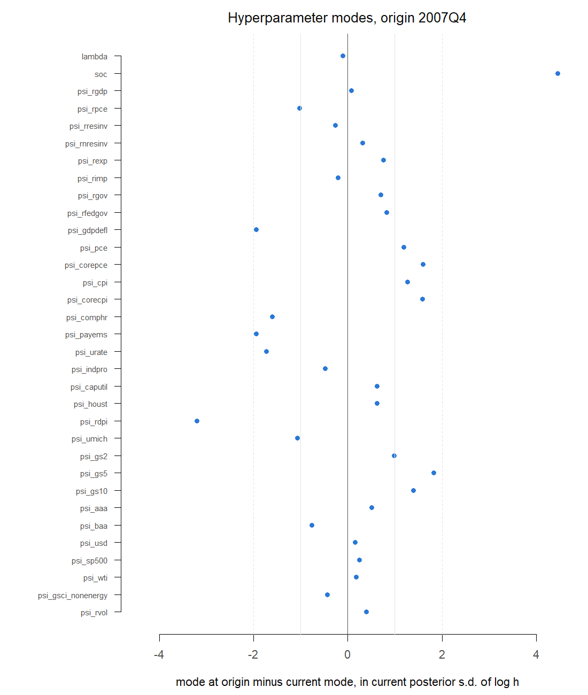
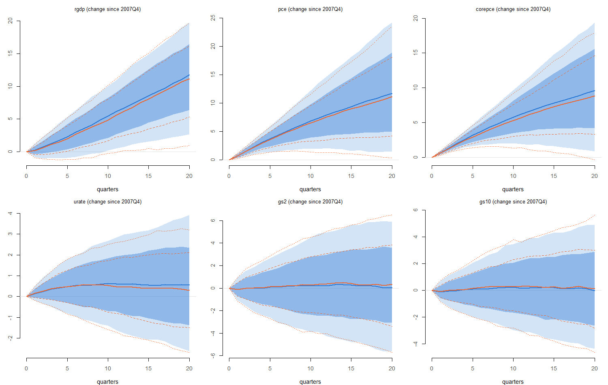
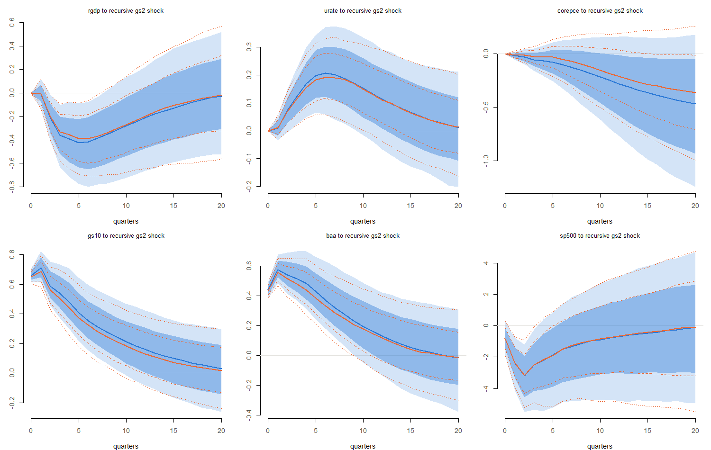
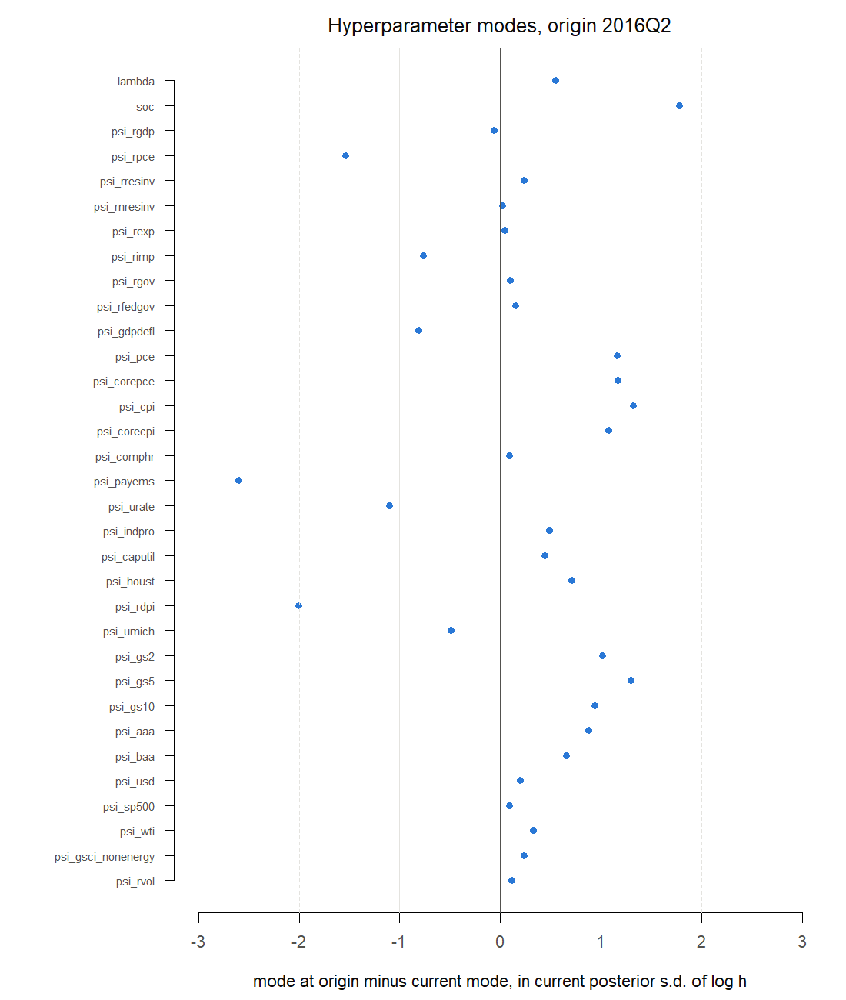
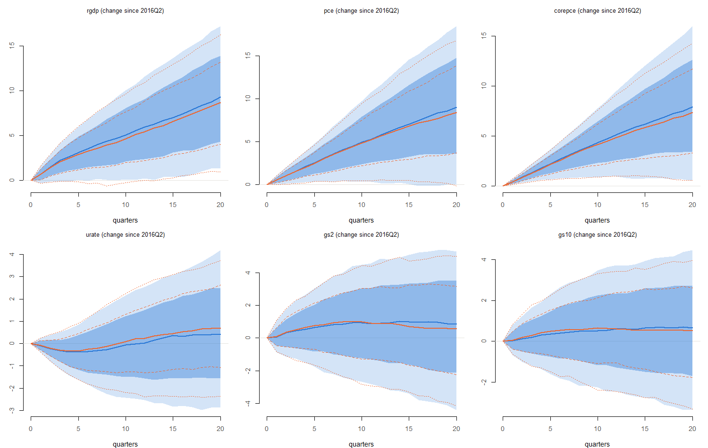
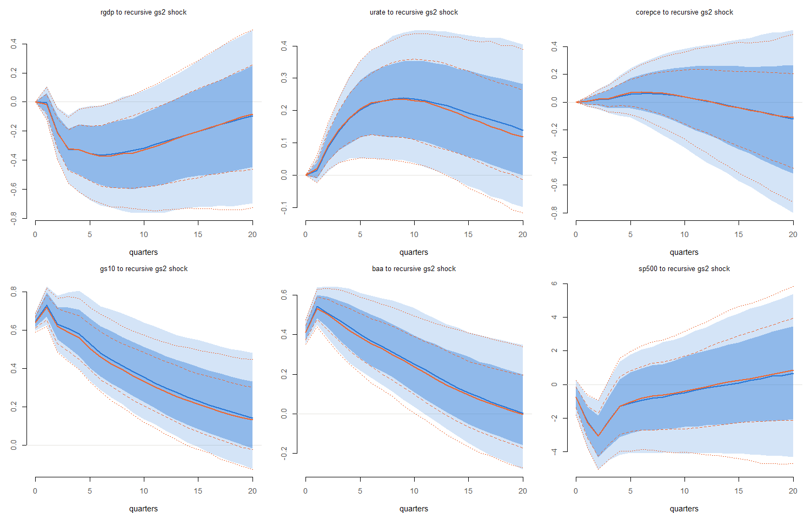
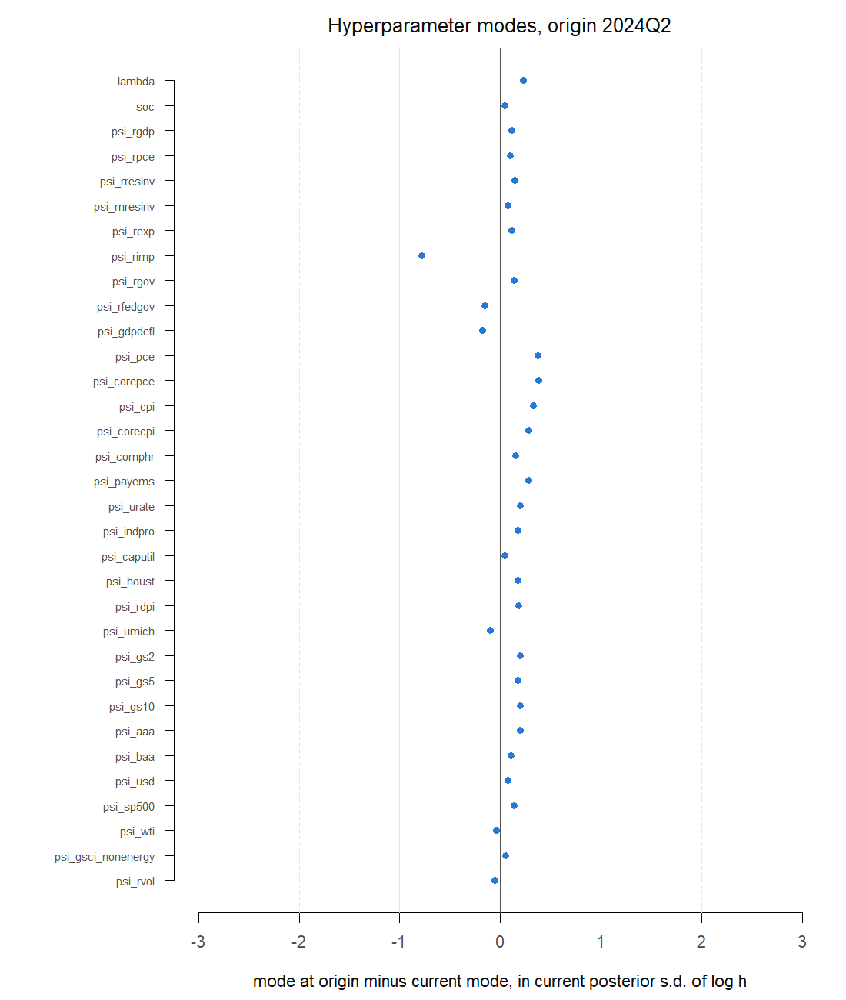
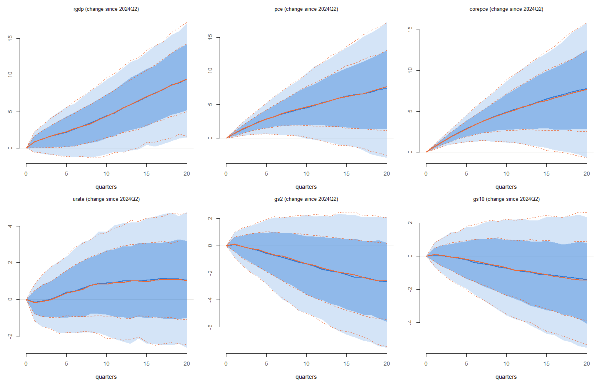
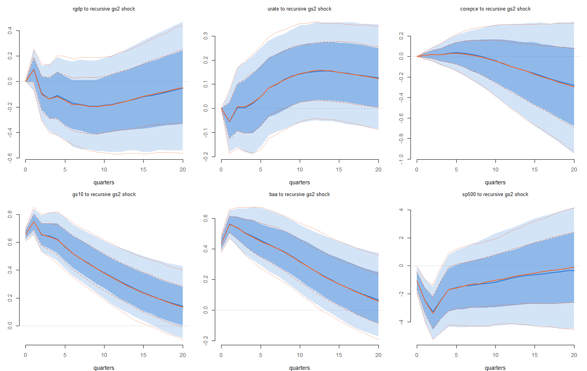

# Hyperparameter stability across origins

**Model:** COVID method `none`, 31 variables, 5 lags, the prior of `config/run.yml`. **Current run:** 2026m09_none_full_545b70ff (sample 1973Q1–2026Q2). **Origins run:** 2007Q4, 2016Q2, 2024Q2.

**Why.** Forecasts from past origins need the model estimated on the data available at each origin. Crump et al. (2021, Section 2.4) re-estimate everything at every origin, hyperparameters included. That costs a mode search and a Metropolis run per origin. If the hyperparameters estimated on a shorter sample are close to the current ones, and fixing them at the current values leaves forecasts and impulse responses unchanged, the current hyperparameters can be reused and only the coefficients redrawn.

**What is computed at each origin.**

1.  The sample is cut at the origin (1973Q1 to the origin quarter).

2.  The mode of the hyperparameter posterior p(θ \| Y) is found on that sample (θ = log h; three starts, as in production), and the Hessian at the mode gives the normal approximation to the posterior, with approximate standard deviations. No Metropolis run.

3.  **Modes compared.** For each hyperparameter, the origin’s mode minus the current mode, on the log scale (0.1 ≈ 10% higher), and the same shift in units of the current posterior s.d. of log h (from the current run’s 1,000 MCMC draws) and of the origin’s approximate s.d. The mode says where each posterior is centred; the s.d. is the yardstick for how far apart two centres are.

4.  **Results compared.** On the origin’s sample, 1000 draws of (B, Σ) are taken given the current mode and given the origin’s mode, with the same random numbers, so the two differ only through the hyperparameters. Both sides use a mode, not the full hyperparameter posterior. Compared: unconditional forecasts from the origin (with shocks) and impulse responses (recursive gs2 shock, GIRF of rgdp), up to 20 quarters; quarters 1–12 are the main window. Measures: the difference of medians as a share of the current-mode 90% band width, and the ratio of band widths (origin mode / current mode).

5.  **Noise level.** The current-mode draws are repeated with other random numbers. The same two measures between the two current-mode runs show how large the measures get from simulation noise alone. A difference is meaningful only if it clearly exceeds this.

6.  **In growth rates and percentage points.** Bands of a BVAR are wide, so a change can be small against the band and still matter (half a point of GDP growth). The same draws are therefore also compared in the units forecasts are quoted in, path by path: year-on-year growth (log approximation, 100 × (log y_h − log y\_{h−4})) and quarter-on-quarter annualized growth (4 × the quarterly log change) for log series, the level in percentage points (or index points) for rates and indexes. For impulse responses, the effect on year-on-year growth (r_h − r\_{h−4}) for log series and the level response for the others. Each change is then read against the variable’s own history (1973Q1–2019Q4, before the 2020–21 swings): the standard deviation and the 10–90 percentile range of its year-on-year growth (log series) or 4-quarter change (rates), or of its QoQ annualized growth for the quarterly measure.

| variable | measure          |   sd |   p10 |  p90 | qoq_sd |
|:---------|:-----------------|-----:|------:|-----:|-------:|
| rgdp     | YoY growth, %    | 2.06 |  0.00 | 4.71 |   3.03 |
| pce      | YoY growth, %    | 2.51 |  1.18 | 7.35 |   2.75 |
| corepce  | YoY growth, %    | 2.22 |  1.39 | 6.68 |   2.29 |
| urate    | 4-quarter change | 1.09 | -0.97 | 1.49 |     NA |
| gs2      | 4-quarter change | 1.52 | -2.07 | 1.64 |     NA |
| gs10     | 4-quarter change | 1.18 | -1.38 | 1.24 |     NA |

*Historical yardstick for the main variables: YoY growth in percent (log series) or 4-quarter change in percentage points (rates); `qoq_sd`: s.d. of QoQ annualized growth.*

There is no pass/fail threshold. Read together with the prior sensitivity check (how much the results respond to moving λ and µ), the result is that exercises at past origins re-estimate the hyperparameters (`docs/methodology.md`, section 14).

# Origin 2007Q4

Sample 1973Q1 to 2007Q4 (140 quarters). Mode search 1.4 min (starts in parallel); Hessian 3.7 min. Smallest eigenvalue of −H: 11.2 (positive: the mode is a maximum).

## Mode search

| start_factor | convergence | message | log_post_theta | lambda | soc |
|---:|---:|:---|---:|---:|---:|
| 1.0 | 0 | CONVERGENCE: REL_REDUCTION_OF_F \<= FACTR\*EPSMCH | -5568.453 | 0.3984 | 0.4687 |
| 0.5 | 0 | CONVERGENCE: REL_REDUCTION_OF_F \<= FACTR\*EPSMCH | -5568.453 | 0.3984 | 0.4687 |
| 2.0 | 0 | CONVERGENCE: REL_REDUCTION_OF_F \<= FACTR\*EPSMCH | -5568.453 | 0.3984 | 0.4687 |

Convergence code 0 means the optimizer met its tolerance. The best start (highest log p(θ \| Y)) is used.

## Hyperparameter modes

| hyperparameter | mode_now | mode_past | log_ratio | sd_now_mcmc | sd_past_hessian | shift_in_sd_now | shift_in_sd_past |
|:---|---:|---:|---:|---:|---:|---:|---:|
| lambda | 0.401 | 0.398 | -0.006 | 0.060 | 0.071 | -0.103 | -0.087 |
| soc | 0.279 | 0.469 | 0.518 | 0.116 | 0.158 | 4.454 | 3.283 |

*λ (overall tightness) and µ (`soc`, sum-of-coefficients tightness). `log_ratio` = log(mode at origin / current mode). s.d. of log h: current from the MCMC draws, origin from the Hessian.*

ψ (prior scale of each variable’s residual variance): \|shift\| in current s.d.: median 0.76, largest 3.21 (psi_rdpi); 1 of 31 beyond 2 s.d. Modes within 1% of a search bound at the origin: 0.

| hyperparameter | mode_now | mode_past | log_ratio | shift_in_sd_now | shift_in_sd_past |
|:---------------|---------:|----------:|----------:|----------------:|-----------------:|
| psi_rdpi       |   44.728 |    21.362 |    -0.739 |          -3.207 |           -3.347 |
| psi_payems     |    1.423 |     0.918 |    -0.439 |          -1.944 |           -1.837 |
| psi_gdpdefl    |    1.265 |     0.863 |    -0.382 |          -1.940 |           -1.819 |
| psi_gs5        |    0.444 |     0.600 |     0.303 |           1.826 |            1.545 |
| psi_urate      |    1.066 |     0.757 |    -0.342 |          -1.724 |           -1.601 |
| psi_comphr     |   24.194 |    17.467 |    -0.326 |          -1.608 |           -1.556 |
| psi_corepce    |    0.367 |     0.497 |     0.303 |           1.601 |            1.428 |
| psi_corecpi    |    0.855 |     1.180 |     0.322 |           1.588 |            1.445 |

*The eight ψ with the largest shifts.*

## Forecasts from the origin

| variable | horizons | max_abs_median_diff | width_ratio_min | width_ratio_max | seed_max_abs_median_diff | seed_width_ratio_min | seed_width_ratio_max |
|:---|:---|---:|---:|---:|---:|---:|---:|
| rgdp | 1-12 | 0.06 | 1.00 | 1.08 | 0.06 | 0.95 | 1.06 |
| rgdp | 13-20 | 0.05 | 1.09 | 1.13 | 0.03 | 0.94 | 1.01 |
| pce | 1-12 | 0.04 | 0.95 | 1.08 | 0.03 | 0.93 | 1.00 |
| pce | 13-20 | 0.03 | 0.98 | 1.02 | 0.02 | 0.96 | 1.02 |
| corepce | 1-12 | 0.08 | 0.99 | 1.03 | 0.03 | 0.91 | 1.00 |
| corepce | 13-20 | 0.05 | 0.98 | 1.02 | 0.02 | 1.01 | 1.05 |
| urate | 1-12 | 0.03 | 0.95 | 1.02 | 0.04 | 0.98 | 1.07 |
| urate | 13-20 | 0.04 | 0.90 | 1.00 | 0.03 | 1.04 | 1.08 |
| gs2 | 1-12 | 0.02 | 0.99 | 1.09 | 0.02 | 0.97 | 1.05 |
| gs2 | 13-20 | 0.03 | 0.99 | 1.06 | 0.02 | 0.95 | 1.03 |
| gs10 | 1-12 | 0.03 | 0.98 | 1.09 | 0.03 | 0.93 | 1.09 |
| gs10 | 13-20 | 0.02 | 1.02 | 1.11 | 0.02 | 0.99 | 1.04 |

*Main variables. `max_abs_median_diff`: largest \|difference of medians\| over the quarters of the window, as a share of the current-mode 90% band width. `width_ratio`: band width under the origin’s mode over the current mode’s. `seed_*`: the same measures for the current mode with other random numbers (noise level).*

All 31 variables, quarters 1–12: largest \|median difference\| 0.11 of the band width (gsci_nonenergy); noise level 0.06. Width ratios 0.86–1.15 (noise 0.91–1.11).

## Impulse responses

| variable | horizons | max_abs_median_diff | width_ratio_min | width_ratio_max | seed_max_abs_median_diff | seed_width_ratio_min | seed_width_ratio_max |
|:---|:---|---:|---:|---:|---:|---:|---:|
| rgdp | 0-12 | 0.06 | 0.89 | 1.02 | 0.01 | 0.88 | 0.97 |
| rgdp | 13-20 | 0.03 | 1.02 | 1.10 | 0.01 | 0.96 | 1.04 |
| corepce | 0-12 | 0.14 | 0.87 | 1.04 | 0.02 | 0.93 | 0.98 |
| corepce | 13-20 | 0.08 | 0.87 | 0.88 | 0.02 | 0.92 | 0.95 |
| urate | 0-12 | 0.06 | 0.85 | 0.99 | 0.03 | 0.91 | 1.10 |
| urate | 13-20 | 0.01 | 0.88 | 0.92 | 0.02 | 0.94 | 0.98 |
| gs10 | 0-12 | 0.11 | 0.93 | 1.04 | 0.02 | 0.98 | 1.08 |
| gs10 | 13-20 | 0.05 | 0.94 | 0.96 | 0.02 | 0.96 | 1.00 |
| baa | 0-12 | 0.12 | 0.91 | 0.98 | 0.03 | 0.98 | 1.04 |
| baa | 13-20 | 0.02 | 0.88 | 0.93 | 0.03 | 0.94 | 0.98 |
| sp500 | 0-12 | 0.01 | 0.95 | 1.02 | 0.04 | 0.96 | 1.02 |
| sp500 | 13-20 | 0.01 | 1.01 | 1.07 | 0.01 | 0.95 | 1.01 |

*Recursive gs2 shock (+1 pp), selected responses. Slow variables are zero on impact by construction, so impact is left out for them.*

| variable | horizons | max_abs_median_diff | width_ratio_min | width_ratio_max | seed_max_abs_median_diff | seed_width_ratio_min | seed_width_ratio_max |
|:---|:---|---:|---:|---:|---:|---:|---:|
| corepce | 0-12 | 0.14 | 0.86 | 1.01 | 0.03 | 0.96 | 1.00 |
| corepce | 13-20 | 0.14 | 0.82 | 0.88 | 0.02 | 0.93 | 1.00 |
| payems | 0-12 | 0.31 | 0.90 | 0.97 | 0.05 | 0.98 | 1.03 |
| payems | 13-20 | 0.31 | 0.88 | 0.93 | 0.02 | 0.96 | 1.01 |
| urate | 0-12 | 0.28 | 0.85 | 0.97 | 0.04 | 0.99 | 1.08 |
| urate | 13-20 | 0.28 | 0.81 | 0.84 | 0.01 | 0.94 | 0.98 |
| gs2 | 0-12 | 0.27 | 0.98 | 1.04 | 0.03 | 1.00 | 1.05 |
| gs2 | 13-20 | 0.28 | 0.92 | 1.01 | 0.02 | 0.96 | 1.01 |

*GIRF of real GDP (+1 log point), selected responses.*

## In growth rates and percentage points

| variable | horizons | max_abs_diff | max_abs_noise | diff_in_sd | diff_in_range | noise_in_sd |
|:---|:---|---:|---:|---:|---:|---:|
| rgdp | 1-12 | 0.306 | 0.293 | 0.148 | 0.065 | 0.142 |
| rgdp | 13-20 | 0.202 | 0.121 | 0.098 | 0.043 | 0.059 |
| pce | 1-12 | 0.217 | 0.117 | 0.087 | 0.035 | 0.047 |
| pce | 13-20 | 0.188 | 0.121 | 0.075 | 0.030 | 0.048 |
| corepce | 1-12 | 0.242 | 0.081 | 0.109 | 0.046 | 0.036 |
| corepce | 13-20 | 0.286 | 0.115 | 0.129 | 0.054 | 0.052 |
| urate | 1-12 | 0.145 | 0.114 | 0.134 | 0.059 | 0.105 |
| urate | 13-20 | 0.242 | 0.137 | 0.223 | 0.099 | 0.126 |
| gs2 | 1-12 | 0.191 | 0.197 | 0.125 | 0.051 | 0.129 |
| gs2 | 13-20 | 0.317 | 0.208 | 0.208 | 0.086 | 0.137 |
| gs10 | 1-12 | 0.154 | 0.201 | 0.130 | 0.059 | 0.170 |
| gs10 | 13-20 | 0.171 | 0.175 | 0.145 | 0.065 | 0.147 |

*Forecasts, main variables. `max_abs_diff`: largest \|difference of medians\| over the window (origin’s mode minus current mode), in YoY growth (%) for log series and level (pp) for rates; `max_abs_noise`: the same between two runs at the current mode with different random numbers. `diff_in_sd`, `diff_in_range`: `max_abs_diff` over the variable’s historical s.d. and 10–90 range; `noise_in_sd`: the noise in the same units.*

| variable | horizons | max_abs_diff | max_abs_noise | diff_in_sd | diff_in_range | noise_in_sd |
|:---|:---|---:|---:|---:|---:|---:|
| rgdp | 1-12 | 0.254 | 0.421 | 0.084 | 0.035 | 0.139 |
| pce | 1-12 | 0.207 | 0.190 | 0.075 | 0.032 | 0.069 |
| corepce | 1-12 | 0.307 | 0.170 | 0.134 | 0.056 | 0.074 |

*QoQ annualized growth, log series among the main variables, quarters 1–12.*

| variable | horizons | max_abs_diff | max_abs_noise | diff_in_sd | diff_in_range | noise_in_sd |
|:---|:---|---:|---:|---:|---:|---:|
| caputil | 1-12 | 0.822 | 0.303 | 0.222 | 0.098 | 0.082 |
| umich | 1-12 | 2.021 | 0.813 | 0.212 | 0.086 | 0.085 |
| gsci_nonenergy | 1-12 | 2.946 | 0.921 | 0.208 | 0.079 | 0.065 |
| rresinv | 1-12 | 2.461 | 1.129 | 0.182 | 0.073 | 0.084 |
| rvol | 1-12 | 1.840 | 1.044 | 0.182 | 0.111 | 0.103 |
| houst | 1-12 | 3.488 | 2.173 | 0.164 | 0.067 | 0.102 |
| corecpi | 1-12 | 0.405 | 0.074 | 0.157 | 0.064 | 0.029 |
| sp500 | 1-12 | 2.399 | 1.571 | 0.154 | 0.064 | 0.101 |

*All 31 variables, quarters 1–12: the eight with the largest change relative to their history. Variables whose change exceeds the noise: 26 of 31.*

| variable | horizons | max_abs_diff | max_abs_noise | diff_in_sd | diff_in_range | noise_in_sd |
|:---|:---|---:|---:|---:|---:|---:|
| rgdp | 0-12 | 0.037 | 0.010 | 0.018 | 0.008 | 0.005 |
| rgdp | 13-20 | 0.016 | 0.005 | 0.008 | 0.003 | 0.003 |
| corepce | 0-12 | 0.039 | 0.005 | 0.018 | 0.007 | 0.002 |
| corepce | 13-20 | 0.019 | 0.006 | 0.009 | 0.004 | 0.003 |
| urate | 0-12 | 0.015 | 0.006 | 0.014 | 0.006 | 0.006 |
| urate | 13-20 | 0.003 | 0.006 | 0.002 | 0.001 | 0.006 |
| gs10 | 0-12 | 0.039 | 0.012 | 0.033 | 0.015 | 0.010 |
| gs10 | 13-20 | 0.028 | 0.009 | 0.024 | 0.011 | 0.008 |
| baa | 0-12 | 0.045 | 0.017 | 0.039 | 0.018 | 0.015 |
| baa | 13-20 | 0.011 | 0.020 | 0.010 | 0.004 | 0.017 |
| sp500 | 0-12 | 0.080 | 0.199 | 0.005 | 0.002 | 0.013 |
| sp500 | 13-20 | 0.033 | 0.052 | 0.002 | 0.001 | 0.003 |

*Recursive gs2 shock (+1 pp): effect on YoY growth (log series) or level (rates), per 1 pp shock.*

## Largest companion root

| hyperparameters | median | share_above_1 |    max |
|:----------------|-------:|--------------:|-------:|
| current mode    | 1.0157 |             1 | 1.0579 |
| origin’s mode   | 1.0198 |             1 | 1.0615 |

# Origin 2016Q2

Sample 1973Q1 to 2016Q2 (174 quarters). Mode search 4.6 min (starts in parallel); Hessian 10.9 min. Smallest eigenvalue of −H: 14.3 (positive: the mode is a maximum).

## Mode search

| start_factor | convergence | message | log_post_theta | lambda | soc |
|---:|---:|:---|---:|---:|---:|
| 1.0 | 0 | CONVERGENCE: REL_REDUCTION_OF_F \<= FACTR\*EPSMCH | -6861.849 | 0.4143 | 0.3435 |
| 0.5 | 0 | CONVERGENCE: REL_REDUCTION_OF_F \<= FACTR\*EPSMCH | -6861.849 | 0.4143 | 0.3434 |
| 2.0 | 0 | CONVERGENCE: REL_REDUCTION_OF_F \<= FACTR\*EPSMCH | -6861.849 | 0.4143 | 0.3433 |

Convergence code 0 means the optimizer met its tolerance. The best start (highest log p(θ \| Y)) is used.

## Hyperparameter modes

| hyperparameter | mode_now | mode_past | log_ratio | sd_now_mcmc | sd_past_hessian | shift_in_sd_now | shift_in_sd_past |
|:---|---:|---:|---:|---:|---:|---:|---:|
| lambda | 0.401 | 0.414 | 0.033 | 0.060 | 0.063 | 0.548 | 0.525 |
| soc | 0.279 | 0.343 | 0.207 | 0.116 | 0.123 | 1.777 | 1.684 |

*λ (overall tightness) and µ (`soc`, sum-of-coefficients tightness). `log_ratio` = log(mode at origin / current mode). s.d. of log h: current from the MCMC draws, origin from the Hessian.*

ψ (prior scale of each variable’s residual variance): \|shift\| in current s.d.: median 0.66, largest 2.6 (psi_payems); 2 of 31 beyond 2 s.d. Modes within 1% of a search bound at the origin: 0.

| hyperparameter | mode_now | mode_past | log_ratio | shift_in_sd_now | shift_in_sd_past |
|:---------------|---------:|----------:|----------:|----------------:|-----------------:|
| psi_payems     |    1.423 |     0.791 |    -0.587 |          -2.603 |           -2.624 |
| psi_rdpi       |   44.728 |    28.177 |    -0.462 |          -2.005 |           -2.106 |
| psi_rpce       |    9.189 |     6.759 |    -0.307 |          -1.535 |           -1.386 |
| psi_cpi        |    0.803 |     1.025 |     0.244 |           1.322 |            1.260 |
| psi_gs5        |    0.444 |     0.550 |     0.215 |           1.297 |            1.171 |
| psi_corepce    |    0.367 |     0.458 |     0.221 |           1.167 |            1.115 |
| psi_pce        |    0.351 |     0.434 |     0.213 |           1.156 |            1.114 |
| psi_urate      |    1.066 |     0.856 |    -0.219 |          -1.100 |           -1.070 |

*The eight ψ with the largest shifts.*

## Forecasts from the origin

| variable | horizons | max_abs_median_diff | width_ratio_min | width_ratio_max | seed_max_abs_median_diff | seed_width_ratio_min | seed_width_ratio_max |
|:---|:---|---:|---:|---:|---:|---:|---:|
| rgdp | 1-12 | 0.05 | 0.96 | 1.08 | 0.06 | 0.92 | 1.02 |
| rgdp | 13-20 | 0.05 | 0.93 | 0.97 | 0.03 | 0.90 | 0.96 |
| pce | 1-12 | 0.02 | 0.90 | 1.03 | 0.03 | 0.94 | 1.01 |
| pce | 13-20 | 0.04 | 0.90 | 0.93 | 0.01 | 0.94 | 0.99 |
| corepce | 1-12 | 0.05 | 0.95 | 1.02 | 0.02 | 0.92 | 0.99 |
| corepce | 13-20 | 0.04 | 0.89 | 0.91 | 0.02 | 0.96 | 1.02 |
| urate | 1-12 | 0.05 | 0.95 | 1.02 | 0.03 | 0.95 | 1.08 |
| urate | 13-20 | 0.04 | 0.86 | 0.96 | 0.03 | 0.95 | 1.01 |
| gs2 | 1-12 | 0.03 | 0.96 | 1.04 | 0.04 | 0.94 | 1.01 |
| gs2 | 13-20 | 0.05 | 0.92 | 0.99 | 0.03 | 0.94 | 1.01 |
| gs10 | 1-12 | 0.04 | 0.93 | 1.06 | 0.04 | 0.92 | 0.99 |
| gs10 | 13-20 | 0.02 | 0.91 | 0.96 | 0.02 | 0.94 | 1.01 |

*Main variables. `max_abs_median_diff`: largest \|difference of medians\| over the quarters of the window, as a share of the current-mode 90% band width. `width_ratio`: band width under the origin’s mode over the current mode’s. `seed_*`: the same measures for the current mode with other random numbers (noise level).*

All 31 variables, quarters 1–12: largest \|median difference\| 0.06 of the band width (caputil); noise level 0.06. Width ratios 0.88–1.08 (noise 0.89–1.09).

## Impulse responses

| variable | horizons | max_abs_median_diff | width_ratio_min | width_ratio_max | seed_max_abs_median_diff | seed_width_ratio_min | seed_width_ratio_max |
|:---|:---|---:|---:|---:|---:|---:|---:|
| rgdp | 0-12 | 0.05 | 0.95 | 0.99 | 0.02 | 0.98 | 1.08 |
| rgdp | 13-20 | 0.01 | 1.01 | 1.03 | 0.02 | 0.96 | 1.03 |
| corepce | 0-12 | 0.03 | 0.86 | 0.98 | 0.02 | 0.91 | 1.01 |
| corepce | 13-20 | 0.01 | 0.90 | 0.93 | 0.01 | 0.93 | 1.00 |
| urate | 0-12 | 0.08 | 0.97 | 1.06 | 0.03 | 0.97 | 1.09 |
| urate | 13-20 | 0.05 | 0.97 | 1.01 | 0.02 | 0.92 | 0.97 |
| gs10 | 0-12 | 0.07 | 0.88 | 1.01 | 0.03 | 0.87 | 1.04 |
| gs10 | 13-20 | 0.04 | 0.92 | 0.95 | 0.01 | 0.89 | 0.91 |
| baa | 0-12 | 0.05 | 0.95 | 1.01 | 0.03 | 0.91 | 1.07 |
| baa | 13-20 | 0.03 | 0.97 | 1.03 | 0.02 | 0.91 | 0.95 |
| sp500 | 0-12 | 0.02 | 0.98 | 1.05 | 0.03 | 1.02 | 1.09 |
| sp500 | 13-20 | 0.02 | 1.07 | 1.10 | 0.03 | 1.01 | 1.05 |

*Recursive gs2 shock (+1 pp), selected responses. Slow variables are zero on impact by construction, so impact is left out for them.*

| variable | horizons | max_abs_median_diff | width_ratio_min | width_ratio_max | seed_max_abs_median_diff | seed_width_ratio_min | seed_width_ratio_max |
|:---|:---|---:|---:|---:|---:|---:|---:|
| corepce | 0-12 | 0.07 | 0.96 | 1.03 | 0.01 | 0.98 | 1.05 |
| corepce | 13-20 | 0.07 | 0.93 | 0.95 | 0.01 | 0.97 | 1.00 |
| payems | 0-12 | 0.11 | 0.93 | 1.08 | 0.03 | 0.96 | 1.07 |
| payems | 13-20 | 0.12 | 1.00 | 1.07 | 0.02 | 0.98 | 1.06 |
| urate | 0-12 | 0.07 | 0.96 | 1.02 | 0.03 | 0.96 | 1.01 |
| urate | 13-20 | 0.10 | 0.94 | 1.01 | 0.01 | 0.99 | 1.05 |
| gs2 | 0-12 | 0.05 | 0.94 | 1.07 | 0.03 | 0.97 | 1.04 |
| gs2 | 13-20 | 0.09 | 0.93 | 0.99 | 0.04 | 0.94 | 1.00 |

*GIRF of real GDP (+1 log point), selected responses.*

## In growth rates and percentage points

| variable | horizons | max_abs_diff | max_abs_noise | diff_in_sd | diff_in_range | noise_in_sd |
|:---|:---|---:|---:|---:|---:|---:|
| rgdp | 1-12 | 0.289 | 0.204 | 0.141 | 0.062 | 0.099 |
| rgdp | 13-20 | 0.153 | 0.118 | 0.074 | 0.033 | 0.057 |
| pce | 1-12 | 0.082 | 0.128 | 0.033 | 0.013 | 0.051 |
| pce | 13-20 | 0.154 | 0.154 | 0.061 | 0.025 | 0.062 |
| corepce | 1-12 | 0.096 | 0.088 | 0.043 | 0.018 | 0.040 |
| corepce | 13-20 | 0.138 | 0.100 | 0.062 | 0.026 | 0.045 |
| urate | 1-12 | 0.244 | 0.076 | 0.225 | 0.099 | 0.070 |
| urate | 13-20 | 0.284 | 0.189 | 0.262 | 0.116 | 0.174 |
| gs2 | 1-12 | 0.137 | 0.200 | 0.090 | 0.037 | 0.131 |
| gs2 | 13-20 | 0.427 | 0.233 | 0.281 | 0.115 | 0.153 |
| gs10 | 1-12 | 0.147 | 0.177 | 0.124 | 0.056 | 0.149 |
| gs10 | 13-20 | 0.146 | 0.168 | 0.124 | 0.056 | 0.142 |

*Forecasts, main variables. `max_abs_diff`: largest \|difference of medians\| over the window (origin’s mode minus current mode), in YoY growth (%) for log series and level (pp) for rates; `max_abs_noise`: the same between two runs at the current mode with different random numbers. `diff_in_sd`, `diff_in_range`: `max_abs_diff` over the variable’s historical s.d. and 10–90 range; `noise_in_sd`: the noise in the same units.*

| variable | horizons | max_abs_diff | max_abs_noise | diff_in_sd | diff_in_range | noise_in_sd |
|:---|:---|---:|---:|---:|---:|---:|
| rgdp | 1-12 | 0.303 | 0.459 | 0.100 | 0.042 | 0.151 |
| pce | 1-12 | 0.223 | 0.179 | 0.081 | 0.034 | 0.065 |
| corepce | 1-12 | 0.138 | 0.086 | 0.060 | 0.025 | 0.037 |

*QoQ annualized growth, log series among the main variables, quarters 1–12.*

| variable | horizons | max_abs_diff | max_abs_noise | diff_in_sd | diff_in_range | noise_in_sd |
|:---|:---|---:|---:|---:|---:|---:|
| urate | 1-12 | 0.244 | 0.076 | 0.225 | 0.099 | 0.070 |
| caputil | 1-12 | 0.778 | 0.293 | 0.210 | 0.093 | 0.079 |
| aaa | 1-12 | 0.180 | 0.185 | 0.180 | 0.080 | 0.185 |
| baa | 1-12 | 0.164 | 0.167 | 0.141 | 0.064 | 0.145 |
| rgdp | 1-12 | 0.289 | 0.204 | 0.141 | 0.062 | 0.099 |
| gs10 | 1-12 | 0.147 | 0.177 | 0.124 | 0.056 | 0.149 |
| payems | 1-12 | 0.223 | 0.130 | 0.123 | 0.052 | 0.072 |
| indpro | 1-12 | 0.483 | 0.311 | 0.110 | 0.047 | 0.070 |

*All 31 variables, quarters 1–12: the eight with the largest change relative to their history. Variables whose change exceeds the noise: 14 of 31.*

| variable | horizons | max_abs_diff | max_abs_noise | diff_in_sd | diff_in_range | noise_in_sd |
|:---|:---|---:|---:|---:|---:|---:|
| rgdp | 0-12 | 0.012 | 0.013 | 0.006 | 0.003 | 0.006 |
| rgdp | 13-20 | 0.010 | 0.012 | 0.005 | 0.002 | 0.006 |
| corepce | 0-12 | 0.009 | 0.006 | 0.004 | 0.002 | 0.003 |
| corepce | 13-20 | 0.007 | 0.007 | 0.003 | 0.001 | 0.003 |
| urate | 0-12 | 0.007 | 0.011 | 0.006 | 0.003 | 0.010 |
| urate | 13-20 | 0.024 | 0.008 | 0.022 | 0.010 | 0.008 |
| gs10 | 0-12 | 0.026 | 0.012 | 0.022 | 0.010 | 0.010 |
| gs10 | 13-20 | 0.021 | 0.004 | 0.017 | 0.008 | 0.004 |
| baa | 0-12 | 0.017 | 0.009 | 0.015 | 0.007 | 0.008 |
| baa | 13-20 | 0.014 | 0.011 | 0.012 | 0.006 | 0.010 |
| sp500 | 0-12 | 0.080 | 0.095 | 0.005 | 0.002 | 0.006 |
| sp500 | 13-20 | 0.044 | 0.091 | 0.003 | 0.001 | 0.006 |

*Recursive gs2 shock (+1 pp): effect on YoY growth (log series) or level (rates), per 1 pp shock.*

## Largest companion root

| hyperparameters | median | share_above_1 |    max |
|:----------------|-------:|--------------:|-------:|
| current mode    | 1.0124 |             1 | 1.0446 |
| origin’s mode   | 1.0138 |             1 | 1.0561 |

# Origin 2024Q2

Sample 1973Q1 to 2024Q2 (206 quarters). Mode search 7 min (starts in parallel); Hessian 3.2 min. Smallest eigenvalue of −H: 14.1 (positive: the mode is a maximum).

## Mode search

| start_factor | convergence | message | log_post_theta | lambda | soc |
|---:|---:|:---|---:|---:|---:|
| 1.0 | 0 | CONVERGENCE: REL_REDUCTION_OF_F \<= FACTR\*EPSMCH | -8373.844 | 0.4063 | 0.2808 |
| 0.5 | 0 | CONVERGENCE: REL_REDUCTION_OF_F \<= FACTR\*EPSMCH | -8373.844 | 0.4063 | 0.2808 |
| 2.0 | 0 | CONVERGENCE: REL_REDUCTION_OF_F \<= FACTR\*EPSMCH | -8373.844 | 0.4063 | 0.2807 |

Convergence code 0 means the optimizer met its tolerance. The best start (highest log p(θ \| Y)) is used.

## Hyperparameter modes

| hyperparameter | mode_now | mode_past | log_ratio | sd_now_mcmc | sd_past_hessian | shift_in_sd_now | shift_in_sd_past |
|:---|---:|---:|---:|---:|---:|---:|---:|
| lambda | 0.401 | 0.406 | 0.013 | 0.060 | 0.060 | 0.224 | 0.226 |
| soc | 0.279 | 0.281 | 0.005 | 0.116 | 0.119 | 0.046 | 0.044 |

*λ (overall tightness) and µ (`soc`, sum-of-coefficients tightness). `log_ratio` = log(mode at origin / current mode). s.d. of log h: current from the MCMC draws, origin from the Hessian.*

ψ (prior scale of each variable’s residual variance): \|shift\| in current s.d.: median 0.15, largest 0.78 (psi_rimp); 0 of 31 beyond 2 s.d. Modes within 1% of a search bound at the origin: 0.

| hyperparameter | mode_now | mode_past | log_ratio | shift_in_sd_now | shift_in_sd_past |
|:---------------|---------:|----------:|----------:|----------------:|-----------------:|
| psi_rimp       |  156.145 |   132.732 |    -0.162 |          -0.778 |           -0.786 |
| psi_corepce    |    0.367 |     0.395 |     0.072 |           0.380 |            0.371 |
| psi_pce        |    0.351 |     0.376 |     0.069 |           0.372 |            0.372 |
| psi_cpi        |    0.803 |     0.853 |     0.060 |           0.323 |            0.319 |
| psi_corecpi    |    0.855 |     0.905 |     0.057 |           0.283 |            0.275 |
| psi_payems     |    1.423 |     1.516 |     0.064 |           0.282 |            0.297 |
| psi_urate      |    1.066 |     1.108 |     0.039 |           0.199 |            0.200 |
| psi_gs2        |    1.577 |     1.639 |     0.039 |           0.197 |            0.200 |

*The eight ψ with the largest shifts.*

## Forecasts from the origin

| variable | horizons | max_abs_median_diff | width_ratio_min | width_ratio_max | seed_max_abs_median_diff | seed_width_ratio_min | seed_width_ratio_max |
|:---|:---|---:|---:|---:|---:|---:|---:|
| rgdp | 1-12 | 0.01 | 0.95 | 1.05 | 0.05 | 0.93 | 1.00 |
| rgdp | 13-20 | 0.01 | 0.96 | 1.01 | 0.04 | 0.91 | 0.97 |
| pce | 1-12 | 0.01 | 0.96 | 1.02 | 0.04 | 0.97 | 1.02 |
| pce | 13-20 | 0.01 | 0.98 | 1.05 | 0.02 | 0.99 | 1.03 |
| corepce | 1-12 | 0.02 | 0.96 | 1.02 | 0.03 | 0.95 | 1.01 |
| corepce | 13-20 | 0.01 | 1.01 | 1.05 | 0.03 | 1.00 | 1.05 |
| urate | 1-12 | 0.01 | 0.97 | 1.02 | 0.04 | 0.95 | 1.06 |
| urate | 13-20 | 0.01 | 0.96 | 1.02 | 0.04 | 0.92 | 1.04 |
| gs2 | 1-12 | 0.02 | 0.98 | 1.04 | 0.04 | 0.97 | 1.08 |
| gs2 | 13-20 | 0.02 | 0.98 | 1.01 | 0.02 | 0.97 | 1.02 |
| gs10 | 1-12 | 0.02 | 0.97 | 1.04 | 0.06 | 0.92 | 1.04 |
| gs10 | 13-20 | 0.01 | 0.96 | 1.01 | 0.04 | 0.94 | 1.01 |

*Main variables. `max_abs_median_diff`: largest \|difference of medians\| over the quarters of the window, as a share of the current-mode 90% band width. `width_ratio`: band width under the origin’s mode over the current mode’s. `seed_*`: the same measures for the current mode with other random numbers (noise level).*

All 31 variables, quarters 1–12: largest \|median difference\| 0.02 of the band width (corecpi); noise level 0.06. Width ratios 0.95–1.07 (noise 0.89–1.1).

## Impulse responses

| variable | horizons | max_abs_median_diff | width_ratio_min | width_ratio_max | seed_max_abs_median_diff | seed_width_ratio_min | seed_width_ratio_max |
|:---|:---|---:|---:|---:|---:|---:|---:|
| rgdp | 0-12 | 0.02 | 0.95 | 1.06 | 0.05 | 0.95 | 1.03 |
| rgdp | 13-20 | 0.01 | 0.99 | 1.01 | 0.02 | 0.98 | 1.01 |
| corepce | 0-12 | 0.02 | 0.96 | 1.03 | 0.02 | 0.95 | 1.04 |
| corepce | 13-20 | 0.01 | 0.97 | 0.99 | 0.01 | 0.99 | 1.01 |
| urate | 0-12 | 0.02 | 0.99 | 1.07 | 0.03 | 0.93 | 1.04 |
| urate | 13-20 | 0.01 | 0.96 | 0.99 | 0.01 | 1.03 | 1.07 |
| gs10 | 0-12 | 0.02 | 1.00 | 1.07 | 0.03 | 0.94 | 1.09 |
| gs10 | 13-20 | 0.01 | 0.97 | 1.03 | 0.02 | 1.02 | 1.04 |
| baa | 0-12 | 0.02 | 1.00 | 1.07 | 0.02 | 0.96 | 1.07 |
| baa | 13-20 | 0.01 | 1.00 | 1.07 | 0.02 | 0.99 | 1.03 |
| sp500 | 0-12 | 0.02 | 0.92 | 1.02 | 0.02 | 0.96 | 1.06 |
| sp500 | 13-20 | 0.03 | 0.96 | 1.00 | 0.01 | 1.01 | 1.07 |

*Recursive gs2 shock (+1 pp), selected responses. Slow variables are zero on impact by construction, so impact is left out for them.*

| variable | horizons | max_abs_median_diff | width_ratio_min | width_ratio_max | seed_max_abs_median_diff | seed_width_ratio_min | seed_width_ratio_max |
|:---|:---|---:|---:|---:|---:|---:|---:|
| corepce | 0-12 | 0.02 | 0.94 | 1.01 | 0.02 | 0.93 | 1.05 |
| corepce | 13-20 | 0.02 | 0.98 | 1.02 | 0.01 | 1.02 | 1.03 |
| payems | 0-12 | 0.02 | 0.95 | 1.04 | 0.04 | 0.95 | 1.03 |
| payems | 13-20 | 0.01 | 0.96 | 1.04 | 0.04 | 0.98 | 0.99 |
| urate | 0-12 | 0.02 | 0.97 | 1.03 | 0.02 | 0.94 | 1.02 |
| urate | 13-20 | 0.01 | 0.99 | 1.04 | 0.01 | 1.00 | 1.06 |
| gs2 | 0-12 | 0.02 | 1.00 | 1.08 | 0.03 | 0.94 | 1.06 |
| gs2 | 13-20 | 0.01 | 1.03 | 1.10 | 0.03 | 0.97 | 1.08 |

*GIRF of real GDP (+1 log point), selected responses.*

## In growth rates and percentage points

| variable | horizons | max_abs_diff | max_abs_noise | diff_in_sd | diff_in_range | noise_in_sd |
|:---|:---|---:|---:|---:|---:|---:|
| rgdp | 1-12 | 0.051 | 0.196 | 0.025 | 0.011 | 0.095 |
| rgdp | 13-20 | 0.120 | 0.216 | 0.058 | 0.025 | 0.105 |
| pce | 1-12 | 0.055 | 0.155 | 0.022 | 0.009 | 0.062 |
| pce | 13-20 | 0.094 | 0.150 | 0.038 | 0.015 | 0.060 |
| corepce | 1-12 | 0.064 | 0.121 | 0.029 | 0.012 | 0.054 |
| corepce | 13-20 | 0.067 | 0.157 | 0.030 | 0.013 | 0.071 |
| urate | 1-12 | 0.082 | 0.185 | 0.076 | 0.033 | 0.171 |
| urate | 13-20 | 0.070 | 0.264 | 0.065 | 0.029 | 0.243 |
| gs2 | 1-12 | 0.090 | 0.192 | 0.059 | 0.024 | 0.126 |
| gs2 | 13-20 | 0.170 | 0.150 | 0.112 | 0.046 | 0.099 |
| gs10 | 1-12 | 0.083 | 0.265 | 0.070 | 0.032 | 0.223 |
| gs10 | 13-20 | 0.080 | 0.242 | 0.068 | 0.031 | 0.204 |

*Forecasts, main variables. `max_abs_diff`: largest \|difference of medians\| over the window (origin’s mode minus current mode), in YoY growth (%) for log series and level (pp) for rates; `max_abs_noise`: the same between two runs at the current mode with different random numbers. `diff_in_sd`, `diff_in_range`: `max_abs_diff` over the variable’s historical s.d. and 10–90 range; `noise_in_sd`: the noise in the same units.*

| variable | horizons | max_abs_diff | max_abs_noise | diff_in_sd | diff_in_range | noise_in_sd |
|:---|:---|---:|---:|---:|---:|---:|
| rgdp | 1-12 | 0.163 | 0.389 | 0.054 | 0.022 | 0.128 |
| pce | 1-12 | 0.087 | 0.212 | 0.032 | 0.013 | 0.077 |
| corepce | 1-12 | 0.048 | 0.170 | 0.021 | 0.009 | 0.074 |

*QoQ annualized growth, log series among the main variables, quarters 1–12.*

| variable | horizons | max_abs_diff | max_abs_noise | diff_in_sd | diff_in_range | noise_in_sd |
|:---|:---|---:|---:|---:|---:|---:|
| baa | 1-12 | 0.091 | 0.234 | 0.078 | 0.036 | 0.202 |
| rdpi | 1-12 | 0.130 | 0.260 | 0.077 | 0.032 | 0.155 |
| urate | 1-12 | 0.082 | 0.185 | 0.076 | 0.033 | 0.171 |
| gs10 | 1-12 | 0.083 | 0.265 | 0.070 | 0.032 | 0.223 |
| gs5 | 1-12 | 0.086 | 0.223 | 0.065 | 0.028 | 0.167 |
| rpce | 1-12 | 0.105 | 0.273 | 0.061 | 0.023 | 0.158 |
| gs2 | 1-12 | 0.090 | 0.192 | 0.059 | 0.024 | 0.126 |
| gsci_nonenergy | 1-12 | 0.762 | 1.649 | 0.054 | 0.021 | 0.116 |

*All 31 variables, quarters 1–12: the eight with the largest change relative to their history. Variables whose change exceeds the noise: 0 of 31.*

| variable | horizons | max_abs_diff | max_abs_noise | diff_in_sd | diff_in_range | noise_in_sd |
|:---|:---|---:|---:|---:|---:|---:|
| rgdp | 0-12 | 0.010 | 0.028 | 0.005 | 0.002 | 0.013 |
| rgdp | 13-20 | 0.005 | 0.006 | 0.003 | 0.001 | 0.003 |
| corepce | 0-12 | 0.006 | 0.005 | 0.003 | 0.001 | 0.002 |
| corepce | 13-20 | 0.004 | 0.005 | 0.002 | 0.001 | 0.002 |
| urate | 0-12 | 0.005 | 0.011 | 0.005 | 0.002 | 0.010 |
| urate | 13-20 | 0.004 | 0.006 | 0.003 | 0.002 | 0.005 |
| gs10 | 0-12 | 0.005 | 0.007 | 0.004 | 0.002 | 0.006 |
| gs10 | 13-20 | 0.006 | 0.010 | 0.005 | 0.002 | 0.008 |
| baa | 0-12 | 0.006 | 0.007 | 0.005 | 0.002 | 0.006 |
| baa | 13-20 | 0.007 | 0.009 | 0.006 | 0.003 | 0.008 |
| sp500 | 0-12 | 0.088 | 0.051 | 0.006 | 0.002 | 0.003 |
| sp500 | 13-20 | 0.038 | 0.032 | 0.002 | 0.001 | 0.002 |

*Recursive gs2 shock (+1 pp): effect on YoY growth (log series) or level (rates), per 1 pp shock.*

## Largest companion root

| hyperparameters | median | share_above_1 |    max |
|:----------------|-------:|--------------:|-------:|
| current mode    | 1.0111 |             1 | 1.0439 |
| origin’s mode   | 1.0115 |             1 | 1.0378 |

# Caveats

- Both sides use a single hyperparameter vector (a mode), so hyperparameter uncertainty is left out on both. The comparison isolates the effect of where the hyperparameters are centred.
- The data are the latest vintage, not what was available at the origin.
- The origin’s s.d. comes from the normal approximation at the mode (Hessian), not from MCMC draws.
