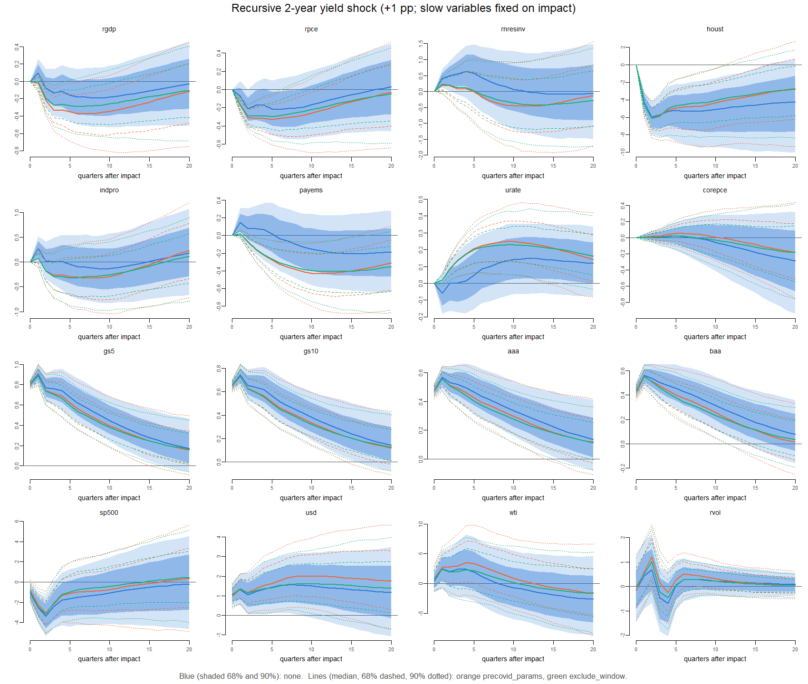
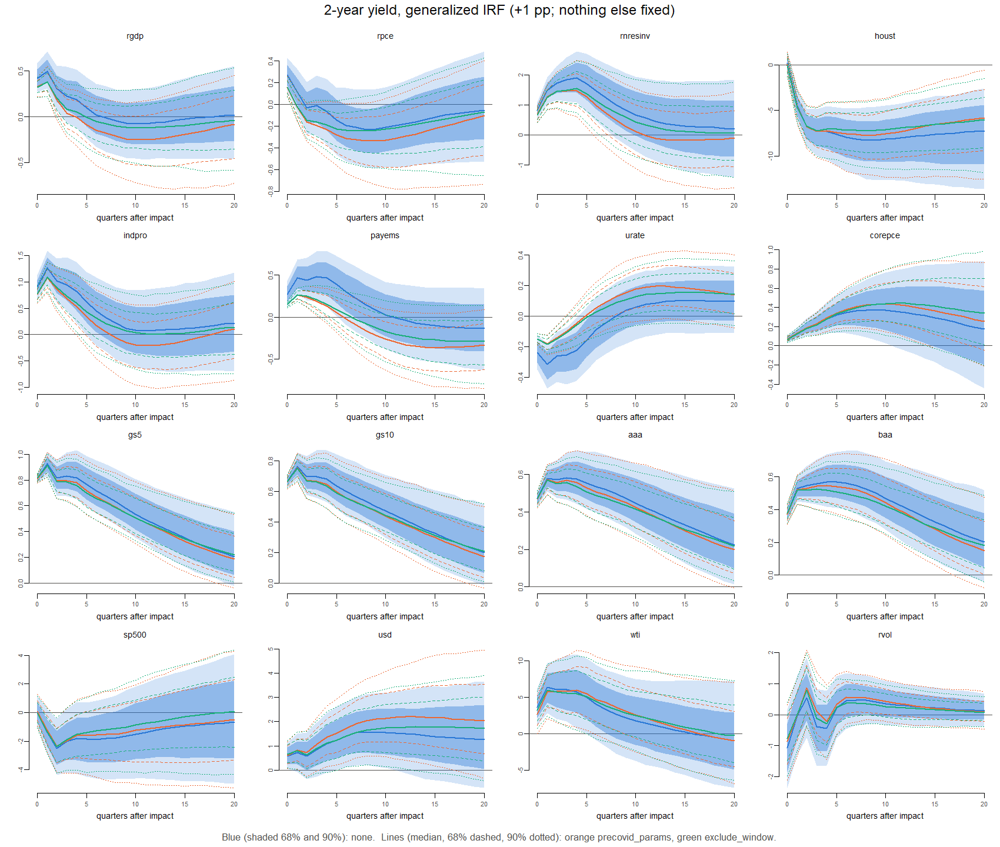
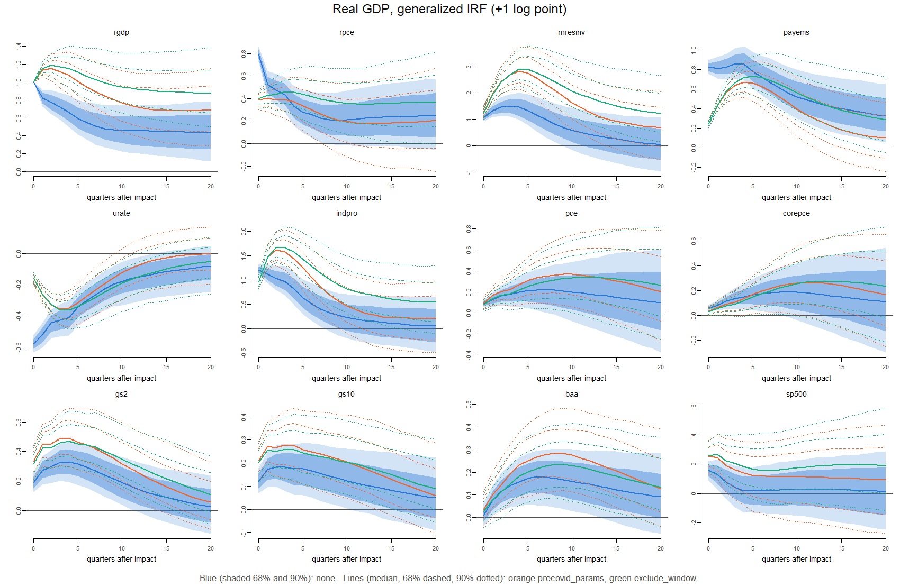
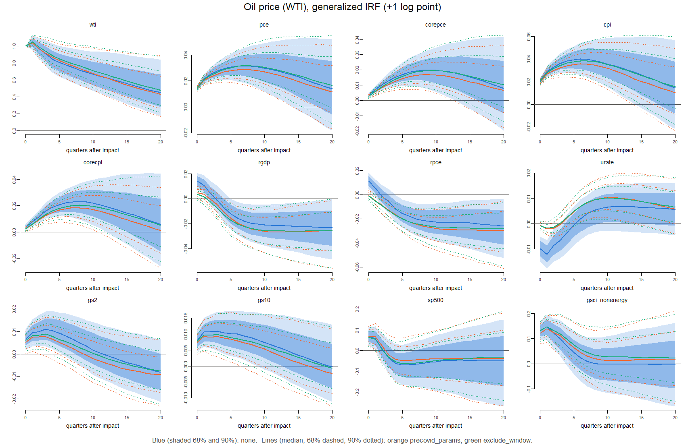
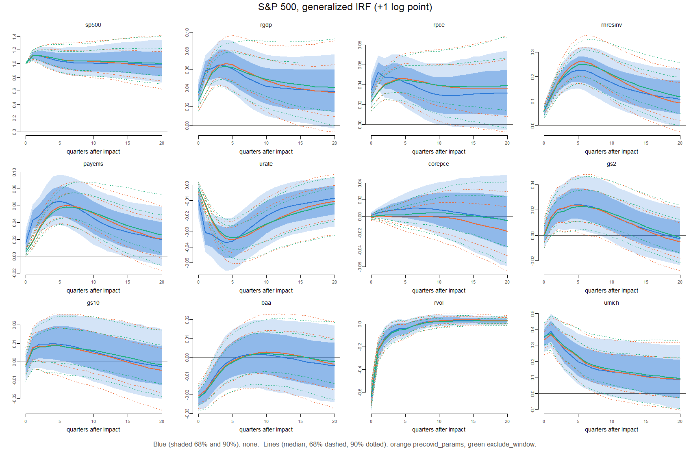
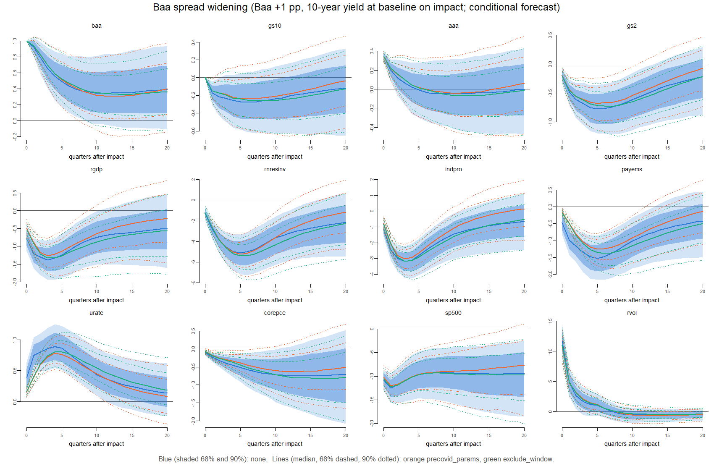
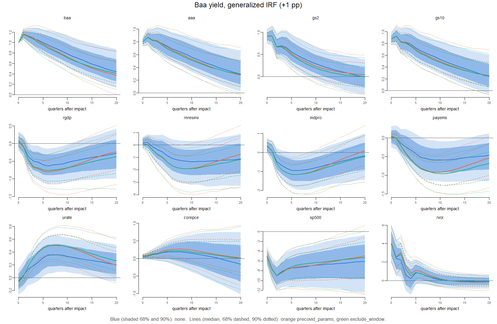

# Impulse-response review

**Runs:** 2026m09_exclude_window_full_6a9c5d25; 2026m09_none_full_545b70ff; 2026m09_precovid_params_full_dc0d4609. COVID method `none` estimates on every quarter to 2026Q2; `precovid_params` estimates on data to 2019Q4; `exclude_window` (if run) estimates on every quarter except the equations of 2020Q1–2021Q4 (`docs/methodology.md`, section 11). The readings below were written for `none` and `precovid_params`; `exclude_window` is compared in the COVID-treatment comparison report. 1,000 posterior draws each; one response per draw (no simulated shocks), so the bands show parameter uncertainty (Crump et al. 2021, Section 2.3).

**What is reviewed.** The correctness of the responses is checked against exact results in the engine checks. Here the question is whether they make economic sense (spec 9.5) and how they compare with the paper’s Figures 6, 8 and 9. The identifications (`docs/methodology.md`, section 10):

- **Generalized IRFs** (GIRFs) of real GDP, the 2-year yield, oil (WTI), the S&P 500 and the Baa yield: the shocked variable moves by one unit on impact and everything else moves as it historically does with it. A GIRF is the combination of shocks that typically moves that variable, not a structural shock.
- **Recursive 2-year yield shock:** the 21 economic (“slow”) variables are held at their baseline on impact, the 2-year yield moves by 1 pp, and the financial (“fast”) variables respond freely. Under the assumption that the economy reacts to financial conditions only with a lag, this is a monetary policy shock.
- **Baa spread widening** (new here): Baa up by 1 pp with the 10-year yield held at its baseline on impact, everything else free. A generalized Baa shock is mostly a rise in all rates (the 10-year yield rises by 0.88 with it), so the spread is isolated by conditioning. This is a conditional forecast: the combination of shocks that most likely widens the spread, not a structural credit shock. It equals the conditional minus the unconditional forecast mean of a scenario with those two cells fixed; checked against the Gaussian conditioning code, largest difference 1.1^{-13}.

**Units.** Responses are in model units: 100 × log difference from the no-shock path (about percent) for log series, percentage points for rates. The figures show unit shocks (1 log point or 1 pp); the tables scale them to the sizes of the expectations (oil +10%, S&P 500 −10%) and of the paper’s figures (2-year yield +25 bp). Responses are linear, so scaling is exact. For scale: since 1973 the standard deviation of the quarterly change is 15% for oil, 6% for the S&P 500, 0.7 pp for the 2-year yield and 0.35 pp for the Baa–10-year spread, so the 1 pp spread widening is a large shock (about three standard deviations).

# 1. Expectations (spec 9.5)

For each expected response: within the first 12 quarters, the horizon at which the median moves furthest in the expected direction, the median and the 68% band there. **As expected**: right sign and the 68% band excludes zero. **Weak**: right sign, band includes zero. **Opposite**: the median never moves in the expected direction.

| shock_size | variable | expected | horizon.none | median.none | q16.none | q84.none | verdict.none | horizon.precovid_params | median.precovid_params | q16.precovid_params | q84.precovid_params | verdict.precovid_params | horizon.exclude_window | median.exclude_window | q16.exclude_window | q84.exclude_window | verdict.exclude_window |
|:---|:---|:---|---:|---:|---:|---:|:---|---:|---:|---:|---:|:---|---:|---:|---:|---:|:---|
| gs2 +1 pp | houst | down | 2 | -5.97 | -7.15 | -4.90 | as expected | 2 | -6.16 | -7.44 | -5.00 | as expected | 2 | -6.11 | -7.25 | -5.03 | as expected |
| gs2 +1 pp | indpro | down | 9 | -0.14 | -0.55 | 0.27 | weak | 7 | -0.32 | -0.73 | 0.11 | weak | 5 | -0.32 | -0.67 | 0.06 | weak |
| gs2 +1 pp | payems | down | 12 | -0.19 | -0.44 | 0.05 | weak | 11 | -0.43 | -0.67 | -0.21 | as expected | 12 | -0.41 | -0.64 | -0.20 | as expected |
| gs2 +1 pp | urate | up | 12 | 0.15 | 0.03 | 0.28 | as expected | 9 | 0.25 | 0.14 | 0.37 | as expected | 10 | 0.23 | 0.13 | 0.34 | as expected |
| gs2 +1 pp | gs5 | up | 1 | 0.91 | 0.84 | 0.96 | as expected | 1 | 0.89 | 0.83 | 0.95 | as expected | 1 | 0.89 | 0.83 | 0.95 | as expected |
| gs2 +1 pp | gs10 | up | 1 | 0.74 | 0.68 | 0.80 | as expected | 1 | 0.73 | 0.67 | 0.79 | as expected | 1 | 0.73 | 0.68 | 0.79 | as expected |
| gs2 +1 pp | sp500 | down | 2 | -3.37 | -4.57 | -2.12 | as expected | 2 | -3.05 | -4.23 | -1.86 | as expected | 2 | -3.18 | -4.32 | -1.95 | as expected |
| gs2 +1 pp | usd | up | 7 | 1.56 | 0.67 | 2.55 | as expected | 9 | 2.01 | 0.96 | 3.07 | as expected | 8 | 1.61 | 0.72 | 2.61 | as expected |
| gs2 +1 pp | rgdp | down | 9 | -0.19 | -0.40 | 0.03 | weak | 7 | -0.37 | -0.60 | -0.14 | as expected | 6 | -0.29 | -0.48 | -0.10 | as expected |
| oil +10% | pce | up | 7 | 0.31 | 0.24 | 0.40 | as expected | 7 | 0.29 | 0.21 | 0.37 | as expected | 7 | 0.32 | 0.24 | 0.40 | as expected |
| oil +10% | corepce | up | 9 | 0.20 | 0.12 | 0.28 | as expected | 8 | 0.17 | 0.11 | 0.24 | as expected | 9 | 0.20 | 0.12 | 0.27 | as expected |
| oil +10% | cpi | up | 6 | 0.40 | 0.31 | 0.48 | as expected | 6 | 0.36 | 0.28 | 0.45 | as expected | 6 | 0.38 | 0.30 | 0.47 | as expected |
| oil +10% | corecpi | up | 8 | 0.23 | 0.15 | 0.31 | as expected | 7 | 0.18 | 0.11 | 0.26 | as expected | 8 | 0.20 | 0.12 | 0.29 | as expected |
| oil +10% | rgdp | down | 12 | -0.22 | -0.32 | -0.11 | as expected | 12 | -0.27 | -0.38 | -0.15 | as expected | 12 | -0.26 | -0.37 | -0.14 | as expected |
| oil +10% | urate | up | 11 | 0.07 | 0.01 | 0.12 | as expected | 11 | 0.10 | 0.05 | 0.16 | as expected | 10 | 0.10 | 0.05 | 0.15 | as expected |
| S&P -10% | rgdp | down | 3 | -0.65 | -0.81 | -0.52 | as expected | 4 | -0.66 | -0.81 | -0.50 | as expected | 4 | -0.63 | -0.78 | -0.49 | as expected |
| S&P -10% | rpce | down | 1 | -0.52 | -0.62 | -0.43 | as expected | 5 | -0.46 | -0.61 | -0.31 | as expected | 4 | -0.45 | -0.57 | -0.32 | as expected |
| S&P -10% | payems | down | 5 | -0.65 | -0.83 | -0.49 | as expected | 6 | -0.60 | -0.74 | -0.46 | as expected | 6 | -0.59 | -0.74 | -0.46 | as expected |
| S&P -10% | urate | up | 4 | 0.37 | 0.27 | 0.47 | as expected | 5 | 0.35 | 0.28 | 0.44 | as expected | 5 | 0.34 | 0.26 | 0.41 | as expected |
| S&P -10% | gs2 | down | 5 | -0.24 | -0.37 | -0.13 | as expected | 5 | -0.24 | -0.37 | -0.11 | as expected | 5 | -0.23 | -0.36 | -0.11 | as expected |
| S&P -10% | gs10 | down | 4 | -0.10 | -0.19 | -0.01 | as expected | 4 | -0.09 | -0.19 | 0.01 | weak | 4 | -0.09 | -0.18 | 0.00 | weak |
| S&P -10% | rvol | up | 0 | 6.41 | 5.73 | 7.13 | as expected | 0 | 6.09 | 5.43 | 6.80 | as expected | 0 | 6.27 | 5.65 | 6.95 | as expected |
| GDP +1% | payems | up | 3 | 0.86 | 0.77 | 0.95 | as expected | 4 | 0.67 | 0.57 | 0.78 | as expected | 5 | 0.73 | 0.60 | 0.84 | as expected |
| GDP +1% | urate | down | 0 | -0.58 | -0.61 | -0.55 | as expected | 3 | -0.36 | -0.42 | -0.30 | as expected | 4 | -0.36 | -0.43 | -0.30 | as expected |
| GDP +1% | indpro | up | 0 | 1.21 | 1.15 | 1.27 | as expected | 2 | 1.62 | 1.41 | 1.81 | as expected | 3 | 1.66 | 1.43 | 1.90 | as expected |
| GDP +1% | pce | up | 6 | 0.22 | 0.10 | 0.33 | as expected | 9 | 0.37 | 0.18 | 0.58 | as expected | 12 | 0.34 | 0.12 | 0.57 | as expected |
| GDP +1% | corepce | up | 9 | 0.19 | 0.06 | 0.31 | as expected | 11 | 0.26 | 0.09 | 0.45 | as expected | 12 | 0.27 | 0.09 | 0.46 | as expected |
| spread +1 pp | rgdp | down | 3 | -1.38 | -1.71 | -1.06 | as expected | 3 | -1.27 | -1.59 | -0.96 | as expected | 3 | -1.33 | -1.63 | -1.02 | as expected |
| spread +1 pp | indpro | down | 3 | -3.18 | -3.83 | -2.66 | as expected | 3 | -3.02 | -3.62 | -2.49 | as expected | 3 | -3.18 | -3.76 | -2.63 | as expected |
| spread +1 pp | payems | down | 5 | -1.52 | -1.91 | -1.13 | as expected | 5 | -1.25 | -1.54 | -0.97 | as expected | 6 | -1.37 | -1.72 | -1.07 | as expected |
| spread +1 pp | urate | up | 4 | 0.89 | 0.67 | 1.11 | as expected | 4 | 0.78 | 0.63 | 0.94 | as expected | 5 | 0.80 | 0.64 | 0.99 | as expected |
| spread +1 pp | rnresinv | down | 5 | -5.08 | -6.32 | -3.97 | as expected | 5 | -5.21 | -6.49 | -4.07 | as expected | 6 | -5.40 | -6.71 | -4.25 | as expected |

| method          | as expected | weak |
|:----------------|------------:|-----:|
| exclude_window  |          30 |    2 |
| none            |          29 |    3 |
| precovid_params |          30 |    2 |

Further expectations from the spec, read off the tables and figures:

- *5- and 10-year yields rise less than 1:1 after the recursive 2-year shock:* yes, peak about 0.9 and 0.75 (table rows gs5, gs10).
- *Oil: headline inflation up more than core:* yes, PCE about +0.3 against core about +0.2, CPI +0.4 against core CPI +0.2 per 10% oil.
- *GDP +1%: inflation up modestly:* yes, about +0.2 to +0.35 on the PCE price levels after 2–3 years.
- *Rate shock: price puzzle?* None: core PCE is flat, then lower (figure).

# 2. Comparison with the paper

The paper’s medians are read from its charts by eye (approximate). The paper’s shock sizes: GDP +1% (Figure 6), 2-year yield +25 bp unrestricted (Figure 8) and recursive (Figure 9). The paper’s model is estimated on data to 2019 (its sample for Section 3 is not stated with the figures), so `precovid_params` is the closer comparison.

| figure | variable | statistic | paper | none | h_none | precovid_params | h_precovid_params | exclude_window | h_exclude_window |
|:---|:---|:---|---:|---:|---:|---:|---:|---:|---:|
| 6 | rgdp | max h0-12 | 1.10 | 1.000 | 0 | 1.154 | 2 | 1.185 | 2 |
| 6 | rgdp | at h12 | 0.50 | 0.454 | 12 | 0.714 | 12 | 0.919 | 12 |
| 6 | payems | max h0-12 | 0.65 | 0.858 | 3 | 0.669 | 4 | 0.729 | 5 |
| 6 | urate | min h0-12 | -0.35 | -0.579 | 0 | -0.356 | 3 | -0.363 | 4 |
| 6 | rnresinv | max h0-12 | 2.90 | 1.501 | 3 | 2.827 | 4 | 2.902 | 4 |
| 6 | pce | at h12 | 0.37 | 0.179 | 12 | 0.350 | 12 | 0.339 | 12 |
| 6 | corepce | at h12 | 0.26 | 0.175 | 12 | 0.261 | 12 | 0.273 | 12 |
| 6 | gs2 | max h0-12 | 0.55 | 0.331 | 4 | 0.493 | 4 | 0.471 | 4 |
| 6 | gs10 | max h0-12 | 0.33 | 0.183 | 2 | 0.279 | 3 | 0.260 | 3 |
| 6 | baa | max h0-12 | 0.33 | 0.180 | 6 | 0.284 | 8 | 0.233 | 9 |
| 6 | sp500 | max h0-4 | 2.80 | 1.573 | 0 | 2.538 | 0 | 2.659 | 1 |
| 8 | rgdp | max h0-4 | 0.09 | 0.123 | 1 | 0.095 | 1 | 0.095 | 1 |
| 8 | rgdp | at h12 | -0.08 | -0.015 | 12 | -0.060 | 12 | -0.028 | 12 |
| 8 | urate | min h0-4 | -0.04 | -0.079 | 1 | -0.045 | 1 | -0.046 | 1 |
| 8 | urate | at h12 | 0.06 | 0.022 | 12 | 0.049 | 12 | 0.037 | 12 |
| 8 | baa | max h0-12 | 0.14 | 0.142 | 4 | 0.137 | 4 | 0.131 | 3 |
| 8 | sp500 | min h0-12 | -1.00 | -0.626 | 2 | -0.587 | 2 | -0.600 | 2 |
| 9 | rgdp | at h1 | 0.00 | 0.025 | 1 | -0.005 | 1 | -0.002 | 1 |
| 9 | rgdp | min h0-12 | -0.09 | -0.048 | 9 | -0.093 | 7 | -0.072 | 6 |
| 9 | urate | at h12 | 0.07 | 0.037 | 12 | 0.059 | 12 | 0.056 | 12 |
| 9 | payems | min h0-12 | -0.12 | -0.046 | 12 | -0.109 | 11 | -0.102 | 12 |
| 9 | baa | max h0-12 | 0.14 | 0.140 | 1 | 0.137 | 1 | 0.138 | 1 |
| 9 | sp500 | min h0-12 | -0.80 | -0.844 | 2 | -0.763 | 2 | -0.795 | 2 |
| 9 | usd | at h12 | 0.60 | 0.354 | 12 | 0.497 | 12 | 0.393 | 12 |

*`h_*`: horizon of our statistic (0 = impact).*

**Reading.** Under `precovid_params` the responses match the paper closely: in Figure 6, GDP peaks at 1.15 (paper about 1.1), payrolls 0.67 (0.65), unemployment −0.36 (−0.35), investment 2.8 (2.9), core PCE 0.26 after 3 years (0.26); in Figure 9, GDP falls to −0.09 (−0.09), unemployment +0.06 after 3 years (+0.07), Baa +0.14 (+0.14), the S&P 500 −0.76 (−0.8). The main difference is GDP after 3 years in Figure 6 (0.71 against 0.5): the response is more persistent. Under `none` the activity responses are about half as large and GDP has no hump; the 2020 quarters dominate the co-movement of GDP and employment.

**Corporate yields.** The paper’s text says that after the recursive rate shock “corporate bond yields increase more than Treasuries”; its Figure 9 shows Aaa and Baa rising by about 0.14 for a 0.25 move in the 2-year yield, less than Treasuries. Our responses agree with the chart (Baa +0.14 per 25 bp).

**One quarter after impact (recursive 2-year shock).** The paper’s Figure 9 has GDP at about 0 one quarter after impact, with an upper band slightly above zero.

| method          | variable |    q05 |    q16 |    q50 |   q84 |   q95 |
|:----------------|:---------|-------:|-------:|-------:|------:|------:|
| none            | rgdp     | -0.058 |  0.003 |  0.099 | 0.199 | 0.265 |
| none            | payems   | -0.015 |  0.047 |  0.145 | 0.243 | 0.313 |
| none            | urate    | -0.181 | -0.131 | -0.060 | 0.011 | 0.062 |
| none            | indpro   |  0.022 |  0.112 |  0.269 | 0.427 | 0.521 |
| precovid_params | rgdp     | -0.127 | -0.089 | -0.021 | 0.049 | 0.085 |
| precovid_params | payems   | -0.031 | -0.011 |  0.016 | 0.043 | 0.063 |
| precovid_params | urate    | -0.020 | -0.003 |  0.019 | 0.043 | 0.059 |
| precovid_params | indpro   | -0.101 | -0.026 |  0.079 | 0.199 | 0.282 |
| exclude_window  | rgdp     | -0.108 | -0.071 | -0.008 | 0.055 | 0.094 |
| exclude_window  | payems   | -0.025 | -0.008 |  0.019 | 0.045 | 0.064 |
| exclude_window  | urate    | -0.018 | -0.004 |  0.020 | 0.042 | 0.057 |
| exclude_window  | indpro   | -0.092 | -0.020 |  0.084 | 0.190 | 0.268 |

*Per 1 pp shock. Under `none`, GDP rises by 0.10 one quarter after impact (68% band just above zero, 90% band includes it); under `precovid_params` the median is −0.02 and both bands include zero, as in the paper.*

# 3. In growth rates

Effect on year-on-year growth (log series; percentage points) or on the level (rates, percentage points), 4, 8 and 12 quarters after impact, at the shock sizes of section 1.

**Method none**: median \[68% band\]

| shock_size | variable | measure | h4 | h8 | h12 |
|:---|:---|:---|:---|:---|:---|
| gs2 +1 pp | rgdp | YoY growth, pp | -0.11 \[-0.29, 0.08\] | -0.07 \[-0.22, 0.07\] | 0.04 \[-0.06, 0.13\] |
| gs2 +1 pp | rpce | YoY growth, pp | -0.17 \[-0.35, 0.01\] | -0.03 \[-0.17, 0.10\] | 0.08 \[-0.01, 0.17\] |
| gs2 +1 pp | payems | YoY growth, pp | 0.07 \[-0.14, 0.24\] | -0.16 \[-0.30, -0.02\] | -0.08 \[-0.20, 0.02\] |
| gs2 +1 pp | urate | level, pp | 0.01 \[-0.10, 0.14\] | 0.12 \[-0.00, 0.25\] | 0.15 \[0.03, 0.28\] |
| gs2 +1 pp | corepce | YoY growth, pp | 0.02 \[-0.06, 0.10\] | -0.04 \[-0.13, 0.06\] | -0.09 \[-0.18, 0.00\] |
| gs2 +1 pp | houst | YoY growth, pp | -5.30 \[-6.97, -3.66\] | -0.13 \[-1.47, 1.19\] | 0.31 \[-0.53, 1.26\] |
| oil +10% | pce | YoY growth, pp | 0.15 \[0.10, 0.20\] | 0.02 \[-0.02, 0.07\] | -0.04 \[-0.09, 0.01\] |
| oil +10% | corepce | YoY growth, pp | 0.12 \[0.09, 0.15\] | 0.04 \[0.01, 0.08\] | -0.01 \[-0.05, 0.03\] |
| oil +10% | cpi | YoY growth, pp | 0.18 \[0.12, 0.23\] | 0.01 \[-0.05, 0.06\] | -0.06 \[-0.12, -0.01\] |
| oil +10% | rgdp | YoY growth, pp | -0.22 \[-0.28, -0.15\] | -0.12 \[-0.18, -0.07\] | -0.02 \[-0.06, 0.02\] |
| oil +10% | urate | level, pp | -0.04 \[-0.08, 0.01\] | 0.05 \[-0.00, 0.10\] | 0.07 \[0.00, 0.12\] |
| S&P -10% | rgdp | YoY growth, pp | -0.28 \[-0.45, -0.14\] | 0.15 \[0.05, 0.27\] | 0.08 \[0.01, 0.16\] |
| S&P -10% | rpce | YoY growth, pp | -0.12 \[-0.26, 0.04\] | 0.12 \[0.03, 0.23\] | 0.04 \[-0.03, 0.10\] |
| S&P -10% | payems | YoY growth, pp | -0.48 \[-0.64, -0.34\] | 0.08 \[-0.03, 0.19\] | 0.17 \[0.10, 0.27\] |
| S&P -10% | urate | level, pp | 0.37 \[0.27, 0.47\] | 0.26 \[0.17, 0.38\] | 0.16 \[0.07, 0.27\] |
| S&P -10% | corepce | YoY growth, pp | -0.07 \[-0.15, 0.01\] | -0.01 \[-0.10, 0.06\] | 0.03 \[-0.03, 0.11\] |
| GDP +1% | rgdp | YoY growth, pp | -0.34 \[-0.44, -0.22\] | -0.17 \[-0.26, -0.08\] | -0.04 \[-0.11, 0.03\] |
| GDP +1% | payems | YoY growth, pp | 0.02 \[-0.07, 0.14\] | -0.23 \[-0.34, -0.14\] | -0.14 \[-0.22, -0.08\] |
| GDP +1% | urate | level, pp | -0.41 \[-0.47, -0.35\] | -0.23 \[-0.30, -0.16\] | -0.15 \[-0.23, -0.07\] |
| GDP +1% | pce | YoY growth, pp | 0.11 \[0.03, 0.18\] | 0.01 \[-0.06, 0.08\] | -0.03 \[-0.09, 0.04\] |
| GDP +1% | corepce | YoY growth, pp | 0.09 \[0.04, 0.14\] | 0.04 \[-0.02, 0.09\] | -0.01 \[-0.07, 0.05\] |
| spread +1 pp | rgdp | YoY growth, pp | -0.55 \[-0.91, -0.24\] | 0.41 \[0.18, 0.67\] | 0.23 \[0.06, 0.42\] |
| spread +1 pp | rnresinv | YoY growth, pp | -3.68 \[-4.63, -2.79\] | 0.57 \[-0.19, 1.27\] | 1.10 \[0.54, 1.81\] |
| spread +1 pp | payems | YoY growth, pp | -1.02 \[-1.36, -0.69\] | 0.21 \[-0.05, 0.46\] | 0.41 \[0.22, 0.63\] |
| spread +1 pp | urate | level, pp | 0.89 \[0.67, 1.11\] | 0.60 \[0.38, 0.83\] | 0.34 \[0.12, 0.58\] |
| spread +1 pp | corepce | YoY growth, pp | -0.35 \[-0.53, -0.18\] | -0.21 \[-0.39, -0.03\] | -0.07 \[-0.25, 0.10\] |

**Method precovid_params**: median \[68% band\]

| shock_size | variable | measure | h4 | h8 | h12 |
|:---|:---|:---|:---|:---|:---|
| gs2 +1 pp | rgdp | YoY growth, pp | -0.33 \[-0.50, -0.15\] | -0.04 \[-0.20, 0.11\] | 0.05 \[-0.06, 0.16\] |
| gs2 +1 pp | rpce | YoY growth, pp | -0.32 \[-0.46, -0.18\] | 0.02 \[-0.11, 0.14\] | 0.08 \[-0.01, 0.17\] |
| gs2 +1 pp | payems | YoY growth, pp | -0.22 \[-0.34, -0.12\] | -0.16 \[-0.29, -0.04\] | -0.05 \[-0.16, 0.06\] |
| gs2 +1 pp | urate | level, pp | 0.18 \[0.10, 0.26\] | 0.24 \[0.13, 0.36\] | 0.24 \[0.12, 0.36\] |
| gs2 +1 pp | corepce | YoY growth, pp | 0.04 \[-0.03, 0.12\] | 0.00 \[-0.08, 0.10\] | -0.07 \[-0.15, 0.02\] |
| gs2 +1 pp | houst | YoY growth, pp | -5.22 \[-7.22, -3.38\] | 0.40 \[-1.12, 1.88\] | 0.72 \[-0.38, 1.85\] |
| oil +10% | pce | YoY growth, pp | 0.13 \[0.09, 0.17\] | 0.02 \[-0.02, 0.07\] | -0.04 \[-0.08, 0.01\] |
| oil +10% | corepce | YoY growth, pp | 0.10 \[0.07, 0.13\] | 0.04 \[0.01, 0.08\] | -0.02 \[-0.05, 0.03\] |
| oil +10% | cpi | YoY growth, pp | 0.15 \[0.09, 0.20\] | 0.01 \[-0.04, 0.07\] | -0.07 \[-0.12, -0.01\] |
| oil +10% | rgdp | YoY growth, pp | -0.16 \[-0.22, -0.09\] | -0.12 \[-0.19, -0.07\] | -0.03 \[-0.08, 0.01\] |
| oil +10% | urate | level, pp | 0.02 \[-0.01, 0.05\] | 0.09 \[0.05, 0.14\] | 0.10 \[0.05, 0.16\] |
| S&P -10% | rgdp | YoY growth, pp | -0.40 \[-0.54, -0.26\] | 0.11 \[-0.01, 0.23\] | 0.10 \[0.01, 0.20\] |
| S&P -10% | rpce | YoY growth, pp | -0.24 \[-0.34, -0.11\] | 0.04 \[-0.05, 0.13\] | 0.05 \[-0.03, 0.12\] |
| S&P -10% | payems | YoY growth, pp | -0.50 \[-0.59, -0.40\] | -0.03 \[-0.14, 0.07\] | 0.14 \[0.05, 0.23\] |
| S&P -10% | urate | level, pp | 0.34 \[0.27, 0.42\] | 0.30 \[0.20, 0.40\] | 0.21 \[0.10, 0.31\] |
| S&P -10% | corepce | YoY growth, pp | -0.01 \[-0.08, 0.06\] | -0.00 \[-0.08, 0.07\] | 0.03 \[-0.04, 0.09\] |
| GDP +1% | rgdp | YoY growth, pp | 0.08 \[-0.06, 0.21\] | -0.23 \[-0.35, -0.12\] | -0.12 \[-0.21, -0.04\] |
| GDP +1% | payems | YoY growth, pp | 0.43 \[0.33, 0.53\] | -0.15 \[-0.25, -0.06\] | -0.22 \[-0.30, -0.13\] |
| GDP +1% | urate | level, pp | -0.35 \[-0.42, -0.28\] | -0.19 \[-0.28, -0.10\] | -0.07 \[-0.18, 0.02\] |
| GDP +1% | pce | YoY growth, pp | 0.18 \[0.08, 0.27\] | 0.10 \[0.02, 0.19\] | -0.01 \[-0.08, 0.08\] |
| GDP +1% | corepce | YoY growth, pp | 0.10 \[0.03, 0.17\] | 0.10 \[0.04, 0.18\] | 0.02 \[-0.03, 0.10\] |
| spread +1 pp | rgdp | YoY growth, pp | -0.74 \[-1.05, -0.46\] | 0.38 \[0.11, 0.67\] | 0.32 \[0.11, 0.55\] |
| spread +1 pp | rnresinv | YoY growth, pp | -3.84 \[-4.77, -2.94\] | 0.55 \[-0.24, 1.37\] | 1.51 \[0.86, 2.31\] |
| spread +1 pp | payems | YoY growth, pp | -1.02 \[-1.24, -0.81\] | 0.07 \[-0.17, 0.28\] | 0.39 \[0.18, 0.60\] |
| spread +1 pp | urate | level, pp | 0.78 \[0.63, 0.94\] | 0.58 \[0.39, 0.80\] | 0.33 \[0.10, 0.59\] |
| spread +1 pp | corepce | YoY growth, pp | -0.27 \[-0.43, -0.11\] | -0.20 \[-0.36, -0.03\] | -0.09 \[-0.26, 0.06\] |

**Method exclude_window**: median \[68% band\]

| shock_size | variable | measure | h4 | h8 | h12 |
|:---|:---|:---|:---|:---|:---|
| gs2 +1 pp | rgdp | YoY growth, pp | -0.26 \[-0.43, -0.10\] | -0.02 \[-0.14, 0.12\] | 0.04 \[-0.05, 0.14\] |
| gs2 +1 pp | rpce | YoY growth, pp | -0.29 \[-0.42, -0.16\] | 0.04 \[-0.06, 0.15\] | 0.08 \[-0.00, 0.15\] |
| gs2 +1 pp | payems | YoY growth, pp | -0.22 \[-0.32, -0.11\] | -0.15 \[-0.26, -0.04\] | -0.05 \[-0.14, 0.05\] |
| gs2 +1 pp | urate | level, pp | 0.17 \[0.10, 0.24\] | 0.23 \[0.13, 0.33\] | 0.22 \[0.12, 0.34\] |
| gs2 +1 pp | corepce | YoY growth, pp | 0.01 \[-0.07, 0.10\] | -0.01 \[-0.10, 0.07\] | -0.06 \[-0.15, 0.02\] |
| gs2 +1 pp | houst | YoY growth, pp | -5.00 \[-6.84, -3.21\] | 0.62 \[-0.63, 1.83\] | 0.55 \[-0.39, 1.46\] |
| oil +10% | pce | YoY growth, pp | 0.14 \[0.10, 0.19\] | 0.03 \[-0.01, 0.07\] | -0.03 \[-0.07, 0.02\] |
| oil +10% | corepce | YoY growth, pp | 0.11 \[0.08, 0.14\] | 0.05 \[0.02, 0.09\] | -0.01 \[-0.04, 0.04\] |
| oil +10% | cpi | YoY growth, pp | 0.16 \[0.11, 0.22\] | 0.01 \[-0.04, 0.07\] | -0.06 \[-0.11, 0.00\] |
| oil +10% | rgdp | YoY growth, pp | -0.16 \[-0.22, -0.11\] | -0.11 \[-0.16, -0.06\] | -0.02 \[-0.07, 0.02\] |
| oil +10% | urate | level, pp | 0.02 \[-0.00, 0.06\] | 0.09 \[0.05, 0.13\] | 0.10 \[0.05, 0.15\] |
| S&P -10% | rgdp | YoY growth, pp | -0.37 \[-0.50, -0.24\] | 0.08 \[-0.02, 0.19\] | 0.07 \[-0.01, 0.15\] |
| S&P -10% | rpce | YoY growth, pp | -0.21 \[-0.32, -0.11\] | 0.03 \[-0.06, 0.11\] | 0.02 \[-0.04, 0.09\] |
| S&P -10% | payems | YoY growth, pp | -0.47 \[-0.57, -0.38\] | -0.05 \[-0.15, 0.04\] | 0.11 \[0.03, 0.19\] |
| S&P -10% | urate | level, pp | 0.33 \[0.26, 0.40\] | 0.29 \[0.21, 0.39\] | 0.22 \[0.12, 0.33\] |
| S&P -10% | corepce | YoY growth, pp | -0.02 \[-0.09, 0.04\] | -0.02 \[-0.10, 0.05\] | 0.01 \[-0.07, 0.07\] |
| GDP +1% | rgdp | YoY growth, pp | 0.15 \[0.02, 0.29\] | -0.15 \[-0.24, -0.05\] | -0.07 \[-0.16, -0.00\] |
| GDP +1% | payems | YoY growth, pp | 0.47 \[0.38, 0.56\] | -0.07 \[-0.16, 0.03\] | -0.16 \[-0.24, -0.09\] |
| GDP +1% | urate | level, pp | -0.36 \[-0.43, -0.30\] | -0.25 \[-0.34, -0.16\] | -0.15 \[-0.25, -0.05\] |
| GDP +1% | pce | YoY growth, pp | 0.15 \[0.05, 0.24\] | 0.09 \[0.01, 0.18\] | 0.02 \[-0.05, 0.09\] |
| GDP +1% | corepce | YoY growth, pp | 0.09 \[0.02, 0.15\] | 0.10 \[0.04, 0.17\] | 0.05 \[-0.01, 0.11\] |
| spread +1 pp | rgdp | YoY growth, pp | -0.76 \[-1.09, -0.49\] | 0.26 \[0.03, 0.52\] | 0.22 \[0.04, 0.40\] |
| spread +1 pp | rnresinv | YoY growth, pp | -3.97 \[-4.91, -3.11\] | 0.20 \[-0.58, 0.95\] | 1.17 \[0.57, 1.84\] |
| spread +1 pp | payems | YoY growth, pp | -1.08 \[-1.31, -0.87\] | -0.05 \[-0.27, 0.15\] | 0.29 \[0.10, 0.47\] |
| spread +1 pp | urate | level, pp | 0.80 \[0.66, 0.97\] | 0.66 \[0.47, 0.88\] | 0.44 \[0.22, 0.71\] |
| spread +1 pp | corepce | YoY growth, pp | -0.31 \[-0.46, -0.16\] | -0.25 \[-0.43, -0.09\] | -0.15 \[-0.33, 0.01\] |

# 4. Figures

Blue (shaded 68% and 90% bands): `none`. Lines (median solid, 68% dashed, 90% dotted): orange `precovid_params`, green `exclude_window` (if run). Unit shocks; horizons 0–20.

# 5. Notes

- After the recursive rate shock, oil rises by 2–3% under both methods. With oil in the fast block, it can respond on impact; the rise reflects the historical co-movement of rates and commodity prices (rate increases tend to come in strong demand), not a causal effect of tighter policy on oil.
- Responses under `none` are not reviewed further: the pre-COVID estimates give the more sensible responses. The published forecasts use `exclude_window`, compared with the other treatments in the COVID-treatment comparison report.
