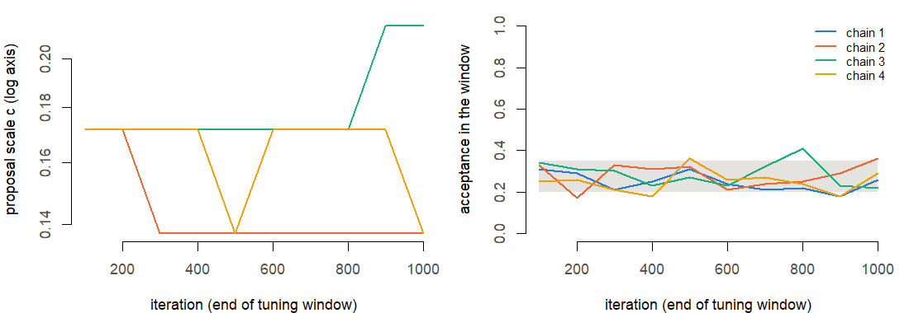
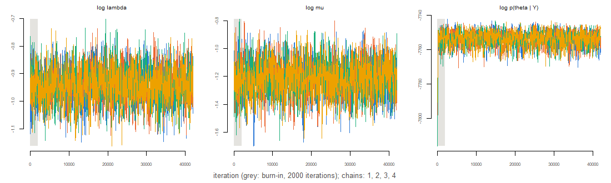
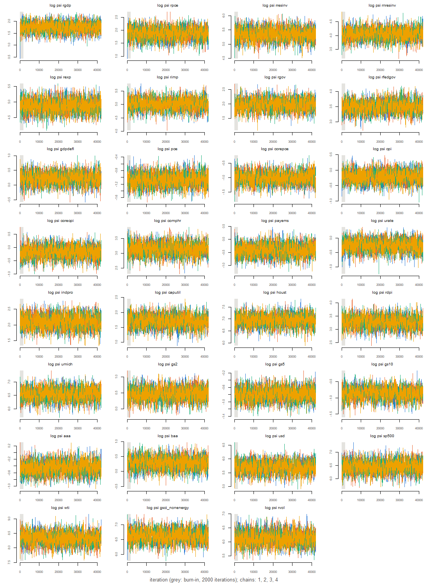
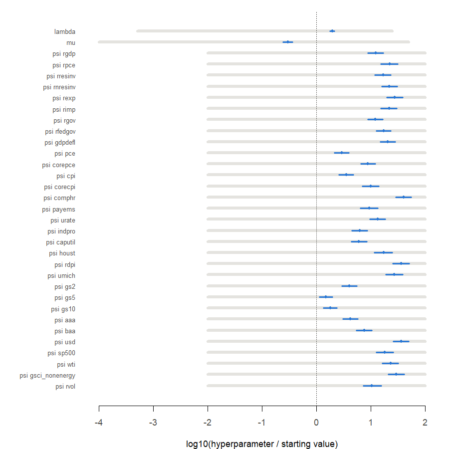
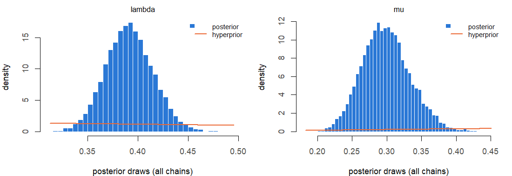
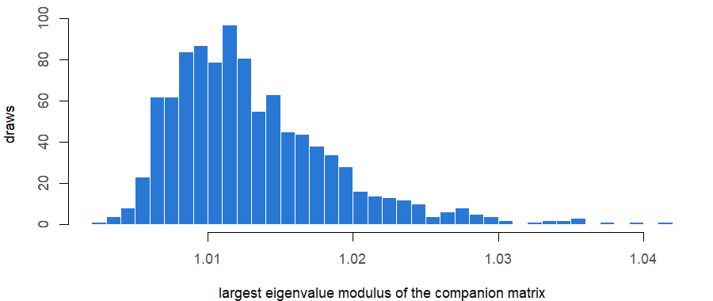
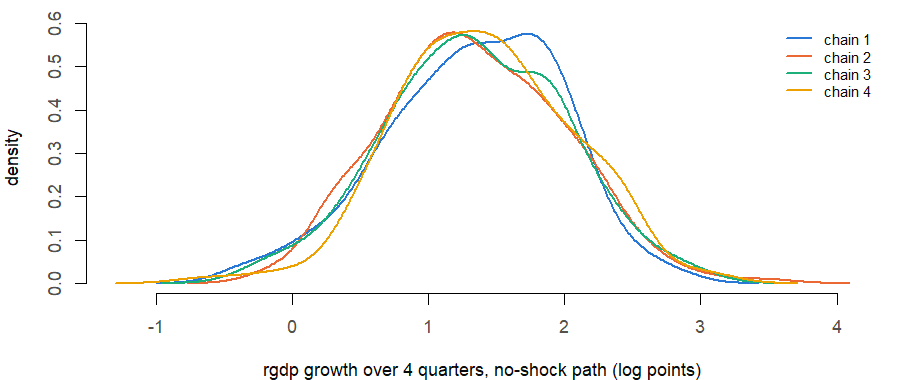

# MCMC diagnostics of an estimation run

**Run:** 2026m09_exclude_window_full_6a9c5d25. **COVID method:** exclude_window. **Estimation sample:** 1973Q1–2026Q2 (214 quarters; the first 5 serve as initial lags). **Lags:** 5. **Data:** QD vintage file fred_qd_vintages/FRED-QD_2026m09.csv, API as-of date 2026-09-30; the forecast history ends 2026Q2.

**Sampler** (Giannone, Lenza and Primiceri 2015, Appendix B): random-walk Metropolis on θ = log(h), h = (λ, µ, ψ₁…ψ₃₁), proposal N(θ, c W) with W the inverse of minus the Hessian at the posterior mode; c tuned during the first 50% of the burn-in, then fixed. **MCMC profile:** full. **Chains:** 4, each 42,000 iterations, of which 2,000 burn-in, thinned every 10: 4,000 retained draws per chain, 16,000 in all. **Starts:** overdispersed, mode + 2 x (approximate posterior s.d.) in random directions. **Seeds:** chains 20261017, 20261018, 20261019, 20261020; starts 20263017, 20263018, 20263019, 20263020; coefficient draws 20262016. **Draws for the engine:** 1,000, evenly spaced over the pooled retained draws, one (Σ, B) each.

**How to read this report.** The hyperparameter chain is the only Markov-chain part of the estimator: given each hyperparameter draw, Σ and B are drawn exactly. Effective sample size (ESS) is the number of independent draws the autocorrelated chains are worth, summed over chains. R-hat compares the spread between chains with the spread within them; values near 1 mean the chains agree, which is informative only because they started apart. Geweke’s z compares the mean of the first 10% of each chain with that of its last 50%. Intervals are posterior (credible) intervals.

# 1. Convergence targets

| check                          | worst                    | threshold | result |
|:-------------------------------|:-------------------------|:----------|:-------|
| ESS (sum over chains), minimum | 1391 (log p(theta \| Y)) | \>= 1000  | pass   |
| R-hat (point), maximum         | 1.004 (psi pce)          | \< 1.05   | pass   |

Multivariate R-hat (Brooks and Gelman 1998) over all 33 hyperparameters: 1.015.

# 2. Chains

| chain |     seed | acceptance | scale | log_post_start | start_clipped | minutes |
|------:|---------:|-----------:|------:|---------------:|--------------:|--------:|
|     1 | 20261017 |      0.297 | 0.137 |      -7802.301 |             0 | 608.764 |
|     2 | 20261018 |      0.243 | 0.172 |      -7807.788 |             0 | 608.762 |
|     3 | 20261019 |      0.197 | 0.215 |      -7819.033 |             0 | 608.740 |
|     4 | 20261020 |      0.296 | 0.137 |      -7801.024 |             0 | 608.719 |

`acceptance` is the share of accepted proposals after the burn-in; `scale` the final c; `log_post_start` the log posterior (θ scale) at the start; `start_clipped` the number of start coordinates moved inside a search bound. For comparison, the log posterior at the mode is -7737.172; the trace below shows how quickly each chain climbs from its start to that level.

# 3. Trace plots

# 4. Every hyperparameter

| hyperparameter | q05 | median | q95 | ess | ess_per_1000 | rhat | rhat_upper | max \|Geweke z\| | near bound |
|:---|---:|---:|---:|---:|---:|---:|---:|---:|---:|
| lambda | 0.3533 | 0.3907 | 0.4306 | 1525.556 | 9.5347 | 1.0014 | 1.0028 | 1.5014 | 0 |
| mu | 0.2444 | 0.2974 | 0.3604 | 1530.087 | 9.5630 | 1.0010 | 1.0030 | 2.7035 | 0 |
| psi rgdp | 4.1113 | 5.7107 | 7.8994 | 1668.229 | 10.4264 | 1.0037 | 1.0109 | 1.6777 | 0 |
| psi rpce | 4.4852 | 6.5163 | 9.1852 | 1472.782 | 9.2049 | 1.0008 | 1.0015 | 1.2373 | 0 |
| psi rresinv | 148.5758 | 211.1960 | 293.5929 | 1557.137 | 9.7321 | 1.0018 | 1.0051 | 1.6622 | 0 |
| psi rnresinv | 41.3655 | 57.8174 | 79.7171 | 1505.810 | 9.4113 | 1.0026 | 1.0080 | 1.3524 | 0 |
| psi rexp | 92.9238 | 130.9678 | 182.1873 | 1585.630 | 9.9102 | 1.0021 | 1.0057 | 3.0338 | 0 |
| psi rimp | 106.2506 | 150.8356 | 208.0812 | 1566.582 | 9.7911 | 1.0005 | 1.0019 | 1.5376 | 0 |
| psi rgov | 5.2216 | 7.2427 | 9.8586 | 1480.651 | 9.2541 | 1.0010 | 1.0032 | 2.0116 | 0 |
| psi rfedgov | 24.3641 | 33.2208 | 45.1303 | 1661.791 | 10.3862 | 1.0010 | 1.0030 | 1.0898 | 0 |
| psi gdpdefl | 0.9077 | 1.2553 | 1.7410 | 1560.095 | 9.7506 | 1.0006 | 1.0016 | 0.6390 | 0 |
| psi pce | 0.2530 | 0.3463 | 0.4639 | 1544.052 | 9.6503 | 1.0042 | 1.0127 | 1.1341 | 0 |
| psi corepce | 0.2675 | 0.3647 | 0.5000 | 1624.579 | 10.1536 | 1.0007 | 1.0017 | 1.1572 | 0 |
| psi cpi | 0.5911 | 0.8089 | 1.0983 | 1537.074 | 9.6067 | 1.0003 | 1.0010 | 1.1425 | 0 |
| psi corecpi | 0.5887 | 0.8487 | 1.1948 | 1518.917 | 9.4932 | 1.0013 | 1.0030 | 1.5974 | 0 |
| psi comphr | 16.8277 | 23.3799 | 32.1477 | 1536.820 | 9.6051 | 1.0008 | 1.0018 | 0.5859 | 0 |
| psi payems | 0.4605 | 0.6667 | 0.9593 | 1579.687 | 9.8730 | 1.0005 | 1.0018 | 3.2918 | 0 |
| psi urate | 0.5555 | 0.7771 | 1.0663 | 1559.447 | 9.7465 | 1.0015 | 1.0031 | 0.5998 | 0 |
| psi indpro | 5.8331 | 8.2390 | 11.3835 | 1646.414 | 10.2901 | 1.0005 | 1.0015 | 2.4234 | 0 |
| psi caputil | 3.9758 | 5.4914 | 7.5917 | 1599.880 | 9.9993 | 1.0005 | 1.0011 | 0.8714 | 0 |
| psi houst | 709.8727 | 1048.2511 | 1524.1025 | 1575.292 | 9.8456 | 1.0004 | 1.0008 | 1.6083 | 0 |
| psi rdpi | 18.7114 | 26.8385 | 37.7493 | 1650.097 | 10.3131 | 1.0011 | 1.0034 | 1.1880 | 0 |
| psi umich | 482.4930 | 699.9036 | 992.2715 | 1674.136 | 10.4634 | 1.0002 | 1.0008 | 0.8885 | 0 |
| psi gs2 | 1.1633 | 1.6055 | 2.1911 | 1603.121 | 10.0195 | 1.0009 | 1.0022 | 1.6012 | 0 |
| psi gs5 | 0.3431 | 0.4523 | 0.6009 | 1688.613 | 10.5538 | 1.0018 | 1.0045 | 1.4913 | 0 |
| psi gs10 | 0.3141 | 0.4204 | 0.5558 | 1571.733 | 9.8233 | 1.0030 | 1.0088 | 0.9061 | 0 |
| psi aaa | 0.4695 | 0.6362 | 0.8725 | 1654.726 | 10.3420 | 1.0040 | 1.0119 | 2.0361 | 0 |
| psi baa | 0.9492 | 1.3279 | 1.8349 | 1426.153 | 8.9135 | 1.0008 | 1.0018 | 1.0513 | 0 |
| psi usd | 213.7922 | 301.2319 | 417.4614 | 1530.074 | 9.5630 | 1.0030 | 1.0084 | 0.4534 | 0 |
| psi sp500 | 447.0475 | 641.8350 | 922.3030 | 1591.971 | 9.9498 | 1.0011 | 1.0025 | 2.1857 | 0 |
| psi wti | 2927.9776 | 4115.0116 | 5716.4664 | 1659.851 | 10.3741 | 1.0023 | 1.0065 | 1.6977 | 0 |
| psi gsci_nonenergy | 541.1005 | 763.3542 | 1057.6280 | 1534.890 | 9.5931 | 1.0012 | 1.0039 | 0.9577 | 0 |
| psi rvol | 315.9877 | 460.7308 | 676.6406 | 1527.388 | 9.5462 | 1.0040 | 1.0122 | 1.2582 | 0 |
| log p(theta \| Y) | -7760.6491 | -7753.2874 | -7747.6541 | 1391.430 | 8.6964 | 1.0008 | 1.0017 | 0.8288 | NA |

Quantiles are on the original scale (the log posterior row: on the θ scale). `ess_per_1000` is the ESS per 1,000 retained iterations of one chain, the rate used to size runs. With 34 quantities and 4 chains, \|Geweke z\| above 2 is expected for a few by chance; values well above 3 deserve a look at the trace.

# 5. Coefficient draws

Σ is positive definite in 100% of the 1,000 kept draws.

**Stability.** Largest companion-matrix eigenvalue modulus across kept draws: median 1.012, 95th percentile 1.024, maximum 1.042; share above 1 (explosive): 1. No stationarity restriction is imposed (Crump et al. 2021 impose none).

**Derived quantities by chain.** The diagnostics above concern the hyperparameters; results come from the coefficient draws. Two quantities the engine uses are compared across chains: the largest companion modulus and rgdp growth over 4 quarters from 2026Q2 on the no-shock forecast path (the forecast mean given each draw; log points, about percent). R-hat over chains: max_modulus 1.004; growth 0.9997.

| quantity    | chain |    q05 | median |    q95 |
|:------------|------:|-------:|-------:|-------:|
| max_modulus |     1 | 1.0063 | 1.0114 | 1.0252 |
| max_modulus |     2 | 1.0065 | 1.0119 | 1.0265 |
| max_modulus |     3 | 1.0064 | 1.0122 | 1.0220 |
| max_modulus |     4 | 1.0063 | 1.0119 | 1.0230 |
| growth      |     1 | 0.2080 | 1.3761 | 2.2304 |
| growth      |     2 | 0.3029 | 1.3076 | 2.4005 |
| growth      |     3 | 0.2678 | 1.3430 | 2.3711 |
| growth      |     4 | 0.4389 | 1.3738 | 2.4427 |

# 6. Timings

Mode search 3.7 min; Hessian 2.5 min; chains 608.8, 608.8, 608.7, 608.7 min (run in parallel); coefficient draws 0.3 min. Code version: commit d94ec1049bbb2fc95aa82d9d1bb51b15f3d79ebf, uncommitted changes in tracked files: TRUE.
