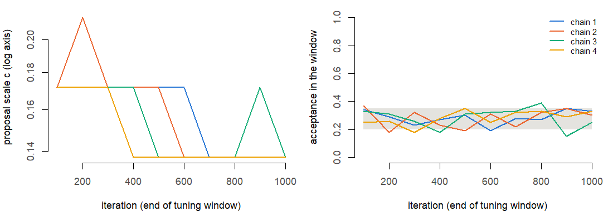
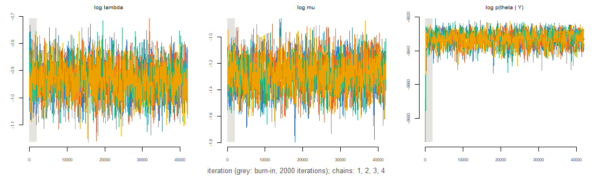
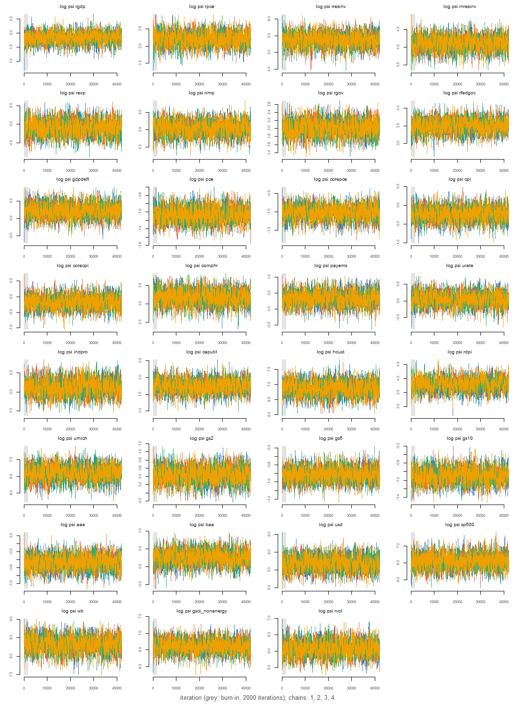
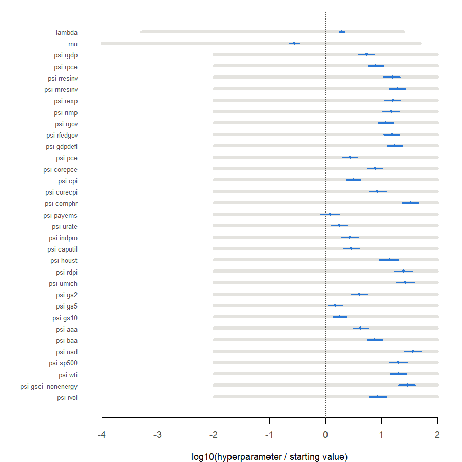
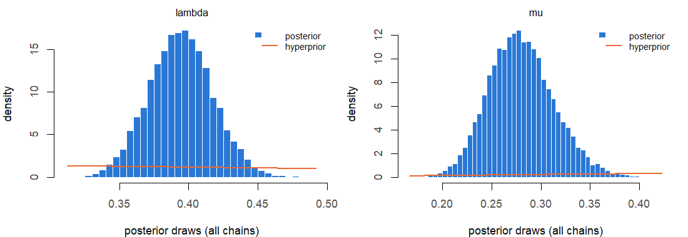
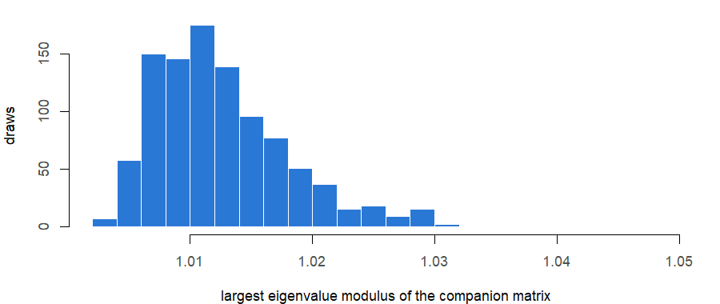
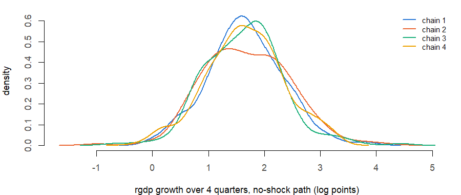

# MCMC diagnostics of an estimation run

**Run:** 2026m09_none_full_545b70ff. **COVID method:** none. **Estimation sample:** 1973Q1–2026Q2 (214 quarters; the first 5 serve as initial lags). **Lags:** 5. **Data:** QD vintage file fred_qd_vintages/FRED-QD_2026m09.csv, API as-of date 2026-09-30; the forecast history ends 2026Q2.

**Sampler** (Giannone, Lenza and Primiceri 2015, Appendix B): random-walk Metropolis on θ = log(h), h = (λ, µ, ψ₁…ψ₃₁), proposal N(θ, c W) with W the inverse of minus the Hessian at the posterior mode; c tuned during the first 50% of the burn-in, then fixed. **MCMC profile:** full. **Chains:** 4, each 42,000 iterations, of which 2,000 burn-in, thinned every 10: 4,000 retained draws per chain, 16,000 in all. **Starts:** overdispersed, mode + 2 x (approximate posterior s.d.) in random directions. **Seeds:** chains 20261017, 20261018, 20261019, 20261020; starts 20263017, 20263018, 20263019, 20263020; coefficient draws 20262016. **Draws for the engine:** 1,000, evenly spaced over the pooled retained draws, one (Σ, B) each.

**How to read this report.** The hyperparameter chain is the only Markov-chain part of the estimator: given each hyperparameter draw, Σ and B are drawn exactly. Effective sample size (ESS) is the number of independent draws the autocorrelated chains are worth, summed over chains. R-hat compares the spread between chains with the spread within them; values near 1 mean the chains agree, which is informative only because they started apart. Geweke’s z compares the mean of the first 10% of each chain with that of its last 50%. Intervals are posterior (credible) intervals.

# 1. Convergence targets

| check                          | worst               | threshold | result |
|:-------------------------------|:--------------------|:----------|:-------|
| ESS (sum over chains), minimum | 1440 (psi baa)      | \>= 1000  | pass   |
| R-hat (point), maximum         | 1.005 (psi corepce) | \< 1.05   | pass   |

Multivariate R-hat (Brooks and Gelman 1998) over all 33 hyperparameters: 1.012.

# 2. Chains

| chain |     seed | acceptance | scale | log_post_start | start_clipped | minutes |
|------:|---------:|-----------:|------:|---------------:|--------------:|--------:|
|     1 | 20261017 |      0.298 | 0.137 |      -8681.387 |             0 |  37.782 |
|     2 | 20261018 |      0.300 | 0.137 |      -8687.259 |             0 |  37.806 |
|     3 | 20261019 |      0.298 | 0.137 |      -8697.253 |             0 |  37.742 |
|     4 | 20261020 |      0.296 | 0.137 |      -8678.568 |             0 |  37.818 |

`acceptance` is the share of accepted proposals after the burn-in; `scale` the final c; `log_post_start` the log posterior (θ scale) at the start; `start_clipped` the number of start coordinates moved inside a search bound. For comparison, the log posterior at the mode is -8616.27; the trace below shows how quickly each chain climbs from its start to that level.

# 3. Trace plots

# 4. Every hyperparameter

| hyperparameter | q05 | median | q95 | ess | ess_per_1000 | rhat | rhat_upper | max \|Geweke z\| | near bound |
|:---|---:|---:|---:|---:|---:|---:|---:|---:|---:|
| lambda | 0.3563 | 0.3942 | 0.4329 | 1573.821 | 9.8364 | 1.0015 | 1.0040 | 0.6774 | 0 |
| mu | 0.2283 | 0.2783 | 0.3382 | 1531.437 | 9.5715 | 1.0019 | 1.0051 | 2.1036 | 0 |
| psi rgdp | 4.4913 | 6.2448 | 8.5219 | 1567.137 | 9.7946 | 1.0017 | 1.0053 | 1.4134 | 0 |
| psi rpce | 6.4866 | 9.1454 | 12.6278 | 1678.939 | 10.4934 | 1.0006 | 1.0013 | 0.7494 | 0 |
| psi rresinv | 152.3122 | 215.8829 | 295.7365 | 1621.785 | 10.1362 | 1.0024 | 1.0055 | 3.1503 | 0 |
| psi rnresinv | 43.5614 | 61.2643 | 84.3811 | 1516.706 | 9.4794 | 1.0028 | 1.0087 | 0.8241 | 0 |
| psi rexp | 96.6458 | 135.9618 | 188.6683 | 1566.168 | 9.7886 | 1.0025 | 1.0080 | 2.2745 | 0 |
| psi rimp | 109.0180 | 154.5545 | 216.3703 | 1528.161 | 9.5510 | 1.0014 | 1.0031 | 1.7078 | 0 |
| psi rgov | 5.4127 | 7.4739 | 10.2378 | 1486.694 | 9.2918 | 1.0022 | 1.0060 | 1.6622 | 0 |
| psi rfedgov | 24.0329 | 33.2107 | 45.2954 | 1557.751 | 9.7359 | 1.0007 | 1.0009 | 0.9313 | 0 |
| psi gdpdefl | 0.8988 | 1.2595 | 1.7398 | 1499.877 | 9.3742 | 1.0027 | 1.0079 | 1.7214 | 0 |
| psi pce | 0.2555 | 0.3473 | 0.4672 | 1569.838 | 9.8115 | 1.0016 | 1.0041 | 1.3197 | 0 |
| psi corepce | 0.2643 | 0.3614 | 0.4934 | 1550.240 | 9.6890 | 1.0046 | 1.0133 | 1.0428 | 0 |
| psi cpi | 0.5835 | 0.7967 | 1.0799 | 1579.316 | 9.8707 | 1.0005 | 1.0009 | 0.7377 | 0 |
| psi corecpi | 0.5984 | 0.8409 | 1.1844 | 1529.359 | 9.5585 | 1.0002 | 1.0005 | 2.2926 | 0 |
| psi comphr | 17.0463 | 24.1994 | 33.3846 | 1523.743 | 9.5234 | 1.0004 | 1.0010 | 1.2325 | 0 |
| psi payems | 0.9727 | 1.4049 | 2.0150 | 1539.093 | 9.6193 | 1.0006 | 1.0014 | 1.4105 | 0 |
| psi urate | 0.7537 | 1.0561 | 1.4494 | 1449.766 | 9.0610 | 1.0013 | 1.0037 | 0.6311 | 0 |
| psi indpro | 5.9556 | 8.3782 | 11.7158 | 1595.358 | 9.9710 | 1.0010 | 1.0018 | 1.8149 | 0 |
| psi caputil | 4.1189 | 5.6762 | 7.8449 | 1626.174 | 10.1636 | 1.0004 | 1.0010 | 0.6089 | 0 |
| psi houst | 644.3205 | 986.6050 | 1437.0122 | 1552.422 | 9.7026 | 1.0005 | 1.0015 | 2.3425 | 0 |
| psi rdpi | 30.2938 | 44.5986 | 64.1253 | 1524.984 | 9.5312 | 1.0033 | 1.0097 | 1.0753 | 0 |
| psi umich | 514.1168 | 745.4920 | 1058.2491 | 1456.719 | 9.1045 | 1.0010 | 1.0024 | 1.7290 | 0 |
| psi gs2 | 1.1189 | 1.5660 | 2.1432 | 1474.415 | 9.2151 | 1.0025 | 1.0077 | 2.4136 | 0 |
| psi gs5 | 0.3327 | 0.4383 | 0.5818 | 1592.190 | 9.9512 | 1.0002 | 1.0004 | 0.7498 | 0 |
| psi gs10 | 0.3071 | 0.4097 | 0.5466 | 1467.018 | 9.1689 | 1.0020 | 1.0051 | 1.0001 | 0 |
| psi aaa | 0.4658 | 0.6258 | 0.8384 | 1663.288 | 10.3956 | 1.0014 | 1.0021 | 1.9771 | 0 |
| psi baa | 0.9309 | 1.3079 | 1.8067 | 1439.650 | 8.9978 | 1.0008 | 1.0023 | 1.5034 | 0 |
| psi usd | 212.6308 | 298.7671 | 415.2667 | 1497.868 | 9.3617 | 1.0019 | 1.0058 | 0.9632 | 0 |
| psi sp500 | 495.9507 | 708.2007 | 1001.9458 | 1591.299 | 9.9456 | 1.0015 | 1.0042 | 1.1110 | 0 |
| psi wti | 2881.9896 | 4099.3187 | 5710.7253 | 1517.186 | 9.4824 | 1.0019 | 1.0052 | 1.6203 | 0 |
| psi gsci_nonenergy | 536.5279 | 757.5126 | 1043.9128 | 1591.282 | 9.9455 | 1.0026 | 1.0075 | 1.0538 | 0 |
| psi rvol | 305.7574 | 444.0810 | 650.1548 | 1642.310 | 10.2644 | 1.0008 | 1.0020 | 1.4917 | 0 |
| log p(theta \| Y) | -8640.0986 | -8632.5111 | -8626.7593 | 1482.829 | 9.2677 | 1.0036 | 1.0110 | 1.6541 | NA |

Quantiles are on the original scale (the log posterior row: on the θ scale). `ess_per_1000` is the ESS per 1,000 retained iterations of one chain, the rate used to size runs. With 34 quantities and 4 chains, \|Geweke z\| above 2 is expected for a few by chance; values well above 3 deserve a look at the trace.

# 5. Coefficient draws

Σ is positive definite in 100% of the 1,000 kept draws.

**Stability.** Largest companion-matrix eigenvalue modulus across kept draws: median 1.011, 95th percentile 1.024, maximum 1.048; share above 1 (explosive): 1. No stationarity restriction is imposed (Crump et al. 2021 impose none).

**Derived quantities by chain.** The diagnostics above concern the hyperparameters; results come from the coefficient draws. Two quantities the engine uses are compared across chains: the largest companion modulus and rgdp growth over 4 quarters from 2026Q2 on the no-shock forecast path (the forecast mean given each draw; log points, about percent). R-hat over chains: max_modulus 1.001; growth 1.001.

| quantity    | chain |    q05 | median |    q95 |
|:------------|------:|-------:|-------:|-------:|
| max_modulus |     1 | 1.0057 | 1.0114 | 1.0223 |
| max_modulus |     2 | 1.0060 | 1.0118 | 1.0240 |
| max_modulus |     3 | 1.0057 | 1.0113 | 1.0243 |
| max_modulus |     4 | 1.0057 | 1.0114 | 1.0233 |
| growth      |     1 | 0.4966 | 1.6441 | 2.6640 |
| growth      |     2 | 0.5837 | 1.6346 | 2.9299 |
| growth      |     3 | 0.6145 | 1.6686 | 2.6550 |
| growth      |     4 | 0.4926 | 1.6637 | 2.8572 |

# 6. Timings

Mode search 9 min; Hessian 6.6 min; chains 37.8, 37.8, 37.7, 37.8 min (run in parallel); coefficient draws 1.4 min. Code version: commit c97cd51ae8510a4fffc51a9fe8bebd0cd1c097e3, uncommitted changes in tracked files: TRUE.
