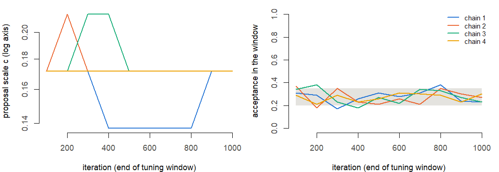
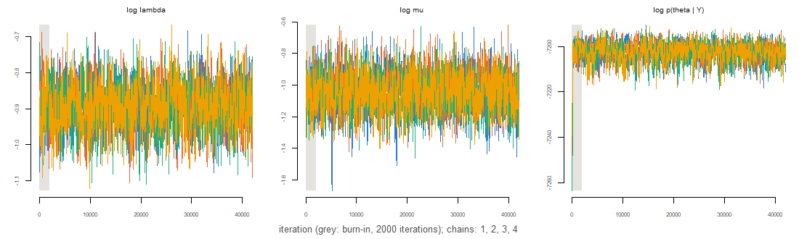
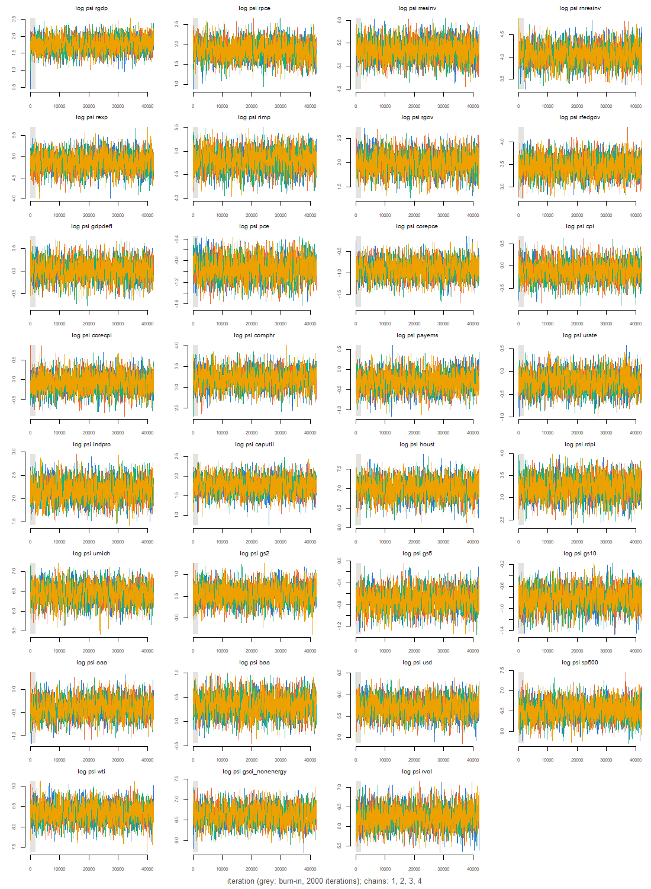
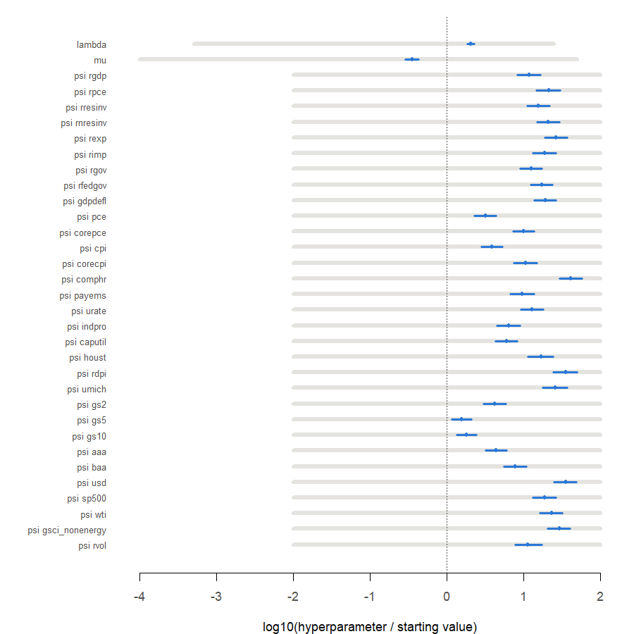
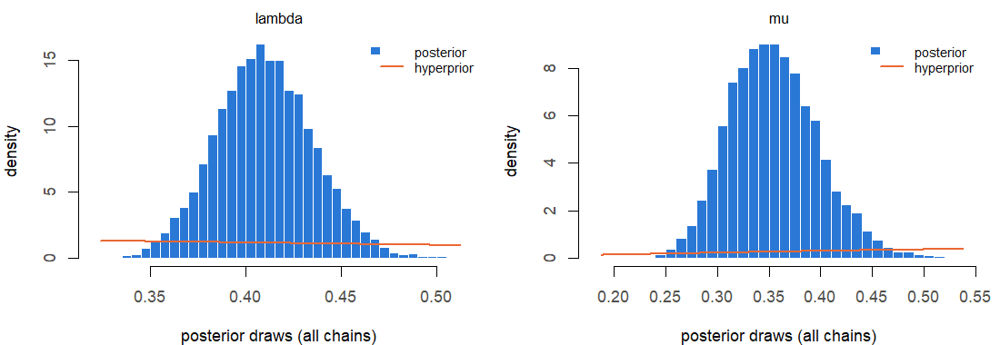
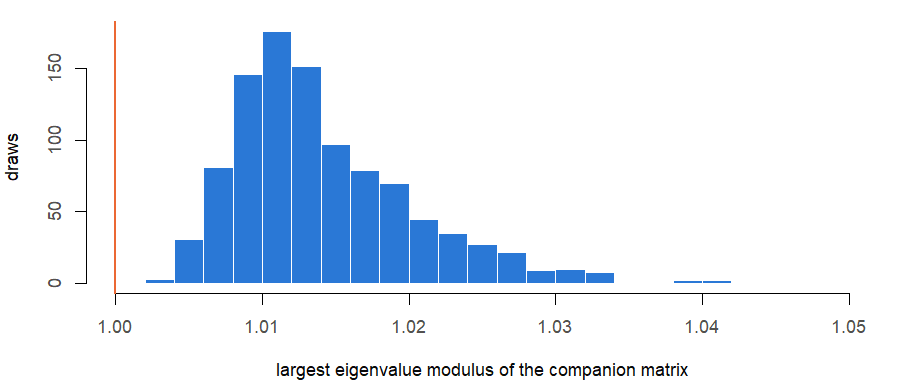
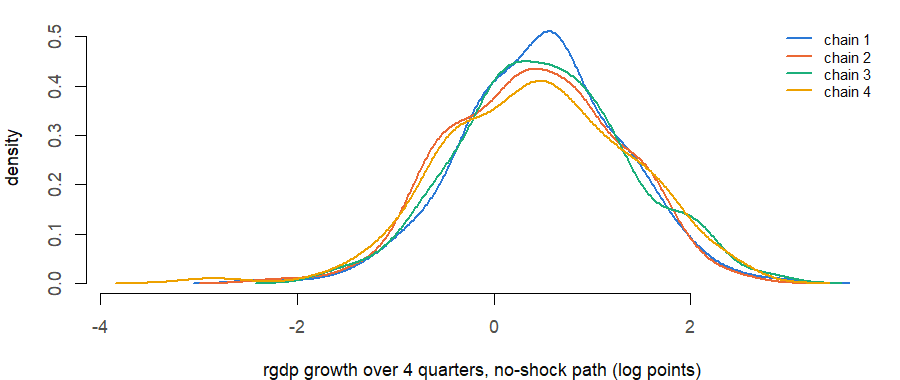

# MCMC diagnostics of an estimation run

**Run:** 2026m09_precovid_params_full_dc0d4609. **COVID method:** precovid_params. **Estimation sample:** 1973Q1–2019Q4 (188 quarters; the first 5 serve as initial lags). **Lags:** 5. **Data:** QD vintage file fred_qd_vintages/FRED-QD_2026m09.csv, API as-of date 2026-09-30; the forecast history ends 2026Q2.

**Sampler** (Giannone, Lenza and Primiceri 2015, Appendix B): random-walk Metropolis on θ = log(h), h = (λ, µ, ψ₁…ψ₃₁), proposal N(θ, c W) with W the inverse of minus the Hessian at the posterior mode; c tuned during the first 50% of the burn-in, then fixed. **MCMC profile:** full. **Chains:** 4, each 42,000 iterations, of which 2,000 burn-in, thinned every 10: 4,000 retained draws per chain, 16,000 in all. **Starts:** overdispersed, mode + 2 x (approximate posterior s.d.) in random directions. **Seeds:** chains 20261017, 20261018, 20261019, 20261020; starts 20263017, 20263018, 20263019, 20263020; coefficient draws 20262016. **Draws for the engine:** 1,000, evenly spaced over the pooled retained draws, one (Σ, B) each.

**How to read this report.** The hyperparameter chain is the only Markov-chain part of the estimator: given each hyperparameter draw, Σ and B are drawn exactly. Effective sample size (ESS) is the number of independent draws the autocorrelated chains are worth, summed over chains. R-hat compares the spread between chains with the spread within them; values near 1 mean the chains agree, which is informative only because they started apart. Geweke’s z compares the mean of the first 10% of each chain with that of its last 50%. Intervals are posterior (credible) intervals.

# 1. Convergence targets

| check                          | worst                    | threshold | result |
|:-------------------------------|:-------------------------|:----------|:-------|
| ESS (sum over chains), minimum | 1326 (log p(theta \| Y)) | \>= 1000  | pass   |
| R-hat (point), maximum         | 1.005 (mu)               | \< 1.05   | pass   |

Multivariate R-hat (Brooks and Gelman 1998) over all 33 hyperparameters: 1.021.

# 2. Chains

| chain |     seed | acceptance | scale | log_post_start | start_clipped | minutes |
|------:|---------:|-----------:|------:|---------------:|--------------:|--------:|
|     1 | 20261017 |      0.246 | 0.172 |      -7249.824 |             0 |  30.756 |
|     2 | 20261018 |      0.246 | 0.172 |      -7258.051 |             0 |  30.758 |
|     3 | 20261019 |      0.248 | 0.172 |      -7266.672 |             0 |  30.766 |
|     4 | 20261020 |      0.243 | 0.172 |      -7250.647 |             0 |  30.750 |

`acceptance` is the share of accepted proposals after the burn-in; `scale` the final c; `log_post_start` the log posterior (θ scale) at the start; `start_clipped` the number of start coordinates moved inside a search bound. For comparison, the log posterior at the mode is -7185.929; the trace below shows how quickly each chain climbs from its start to that level.

# 3. Trace plots

# 4. Every hyperparameter

| hyperparameter | q05 | median | q95 | ess | ess_per_1000 | rhat | rhat_upper | max \|Geweke z\| | near bound |
|:---|---:|---:|---:|---:|---:|---:|---:|---:|---:|
| lambda | 0.3685 | 0.4091 | 0.4528 | 1583.415 | 9.8963 | 1.0016 | 1.0049 | 2.5941 | 0 |
| mu | 0.2893 | 0.3524 | 0.4303 | 1774.309 | 11.0894 | 1.0052 | 1.0152 | 1.6650 | 0 |
| psi rgdp | 4.0911 | 5.7946 | 8.1259 | 1554.651 | 9.7166 | 1.0026 | 1.0081 | 1.3215 | 0 |
| psi rpce | 4.4317 | 6.4425 | 9.0951 | 1592.317 | 9.9520 | 1.0037 | 1.0097 | 1.3758 | 0 |
| psi rresinv | 148.8756 | 210.9976 | 294.3971 | 1721.323 | 10.7583 | 1.0033 | 1.0080 | 1.1385 | 0 |
| psi rnresinv | 41.2893 | 58.1889 | 80.8551 | 1533.615 | 9.5851 | 1.0031 | 1.0099 | 1.3889 | 0 |
| psi rexp | 93.3381 | 130.5683 | 182.0700 | 1671.004 | 10.4438 | 1.0013 | 1.0027 | 1.9868 | 0 |
| psi rimp | 86.3304 | 122.1580 | 171.3529 | 1581.544 | 9.8846 | 1.0033 | 1.0102 | 1.9069 | 0 |
| psi rgov | 5.3209 | 7.4183 | 10.2096 | 1563.181 | 9.7699 | 1.0042 | 1.0129 | 2.5176 | 0 |
| psi rfedgov | 23.2837 | 32.2610 | 44.1033 | 1650.720 | 10.3170 | 1.0021 | 1.0053 | 1.5962 | 0 |
| psi gdpdefl | 0.7302 | 1.0198 | 1.4146 | 1603.466 | 10.0217 | 1.0017 | 1.0051 | 0.9886 | 0 |
| psi pce | 0.2777 | 0.3840 | 0.5300 | 1477.511 | 9.2344 | 1.0009 | 1.0020 | 1.2822 | 0 |
| psi corepce | 0.2895 | 0.3989 | 0.5522 | 1582.491 | 9.8906 | 1.0015 | 1.0045 | 1.4110 | 0 |
| psi cpi | 0.6545 | 0.9048 | 1.2516 | 1490.524 | 9.3158 | 1.0043 | 1.0102 | 1.3439 | 0 |
| psi corecpi | 0.6507 | 0.9304 | 1.3189 | 1603.350 | 10.0209 | 1.0036 | 1.0102 | 1.3902 | 0 |
| psi comphr | 17.4796 | 24.5125 | 34.0777 | 1559.458 | 9.7466 | 1.0022 | 1.0070 | 1.1150 | 0 |
| psi payems | 0.5192 | 0.7468 | 1.0756 | 1649.840 | 10.3115 | 1.0005 | 1.0007 | 2.7348 | 0 |
| psi urate | 0.5738 | 0.7995 | 1.1225 | 1516.047 | 9.4753 | 1.0040 | 1.0122 | 0.9723 | 0 |
| psi indpro | 6.3236 | 8.9377 | 12.5482 | 1596.120 | 9.9758 | 1.0007 | 1.0021 | 1.7593 | 0 |
| psi caputil | 4.1826 | 5.8570 | 8.0161 | 1596.765 | 9.9798 | 1.0003 | 1.0011 | 0.8148 | 0 |
| psi houst | 741.7040 | 1102.5815 | 1588.2757 | 1673.577 | 10.4599 | 1.0007 | 1.0016 | 1.0159 | 0 |
| psi rdpi | 17.5639 | 25.6937 | 36.5939 | 1599.393 | 9.9962 | 1.0008 | 1.0025 | 1.6606 | 0 |
| psi umich | 423.5344 | 625.6834 | 894.6171 | 1496.628 | 9.3539 | 1.0008 | 1.0014 | 1.0775 | 0 |
| psi gs2 | 1.2460 | 1.7310 | 2.4043 | 1557.523 | 9.7345 | 1.0012 | 1.0033 | 3.6603 | 0 |
| psi gs5 | 0.3651 | 0.4873 | 0.6540 | 1538.168 | 9.6135 | 1.0005 | 1.0009 | 2.5007 | 0 |
| psi gs10 | 0.3231 | 0.4384 | 0.5872 | 1519.528 | 9.4971 | 1.0010 | 1.0030 | 1.7527 | 0 |
| psi aaa | 0.4964 | 0.6840 | 0.9353 | 1611.104 | 10.0694 | 1.0005 | 1.0007 | 0.8264 | 0 |
| psi baa | 0.9979 | 1.4013 | 1.9593 | 1501.982 | 9.3874 | 1.0007 | 1.0023 | 1.2011 | 0 |
| psi usd | 214.4668 | 302.6893 | 419.5118 | 1610.830 | 10.0677 | 1.0008 | 1.0025 | 1.3352 | 0 |
| psi sp500 | 478.0677 | 681.6291 | 970.7825 | 1615.887 | 10.0993 | 1.0002 | 1.0009 | 2.8511 | 0 |
| psi wti | 2980.6937 | 4220.4304 | 5857.3816 | 1631.668 | 10.1979 | 1.0030 | 1.0087 | 1.1887 | 0 |
| psi gsci_nonenergy | 532.7389 | 758.4519 | 1051.8376 | 1555.375 | 9.7211 | 1.0022 | 1.0062 | 1.3557 | 0 |
| psi rvol | 344.3413 | 510.2422 | 762.8641 | 1647.530 | 10.2971 | 1.0024 | 1.0063 | 2.4888 | 0 |
| log p(theta \| Y) | -7209.6892 | -7202.1880 | -7196.3229 | 1325.816 | 8.2864 | 1.0009 | 1.0021 | 0.4012 | NA |

Quantiles are on the original scale (the log posterior row: on the θ scale). `ess_per_1000` is the ESS per 1,000 retained iterations of one chain, the rate used to size runs. With 34 quantities and 4 chains, \|Geweke z\| above 2 is expected for a few by chance; values well above 3 deserve a look at the trace.

# 5. Coefficient draws

Σ is positive definite in 100% of the 1,000 kept draws.

**Stability.** Largest companion-matrix eigenvalue modulus across kept draws: median 1.013, 95th percentile 1.026, maximum 1.048; share above 1 (explosive): 1. No stationarity restriction is imposed (Crump et al. 2021 impose none).

**Derived quantities by chain.** The diagnostics above concern the hyperparameters; results come from the coefficient draws. Two quantities the engine uses are compared across chains: the largest companion modulus and rgdp growth over 4 quarters from 2026Q2 on the no-shock forecast path (the forecast mean given each draw; log points, about percent). R-hat over chains: max_modulus 1.002; growth 1.002.

| quantity    | chain |     q05 | median |    q95 |
|:------------|------:|--------:|-------:|-------:|
| max_modulus |     1 |  1.0066 | 1.0130 | 1.0259 |
| max_modulus |     2 |  1.0068 | 1.0123 | 1.0257 |
| max_modulus |     3 |  1.0061 | 1.0131 | 1.0273 |
| max_modulus |     4 |  1.0068 | 1.0131 | 1.0271 |
| growth      |     1 | -0.8712 | 0.4998 | 1.7936 |
| growth      |     2 | -0.8609 | 0.4168 | 1.6991 |
| growth      |     3 | -0.8399 | 0.4918 | 2.0692 |
| growth      |     4 | -0.9984 | 0.4533 | 1.9115 |

# 6. Timings

Mode search 10.2 min; Hessian 6.8 min; chains 30.8, 30.8, 30.8, 30.8 min (run in parallel); coefficient draws 1.4 min. Code version: commit c97cd51ae8510a4fffc51a9fe8bebd0cd1c097e3, uncommitted changes in tracked files: TRUE.
