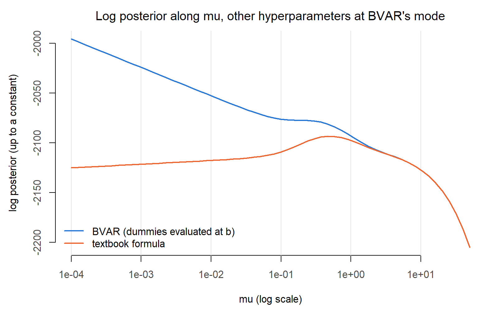
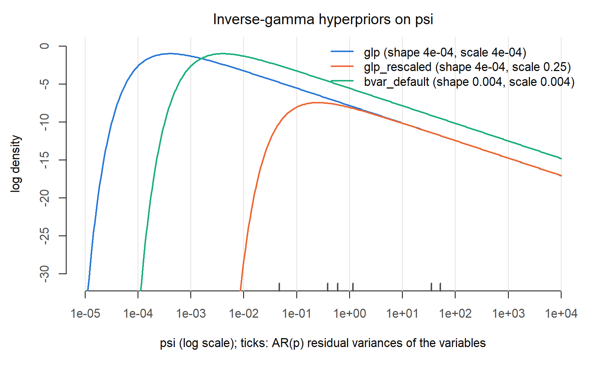
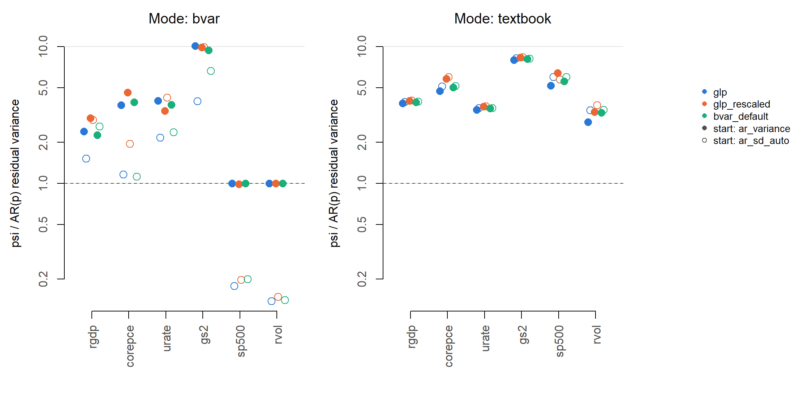

# Prior and hyperparameter checks

**Model checked:** 6 variables (rgdp, corepce, urate, gs2, sp500, rvol), 5 lags, sample 1973Q1 to 2026Q2 ( 214 quarters ), COVID method none. BVAR version 1.0.5. Run 2026-10-21 20:04.

**What is being checked.** The hyperparameters λ (overall tightness), µ (sum-of-coefficients tightness) and ψ (the scale of each variable) are chosen by the posterior of the hyperparameters: the marginal likelihood of the data times the hyperpriors (Giannone, Lenza and Primiceri 2015). Every draw of the model depends on that function. These checks test, on a small model where every number can be inspected, (1–2) that the prior is built as intended, (3) that the package’s log posterior agrees with an independent implementation written from the formulas (`R/estimate_ml.R`), and (4–5) how the mode depends on the settings that the paper does not specify.

Verdicts: **PASS** when the stated criterion holds; **FLAG** when it does not. A flag is a finding to be explained, not an error to be hidden.

# 1. Prior mean placement

**What:** BVAR builds the prior mean matrix b (K × n) from a vector of own-first-lag means. Intended: 1 for random-walk variables, 0 for realized volatility (white noise), 0 everywhere else. **How:** read the matrix stored in the fitted object; compare the diagonal of the lag-1 block with the intended vector, and check every other entry is 0. **Criterion:** exact equality.

| variable | intended | found | max_abs_elsewhere | ok   |
|:---------|---------:|------:|------------------:|:-----|
| rgdp     |        1 |     1 |                 0 | TRUE |
| corepce  |        1 |     1 |                 0 | TRUE |
| urate    |        1 |     1 |                 0 | TRUE |
| gs2      |        1 |     1 |                 0 | TRUE |
| sp500    |        1 |     1 |                 0 | TRUE |
| rvol     |        0 |     0 |                 0 | TRUE |

Verdict: **PASS**.

# 2. Posterior mean under a very tight prior

**What:** as λ → 0 the prior dominates, so the posterior mean of every lag coefficient must approach its prior mean. **How:** BVAR’s posterior mean of the coefficients at λ = 10^{-4}, µ at its prior mode, ψ at the starting values; compare all lag coefficients with b. **Criterion:** largest absolute deviation below 0.001.

| variable | prior_own_lag1 | posterior_own_lag1 | max_abs_dev_all_lags |
|:---------|---------------:|-------------------:|---------------------:|
| rgdp     |              1 |           0.999994 |             0.000091 |
| corepce  |              1 |           0.999343 |             0.000657 |
| urate    |              1 |           0.999999 |             0.000047 |
| gs2      |              1 |           0.999999 |             0.000026 |
| sp500    |              1 |           1.000001 |             0.000636 |
| rvol     |              0 |           0.000001 |             0.001403 |

Largest absolute deviation over all lag coefficients: 0.0014. Verdict: **FLAG**.

**Limit along λ.** The deviation is the pull of the data under a finite prior variance λ²/(s^α ψⱼ), so it should shrink in proportion to λ² as λ decreases, whatever µ is. **Criterion:** once λ is small enough for the prior to dominate (steps ending at λ ≤ 1e-5), each tenfold decrease in λ divides the deviation by about 100 (ratio between 0.005 and 0.02), and the deviation at λ = 1e-6 is below 1e-6. The first step, from λ = 1e-3, is shown but not judged: there the data still matter beyond the leading term.

| lambda | max_abs_dev | ratio_to_previous | lambda_sq_ratio |
|-------:|------------:|------------------:|----------------:|
|  1e-03 |  0.00861572 |                NA |              NA |
|  1e-04 |  0.00140254 |        0.16278804 |            0.01 |
|  1e-05 |  0.00001615 |        0.01151205 |            0.01 |
|  1e-06 |  0.00000016 |        0.01001511 |            0.01 |

Verdict: **PASS**.

# 3. Log posterior: BVAR against an independent implementation

**What:** the log posterior of the hyperparameters, log p(Y \| γ) + log p(γ), where the sum-of-coefficients prior enters as dummy observations and p(Y \| γ) = p(\[Y⁺; Y\] \| γ) / p(Y⁺ \| γ). **How:** at each point, three values:

- `bvar`: the package’s value (its internal function `bv_ml`, as used by `bvar()`);
- `direct_dummy_at_b`: the direct implementation, with the dummy-only term p(Y⁺ \| γ) evaluated at the prior mean b (the way the package source does it);
- `direct_textbook`: the direct implementation with the standard formula, where p(Y⁺ \| γ) uses the posterior mean of the coefficients given the dummy observations.

The two direct versions coincide whenever the dummy observations are fitted exactly by b. For the sum-of-coefficients dummies that holds for a variable with prior mean 1 on its own first lag (X⁺b reproduces Y⁺), and not for a variable with prior mean 0.

**Criteria:** (a) `bvar` equals `direct_dummy_at_b` to within 1e-6 at ordinary values of the hyperparameters (implementation check); (b) `bvar` equals `direct_textbook` to within 1e-6 (formula check).

## 3.1 Model as specified (realized volatility with prior mean 0)

| point | lambda | mu | bvar | direct_dummy_at_b | direct_textbook | diff_bvar_vs_dummy_at_b | diff_bvar_vs_textbook |
|:---|---:|---:|---:|---:|---:|---:|---:|
| BVAR mode | 0.450827 | 1e-04 | -1995.769 | -1995.763 | -2125.237 | -0.005702 | 129.467833 |
| prior modes | 0.200000 | 1e+00 | -2111.694 | -2111.694 | -2113.066 | 0.000000 | 1.371925 |
| mu = 0.01 | 0.200000 | 1e-02 | -2084.528 | -2084.528 | -2139.574 | -0.000002 | 55.045945 |
| mu = 0.1 | 0.200000 | 1e-01 | -2105.683 | -2105.683 | -2128.741 | 0.000000 | 23.057837 |
| mu = 10 | 0.200000 | 1e+01 | -2142.626 | -2142.626 | -2142.626 | 0.000000 | 0.000863 |
| lambda = 1 | 1.000000 | 1e+00 | -2163.851 | -2163.851 | -2172.761 | 0.000000 | 8.910110 |

1)  Largest \|bvar − direct_dummy_at_b\| at points with µ ≥ 0.01: 2.39^{-6}. Verdict: **FLAG**.
2)  Largest \|bvar − direct_textbook\|: 129. Verdict: **FLAG**.

## 3.2 Every variable with prior mean 1 (realized volatility set to random walk for this check only)

| point | lambda | mu | bvar | direct_dummy_at_b | direct_textbook | diff_bvar_vs_dummy_at_b | diff_bvar_vs_textbook |
|:---|---:|---:|---:|---:|---:|---:|---:|
| BVAR mode | 0.621269 | 0.533176 | -2090.330 | -2090.330 | -2090.330 | 0e+00 | 0e+00 |
| prior modes | 0.200000 | 1.000000 | -2129.215 | -2129.215 | -2129.215 | 0e+00 | 0e+00 |
| mu = 0.01 | 0.200000 | 0.010000 | -2156.447 | -2156.447 | -2156.447 | -2e-06 | -2e-06 |
| mu = 0.1 | 0.200000 | 0.100000 | -2146.850 | -2146.850 | -2146.850 | 0e+00 | 0e+00 |
| mu = 10 | 0.200000 | 10.000000 | -2148.792 | -2148.792 | -2148.792 | 0e+00 | 0e+00 |
| lambda = 1 | 1.000000 | 1.000000 | -2176.268 | -2176.268 | -2176.268 | 0e+00 | 0e+00 |

1)  Largest \|bvar − direct_dummy_at_b\|: 2.39^{-6}. (b) Largest \|bvar − direct_textbook\|: 2.39^{-6}. Verdict (both below 1e-6): **FLAG**.

BVAR’s mode in this variant: λ = 0.6213, µ = 0.5332.

## 3.3 The log posterior along µ

Other hyperparameters fixed at BVAR’s mode for the model as specified. Where the two curves differ, the package’s mode in µ differs from the textbook one.

# 4. ψ hyperprior and ψ starting values

**What:** the paper estimates ψ but does not state its hyperprior or the starting values and bounds of the search. Three hyperpriors are compared, each an inverse gamma on ψⱼ:

| option       | shape |  scale |
|:-------------|------:|-------:|
| glp          | 4e-04 | 0.0004 |
| glp_rescaled | 4e-04 | 0.2500 |
| bvar_default | 4e-03 | 0.0040 |

and two ways of setting the starting values and bounds:

- `ar_variance`: start at the OLS AR(p) residual variance of each variable (ψ is a variance scale: with d = n + 2, ψⱼ is the prior mean of Σⱼⱼ); bounds start / 100 and start × 100;
- `ar_sd_auto`: the package default, start at the AR(p) residual standard deviation (maximum likelihood fit); bounds start / 100 and start × 100.

**How:** for each of the 6 configurations, the mode found by BVAR and the mode of the textbook log posterior (same optimizer, L-BFGS-B, same start and bounds). `log_post_textbook` evaluates both modes with the textbook formula, so the two rows of a configuration can be compared: the textbook mode should have the higher value. **Criteria:** optimizer converged (code 0); no hyperparameter at a bound.

| hyperprior | psi_start | source | lambda | mu | log_post_own_objective | log_post_textbook | convergence | message | at_bound |
|:---|:---|:---|---:|---:|---:|---:|---:|:---|:---|
| glp | ar_variance | bvar | 0.4660 | 0.0001 | -1991.774 | -2125.161 | 52 | ERROR: ABNORMAL_TERMINATION_IN_LNSRCH | soc lower |
| glp | ar_variance | textbook | 0.5231 | 0.6139 | -2081.835 | -2081.835 | 0 | CONVERGENCE: REL_REDUCTION_OF_F \<= FACTR\*EPSMCH |  |
| glp | ar_sd_auto | bvar | 0.2314 | 0.0001 | -2010.196 | -2149.073 | 52 | ERROR: ABNORMAL_TERMINATION_IN_LNSRCH | soc lower |
| glp | ar_sd_auto | textbook | 0.5539 | 0.6171 | -2081.653 | -2081.653 | 0 | CONVERGENCE: REL_REDUCTION_OF_F \<= FACTR\*EPSMCH |  |
| glp_rescaled | ar_variance | bvar | 0.4866 | 0.0001 | -1992.373 | -2126.180 | 52 | ERROR: ABNORMAL_TERMINATION_IN_LNSRCH | soc lower |
| glp_rescaled | ar_variance | textbook | 0.5650 | 0.6172 | -2082.927 | -2082.927 | 0 | CONVERGENCE: REL_REDUCTION_OF_F \<= FACTR\*EPSMCH |  |
| glp_rescaled | ar_sd_auto | bvar | 0.2609 | 0.0001 | -2010.464 | -2150.392 | 52 | ERROR: ABNORMAL_TERMINATION_IN_LNSRCH | soc lower |
| glp_rescaled | ar_sd_auto | textbook | 0.5785 | 0.6182 | -2082.813 | -2082.813 | 0 | CONVERGENCE: REL_REDUCTION_OF_F \<= FACTR\*EPSMCH |  |
| bvar_default | ar_variance | bvar | 0.4659 | 0.0001 | -1978.201 | -2111.609 | 52 | ERROR: ABNORMAL_TERMINATION_IN_LNSRCH | soc lower |
| bvar_default | ar_variance | textbook | 0.5469 | 0.6161 | -2068.009 | -2068.009 | 0 | CONVERGENCE: REL_REDUCTION_OF_F \<= FACTR\*EPSMCH |  |
| bvar_default | ar_sd_auto | bvar | 0.2278 | 0.0001 | -1992.781 | -2131.324 | 52 | ERROR: ABNORMAL_TERMINATION_IN_LNSRCH | soc lower |
| bvar_default | ar_sd_auto | textbook | 0.5547 | 0.6173 | -2068.000 | -2068.000 | 0 | CONVERGENCE: REL_REDUCTION_OF_F \<= FACTR\*EPSMCH |  |

Configurations with a non-zero convergence code: 6 of 12. Modes with a hyperparameter at a bound: 6 of 12.

ψ at the mode relative to each variable’s AR(p) residual variance:

| source | hyperprior | psi_start | variable | psi | ar_variance | ratio_to_ar_variance | min | max | at_bound |
|:---|:---|:---|:---|---:|---:|---:|---:|---:|:---|
| bvar | bvar_default | ar_sd_auto | rgdp | 3.0202 | 1.1583 | 2.6074 | 0.0113 | 113.1113 |  |
| bvar | bvar_default | ar_sd_auto | corepce | 0.0525 | 0.0469 | 1.1199 | 0.0021 | 20.6079 |  |
| bvar | bvar_default | ar_sd_auto | urate | 1.4146 | 0.5987 | 2.3625 | 0.0076 | 76.3522 |  |
| bvar | bvar_default | ar_sd_auto | gs2 | 2.5493 | 0.3844 | 6.6322 | 0.0061 | 60.9135 |  |
| bvar | bvar_default | ar_sd_auto | sp500 | 7.0041 | 35.1689 | 0.1992 | 0.0602 | 601.7103 |  |
| bvar | bvar_default | ar_sd_auto | rvol | 7.3472 | 52.2168 | 0.1407 | 0.0712 | 712.2702 |  |
| bvar | bvar_default | ar_variance | rgdp | 2.6063 | 1.1583 | 2.2500 | 0.0116 | 115.8350 |  |
| bvar | bvar_default | ar_variance | corepce | 0.1832 | 0.0469 | 3.9096 | 0.0005 | 4.6869 |  |
| bvar | bvar_default | ar_variance | urate | 2.2453 | 0.5987 | 3.7500 | 0.0060 | 59.8750 |  |
| bvar | bvar_default | ar_variance | gs2 | 3.6142 | 0.3844 | 9.4028 | 0.0038 | 38.4377 |  |
| bvar | bvar_default | ar_variance | sp500 | 35.1939 | 35.1689 | 1.0007 | 0.3517 | 3516.8928 |  |
| bvar | bvar_default | ar_variance | rvol | 52.1667 | 52.2168 | 0.9990 | 0.5222 | 5221.6842 |  |
| bvar | glp | ar_sd_auto | rgdp | 1.7647 | 1.1583 | 1.5234 | 0.0113 | 113.1113 |  |
| bvar | glp | ar_sd_auto | corepce | 0.0545 | 0.0469 | 1.1636 | 0.0021 | 20.6079 |  |
| bvar | glp | ar_sd_auto | urate | 1.2972 | 0.5987 | 2.1665 | 0.0076 | 76.3522 |  |
| bvar | glp | ar_sd_auto | gs2 | 1.5359 | 0.3844 | 3.9958 | 0.0061 | 60.9135 |  |
| bvar | glp | ar_sd_auto | sp500 | 6.2625 | 35.1689 | 0.1781 | 0.0602 | 601.7103 |  |
| bvar | glp | ar_sd_auto | rvol | 7.2167 | 52.2168 | 0.1382 | 0.0712 | 712.2702 |  |
| bvar | glp | ar_variance | rgdp | 2.7749 | 1.1583 | 2.3955 | 0.0116 | 115.8350 |  |
| bvar | glp | ar_variance | corepce | 0.1752 | 0.0469 | 3.7374 | 0.0005 | 4.6869 |  |
| bvar | glp | ar_variance | urate | 2.4086 | 0.5987 | 4.0228 | 0.0060 | 59.8750 |  |
| bvar | glp | ar_variance | gs2 | 3.8908 | 0.3844 | 10.1224 | 0.0038 | 38.4377 |  |
| bvar | glp | ar_variance | sp500 | 35.1922 | 35.1689 | 1.0007 | 0.3517 | 3516.8928 |  |
| bvar | glp | ar_variance | rvol | 52.1436 | 52.2168 | 0.9986 | 0.5222 | 5221.6842 |  |
| bvar | glp_rescaled | ar_sd_auto | rgdp | 3.3736 | 1.1583 | 2.9125 | 0.0113 | 113.1113 |  |
| bvar | glp_rescaled | ar_sd_auto | corepce | 0.0914 | 0.0469 | 1.9510 | 0.0021 | 20.6079 |  |
| bvar | glp_rescaled | ar_sd_auto | urate | 2.5374 | 0.5987 | 4.2378 | 0.0076 | 76.3522 |  |
| bvar | glp_rescaled | ar_sd_auto | gs2 | 3.8235 | 0.3844 | 9.9473 | 0.0061 | 60.9135 |  |
| bvar | glp_rescaled | ar_sd_auto | sp500 | 6.9223 | 35.1689 | 0.1968 | 0.0602 | 601.7103 |  |
| bvar | glp_rescaled | ar_sd_auto | rvol | 7.7300 | 52.2168 | 0.1480 | 0.0712 | 712.2702 |  |
| bvar | glp_rescaled | ar_variance | rgdp | 3.4732 | 1.1583 | 2.9984 | 0.0116 | 115.8350 |  |
| bvar | glp_rescaled | ar_variance | corepce | 0.2166 | 0.0469 | 4.6208 | 0.0005 | 4.6869 |  |
| bvar | glp_rescaled | ar_variance | urate | 2.0246 | 0.5987 | 3.3814 | 0.0060 | 59.8750 |  |
| bvar | glp_rescaled | ar_variance | gs2 | 3.7877 | 0.3844 | 9.8542 | 0.0038 | 38.4377 |  |
| bvar | glp_rescaled | ar_variance | sp500 | 34.7493 | 35.1689 | 0.9881 | 0.3517 | 3516.8928 |  |
| bvar | glp_rescaled | ar_variance | rvol | 52.2773 | 52.2168 | 1.0012 | 0.5222 | 5221.6842 |  |
| textbook | bvar_default | ar_sd_auto | rgdp | 4.5863 | 1.1583 | 3.9593 | 0.0113 | 113.1113 |  |
| textbook | bvar_default | ar_sd_auto | corepce | 0.2410 | 0.0469 | 5.1418 | 0.0021 | 20.6079 |  |
| textbook | bvar_default | ar_sd_auto | urate | 2.1294 | 0.5987 | 3.5564 | 0.0076 | 76.3522 |  |
| textbook | bvar_default | ar_sd_auto | gs2 | 3.1395 | 0.3844 | 8.1677 | 0.0061 | 60.9135 |  |
| textbook | bvar_default | ar_sd_auto | sp500 | 210.8698 | 35.1689 | 5.9959 | 0.0602 | 601.7103 |  |
| textbook | bvar_default | ar_sd_auto | rvol | 179.9564 | 52.2168 | 3.4463 | 0.0712 | 712.2702 |  |
| textbook | bvar_default | ar_variance | rgdp | 4.5514 | 1.1583 | 3.9292 | 0.0116 | 115.8350 |  |
| textbook | bvar_default | ar_variance | corepce | 0.2362 | 0.0469 | 5.0398 | 0.0005 | 4.6869 |  |
| textbook | bvar_default | ar_variance | urate | 2.1128 | 0.5987 | 3.5288 | 0.0060 | 59.8750 |  |
| textbook | bvar_default | ar_variance | gs2 | 3.1147 | 0.3844 | 8.1032 | 0.0038 | 38.4377 |  |
| textbook | bvar_default | ar_variance | sp500 | 196.2644 | 35.1689 | 5.5806 | 0.3517 | 3516.8928 |  |
| textbook | bvar_default | ar_variance | rvol | 172.0282 | 52.2168 | 3.2945 | 0.5222 | 5221.6842 |  |
| textbook | glp | ar_sd_auto | rgdp | 4.5738 | 1.1583 | 3.9485 | 0.0113 | 113.1113 |  |
| textbook | glp | ar_sd_auto | corepce | 0.2402 | 0.0469 | 5.1241 | 0.0021 | 20.6079 |  |
| textbook | glp | ar_sd_auto | urate | 2.1300 | 0.5987 | 3.5573 | 0.0076 | 76.3522 |  |
| textbook | glp | ar_sd_auto | gs2 | 3.1562 | 0.3844 | 8.2112 | 0.0061 | 60.9135 |  |
| textbook | glp | ar_sd_auto | sp500 | 211.0272 | 35.1689 | 6.0004 | 0.0602 | 601.7103 |  |
| textbook | glp | ar_sd_auto | rvol | 178.9258 | 52.2168 | 3.4266 | 0.0712 | 712.2702 |  |
| textbook | glp | ar_variance | rgdp | 4.4570 | 1.1583 | 3.8477 | 0.0116 | 115.8350 |  |
| textbook | glp | ar_variance | corepce | 0.2215 | 0.0469 | 4.7259 | 0.0005 | 4.6869 |  |
| textbook | glp | ar_variance | urate | 2.0715 | 0.5987 | 3.4596 | 0.0060 | 59.8750 |  |
| textbook | glp | ar_variance | gs2 | 3.0706 | 0.3844 | 7.9884 | 0.0038 | 38.4377 |  |
| textbook | glp | ar_variance | sp500 | 182.4950 | 35.1689 | 5.1891 | 0.3517 | 3516.8928 |  |
| textbook | glp | ar_variance | rvol | 146.4503 | 52.2168 | 2.8047 | 0.5222 | 5221.6842 |  |
| textbook | glp_rescaled | ar_sd_auto | rgdp | 4.6693 | 1.1583 | 4.0310 | 0.0113 | 113.1113 |  |
| textbook | glp_rescaled | ar_sd_auto | corepce | 0.2810 | 0.0469 | 5.9959 | 0.0021 | 20.6079 |  |
| textbook | glp_rescaled | ar_sd_auto | urate | 2.1999 | 0.5987 | 3.6742 | 0.0076 | 76.3522 |  |
| textbook | glp_rescaled | ar_sd_auto | gs2 | 3.2260 | 0.3844 | 8.3928 | 0.0061 | 60.9135 |  |
| textbook | glp_rescaled | ar_sd_auto | sp500 | 202.6227 | 35.1689 | 5.7614 | 0.0602 | 601.7103 |  |
| textbook | glp_rescaled | ar_sd_auto | rvol | 195.1202 | 52.2168 | 3.7367 | 0.0712 | 712.2702 |  |
| textbook | glp_rescaled | ar_variance | rgdp | 4.6370 | 1.1583 | 4.0031 | 0.0116 | 115.8350 |  |
| textbook | glp_rescaled | ar_variance | corepce | 0.2732 | 0.0469 | 5.8297 | 0.0005 | 4.6869 |  |
| textbook | glp_rescaled | ar_variance | urate | 2.1850 | 0.5987 | 3.6492 | 0.0060 | 59.8750 |  |
| textbook | glp_rescaled | ar_variance | gs2 | 3.2066 | 0.3844 | 8.3423 | 0.0038 | 38.4377 |  |
| textbook | glp_rescaled | ar_variance | sp500 | 225.3298 | 35.1689 | 6.4071 | 0.3517 | 3516.8928 |  |
| textbook | glp_rescaled | ar_variance | rvol | 173.5257 | 52.2168 | 3.3232 | 0.5222 | 5221.6842 |  |

# 5. Centring of the sum-of-coefficients dummies

**What:** the dummies are Y⁺ = diag(ȳ)/µ. Giannone, Lenza and Primiceri (2015) set ȳ to the mean of the first p observations of the sample; the package uses the first p rows after the initial lags. **How:** textbook mode under each convention, configured hyperprior and starting values. **Criterion:** none fixed; the size of the difference is reported.

| convention | rows_used | lambda | mu | log_post | convergence | psi_rgdp | psi_corepce | psi_urate | psi_gs2 | psi_sp500 | psi_rvol |
|:---|:---|---:|---:|---:|---:|---:|---:|---:|---:|---:|---:|
| estimation_sample | 1974Q2 to 1975Q2 | 0.5231 | 0.6139 | -2081.835 | 0 | 4.457 | 0.2215 | 2.0715 | 3.0706 | 182.495 | 146.4503 |
| presample | 1973Q1 to 1974Q1 | 0.5557 | 0.5009 | -2081.546 | 0 | 4.576 | 0.2400 | 2.1355 | 3.1192 | 184.491 | 185.2043 |

# 6. Names and starting values

Estimated hyperparameters, as named in the fitted object: lambda, soc, psi1, psi2, psi3, psi4, psi5, psi6 (ψ numbered in the column order of the data: rgdp, corepce, urate, gs2, sp500, rvol).

ψ starting values under both options (OLS AR(p) residual variance and standard deviation; the package’s automatic start and bounds):

| variable | ar_variance |  ar_sd | auto_start | auto_min | auto_max |
|:---------|------------:|-------:|-----------:|---------:|---------:|
| rgdp     |      1.1583 | 1.0763 |     1.1311 |   0.0113 | 113.1113 |
| corepce  |      0.0469 | 0.2165 |     0.2061 |   0.0021 |  20.6079 |
| urate    |      0.5987 | 0.7738 |     0.7635 |   0.0076 |  76.3522 |
| gs2      |      0.3844 | 0.6200 |     0.6091 |   0.0061 |  60.9135 |
| sp500    |     35.1689 | 5.9303 |     6.0171 |   0.0602 | 601.7103 |
| rvol     |     52.2168 | 7.2261 |     7.1227 |   0.0712 | 712.2702 |

Optimizer result for the configured prior: convergence code 52 (ERROR: ABNORMAL_TERMINATION_IN_LNSRCH).
