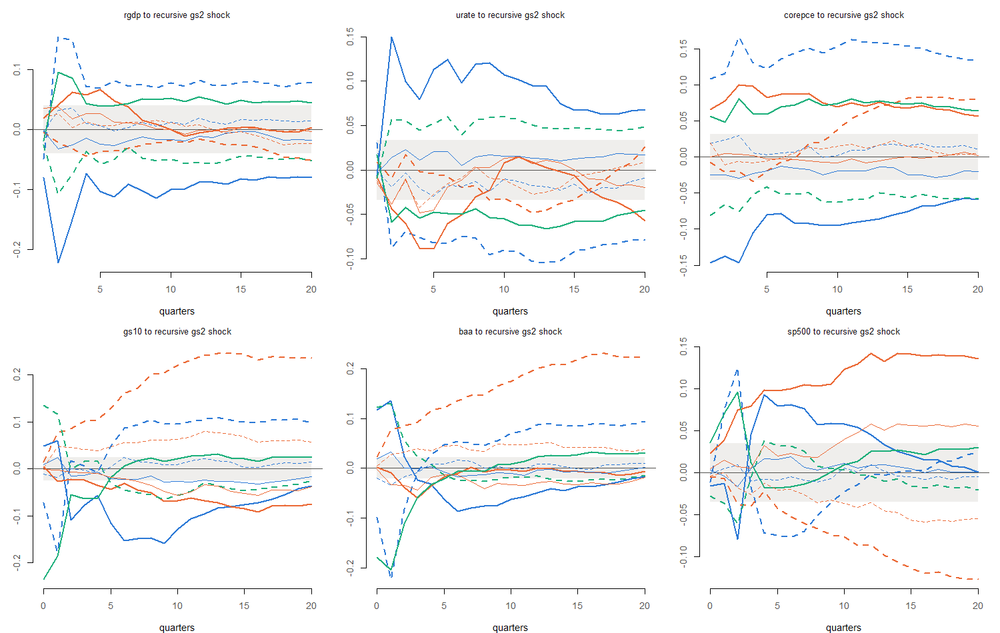

# Sensitivity to the hyperparameters

**Model:** COVID method `none`, 31 variables, 5 lags, the prior of `config/run.yml`, sample 1973Q1 to 2026Q2. **Reference:** the current run 2026m09_none_full_545b70ff, at its hyperparameter mode. 1000 draws of (B, Σ) per setting.

**What is checked.** The hyperparameters set how tight the prior is: λ the overall tightness of the Minnesota prior, µ the tightness of the sum-of-coefficients prior, ψ the scale of each variable’s residual variance in the prior (Crump et al. 2021, Section 2.2). They are estimated, and the production run averages over their posterior. Here each is moved away from its mode, one at a time, the coefficients are drawn given the moved value, and forecasts (from the last quarter) and impulse responses are compared with those at the mode. Two kinds of move:

- **Stress:** half or twice the mode (for ψ, all 31 together). Far outside the posterior; they show how strongly the results depend on the prior.
- **Posterior range:** λ or µ at the mode ± 2 posterior standard deviations of log h (from the current run’s MCMC draws). The edge of what the data allow.

Every setting uses the same random numbers, so differences come from the hyperparameters only. A rerun at the mode with other random numbers gives the noise level. Measures, as in the stability check: the difference of medians as a share of the reference’s 90% band width, and the ratio of band widths (variant / mode). Quarters 1–12 are the main window.

**How to read it with the stability check.** Between origins, the hyperparameter modes moved by up to about 0.2 on the log scale (µ at 2016Q2), within the posterior-range variants here. If those variants move results little, re-estimating the hyperparameters at past origins matters little.

# Variants

| variant | kind | value | change_in_log_h | log_posterior_vs_mode |
|:---|:---|:---|---:|---:|
| lambda x 0.5 | stress | 0.200 | -0.693 | -73.250 |
| lambda x 2 | stress | 0.802 | 0.693 | -111.660 |
| mu x 0.5 | stress | 0.140 | -0.693 | -13.841 |
| mu x 2 | stress | 0.559 | 0.693 | -17.200 |
| psi x 0.5 | stress | all ψ scaled | -0.693 | -127.612 |
| psi x 2 | stress | all ψ scaled | 0.693 | -144.054 |
| lambda -2 sd | posterior range | 0.355 | -0.120 | -2.685 |
| lambda +2 sd | posterior range | 0.452 | 0.120 | -2.887 |
| mu -2 sd | posterior range | 0.221 | -0.233 | -1.929 |
| mu +2 sd | posterior range | 0.352 | 0.233 | -2.080 |

*Mode: λ = 0.401, µ = 0.279. Posterior s.d. of log h: λ 0.0602, µ 0.116. `log_posterior_vs_mode`: log p(θ \| Y) at the variant minus at the mode; −2 corresponds to about 2 s.d. under a normal posterior, −70 and below is far outside it.*

# Forecasts

| variant | max_abs_median_diff | worst_variable | width_ratio_min | width_ratio_max | noise_max_abs_median_diff |
|:---|---:|:---|---:|---:|---:|
| lambda x 0.5 | 0.085 | urate | 0.923 | 1.100 | 0.052 |
| lambda x 2 | 0.075 | urate | 0.933 | 1.076 | 0.052 |
| mu x 0.5 | 0.128 | corepce | 0.930 | 1.066 | 0.052 |
| mu x 2 | 0.070 | gs2 | 0.925 | 1.105 | 0.052 |
| psi x 0.5 | 0.042 | urate | 0.959 | 1.042 | 0.052 |
| psi x 2 | 0.049 | urate | 0.971 | 1.067 | 0.052 |
| lambda -2 sd | 0.018 | urate | 0.967 | 1.029 | 0.052 |
| lambda +2 sd | 0.019 | urate | 0.961 | 1.042 | 0.052 |
| mu -2 sd | 0.040 | corepce | 0.944 | 1.083 | 0.052 |
| mu +2 sd | 0.036 | urate | 0.963 | 1.074 | 0.052 |

*Main variables (rgdp, pce, corepce, urate, gs2, gs10), quarters 1–12. `max_abs_median_diff`: largest \|difference of medians\| as a share of the 90% band width at the mode; `noise_*`: the same measure between two runs at the mode with different random numbers.*

| variant | max_abs_median_diff | worst_variable | width_ratio_min | width_ratio_max | noise_max_abs_median_diff |
|:---|---:|:---|---:|---:|---:|
| lambda x 0.5 | 0.089 | indpro | 0.877 | 1.120 | 0.058 |
| lambda x 2 | 0.080 | rresinv | 0.909 | 1.135 | 0.058 |
| mu x 0.5 | 0.154 | payems | 0.893 | 1.212 | 0.058 |
| mu x 2 | 0.101 | comphr | 0.925 | 1.154 | 0.058 |
| psi x 0.5 | 0.045 | rresinv | 0.909 | 1.052 | 0.058 |
| psi x 2 | 0.049 | urate | 0.959 | 1.151 | 0.058 |
| lambda -2 sd | 0.018 | urate | 0.950 | 1.050 | 0.058 |
| lambda +2 sd | 0.019 | urate | 0.952 | 1.047 | 0.058 |
| mu -2 sd | 0.060 | sp500 | 0.915 | 1.084 | 0.058 |
| mu +2 sd | 0.038 | rgov | 0.930 | 1.095 | 0.058 |

*All 31 variables, quarters 1–12.*

| variant | max_abs_median_diff | worst_variable | width_ratio_min | width_ratio_max | noise_max_abs_median_diff |
|:---|---:|:---|---:|---:|---:|
| lambda x 0.5 | 0.038 | urate | 0.875 | 1.020 | 0.044 |
| lambda x 2 | 0.033 | urate | 1.004 | 1.103 | 0.044 |
| mu x 0.5 | 0.136 | gs2 | 0.859 | 1.090 | 0.044 |
| mu x 2 | 0.083 | gs2 | 0.885 | 1.095 | 0.044 |
| psi x 0.5 | 0.019 | urate | 0.975 | 1.055 | 0.044 |
| psi x 2 | 0.019 | urate | 0.918 | 1.051 | 0.044 |
| lambda -2 sd | 0.015 | gs2 | 0.944 | 1.036 | 0.044 |
| lambda +2 sd | 0.016 | gs10 | 0.967 | 1.053 | 0.044 |
| mu -2 sd | 0.049 | corepce | 0.908 | 1.054 | 0.044 |
| mu +2 sd | 0.042 | gs2 | 0.944 | 1.101 | 0.044 |

*Main variables, quarters 13–20.*

# Impulse responses

| variant | max_abs_median_diff | worst_variable | width_ratio_min | width_ratio_max | noise_max_abs_median_diff |
|:---|---:|:---|---:|---:|---:|
| lambda x 0.5 | 0.223 | baa | 0.813 | 0.997 | 0.04 |
| lambda x 2 | 0.223 | rgdp | 1.006 | 1.208 | 0.04 |
| mu x 0.5 | 0.242 | gs10 | 0.961 | 1.138 | 0.04 |
| mu x 2 | 0.142 | sp500 | 0.945 | 1.132 | 0.04 |
| psi x 0.5 | 0.135 | gs10 | 0.962 | 1.129 | 0.04 |
| psi x 2 | 0.236 | gs10 | 0.909 | 1.065 | 0.04 |
| lambda -2 sd | 0.036 | rgdp | 0.938 | 1.029 | 0.04 |
| lambda +2 sd | 0.032 | rgdp | 0.991 | 1.068 | 0.04 |
| mu -2 sd | 0.080 | gs10 | 0.943 | 1.124 | 0.04 |
| mu +2 sd | 0.058 | sp500 | 0.914 | 1.093 | 0.04 |

*Recursive gs2 shock, responses rgdp, urate, corepce, gs10, baa, sp500, horizons 0–12 (slow variables’ impact, zero by construction, left out).*

| variant | max_abs_median_diff | worst_variable | width_ratio_min | width_ratio_max | noise_max_abs_median_diff |
|:---|---:|:---|---:|---:|---:|
| lambda x 0.5 | 0.220 | urate | 0.877 | 1.013 | 0.03 |
| lambda x 2 | 0.131 | gs2 | 1.013 | 1.232 | 0.03 |
| mu x 0.5 | 0.381 | urate | 0.925 | 1.132 | 0.03 |
| mu x 2 | 0.375 | urate | 0.852 | 1.084 | 0.03 |
| psi x 0.5 | 0.107 | payems | 0.970 | 1.095 | 0.03 |
| psi x 2 | 0.205 | payems | 0.893 | 1.015 | 0.03 |
| lambda -2 sd | 0.030 | urate | 0.934 | 1.054 | 0.03 |
| lambda +2 sd | 0.028 | urate | 0.983 | 1.072 | 0.03 |
| mu -2 sd | 0.129 | urate | 0.927 | 1.110 | 0.03 |
| mu +2 sd | 0.135 | urate | 0.864 | 1.058 | 0.03 |

*GIRF of real GDP, responses urate, corepce, gs2, payems, horizons 0–12.*

# In growth rates and percentage points

Bands of a BVAR are wide, so a change can be small against the band and still matter. The same draws are compared in the units forecasts are quoted in, path by path: year-on-year growth (log approximation) for log series, the level in percentage points for rates and indexes; impulse responses as the effect on year-on-year growth (log series) or the level response. Each change is read against the variable’s history (1973Q1–2019Q4): its s.d. and 10–90 percentile range of YoY growth (log series) or 4-quarter change (rates).

| variant | worst_variable | max_abs_diff | noise | diff_in_sd | diff_in_range | noise_in_sd |
|:---|:---|---:|---:|---:|---:|---:|
| lambda x 0.5 | urate | 0.284 | 0.147 | 0.261 | 0.115 | 0.135 |
| lambda x 2 | urate | 0.223 | 0.147 | 0.205 | 0.091 | 0.135 |
| mu x 0.5 | urate | 0.643 | 0.147 | 0.593 | 0.262 | 0.135 |
| mu x 2 | gs2 | 0.571 | 0.098 | 0.375 | 0.154 | 0.135 |
| psi x 0.5 | urate | 0.120 | 0.147 | 0.111 | 0.049 | 0.135 |
| psi x 2 | urate | 0.157 | 0.147 | 0.144 | 0.064 | 0.135 |
| lambda -2 sd | urate | 0.072 | 0.147 | 0.066 | 0.029 | 0.135 |
| lambda +2 sd | gs2 | 0.114 | 0.098 | 0.075 | 0.031 | 0.135 |
| mu -2 sd | urate | 0.194 | 0.147 | 0.178 | 0.079 | 0.135 |
| mu +2 sd | urate | 0.175 | 0.147 | 0.161 | 0.071 | 0.135 |

*Forecasts, main variables, quarters 1–12: per variant, the variable with the largest change relative to its history. `max_abs_diff` in YoY growth (%) or level (pp); `noise` the same between two runs at the mode with different random numbers; `diff_in_sd`, `diff_in_range` relative to the variable’s historical s.d. and 10–90 range.*

| variant      | variable | max_abs_diff | noise | diff_in_sd |
|:-------------|:---------|-------------:|------:|-----------:|
| lambda x 0.5 | rgdp     |        0.320 | 0.243 |      0.155 |
| lambda x 2   | rgdp     |        0.213 | 0.243 |      0.104 |
| mu x 0.5     | rgdp     |        0.517 | 0.243 |      0.251 |
| mu x 2       | rgdp     |        0.291 | 0.243 |      0.141 |
| psi x 0.5    | rgdp     |        0.125 | 0.243 |      0.061 |
| psi x 2      | rgdp     |        0.158 | 0.243 |      0.077 |
| lambda -2 sd | rgdp     |        0.071 | 0.243 |      0.034 |
| lambda +2 sd | rgdp     |        0.091 | 0.243 |      0.044 |
| mu -2 sd     | rgdp     |        0.176 | 0.243 |      0.086 |
| mu +2 sd     | rgdp     |        0.093 | 0.243 |      0.045 |
| lambda x 0.5 | corepce  |        0.113 | 0.145 |      0.051 |
| lambda x 2   | corepce  |        0.034 | 0.145 |      0.015 |
| mu x 0.5     | corepce  |        0.554 | 0.145 |      0.250 |
| mu x 2       | corepce  |        0.157 | 0.145 |      0.071 |
| psi x 0.5    | corepce  |        0.050 | 0.145 |      0.023 |
| psi x 2      | corepce  |        0.052 | 0.145 |      0.024 |
| lambda -2 sd | corepce  |        0.026 | 0.145 |      0.012 |
| lambda +2 sd | corepce  |        0.026 | 0.145 |      0.012 |
| mu -2 sd     | corepce  |        0.203 | 0.145 |      0.092 |
| mu +2 sd     | corepce  |        0.106 | 0.145 |      0.048 |
| lambda x 0.5 | urate    |        0.284 | 0.147 |      0.261 |
| lambda x 2   | urate    |        0.223 | 0.147 |      0.205 |
| mu x 0.5     | urate    |        0.643 | 0.147 |      0.593 |
| mu x 2       | urate    |        0.328 | 0.147 |      0.302 |
| psi x 0.5    | urate    |        0.120 | 0.147 |      0.111 |
| psi x 2      | urate    |        0.157 | 0.147 |      0.144 |
| lambda -2 sd | urate    |        0.072 | 0.147 |      0.066 |
| lambda +2 sd | urate    |        0.056 | 0.147 |      0.051 |
| mu -2 sd     | urate    |        0.194 | 0.147 |      0.178 |
| mu +2 sd     | urate    |        0.175 | 0.147 |      0.161 |

*Real GDP and core PCE (YoY growth, %) and the unemployment rate (pp), quarters 1–12.*

| variant | worst_variable | max_abs_diff | noise | diff_in_sd | diff_in_range | noise_in_sd |
|:---|:---|---:|---:|---:|---:|---:|
| lambda x 0.5 | urate | 0.284 | 0.147 | 0.261 | 0.115 | 0.194 |
| lambda x 2 | urate | 0.223 | 0.147 | 0.205 | 0.091 | 0.194 |
| mu x 0.5 | urate | 0.643 | 0.147 | 0.593 | 0.262 | 0.194 |
| mu x 2 | umich | 4.229 | 1.149 | 0.443 | 0.181 | 0.194 |
| psi x 0.5 | rdpi | 0.204 | 0.274 | 0.122 | 0.050 | 0.194 |
| psi x 2 | rdpi | 0.257 | 0.274 | 0.153 | 0.063 | 0.194 |
| lambda -2 sd | urate | 0.072 | 0.147 | 0.066 | 0.029 | 0.194 |
| lambda +2 sd | gs2 | 0.114 | 0.098 | 0.075 | 0.031 | 0.194 |
| mu -2 sd | urate | 0.194 | 0.147 | 0.178 | 0.079 | 0.194 |
| mu +2 sd | umich | 1.698 | 1.149 | 0.178 | 0.073 | 0.194 |

*All 31 variables, quarters 1–12.*

| variant | worst_variable | max_abs_diff | noise | diff_in_sd | diff_in_range | noise_in_sd |
|:---|:---|---:|---:|---:|---:|---:|
| lambda x 0.5 | sp500 | 0.846 | 0.114 | 0.054 | 0.022 | 0.01 |
| lambda x 2 | sp500 | 0.829 | 0.114 | 0.053 | 0.022 | 0.01 |
| mu x 0.5 | gs10 | 0.104 | 0.009 | 0.088 | 0.040 | 0.01 |
| mu x 2 | urate | 0.035 | 0.011 | 0.032 | 0.014 | 0.01 |
| psi x 0.5 | sp500 | 0.437 | 0.114 | 0.028 | 0.012 | 0.01 |
| psi x 2 | baa | 0.036 | 0.010 | 0.031 | 0.014 | 0.01 |
| lambda -2 sd | sp500 | 0.173 | 0.114 | 0.011 | 0.005 | 0.01 |
| lambda +2 sd | gs10 | 0.011 | 0.009 | 0.010 | 0.004 | 0.01 |
| mu -2 sd | gs10 | 0.034 | 0.009 | 0.029 | 0.013 | 0.01 |
| mu +2 sd | gs10 | 0.023 | 0.009 | 0.019 | 0.009 | 0.01 |

*Recursive gs2 shock (+1 pp), effect on YoY growth (log series) or level (rates), horizons 0–12.*

# Caveats

- One hyperparameter moves at a time; joint moves are not checked.
- Each setting fixes the hyperparameters at one value, so the bands leave out hyperparameter uncertainty; the production run includes it.
- One origin (the last quarter) and COVID method `none` only.
