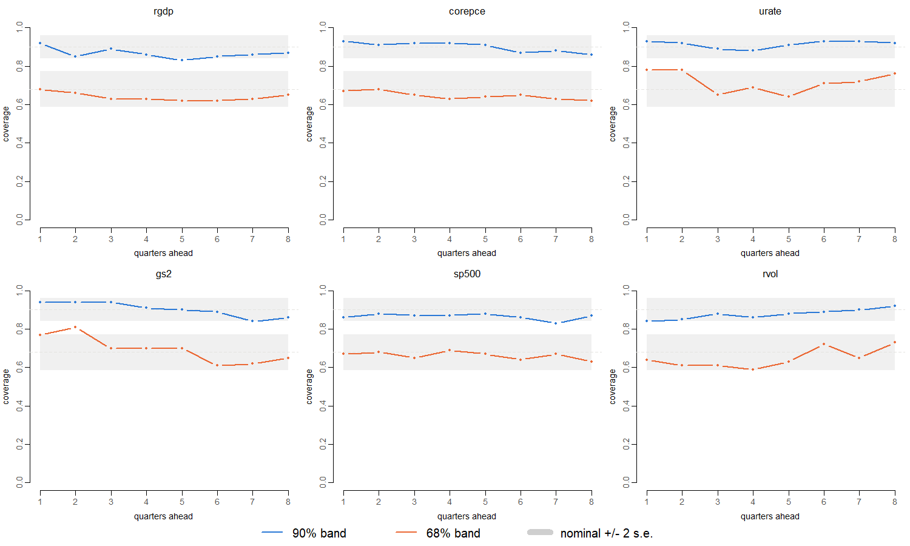
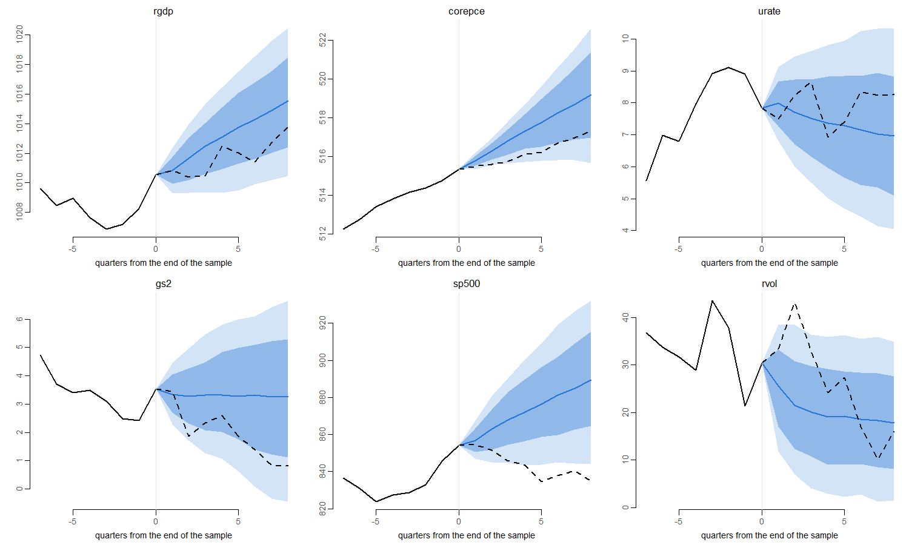
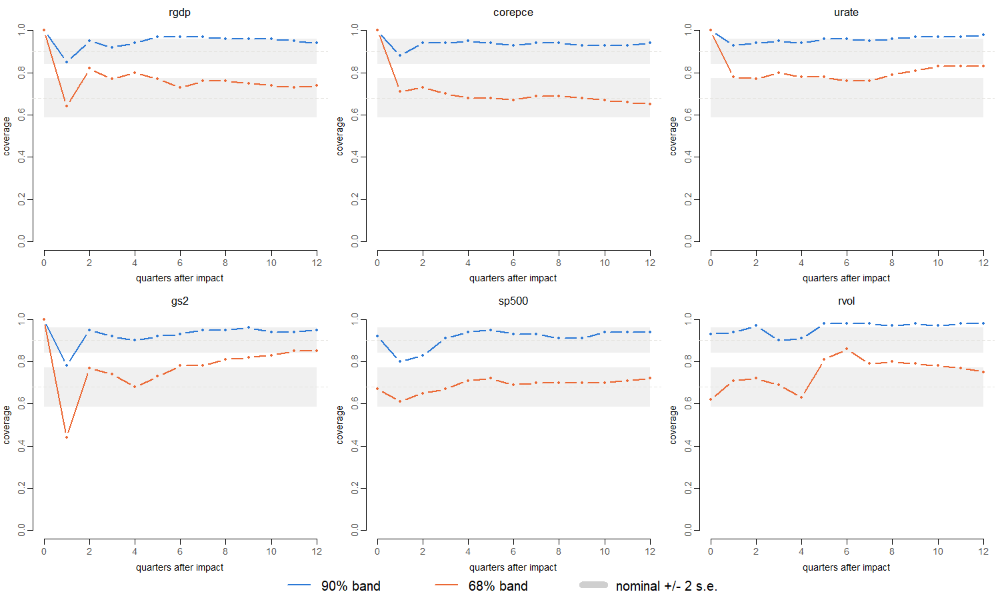

# Simulation recovery

**Model:** 6 variables (rgdp, corepce, urate, gs2, sp500, rvol), 5 lags, the prior of `config/run.yml`. **Replications:** 100 of 100 fitted. Each sample has 214 quarters, as many as the data (1973Q1 to 2026Q2). **Chains:** 6000 iterations, 1000 burn-in, thinning 5, so 1000 draws per fit. Seeds derived from 2.0264516^{7}. Run time 14.4 minutes on 4 R processes.

**What is checked.** The estimator, the forecast simulator and the impulse responses are each checked against exact results in other reports. Here the whole chain runs together where the right answer is known:

1.  The **true model** is a fixed VAR: the posterior mean of B and Σ of this small model estimated on the data (full sample). Its largest companion root is 0.999905: stable, but close to a unit root, like the data.
2.  Each replication **simulates** 214 + 8 quarters from the true model, starting from the data’s first 5 quarters. The first 214 quarters are the sample, and the last 8 are the true future.
3.  The model is **estimated** on the sample.
4.  **Coverage**: how often the 68% and 90% posterior bands (16–84 and 5–95 percent quantiles) contain the truth. This is checked for forecasts 1 to 8 quarters ahead (the predictive density, with shocks, against the simulated future), for the recursive gs2 impulse response (against the true model’s response; ordering rgdp, corepce, urate \| gs2 \| sp500, rvol), and for the coefficients and Σ.

**How to read it.** These are Bayesian credible bands, not confidence intervals: over repeated samples from one fixed model they need not contain the truth at exactly their nominal rate. For forecasts, coverage should be close to nominal when the model is right. For coefficients, the prior shrinks the lags of other variables towards zero, so some undercoverage is expected there. With 100 replications, one coverage rate has a binomial standard error of 4.7% at 68% and 3.0% at 90%. Cells within one replication are correlated, so the figures are read by eye, without a pass/fail threshold.

# 1. Forecasts

| band | nominal | all_cells | lowest_cell | highest_cell |
|:-----|--------:|----------:|------------:|-------------:|
| 68%  |    0.68 |     0.668 |        0.59 |         0.81 |
| 90%  |    0.90 |     0.887 |        0.83 |         0.94 |

Coverage per variable and horizon (share of replications whose band contains the realized value):

| horizon | rgdp | corepce | urate |  gs2 | sp500 | rvol |
|:--------|-----:|--------:|------:|-----:|------:|-----:|
| h1      | 0.92 |    0.93 |  0.93 | 0.94 |  0.86 | 0.84 |
| h2      | 0.85 |    0.91 |  0.92 | 0.94 |  0.88 | 0.85 |
| h3      | 0.89 |    0.92 |  0.89 | 0.94 |  0.87 | 0.88 |
| h4      | 0.86 |    0.92 |  0.88 | 0.91 |  0.87 | 0.86 |
| h5      | 0.83 |    0.91 |  0.91 | 0.90 |  0.88 | 0.88 |
| h6      | 0.85 |    0.87 |  0.93 | 0.89 |  0.86 | 0.89 |
| h7      | 0.86 |    0.88 |  0.93 | 0.84 |  0.83 | 0.90 |
| h8      | 0.87 |    0.86 |  0.92 | 0.86 |  0.87 | 0.92 |

*90% band, above; 68% band, below.*

| horizon | rgdp | corepce | urate |  gs2 | sp500 | rvol |
|:--------|-----:|--------:|------:|-----:|------:|-----:|
| h1      | 0.68 |    0.67 |  0.78 | 0.77 |  0.67 | 0.64 |
| h2      | 0.66 |    0.68 |  0.78 | 0.81 |  0.68 | 0.61 |
| h3      | 0.63 |    0.65 |  0.65 | 0.70 |  0.65 | 0.61 |
| h4      | 0.63 |    0.63 |  0.69 | 0.70 |  0.69 | 0.59 |
| h5      | 0.62 |    0.64 |  0.64 | 0.70 |  0.67 | 0.63 |
| h6      | 0.62 |    0.65 |  0.71 | 0.61 |  0.64 | 0.72 |
| h7      | 0.63 |    0.63 |  0.72 | 0.62 |  0.67 | 0.65 |
| h8      | 0.65 |    0.62 |  0.76 | 0.65 |  0.63 | 0.73 |

One replication’s forecast against its true future (dashed); median, 68% and 90% bands:

# 2. Impulse responses

Recursive gs2 shock, unit impact, responses at horizons 0 to 12. Impact responses of the slow variables are zero by construction in both the truth and the estimates, so their coverage at h = 0 is 1 by definition. The summary uses horizons 1 and later.

| variable | cover68 | cover90 | lowest90 |
|:---------|--------:|--------:|---------:|
| rgdp     |   0.751 |   0.945 |     0.85 |
| corepce  |   0.684 |   0.932 |     0.88 |
| urate    |   0.793 |   0.957 |     0.93 |
| gs2      |   0.757 |   0.924 |     0.78 |
| sp500    |   0.690 |   0.911 |     0.80 |
| rvol     |   0.758 |   0.962 |     0.90 |

# 3. Coefficients and Σ

Coverage by group of parameters. The bias is the posterior mean minus the truth, averaged over cells and replications. The RMSE is that of the posterior mean. Mean \|truth\| gives the scale of each group.

| group              | cells | cover68 | cover90 | mean_bias |  rmse | mean_abs_truth |
|:-------------------|------:|--------:|--------:|----------:|------:|---------------:|
| constant           |     6 |   0.802 |   0.965 |     0.334 | 3.453 |          2.570 |
| own first lag      |     6 |   0.295 |   0.595 |    -0.045 | 0.109 |          0.987 |
| own longer lags    |    24 |   0.655 |   0.888 |     0.009 | 0.053 |          0.063 |
| cross lags         |   150 |   0.753 |   0.930 |    -0.001 | 0.320 |          0.140 |
| Sigma, variances   |     6 |   0.712 |   0.910 |    -0.261 | 2.245 |         13.853 |
| Sigma, covariances |    15 |   0.695 |   0.895 |     0.092 | 0.880 |          1.842 |

# 4. Replications

| statistic                          |    min | median |    max |
|:-----------------------------------|-------:|-------:|-------:|
| seconds per fit                    | 25.310 | 32.855 | 36.140 |
| acceptance rate                    |  0.206 |  0.274 |  0.388 |
| median lambda                      |  0.341 |  0.481 |  0.595 |
| largest root of the posterior mean |  1.000 |  1.000 |  1.004 |

Every replication was fitted.
