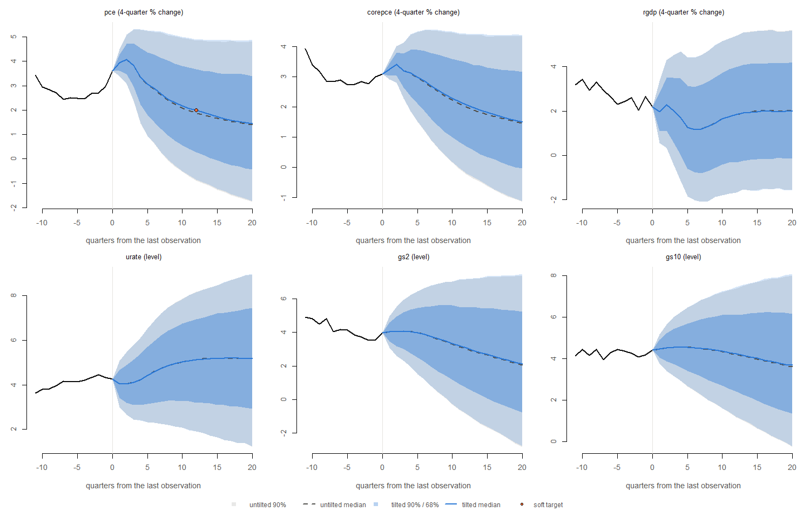
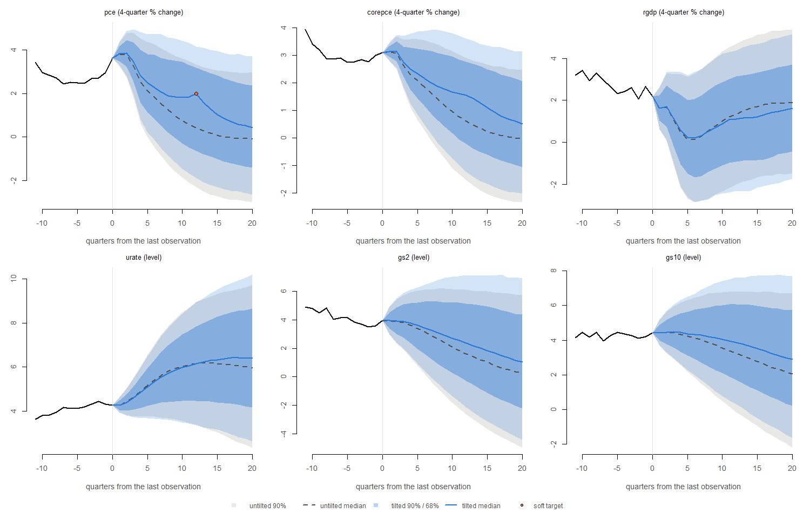
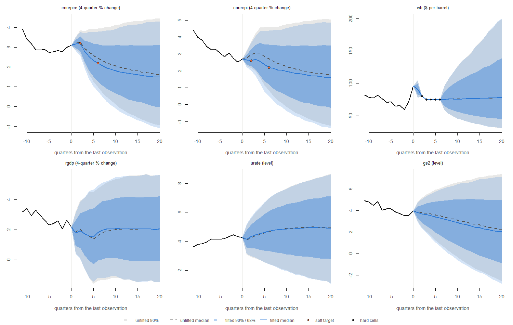
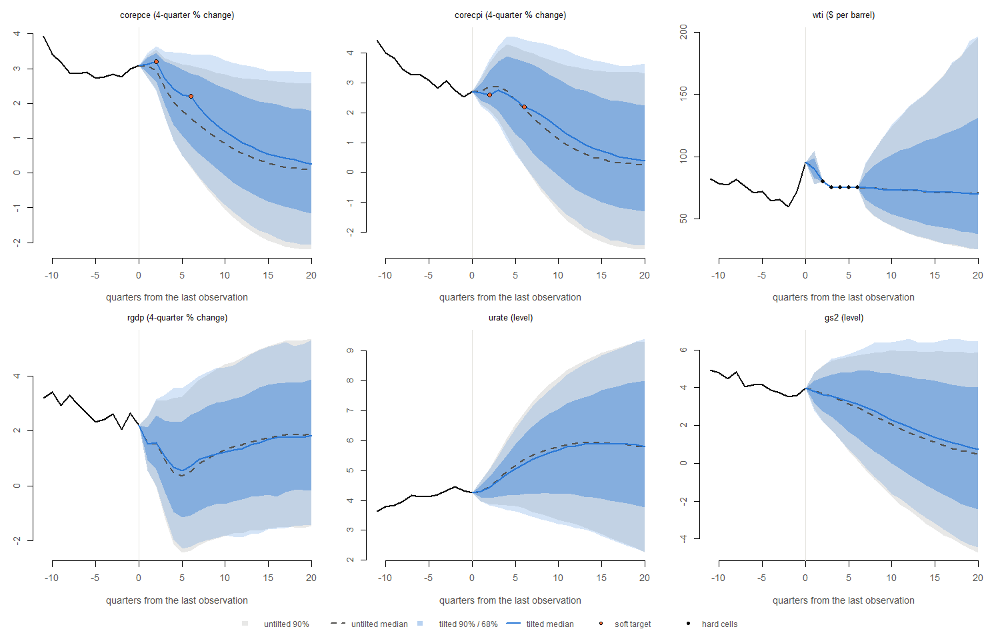

# Entropic tilting

**Runs:** `2026m09_none_full_545b70ff` (1000 draws), `2026m09_precovid_params_full_dc0d4609` (1000 draws). Forecasts start after 2026Q2. Gaussian conditioning, engine seed 20264016, 10 paths per posterior draw for tilted scenarios, solver tolerance 10^{-10}. Run time 8.7 minutes.

**What tilting does.** A soft condition is a target for a feature of the forecast distribution, for example “the median of 4-quarter PCE inflation 12 quarters ahead is 2%”. Entropic tilting (Crump et al. 2021, Section 4.2, eqs. 14–16) keeps every forecast path and changes only its weight: among all weights that meet the targets, it takes those closest to equal weights in Kullback–Leibler divergence. The properties that must hold exactly (targets met, weights positive and summing to one, equal weights when nothing has to change, the closed form for a Gaussian sample, minimal divergence, infeasible targets rejected, hard cells untouched) are checked in `tests/testthat/test-tilting.R` and `test-engine-run.R`. This report applies the method to the model’s own draws.

**How to read the weights.** The effective sample size (ESS) 1/Σw² says how many equally weighted paths the tilted sample is worth. For a single **median** target the weights take only two values: the share p of paths at or below the target value gets 0.5/(pJ) each, the rest 0.5/((1−p)J) each. The ESS share is then exactly 4p(1−p). It depends on how far the target lies in the untilted distribution, not on the number of paths.

# 1. The inflation anchor (the paper’s Figure 16b)

Scenario `anchor_pce_2pct`: the median of 4-quarter headline PCE inflation (exact percent change) in 2029Q2, 12 quarters ahead, tilted to 2.0%. Nothing is fixed exactly. The paper’s Figure 16a (inflation fixed at exactly 2% from 12 to 20 quarters ahead) is not reproduced: fixing a growth rate is a condition on a linear combination of cells, which the scenario files do not support.

| run | target | untilted_median | share_below_target | paths | ess | ess_share | largest_weight_x_J | draws_carrying_half | newton_steps |
|:---|---:|---:|---:|---:|---:|---:|---:|---:|---:|
| none | 2 | 1.887 | 0.527 | 10000 | 9970.188 | 0.997 | 1.058 | 0.489 | 2 |
| precovid_params | 2 | 0.414 | 0.818 | 10000 | 5947.404 | 0.595 | 2.752 | 0.326 | 4 |

*share_below_target: the untilted share of paths at or below 2.0% (p above). draws_carrying_half: the smallest share of posterior draws whose paths carry half the tilted weight (0.5 with equal weights).*

**none**: grey, untilted; blue, tilted. Panels: headline PCE inflation (the target), core PCE inflation and real GDP growth (4-quarter percent changes), the unemployment rate and the 2- and 10-year yields (levels, percent). Fans start at the last observation.

**precovid_params**: grey, untilted; blue, tilted. Panels: headline PCE inflation (the target), core PCE inflation and real GDP growth (4-quarter percent changes), the unemployment rate and the 2- and 10-year yields (levels, percent). Fans start at the last observation.

**Width of the bands over the horizon.** The paper’s point against hard conditioning is that fixing inflation at 12–20 quarters ahead makes the interquartile range 11 quarters ahead narrower than 6 quarters ahead. With tilting the bands should keep their shape. Interquartile range of headline PCE inflation:

| run | untilted_h6 | untilted_h11 | untilted_h12 | tilted_h6 | tilted_h11 | tilted_h12 |
|:---|---:|---:|---:|---:|---:|---:|
| none | 1.886 | 2.250 | 2.300 | 1.893 | 2.252 | 2.285 |
| precovid_params | 1.902 | 2.263 | 2.295 | 1.987 | 2.666 | 2.704 |

**What the anchor implies for other variables** in the target quarter (medians; q16–q84 is the width of the 68% band). Tilting reweights whole paths, so every variable moves with inflation through the paths’ joint distribution. These are conditional statements, not causal effects.

| run | variable | measure | quarter | untilted_median | tilted_median | untilted_q16_q84 | tilted_q16_q84 |
|:---|:---|:---|:---|---:|---:|---:|---:|
| none | pce | yoy | 2029Q2 | 1.887 | 2.000 | 3.390 | 3.390 |
| none | corepce | yoy | 2029Q2 | 2.006 | 2.072 | 2.766 | 2.781 |
| none | rgdp | yoy | 2029Q2 | 1.842 | 1.835 | 4.295 | 4.300 |
| none | urate | level | 2029Q2 | 5.138 | 5.130 | 3.738 | 3.740 |
| none | gs2 | level | 2029Q2 | 3.030 | 3.082 | 4.779 | 4.778 |
| none | gs10 | level | 2029Q2 | 4.198 | 4.236 | 3.702 | 3.703 |
| precovid_params | pce | yoy | 2029Q2 | 0.414 | 2.000 | 3.374 | 3.824 |
| precovid_params | corepce | yoy | 2029Q2 | 0.603 | 1.533 | 2.681 | 2.980 |
| precovid_params | rgdp | yoy | 2029Q2 | 1.345 | 1.107 | 4.034 | 4.067 |
| precovid_params | urate | level | 2029Q2 | 6.155 | 6.158 | 3.365 | 3.370 |
| precovid_params | gs2 | level | 2029Q2 | 1.602 | 2.369 | 5.150 | 5.418 |
| precovid_params | gs10 | level | 2029Q2 | 3.235 | 3.860 | 4.106 | 4.386 |

# 2. Paths per posterior draw

The same anchor with 1, 10 and 20 paths per draw (J = draws × paths). Tilted quantiles in the target quarter.

| run | paths_per_draw | paths | ess | ess_share | draws_for_half | iterations | untilted_median | tilted_median | tilted_q16 | tilted_q84 | seconds |
|:---|---:|---:|---:|---:|---:|---:|---:|---:|---:|---:|---:|
| none | 1 | 1000 | 999.324 | 0.999 | 0.488 | 2 | 1.930 | 1.999 | 0.223 | 3.678 | 33.64 |
| none | 10 | 10000 | 9970.188 | 0.997 | 0.489 | 2 | 1.887 | 2.000 | 0.279 | 3.668 | 43.60 |
| none | 20 | 20000 | 19949.197 | 0.997 | 0.491 | 2 | 1.890 | 2.000 | 0.245 | 3.686 | 62.95 |
| precovid_params | 1 | 1000 | 553.776 | 0.554 | 0.167 | 4 | 0.475 | 1.996 | -0.547 | 3.101 | 34.03 |
| precovid_params | 10 | 10000 | 5947.404 | 0.595 | 0.326 | 4 | 0.414 | 2.000 | -0.639 | 3.185 | 52.09 |
| precovid_params | 20 | 20000 | 11614.875 | 0.581 | 0.329 | 4 | 0.416 | 2.000 | -0.635 | 3.169 | 63.67 |

The tilted median is the weighted type-7 quantile (Akinshin 2023), which interpolates between neighbouring paths. The tilting itself puts exactly half the weight at or below 2.0%, but with few paths the interpolated median can differ from 2.0 by the spacing between paths near it; with more paths the two agree.

# 3. Hard and soft together

`gs_inflation_oil_2026` with its oil prices hard (exact, as in the shipped file) and its core PCE and core CPI columns soft: medians of their 4-quarter inflation rates (corepce 2026Q4 3.20%; corecpi 2026Q4 2.60%; corepce 2027Q4 2.20%; corecpi 2027Q4 2.20%), recovered from the file’s levels. Hard cells are imposed first by conditioning; the paths are then tilted. The shipped scenario keeps every column hard.

| run | variable | quarter | target | untilted_median | achieved | ess_share | hard_cells_max_error |
|:---|:---|:---|---:|---:|---:|---:|---:|
| none | corepce | 2026Q4 | 3.2 | 3.273 | 0.5 | 0.643 | 0 |
| none | corecpi | 2026Q4 | 2.6 | 2.958 | 0.5 | 0.643 | 0 |
| none | corepce | 2027Q4 | 2.2 | 2.445 | 0.5 | 0.643 | 0 |
| none | corecpi | 2027Q4 | 2.2 | 2.729 | 0.5 | 0.643 | 0 |
| precovid_params | corepce | 2026Q4 | 3.2 | 2.962 | 0.5 | 0.306 | 0 |
| precovid_params | corecpi | 2026Q4 | 2.6 | 2.863 | 0.5 | 0.306 | 0 |
| precovid_params | corepce | 2027Q4 | 2.2 | 1.581 | 0.5 | 0.306 | 0 |
| precovid_params | corecpi | 2027Q4 | 2.2 | 2.126 | 0.5 | 0.306 | 0 |

*achieved: the weighted share at or below the target (0.5 when met). untilted_median: the median with oil fixed and no tilting.*

**none**: grey, oil fixed only; blue, oil fixed and core inflation tilted. Black dots: the fixed oil prices; orange: the soft targets.

**precovid_params**: grey, oil fixed only; blue, oil fixed and core inflation tilted. Black dots: the fixed oil prices; orange: the soft targets.

| run | variable | measure | quarter | untilted_median | tilted_median | untilted_q16_q84 | tilted_q16_q84 |
|:---|:---|:---|:---|---:|---:|---:|---:|
| none | corepce | yoy | 2026Q4 | 3.273 | 3.200 | 0.697 | 0.737 |
| none | corepce | yoy | 2027Q4 | 2.445 | 2.200 | 1.789 | 1.854 |
| none | corecpi | yoy | 2026Q4 | 2.958 | 2.600 | 0.941 | 1.015 |
| none | corecpi | yoy | 2027Q4 | 2.729 | 2.200 | 2.275 | 2.362 |
| none | wti | level | 2026Q4 | 438.203 | 438.203 | 0.000 | 0.000 |
| none | wti | level | 2027Q4 | 431.749 | 431.749 | 0.000 | 0.000 |
| none | rgdp | yoy | 2026Q4 | 2.024 | 1.931 | 2.285 | 2.294 |
| none | rgdp | yoy | 2027Q4 | 1.617 | 1.816 | 3.703 | 3.704 |
| none | urate | level | 2026Q4 | 4.228 | 4.329 | 1.623 | 1.633 |
| none | urate | level | 2027Q4 | 4.695 | 4.720 | 2.691 | 2.747 |
| none | gs2 | level | 2026Q4 | 3.799 | 3.685 | 1.697 | 1.692 |
| none | gs2 | level | 2027Q4 | 3.518 | 3.312 | 3.097 | 3.175 |
| precovid_params | corepce | yoy | 2026Q4 | 2.962 | 3.200 | 0.683 | 0.827 |
| precovid_params | corepce | yoy | 2027Q4 | 1.581 | 2.199 | 1.759 | 2.055 |
| precovid_params | corecpi | yoy | 2026Q4 | 2.863 | 2.600 | 0.950 | 1.128 |
| precovid_params | corecpi | yoy | 2027Q4 | 2.126 | 2.200 | 2.342 | 2.665 |
| precovid_params | wti | level | 2026Q4 | 438.203 | 438.203 | 0.000 | 0.000 |
| precovid_params | wti | level | 2027Q4 | 431.749 | 431.749 | 0.000 | 0.000 |
| precovid_params | rgdp | yoy | 2026Q4 | 1.529 | 1.571 | 1.902 | 1.949 |
| precovid_params | rgdp | yoy | 2027Q4 | 0.533 | 0.723 | 3.560 | 3.672 |
| precovid_params | urate | level | 2026Q4 | 4.467 | 4.445 | 0.718 | 0.722 |
| precovid_params | urate | level | 2027Q4 | 5.367 | 5.221 | 1.957 | 1.982 |
| precovid_params | gs2 | level | 2026Q4 | 3.663 | 3.613 | 1.792 | 1.804 |
| precovid_params | gs2 | level | 2027Q4 | 2.961 | 3.123 | 3.355 | 3.558 |

# Notes

- Quantities are exact percent changes: yoy = 100 (x_t / x\_{t−4} − 1) with x = exp(y / 100). The paper does not say whether its 2% is an exact rate or a log difference; 2% exact is 1.98 log points.
- Medians are tilted with the indicator moment of the paper (g = 1\[s ≤ x\], ḡ = 0.5). The weights then jump at the target value, which is correct for the method but makes the tilted distribution less smooth than with a mean target.
- The target applies to one quarter. The tilted median meets it there exactly, and neighbouring quarters move with it only as far as they are correlated with it along each path, so the tilted median line bends at the target quarter. A smoother anchor would need targets in several quarters.
- A target outside the range of the draws cannot be reached by reweighting and is an error, not an approximation.
